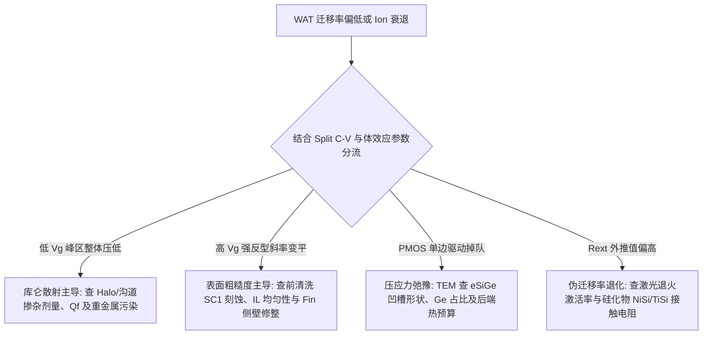

# 能带理论、费米能级与载流子输运特性

- **所属模块**：`01_器件物理与硅片 / 02_半导体物理基础`

---

## 1. 硅的能带结构、有效质量与费米-狄拉克统计

### （1）倒易空间能带物理特征（室温 $T = 300\text{K}$）
单晶硅属于金刚石立方结构，其周期势场下的 $E-k$ 色散关系决定了所有硅基半导体器件的电学极限：

```text
能量 E
  ^          导带底 Ec (沿 <100> 约 0.85 X 点, 6 重简并旋转椭球能谷 Δ6)
  |                       \   /
  |                        \_/  <-- ml* = 0.98 m0, mt* = 0.19 m0
  |   --------  间接带隙 Eg ≈ 1.124 eV (跃迁需声子参与动量守恒)  --------
  |      _
  |     / \   <-- Γ 点 (k = 0) 价带顶 Ev: 重空穴 HH + 轻空穴 LH 简并
  |    /   \      (向下 0.044 eV 为自旋-轨道劈裂带 SO)
  +-------------------------------------------------> 波矢 k ([111] <-- Γ --> [100])
```

- **间接带隙（Indirect Bandgap）的工程含义**：
  - 价带顶位于布里渊区中心 $\Gamma$ 点（$k=0$），而导带底位于沿 `<100>` 晶轴方向约 $85\%$ 布里渊区边界处的 **$\Delta$ 点（6 个等效旋转椭球等能面 $\Delta_6$）**；
  - 因为电子跨带隙跃迁必须同时吸收或发射晶格声子以保证动量守恒，硅的带间直接辐射复合效率极低（仅百万分之一量级）；
  - 这决定了硅不适合做激光器或发光二极管，但同时赋予了硅极长的非平衡少子寿命（$\mu\text{s}\sim \text{ms}$ 级），使其成为开关逻辑、双极放大与光电传感的理想衬底材料。
- **禁带宽度及其温度依赖（Varshni 经验模型）**：
  $$E_g(T) = E_g(0) - \frac{\alpha T^2}{T + \beta}$$
  - 硅的绝对零度带隙 $E_g(0) \approx 1.169\,\text{eV}$，室温 $300\text{K}$ 下 $E_g \approx 1.124\,\text{eV}$；
  - 当汽车电子或服务器芯片结温升至 $423\text{K}\,(150^\circ\text{C})$ 时，$E_g$ 收缩至约 $1.08\,\text{eV}$。
- **各向异性有效质量（Effective Mass）**：
  - 导带椭球能谷的纵向有效质量 $m_l^* \approx 0.98\,m_0$（极重），横向有效质量 $m_t^* \approx 0.19\,m_0$（极轻）；
  - 电子态密度有效质量：$m_{de}^* = 6^{2/3}(m_l^* m_t^{*2})^{1/3} \approx 1.08\,m_0$；
  - 各向同性平均电导有效质量：$m_{ce}^* = 3\left(\frac{1}{m_l^*} + \frac{2}{m_t^*}\right)^{-1} \approx 0.26\,m_0$；
  - 价带顶由**重空穴带（HH, $m_{hh}^* \approx 0.49\,m_0$）**、**轻空穴带（LH, $m_{lh}^* \approx 0.16\,m_0$）**（二者在 $k=0$ 处简并）以及自旋-轨道劈裂带（SO）构成。导带能谷的各向异性与价带简并度，是**应变硅工程（Strained Silicon）**的量子力学物理根基。

### （2）载流子浓度、温度三区演化与简并边界
热平衡条件下，电子占据能级的概率服从费米-狄拉克（Fermi-Dirac）分布：
$$f(E) = \frac{1}{1 + \exp\left(\frac{E - E_F}{k_B T}\right)}$$
- **非简并玻尔兹曼近似（掺杂浓度 $< 10^{18}\,\text{cm}^{-3}$）**：当 $E_F$ 距离导带底与价带顶均大于 $3k_B T$（约 $78\,\text{mV}$ @300K）时，载流子浓度简化为：
  $$n = N_c \exp\left(-\frac{E_c - E_F}{k_B T}\right) = n_i \exp\left(\frac{E_F - E_i}{k_B T}\right)$$
  $$p = N_v \exp\left(-\frac{E_F - E_v}{k_B T}\right) = n_i \exp\left(\frac{E_i - E_F}{k_B T}\right)$$
  $300\text{K}$ 下硅有效状态密度 $N_c \approx 2.86 \times 10^{19}\,\text{cm}^{-3}$，$N_v \approx 3.10 \times 10^{19}\,\text{cm}^{-3}$；因 $N_v > N_c$，本征费米能级 $E_i$ 位于禁带中央略偏下约 $13\,\text{meV}$ 处。
- **质量作用定律与本征浓度温漂极限**：
  $$n \cdot p = n_i^2 = N_c N_v \exp\left(-\frac{E_g}{k_B T}\right)$$
  $300\text{K}$ 下硅的 $n_i \approx 1.0\sim 1.5 \times 10^{10}\,\text{cm}^{-3}$（例如 $N_A = 10^{17}\,\text{cm}^{-3}$ 的 P 衬底体费米势 $\psi_B = \frac{k_B T}{q}\ln(N_A/n_i) \approx 0.41\,\text{V}$）。温度每升高 $8\sim 10^\circ\text{C}$，$n_i^2$ 几乎翻倍。
- **载流子浓度随温度的三区演化与硅器件耐温边界**：
  1. **杂质冻析区（Freeze-out, $T < 100\text{K}$）**：热能不足以将施主/受主杂质电离，载流子冻结，芯片阈值电压急剧抬高；
  2. **正常饱和电离区（Extrinsic, $150\text{K}\sim 450\text{K}$）**：杂质几乎 100% 电离，$n \approx N_D$（或 $p \approx N_A$），这是常规集成电路稳定工作的温区；
  3. **高温本征区（Intrinsic, $T > 500\text{K}$）**：$n_i(T)$ 暴涨反超掺杂浓度（如 $300^\circ\text{C}$ 时 $n_i$ 突破 $10^{15}\,\text{cm}^{-3}$），PN 结单向导电性彻底失效——这也是硅器件无法胜任 $> 200^\circ\text{C}$ 高温油井探测或航空引擎控制、必须转向宽禁带 SiC 的物理根因。
- **重掺杂简并态与带隙变窄效应（BGN, Bandgap Narrowing）**：
  在源漏极区（掺杂浓度 $10^{20}\sim 10^{21}\,\text{cm}^{-3}$），杂质能级展宽成杂质带并与能带交叠，玻尔兹曼近似彻底失效；多体库仑屏蔽效应导致硅的有效带隙收缩 $\Delta E_g \approx 50\sim 120\,\text{meV}$，增大重掺区的有效 $n_{ie}^2$ 与反向带间隧穿漏电。

---

## 2. 载流子输运机理：漂移、扩散、接触隧穿与非平衡复合

### （1）低场漂移、马西森定则与迁移率模型
外电场 $\mathcal{E}$ 下，载流子漂移速度 $v_d = \mu \mathcal{E}$，总漂移电流密度为：
$$J_{drift} = q(n\mu_n + p\mu_p)\mathcal{E}, \quad \mu = \frac{q \tau_c}{m_c^*}$$
其中 $\tau_c$ 为平均散射自由时间。实际体硅总迁移率满足**马西森定则（Matthiessen's Rule）**，各独立散射机构倒数相加：
$$\frac{1}{\mu_{bulk}} = \frac{1}{\mu_{phonon}} + \frac{1}{\mu_{impurity}} + \frac{1}{\mu_{neutral}} + \frac{1}{\mu_{carrier-carrier}}$$
- **晶格声子散射（$\mu_{phonon} \propto T^{-3/2}\sim T^{-2.4}$）**：温度越高热振动越剧烈，室温低掺杂体硅主要由声子主导（$\mu_{n0} \approx 1400\,\text{cm}^2/(\text{V}\cdot\text{s})$，$\mu_{p0} \approx 450\,\text{cm}^2/(\text{V}\cdot\text{s})$），决定 NMOS 驱动能力天然约为空穴管（PMOS）的 $2.5\sim 3$ 倍。
- **电离杂质散射（$\mu_{impurity} \propto \frac{T^{3/2}}{N_I}$）**：杂质离子库仑势场偏转低速热载流子。根据 **Caughey-Thomas 经验模型**，当掺杂浓度超过 $10^{17}\,\text{cm}^{-3}$ 时迁移率陡降；掺杂达 $10^{19}\,\text{cm}^{-3}$ 时电子迁移率跌至不足 $150\,\text{cm}^2/(\text{V}\cdot\text{s})$。

### （2）高场速度饱和与准弹道输运（Quasi-Ballistic Transport）
在先进短沟道中横向电场轻易突破 $5\times 10^5\,\text{V/cm}$，远超临界饱和电场 $\mathcal{E}_{sat}$（电子约 $10^4\,\text{V/cm}$，空穴约 $2\times 10^4\,\text{V/cm}$）：
1. **速度饱和效应**：高能载流子频繁发射硅光学声子（能量 $\sim 63\,\text{meV}$），将从电场获取的动能迅速归还晶格，漂移速度被钳制在饱和极限 $v_{sat} \approx 1.0 \times 10^7\,\text{cm/s}$（空穴约 $0.8 \times 10^7\,\text{cm/s}$）：
   $$v_d(\mathcal{E}) = \frac{\mu_{eff} \mathcal{E}}{\left[1 + \left(\frac{\mu_{eff}\mathcal{E}}{v_{sat}}\right)^\beta\right]^{1/\beta}} \quad (\text{典型 }\beta_n \approx 2, \beta_p \approx 1)$$
   这导致短沟道 MOSFET 的饱和电流从经典平方律退化为线性律：$I_{Dsat} \approx W C_{ox} v_{sat}(V_{GS}-V_{th}-V_{Dsat})$。
2. **准弹道输运与 Lundstrom 背散射理论**：当栅长缩短至与平均自由程（约 $5\sim 10\,\text{nm}$）可比拟时，载流子在沟道内来不及建立稳态散射即飞跃漏端，出现**速度过冲（Velocity Overshoot）**。此时驱动电流由源端虚拟势垒顶（Virtual Source）的热注入速度 $v_{inj}$ 与在靠近源端几纳米内被弹回源区的**背散射系数 $r$** 决定：
   $$I_{Dsat} = W C_{ox} (V_{GS}-V_{th}) v_{inj} \frac{1 - r}{1 + r}$$

### （3）扩散运动、金属-半导体接触隧穿与非平衡复合
- **扩散电流与爱因斯坦关系**：浓度梯度驱动的扩散运动满足：
  $$J_{diff,n} = q D_n \frac{dn}{dx}, \quad J_{diff,p} = -q D_p \frac{dp}{dx}$$
  $$\frac{D_{n,p}}{\mu_{n,p}} = \frac{k_B T}{q} = V_t \approx 25.85\,\text{mV}\,(300\text{K})$$
- **硅化物接触能带势垒与比接触电阻率 $\rho_c$**：
  在 300mm 先进逻辑中段工艺（MEOL），芯片性能极度受限于源漏接触电阻（可占总导通电阻 $30\%\sim 50\%$）。金属硅化物（如 $\text{NiSi}$、$\text{TiSi}_x$）与硅界面存在约 $0.4\sim 0.7\,\text{eV}$ 的肖特基势垒 $\Phi_B$，必须通过**激光毫秒退火突破固溶度极限**使源漏表面电活性掺杂浓度达到 $N_D > 5\times 10^{20}\,\text{cm}^{-3}$，将势垒区压薄至数纳米以便载流子直接量子场发射隧穿（FE）：
  $$\rho_c \propto \exp\left(\frac{4\pi\sqrt{\varepsilon_{Si} m^*}}{h}\cdot\frac{\Phi_B}{\sqrt{N_D}}\right)$$
  工程上每把 $\Phi_B$ 压低 $0.1\,\text{eV}$ 或将表面激活掺杂提升一倍，接触电阻都能呈指数级下降。
- **三大非平衡复合机理**（有效少子寿命 $\frac{1}{\tau_{eff}} = \frac{1}{\tau_{rad}} + \frac{1}{\tau_{SRH}} + \frac{1}{\tau_{Auger}}$）：
  1. **SRH 陷阱复合（Shockley-Read-Hall）**：由禁带中央深能级缺陷或重金属（Fe/Cu/Au）主导，**直接控制反偏 PN 结热漏电、DRAM 刷新保持时间与 CIS 暗电流白点**；
  2. **俄歇复合（Auger Recombination）**：复合能量直接传递给第三个载流子（速率 $\propto n^2 p$ 或 $p^2 n$），在 $> 10^{19}\,\text{cm}^{-3}$ 重掺区占主导，限制高压双极器件发射效率；
  3. **辐射复合**：带间直接发光，仅在直接带隙材料（GaAs/GaN）显著，硅中极弱。

---

## 3. 晶圆厂工艺对沟道迁移率与输运的重塑

### （1）垂直有效电场与 Takagi 普适迁移率曲线
反型层载流子被栅压垂直电场压缩在界面下 $1\sim 3\,\text{nm}$ 波阱内，垂直有效电场定义为：
$$\mathcal{E}_{eff} = \frac{Q_{dep} + \eta Q_{inv}}{\varepsilon_{Si}} \quad (\text{硅电子 }\eta_n = \frac{1}{2}\text{，空穴 }\eta_p = \frac{1}{3})$$
依据 **Takagi（1994）** 确立的实验普适迁移率曲线，随着 $\mathcal{E}_{eff}$ 升高依次出现三大主控散射区：
1. **低电场区（$< 0.1\,\text{MV/cm}$）**：受沟道电离杂质与界面固定电荷**库仑散射**控制；
2. **中电场区（$0.1\sim 0.6\,\text{MV/cm}$）**：受界面声子散射主导，$\mu_{eff} \propto \mathcal{E}_{eff}^{-0.3}$；
3. **高电场强反型区（$> 0.6\,\text{MV/cm}$）**：波函数紧贴原子尺度起伏的 $\text{Si}-\text{SiO}_2$ 界面，**表面粗糙度散射**造成迁移率呈 $\mu_{eff} \propto \mathcal{E}_{eff}^{-2}$ 断崖滚降！这就是前道晶圆清洗（控制 SC1 刻蚀比）及栅氧化前原位烘烤必须确保界面原子级平坦（$R_a < 0.1\,\text{nm}$）的根本理由。

### （2）High-k 介质引入的远程散射（RCS / RPS）
自 45nm 节点导入 $\text{HfO}_2$ 高 k 栅介质后，高 k 晶格极化率极高带来低能**软光学声子散射（RPS）**，且介质层偶极子与体内固定电荷产生**远程库仑散射（RCS）**，直接拉低沟道迁移率约 $20\%\sim 40\%$。
- **产线标准解法**：在沟道与 $\text{HfO}_2$ 之间精准保留或化学氧化生长一层极薄（$0.5\sim 0.8\,\text{nm}$）优质**界面层（IL, $\text{SiO}_2/\text{SiON}$）**，拉开载流子波函数与 $\text{HfO}_2$ 声子势场的物理间距（代价是损耗约 $0.5\,\text{nm}$ 的等效 EOT 空间）。

### （3）应变硅工程（Strained Silicon）能带重构对比

| 器件类型 | 产线应力引入工艺方案 | 能带结构微观物理重构机制 | 迁移率工程收益 |
| :--- | :--- | :--- | :--- |
| **NMOS（拉应力）** | 1. **t-CESL**：高拉伸应力氮化硅覆层（$> 1.5\,\text{GPa}$）<br>2. **SMT**：应力记忆技术（非晶化+氮化硅盖帽退火锁定拉应力）<br>3. 源漏嵌入 **SiC** | 沿 `<110>` 沟道施单轴拉应力使导带 6 重能谷劈裂：面外 2 重能谷（**$\Delta_2$**）能量下移，面内 4 重能谷（$\Delta_4$）上移。电子大量落入面内有效质量极轻（$m_t^* = 0.19\,m_0$）的 $\Delta_2$ 能谷并大幅抑制谷间声子散射 | 低场电子迁移率提升 **40%~70%**；高场下源端注入速度 $v_{inj}$ 明显增强 |
| **PMOS（压应力）** | 1. **eSiGe 源漏嵌入式外延**（刻蚀 $\Sigma$ 型凹槽并选择性外延 $\text{Si}_{1-x}\text{Ge}_x$，Ge 含量 $20\%\to 40\%+$）<br>2. **c-CESL**：高压应力氮化硅覆层（$> 2\sim 3\,\text{GPa}$）<br>3. RMG 替换栅金属热挤压 | 晶格常数更大的 SiGe 对沟道施单轴压应力，强力打破价带顶 HH/LH 简并，反转并拉尖 `<110>` 方向的顶层空穴色散曲线，大幅降低空穴有效质量 $m_p^*$ 并抑制带间散射 | 空穴迁移率提升 **100%~150%+**，几乎追平同代 NMOS 的单位宽度驱动电流 |

### （4）晶面取向效应、量子限域与 FinFET / GAA 差异
- **晶面取向优势**：在传统 `(100)` 晶圆、`[110]` 沟道方向上，电子迁移率处于最优而空穴偏低；而在 **`(110)` 晶面、`[110]` 方向**上，空穴迁移率可达 `(100)` 面的 **2 倍以上**。
- **FinFET vs GAA 演进彩蛋**：立体 FinFET 将沟道竖起，两个占面积主导的垂直侧壁天然就是 **`(110)` 晶面**，不花一分钱即大幅利好 PMOS；但进入水平堆叠的 **GAA Nanosheet** 后，主导电面又回归占主导的 `(100)` 上下表面，迫使 2nm 节点工艺必须提高源漏 eSiGe 的 Ge 占比或采用高迁衬底补偿 PMOS 性能。
- **超薄纳米片量子限域效应**：当 GAA 纳米片厚度 $T_{sh} < 5\,\text{nm}$ 时，垂直方向强限域引起子带能量劈裂与体厚敏感性飙升（$\Delta T_{sh}$ 波动 $0.5\,\text{nm}$ 即引起 $V_{th}$ 明显偏移），并大幅增加上下面界面粗糙度散射，成为阻挡硅片无限减薄的量子下限。

---

## 4. 工艺整合中的输运 Trade-off 与 WAT 异常排查



- **不可回避的工程权衡**：
  1. **抑制短沟道 vs 牺牲迁移率**：传统体硅提升 Halo 掺杂虽能压低 DIBL，但电离杂质散射叠加高 $\mathcal{E}_{eff}$ 导致 $\mu_{eff}$ 骤降，直接推动产线转向非掺杂沟道的 FD-SOI / FinFET / GAA；
  2. **热预算调控 vs 应力松弛与激活**：源漏毫秒激光退火（LSA）既要实现极高 $\rho_c$ 所需激活浓度，又绝不能触发高温长时间扩散导致 eSiGe 压应力弛豫与超薄硅锗超晶格互混；
  3. **迁移率表征选择**：产线评估体硅/外延来料多用 **Hall 霍尔效应测试**（反映体态有效迁移率）；评估实际器件沟道散射必须采用 **Split C-V 联合低漏压 $I_D-V_G$** 提取，同时剥离源漏串联电阻 $R_{sd}$ 才不会产生误判。

---

## 5. 硅（Si）核心物理常数速查（300K 工程计算基准）

| 物理参数 | 符号 | 典型工程数值（300K） | Fab 工程计算常见用途 |
| :--- | :---: | :--- | :--- |
| **禁带宽度** | $E_g$ | $1.124\,\text{eV}$ | 估算本征浓度 $n_i$、结内建电势 $V_{bi}$ 与光学吸收截断波长（$\sim 1.1\,\mu\text{m}$） |
| **本征载流子浓度** | $n_i$ | $1.0\sim 1.5\times 10^{10}\,\text{cm}^{-3}$ | 计算热平衡费米势 $\psi_B$、反偏 PN 结热产生漏电基准 |
| **相对介电常数** | $\varepsilon_{r,Si}$ | $11.7$（$\text{SiO}_2$ 约 $3.9$） | 计算耗尽层电容 $C_{dep}$、最大耗尽宽度与自然特征长度 $\lambda$ |
| **热电压** | $V_t = k_B T / q$ | $25.85\,\text{mV}$ | 爱因斯坦扩散系数转换、计算亚阈值极限摆幅（$2.303 V_t \approx 59.6\,\text{mV/dec}$） |
| **低掺杂体迁移率** | $\mu_{n0} / \mu_{p0}$ | $\sim 1400 / 450\,\text{cm}^2/(\text{V}\cdot\text{s})$ | 估算长沟道电流比、外延/离子注入体电阻率换算 |
| **高场饱和漂移速度** | $v_{sat}$ | $\sim 1.0\times 10^7\,\text{cm/s}$（电子） | 估算先进短沟道最大理论开态驱动电流上限 |
