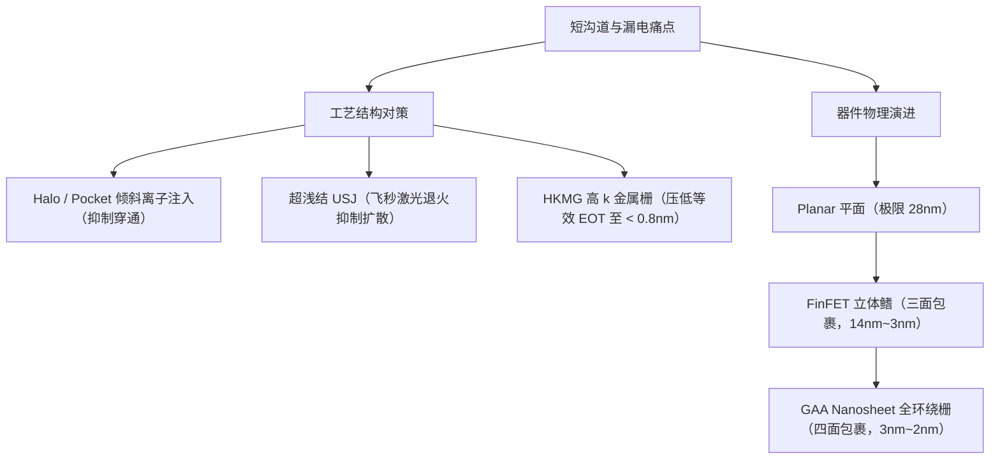

# 短沟道效应（SCE）全景：物理机制、漏电流成份与产线对策

- **所属模块**：`01_器件物理与硅片 / 02_半导体物理基础`

---

## 1. 为什么沟道缩短会导致器件失控？

当晶体管栅长 $L_g$ 缩短到与源漏耗尽区宽度（$W_{dep}$）相当的量级时，一维 MOS 能带模型彻底失效，必须引入二维甚至三维静电场分析：

$$\lambda = \sqrt{\frac{\varepsilon_{ch}}{\varepsilon_{ox}} t_{ox} t_{ch}}$$

- **自然特征长度 $\lambda$（Natural Length）**：衡量栅极静电控制力的核心物理标尺。一般要求 **$L_g > 3\sim 4\lambda$** 才能有效抑制短沟道效应。
- 为了让 $\lambda$ 变小：
  - 减小栅介质厚度 $t_{ox}$（导致漏电击穿，催生 High-k 金属栅）；
  - 减小沟道厚度 $t_{ch}$（催生超薄体 UTBB FD-SOI、FinFET 纳米鳍片以及 GAA 纳米片 Nanosheet）。

---

## 2. 短沟道效应四大物理表象

### （1）阈值电压滚降（$V_{th}$ Roll-off）
- **机理**：源漏 PN 结内建电场向沟道侵入，分担了部分原本需要由栅极耗尽的电荷（Charge Sharing 模型）。
- **现象**：当 $L_g$ 变小时，开启晶体管所需的阈值电压 $V_{th}$ 急剧下降，工艺中线宽哪怕波动 1nm，阈值电压就会剧烈漂移，造成芯片电路时序混乱。

### （2）漏致势垒降低（DIBL, Drain-Induced Barrier Lowering）
- **机理**：漏端施加高电压 $V_{DS}$ 时，漏区反偏耗尽层深插进沟道，降低了源端载流子注入沟道的静电势垒高：
  $$\text{DIBL} = \frac{V_{th}(V_{DD, low}) - V_{th}(V_{DD, high})}{V_{DD, high} - V_{DD, low}} \quad (\text{mV/V})$$
- 典型合格器件 DIBL 应控制在 $< 50\sim 80\,\text{mV/V}$；严重短沟道器件 DIBL 会飙升至 $> 150\,\text{mV/V}$。

### （3）亚阈值摆幅退化（Subthreshold Swing, SS）
- **定义**：将漏电流改变 1 个数量级（10 倍）所需的栅电压变化：
  $$SS = \left(\frac{d(\log_{10} I_D)}{dV_G}\right)^{-1} = 2.3 \frac{k_B T}{q} \left(1 + \frac{C_{dep}}{C_{ox}}\right)$$
- **室温物理极限（玻尔兹曼热极限）**：
  $$SS_{min} \approx 60\,\text{mV/decade} \quad (T = 300\text{K})$$
- 当沟道变短，栅控变弱使得 $\frac{C_{dep}}{C_{ox}}$ 恶化，$SS$ 从理想的 65~70 mV/dec 恶化到 100+ mV/dec。为了保持相同开态电流，关态漏电 $I_{off}$ 将成千上万倍暴涨。

### （4）热载流子注入（HCI, Hot Carrier Injection）与穿通（Punch-through）
- **HCI**：漏端高纵向电场加速电子，产生高能“热电子”，碰撞电离产生雪崩效应，部分热电子撞击并注入栅介质，造成长期工作后 $V_{th}$ 漂移与寿命衰退；
- **Punch-through（穿通）**：源端耗尽区与漏端耗尽区在衬底深部直接连接，电荷在衬底深处绕过栅极控制形成失控暴走电流。

---

## 3. 晶圆厂工艺演进与对策矩阵

---

## 4. 六大漏电流源（Leakage Current Components）
现代先进制程待机功耗主要由这 6 种微观漏电贡献：
1. **$I_{sub}$ 亚阈值漏电**：$V_{GS} < V_{th}$ 时的扩散电流，受 $SS$ 和 DIBL 支配；
2. **$I_{gate, tun}$ 栅直接隧穿漏电**：量子力学波函数直接穿过纳米薄介质层；
3. **$I_{junc}$ 源漏反向偏置 PN 结漏电**：包括带间隧穿（BTBT, Band-to-Band Tunneling）；
4. **$I_{GIDL}$ 栅感应漏极漏电**：栅与漏重叠区高电场诱导价带电子隧穿进导带；
5. **$I_{punch}$ 穿通电流**：源漏耗尽区完全接通造成的衬底深层漏电；
6. **$I_{parasitic}$ 窄沟道与浅沟槽隔离（STI）边缘拐角寄生晶体管漏电**。
