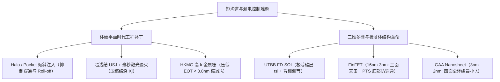
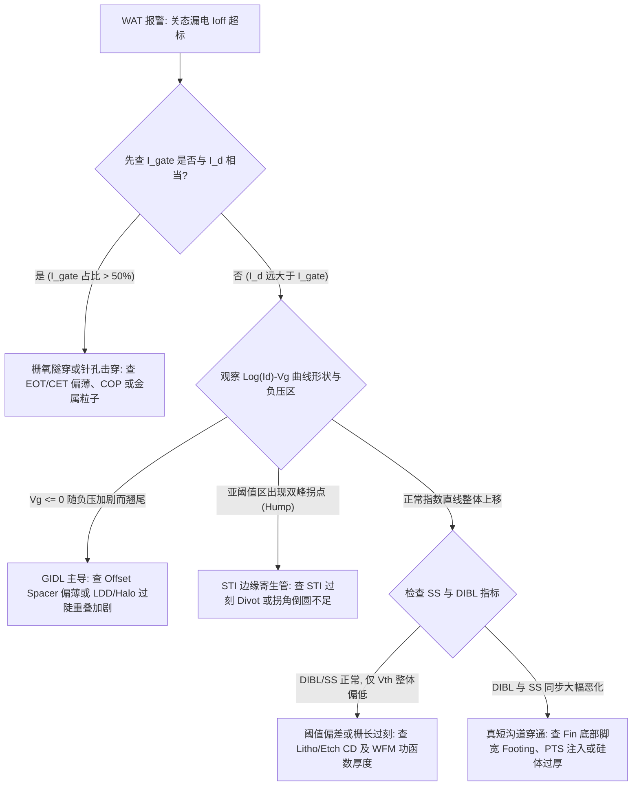

# 短沟道效应（SCE）全景：物理机制、漏电流成份与产线对策

- **所属模块**：`01_器件物理与硅片 / 02_半导体物理基础`

---

## 1. 为什么沟道缩短会导致器件失控？

### （1）Dennard 缩微定律的终结与二维静电博弈
在理想长沟道 MOSFET 中，沟道电势完全受栅极垂直一维电容支配（缓变沟道近似）。1974 年 Robert Dennard 提出**恒定电场等比例缩微（Constant-Field Scaling）**：若尺寸 $L, W, t_{ox}$ 与工作电压 $V_{DD}$ 同比例缩减 $1/\kappa$，芯片功耗密度保持恒定不变。

然而进入 90nm 节点以下，室温亚阈值摆幅 $SS \ge 60\,\text{mV/dec}$ 的热力学底线死死锁住了阈值电压 $V_{th}$ 的下限（否则关态漏电呈指数爆炸），导致 $V_{DD}$ 无法等比下调而长期停滞在 $0.7\sim 1.0\,\text{V}$ 区间。随着物理栅长持续微缩，漏端横向强电场直接侵入沟道夺取势垒控制权，一维电容模型彻底崩塌，短沟道效应（SCE）全面爆发。

### （2）自然特征长度 $\lambda$（Natural Length）家族与栅控判据
通过求解沟道二维/三维泊松方程，定义衡量漏极电场向沟道横向穿透衰减特征距离的标尺——**自然特征长度 $\lambda$**（Yan et al. / Auth-Plummer 模型）。工程上通常要求实际栅长满足 **$L_g \ge (3\sim 4)\lambda$**（极低漏电应用要求 $L_g > 5\lambda$）才能压制短沟道失控：

| 器件几何结构 | 自然特征长度 $\lambda$ 表达式 | 静电缩放因子 | 静电控制能力与节点上限 |
| :--- | :--- | :---: | :--- |
| **平面体硅（Planar Bulk）** | $$\lambda_{bulk} \approx \sqrt{\frac{\varepsilon_{Si}}{\varepsilon_{ox}} t_{ox} W_{dep}} \quad \text{（与 }X_j\text{ 耦合）}$$ | 基准 $1$（单面顶控） | 依赖重掺杂压窄 $W_{dep}$ 与超浅结 $X_j$；极限约 **28nm / 20nm** |
| **超薄体 SOI（FD-SOI）** | $$\lambda_{FDSOI} \approx \sqrt{\frac{\varepsilon_{Si}}{\varepsilon_{ox}} t_{ox} t_{Si}}$$ | 受限极薄硅厚 $t_{Si}$ | 以无掺杂极薄 $t_{Si}\,(6\sim 8\,\text{nm})$ 替代 $W_{dep}$；可下探至 **22nm / 12nm** |
| **双栅 / 立体鳍（FinFET）** | $$\lambda_{DG} = \sqrt{\frac{\varepsilon_{Si}}{2\varepsilon_{ox}} \left(1 + \frac{\varepsilon_{ox} t_{Si}}{4\varepsilon_{Si} t_{ox}}\right) t_{ox} t_{Si}}$$ | 近似因子 **$1/\sqrt{2}$** | 窄硅鳍 $W_{fin}$ 三面夹击；主力跨越 **16/14nm $\to$ 3nm** |
| **全环绕纳米片 / 圆柱（GAA）** | $$\lambda_{GAA} = \sqrt{\frac{\varepsilon_{Si}}{4\varepsilon_{ox}} \left(1 + \frac{\varepsilon_{ox} t_{Si}}{4\varepsilon_{Si} t_{ox}}\right) t_{ox} t_{Si}}$$ | 近似因子 **$1/2$** | 四面全包围最强静电屏蔽；开启 **3nm/2nm 及以下时代** |

同时，**Brews 经验最小沟道长度判据**给出了体硅器件避免穿通的经典设计公式：
$$L_{min} = A \cdot \left[X_j \, t_{ox} \, (W_s + W_d)^2\right]^{1/3} \quad (A \approx 0.41\,\text{\AA}^{-1/3})$$
这明确指出了晶圆厂压制短沟道效应的四大物理杠杆：
1. 减薄等效栅氧 **EOT（$t_{ox}$）** 提升栅极垂直电容；
2. 压浅源漏结深 **USJ（$X_j$）** 阻断横向电力线入侵；
3. 减薄沟道硅体厚度 **（$t_{Si}$）** 实现全耗尽；
4. 升级三维栅极包裹维度（从单面到四面环栅）。

---

## 2. 短沟道效应四大物理表象、势垒图解与产线边界

### （1）沟道能带势垒随 $L_g$ 与 $V_{DS}$ 退化图解
```text
电子势能 (-q·ψ)
  ^
  |      /=======\               <-- 长沟道 / 低 Vds: 势垒高且平缓，栅极完全主导
  |     /         \
  |----/           \   /-------  <-- 短沟道高 Vds (DIBL): 漏端拉低并左移势垒峰值 (ΔΦ_B)
  |   |   源端      \ /    漏端
  |   |   Source     V    Drain
  +-----------------------------> 沟道纵向位置 x
```

### （2）阈值电压滚降（$V_{th}$ Roll-off）与反短沟道效应（RSCE）
- **Yau 电荷共享模型（$V_{th}$ Roll-off）**：
  - **物理机理**：源漏 PN 结耗尽区向沟道两端侵入，分担了原本必须由栅极电压平衡的受主耗尽电荷（梯形耗尽区近似）。
  - **工程危害**：$L_g$ 越短，被源漏“分摊”的耗尽电荷占比越高，使晶体管开启阈值 $V_{th}$ 骤降。光刻 CD 仅漂移 $1\,\text{nm}$，关键路径的 $V_{th}$ 便剧烈离散，造成芯片时序崩坏与良率暴跌。
- **反短沟道效应（RSCE, Reverse Short Channel Effect）**：
  - **异常表象**：产线实际量测 $V_{th}-L_g$ 曲线时，常见到随 $L_g$ 缩短，$V_{th}$ 在中等栅长处先**逆势略微爬升**、在极短栅长处才断崖下跌。
  - **两大成因**：一是源漏重掺注入损伤产生的过饱和自间隙硅原子触发**硼的瞬态增强扩散（TED）**向沟道侧堆积；二是产线特意倾斜注入 **Halo / Pocket（晕环掺杂）**，当 $L_g$ 变短使左右两侧 Halo 峰相互叠加，沟道中心平均掺杂浓度反升。
  - **调控目标**：通过精细调节 Halo 剂量/倾角能量使目标工作栅长处的 $V_{th}(L_g)$ 呈现尽可能平坦的平台期。

### （3）漏致势垒降低（DIBL, Drain-Induced Barrier Lowering）
当漏端施加高工作电压 $V_{DD}$ 时，漏端反偏势场直接压低源端电子注入势垒高度 $\Delta\Phi_B$（见上图势垒下陷）：
$$\text{DIBL} = \frac{V_{th}(V_{DS,low}) - V_{th}(V_{DS,high})}{V_{DS,high} - V_{DS,low}} \quad (\text{单位: mV/V})$$
- **测试条件**：常用测试点为 $V_{DS,low} = 0.05\,\text{V}$ 对比 $V_{DS,high} = V_{DD}$。
- **量产卡控窗**：先进 FinFET/GAA 器件需控制在 **$< 30\sim 60\,\text{mV/V}$**；成熟平面 28nm 约 $70\sim 100\,\text{mV/V}$；若工艺飘移导致 DIBL $> 150\,\text{mV/V}$，高压待机漏电将无法收口。

### （4）亚阈值摆幅退化（$SS$）与玻尔兹曼极限
在亚阈值区（$V_{GS} < V_{th}$），电流受源端热发射扩散指数控制。定义使漏电流改变 10 倍所需的栅压摆幅：
$$SS = \left(\frac{d(\log_{10} I_D)}{dV_G}\right)^{-1} = \ln(10)\cdot\frac{k_B T}{q}\cdot\left(1 + \frac{C_{dep} + C_{it}}{C_{ox}}\right) \approx 59.6 \cdot \left(1 + \frac{C_{dep} + C_{it}}{C_{ox}}\right) \quad (\text{mV/dec @ 300K})$$
其中 $C_{it} = q D_{it}$ 为界面态电容。
- **玻尔兹曼热力学极限**：即便拥有理想栅控（$C_{dep} \to 0, D_{it} \to 0$），室温下传统热注入 MOSFET 的 $SS$ 也绝不能低于 **$60\,\text{mV/dec}$**（TFET 带间隧穿管或 NCFET 负电容管均试图打破此极限，但目前仍受限于开态电流或铁电迟滞尚未大规模取代常规 CMOS）；
- **工程边界**：优秀 FinFET/GAA 量产器件的 $SS$ 处于 **$63\sim 72\,\text{mV/dec}$**；若表面退火不足（$D_{it}$ 高）或体耦合丧失，$SS$ 恶化到 $90\sim 110\,\text{mV/dec}$，迫使提高 $V_{th}$ 以守住 $I_{off}$，直接牺牲逾 20% 芯片频率。

### （5）热载流子注入（HCI）、BTI 可靠性与穿通（Punch-through）
- **HCI（Lucky Electron 模型）**：电子在漏端夹断区高电场（MV/cm 级）中加速成为“热电子”，动能超过硅碰撞电离阈值（$\sim 1.5\sim 1.8\,\text{eV}$）诱发电子-空穴对产生显著**衬底电流 $I_{sub}$（峰值出现在 $V_G \approx V_D/2$）**；能量突破 $\text{Si}-\text{SiO}_2$ 势垒（约 $3.1\,\text{eV}$）的电子注入栅介质产生永久损伤，导致长期运行后 $V_{th}$ 正漂与跨导下降。产线核心对策为 **LDD（轻掺杂漏极）/ Extension 注入**以展宽降压区压低峰值场强。
- **BTI（偏压温度不稳定性，NBTI / PBTI）耦合**：与 HCI 发生在高 $V_D$ 不同，**NBTI** 在高垂直栅压 $V_G$、低 $V_D$ 及高温下最为剧烈——PMOS 沟道空穴打破界面的 $\text{Si}-\text{H}$ 键导致界面态 $D_{it}$ 激增与 $|V_{th}|$ 不可逆/可逆漂移（是 EOT 压薄至 $< 0.8\,\text{nm}$ 后晶圆级可靠性 WLR 的头号杀手）。
- **穿通（Punch-through）**：源漏耗尽区在栅极控制最弱的沟道深处直接连接，电流绕过表面势垒从体内失控导通。

### （6）三维延伸：窄沟道效应（NWE）与反窄沟道效应（INWE）
除栅长 $L_g$ 缩短引发的短沟道效应外，沟道宽度 $W$ 缩小也会剧烈改变器件阈值：
- **LOCOS 时代窄沟道效应（NWE）**：早期鸟嘴氧化挤压使耗尽区向边缘侧翼扩张，需要额外栅压平衡边缘电荷，导致 $W$ 越窄时 $V_{th}$ **升高**；
- **STI 时代反窄沟道效应（INWE）**：现代浅沟槽隔离（STI）顶部边缘的电力线产生三维电场边缘集中效应，且热退火时硼易于向 STI 氧化硅偏析流失，导致沟道边缘局域 $V_{th}$ 偏低——最终使**沟道总宽 $W$ 越窄时器件 $V_{th}$ 反而下降**，这也是触发下文第 4 节 STI 边缘寄生双驼峰（Hump）漏电的同源物理机制。

---

## 3. 晶圆厂工艺演进与抑制 SCE 的 Trade-off 矩阵



### （1）SCE 抑制杠杆的工程 Trade-off

| 抑制 SCE 工艺杠杆 | 正向物理收益 | 不可回避的工程 Trade-off / 副作用 |
| :--- | :--- | :--- |
| **提高沟道与 Halo 掺杂浓度** | 压窄 $W_{dep}$、阻止源漏耗尽区接通、压低 DIBL 与穿通 | 1. 杂质电离散射剧增拉低 $\mu_{eff}$<br>2. 抬高结电容 $C_j$ 并大幅恶化 **BTBT / GIDL 漏电**<br>3. 引发 **RDF（随机掺杂涨落）**导致 SRAM $V_{th}$ 离散失配 |
| **超浅结 USJ + 激光退火（LSA）** | 降低 $X_j$ 缩减 Brews $L_{min}$；毫秒级退火压制硼瞬态增强扩散（TED） | 退火时间过短易残留离子注入尾部点缺陷，恶化 **PN 结复合漏电**；浅结高方块电阻增加扩展电阻 $R_{ext}$ |
| **压缩 EOT（减薄 $\text{HfO}_2$/IL）** | 提升 $C_{ox}$ 压低 $\lambda$ 与 $SS$，强化垂直栅控 | 物理厚度逼近 $1\sim 1.5\,\text{nm}$ 后，**栅极直接隧穿漏电 $I_{gate}$ 呈指数暴涨**，大幅压缩 TDDB 击穿寿命 |
| **极窄硅鳍 / 极薄纳米片** | 压低 $t_{ch}$ 无需重掺杂即消除穿通并使 $SS$ 接近 $60\,\text{mV/dec}$ | 沟道薄至 $< 5\,\text{nm}$ 会诱发**量子限域能带展宽（$V_{th}$ 对膜厚 $\pm 0.2\,\text{nm}$ 波动极其敏感）**及声子散热困难（自热效应） |

### （2）多阈值电压（Multi-$V_{th}$）调节策略随节点的演化
产线 SOC 设计需要同时提供 ULVT / LVT / SVT / HVT 等多档阈值管平衡速度与待机功耗：
- **平面时代**：主要依靠额外多掩模版做不同剂量的沟道离子注入调控 $V_{th}$，但高剂量注入带来剧烈 RDF；
- **FinFET 时代**：依靠在替换栅（RMG）狭槽内通过光刻剥离沉积不同厚度与组分的功函数金属（WFM，如 TiN/TiAlC）控制 $V_{th}$，保留沟道低掺杂纯净度；
- **GAA 时代**：片间距缩至 $< 10\,\text{nm}$ 无法堆砌厚金属，转向原子级 $\text{La}_2\text{O}_3/\text{Al}_2\text{O}_3$ **界面偶极子（Dipole）调压**配合薄层 WFM。

---

## 4. 六大漏电流源定量分解与 WAT 排查决策流

芯片静态功耗由以下 6 种微观漏电流叠加构成。产线 FA 与 WAT 工程师通过**偏压斜率、温度特征与特定曲线形态**即可快速剥离根因：

| 漏电类型 | 微观产生机制与主导偏压区间 | 温度敏感度 | 产线特征诊断法与核心改进对策 |
| :--- | :--- | :---: | :--- |
| **1. 亚阈值漏电 $I_{sub}$** | $V_{GS} < V_{th}$ 时源端多子热扩散越过势垒；受 $SS$ 与 DIBL 指数放大 | **强正温度系数**（升温使 $V_{th}$ 降低约 $-1.2\,\text{mV/K}$，漏电翻倍） | 随 $V_{GS}$ 呈对数直线关系；核查 Poly/Fin CD 偏小（过刻）、$D_{it}$ 退化；电路侧靠 HVT/SVT/LVT 分级控制 |
| **2. 栅直接隧穿 $I_{gate}$** | 载流子量子波函数直接穿透纳米薄栅介质（高场呈 FN 隧穿） | **对温度几乎不敏感** | **物理厚度偏薄 0.2nm 漏电即可翻约 10 倍**；直接测 $I_g-V_g$ 即可剥离；排查 ALD $\text{HfO}_2$ 周期或 IL 生长偏薄 |
| **3. 源漏 PN 结漏电 $I_{junc}$** | 反偏结空间电荷区 **SRH 热产生电流**（正温）与重掺高场 **BTBT 带间隧穿** | SRH 强正温（$\propto n_i$）；BTBT 微弱正温 | 独立测试大面积源漏二极管结构；排查重金属沾污（SRH 升高）或 Halo 与源漏结面过陡产生极高场（BTBT） |
| **4. 栅感应漏极漏电 $I_{GIDL}$** | $V_G \le 0$ 而漏端加高压 $V_{DD}$ 时，栅漏交叠区（Overlap）硅表层深耗尽弯曲，价带电子隧穿进导带被漏极收集 | **弱温敏、对 $V_{DG}$ 极其敏感** | **特征指纹：在 $I_D-V_G$ 对数曲线负栅压区间出现明显反常翘尾抬升！** 对策：微调 Offset Spacer 厚度与 LDD 注入倾斜角 |
| **5. 体内穿通漏电 $I_{punch}$** | 源漏耗尽区在衬底深部直接打通，电流绕开栅极表面控制 | 随 $V_{DS}$ 呈近二次方急剧飙升 | 表现为 $I_D-V_G$ 亚阈值底噪抬高且关不死，加负体偏置（Back-bias）有明显变化；检查 Fin 底部 **PTS 注入**或底部宽化（Footing） |
| **6. STI 寄生边缘漏电 $I_{parasitic}$** | 浅沟槽隔离（STI）顶部硅拐角过尖引发电场集中，或刻蚀过深形成凹陷（**STI Divot**）使栅极包覆侧壁导通低 $V_{th}$ 寄生通道 | 在亚阈值开启前率先导通 | **特征指纹：$I_D-V_G$ 亚阈值区出现典型“双驼峰”（Kink / Hump Effect）！** 优化 STI 氧化前拐角圆化及削减 HF 湿法清洗过刻蚀量 |

- **常温测试 vs 高温老化（HTOL, $125^\circ\text{C}$）的主导漏电切换**：常温 $25^\circ\text{C}$ 下 $I_{gate}$ 与 $I_{GIDL}$ 可能与 $I_{sub}$ 处于同一量级；但芯片高负载升至 $125^\circ\text{C}$ 时，$I_{gate}$ 几乎原地踏步，而 **$I_{sub}$ 与 $I_{junc,SRH}$ 呈指数暴涨 $5\sim 15$ 倍以上**，反客为主成为引发芯片待机功耗崩盘及热失控循环的绝对元凶。

### WAT $I_{off}$ 异常快速排查决策树


