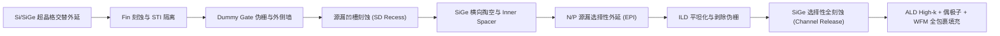

# 逻辑晶体管演进：Planar → FinFET → GAA → CFET

- **所属模块**：`01_器件物理与硅片 / 03_逻辑器件演进`

---

## 1. 为什么晶体管架构必须持续迭代重构？

在 28nm 之前的经典缩微时代，工艺进步主要依靠光刻直接按比例缩小栅极长度；然而进入 20nm 以下后，**物理栅长 $L_g$ 已放缓微缩（目前最先进量产节点物理 $L_g$ 长期徘徊在 $12\sim 18\,\text{nm}$ 附近）**，节点命名（如 5nm/3nm/2nm）已与实际物理尺寸脱钩。迫使晶体管历经四次结构大换代的核心工程驱动力有三点：
1. **静电完整性与自然特征长度 $\lambda$ 约束**：为满足 $L_g > 3\sim 4\lambda$ 抑制 $V_{th}$ 滚降、DIBL 与待机漏电，必须将栅极对沟道的控制维度从单面提升到三面甚至四面全包围；
2. **标准单元（Standard Cell）轨高压缩与版图微缩**：密度翻倍日益依赖压窄**接触多晶硅节距（CPP）**、**最小金属节距（MMP）**及标准单元轨道数（Cell Track Height 从早期 9T/7.5T 压缩至 FinFET 的 6T/5T，再向 CFET 的 3T~4T 迈进）；
3. **有效导电宽度与寄生 RC 的平衡**：必须在越来越狭小的单颗晶体管占地面积（Footprint）内向垂直第三维立体空间索取更大的有效导电宽长比（$W_{eff}/L_g$），同时压低栅极-源漏寄生电容与狭缝接触电阻。

### 四代逻辑晶体管截面几何结构演进图解
```text
(1) Planar (28nm+)     (2) FinFET (16-3nm)      (3) GAA Nanosheet (2nm)     (4) CFET (1nm 以下)
   [ Metal Gate ]          [  Metal Gate  ]          [   Metal Gate    ]          [  Top PMOS  ]
   --------------          |  +--------+  |          |  +-----------+  |          [  Channel   ]
    High-k / IL            |  |  Fin   |  |          |  |  Sheet 3  |  |        --+------------+--
   ==============          |  | (110)  |  |          |  +-----------+  |         隔离介质 Isolation
   源极     漏极           |  |  侧壁  |  |          |  +-----------+  |        --+------------+--
   [n+]     [n+]           |  |  导电  |  |          |  |  Sheet 2  |  |          [ Bottom NMOS]
    \_________/            |  +--------+  |          |  +-----------+  |          [  Channel   ]
     P-Sub 衬底         ===+==============+===       |  +-----------+  |        ==================
                        STI   PTS 注入     STI       |  |  Sheet 1  |  |         BSPDN 背面直连供电
                                                     ===+===========+===
  单面控制 (1 面)         三面包裹 (顶+双侧)         四面全包络 (N片叠层)        垂直双层叠放 + BSPDN
```

### 逻辑先进节点关键尺寸演进量级参考（行业工程典型区间）

| 工艺时代 | 典型节点 | 接触栅节距 CPP | 最小金属节距 MMP | 典型物理栅长 $L_g$ | 核心架构特征与单元轨高趋势 |
| :--- | :--- | :---: | :---: | :---: | :--- |
| **平面 HKMG** | `28nm` | $\sim 90\sim 110\,\text{nm}$ | $\sim 80\sim 90\,\text{nm}$ | $\sim 28\sim 32\,\text{nm}$ | 单面体硅平面/FD-SOI；9T~12T |
| **第一/二代 FinFET** | `16/14nm → 7nm` | $\sim 54\sim 78\,\text{nm}$ | $\sim 36\sim 64\,\text{nm}$ | $\sim 18\sim 24\,\text{nm}$ | 三面鳍式立体沟道；引入 EUV/SAQP；7.5T~6T |
| **极限 FinFET** | `5nm / 3nm` | $\sim 45\sim 51\,\text{nm}$ | $\sim 22\sim 30\,\text{nm}$ | $\sim 14\sim 18\,\text{nm}$ | 极致 Fin 节距（24~28nm）与 **Fin Depopulation**（2-fin 甚至 1-fin）；5T |
| **GAA Nanosheet** | `3nm / 2nm` | $\sim 42\sim 48\,\text{nm}$ | $\sim 20\sim 24\,\text{nm}$ | $\sim 12\sim 16\,\text{nm}$ | 四面全环绕多层纳米片；支持背面供电 BSPDN；5T~4.5T |
| **CFET（探索期）** | `1nm 以下 (A10/A7)` | $< 40\,\text{nm}$ | $< 18\,\text{nm}$ | $\sim 10\sim 12\,\text{nm}$ | N/P 垂直堆叠彻底消除 N-P 横向间距；强绑定 BSPDN；**3T~4T** |

---

## 2. 四代架构横向对比与工艺集成演进脉络

| 演进世代 | 栅极包裹方式 | 核心物理突破 | Fab 制造与工艺集成核心难点 |
| :--- | :--- | :--- | :--- |
| **Planar MOSFET** | **单面顶控**（栅压在沟道上方） | 45nm 导入 **HKMG**（压低 EOT 并消除多晶硅耗尽）；90nm 导入 eSiGe/CESL 应变硅 | 20nm 平面架构即便采用重掺 Halo 也无法阻挡深部穿通；重掺引发极严重 **RDF（随机掺杂涨落）**与迁移率暴跌 |
| **FinFET（鳍式）** | **三面包裹**（沟道直立成鱼鳍，栅极跨骑顶面与双侧壁） | 1. 纵深增容：$W_{eff} = 2H_{fin} + W_{fin}$<br>2. 非掺杂窄 Fin 消除 RDF，将 $SS$ 压至 $\sim 65\,\text{mV/dec}$、DIBL $< 40\,\text{mV/V}$<br>3. `(110)` 侧壁天然利好 PMOS 空穴输运 | 1. **高深宽比 Fin 倒塌与倾斜**（$W_{fin} \sim 5\,\text{nm}$，$H_{fin} \sim 55\,\text{nm}$）<br>2. **宽度离散量化瓶颈**与底部漏电（依赖 PTS 注入）<br>3. 狭小 Fin 间距内 **RMG 多功函数金属填充空间耗尽** |
| **GAA Nanosheet** | **四面全包围**（水平堆叠 3~4 层宽硅纳米片） | 1. 最强静电控制（最小 $\lambda$），支撑继续压低 $L_g$ 或工作电压 $V_{DD}$<br>2. **纳米片宽度 $W_{sh}$ 连续可调**，同占位下导电面积大于 FinFET<br>3. 上下主表面回归 `(100)` 面极大强化 NMOS | 1. **$\text{Si}/\text{SiGe}$ 超晶格高质量外延**与热预算控制<br>2. **内侧墙（Inner Spacer）掏空与保形回刻**<br>3. **通道释放（Channel Release）超百比一选择性刻蚀与防粘连干燥**<br>4. 狭窄垂直间隙内**偶极子多 $V_{th}$ 调控** |
| **CFET（互补场效应）** | **PMOS 与 NMOS 垂直 3D 堆叠** | 彻底消除传统平面布局中 N-to-P 阱横向安全隔离间距，**压缩标准单元面积约 40%~50%** | 1. **超高深宽比（AR > 15~20）接触通孔刻蚀与填充**<br>2. 上下层互不串扰的**独立双功函数金属剥离**<br>3. 强绑定 **背面供电网络（BSPDN）**，制造与散热极其复杂 |

---

## 3. 各代标志性工艺路线抉择与底层难点深挖

### （1）Planar 时代世纪路线之争：Gate-First vs Gate-Last（RMG 替换金属栅）
28nm~45nm 导入 $\text{HfO}_2$ 高 k 与金属栅（HKMG）时，业界曾分裂为两派：
- **Gate-First（先栅极，IBM/Samsung 等早期联盟）**：直接淀积高 k 介质与功函数金属栅并完成图形化，随后经历 $1000^\circ\text{C}$ 以上的源漏激活尖峰退火。
  - **致命失效**：高温下非晶 $\text{HfO}_2$ 过早结晶生成晶界漏电通路，且界面氧扩散引起**费米能级钉扎效应（Fermi-level Pinning）**，导致 PMOS 阈值电压漂移严重且无法压低。
- **Gate-Last / RMG（后栅极/替换金属栅，Intel 45nm 首创量产）**：先用牺牲多晶硅伪栅（Dummy Poly）硬扛源漏 $1000^\circ\text{C}$ 高温激活退火；待后端温度降至 $400^\circ\text{C}$ 以下后，CMP 露头并湿法剥除伪栅，再在空栅槽内依次 ALD 填入 $\text{HfO}_2$、低热预算 N/P 功函数金属（如 TiAlC / TiN）与低阻金属填充。
  - **行业定局**：RMG 完美保留了功函数纯净度与压应力加成，最终在 20nm 以后 100% 一统江湖。

### （2）FinFET 量产核心制造瓶颈
- **SADP/SAQP 芯轴图形化与 STI 凹槽深度**：在 ArFi 193nm 时代依靠自对准四重曝光（SAQP）做出节距 $< 28\,\text{nm}$ 的超密硅鳍，随后填入氧化硅并经干法/湿法精确回刻（STI Recess）露出 $50\sim 60\,\text{nm}$ 高的硅鳍；STI 回刻深度的片内偏差哪怕 $2\,\text{nm}$，都会直接转化为 $W_{eff}$ 与饱和电流波动。
- **Fin 底部防穿通（PTS）与脚宽（Footing）**：Fin 底部未被栅极直接包裹，极易发生底部源漏穿通，必须在底部实施高浓度反型掺杂（PTS）并控制硅鳍侧壁接近垂直的陡直度——同时避免硅鳍过于细高在湿法清洗时因毛细力发生弯曲粘连。
- **MEOL 自对准接触（SAC, Self-Aligned Contact）**：随着 CPP 压缩至 $45\sim 50\,\text{nm}$，栅极与源漏触孔仅相距数纳米，微小套刻偏差即可引爆栅-源漏短路。Fab 必须在栅极顶部先回刻填入坚固的氮化硅硬帽层（SiN Cap），利用极高刻蚀选择比使源漏接触孔沿栅帽侧壁自对准向下滑入着陆。

### （3）GAA Nanosheet 四大核心增量工艺模块（最硬核产线壁垒）



1. **$\text{Si}/\text{Si}_{1-x}\text{Ge}_x$ 超晶格交替外延与 Ge 含量权衡**：
   - **工艺参数**：在硅衬底上用 RP-CVD 交替生长 3~4 组极薄硅沟道层（$T_{sh} \approx 5\sim 7\,\text{nm}$）与牺牲层 $\text{SiGe}$（$T_{sus} \approx 8\sim 12\,\text{nm}$，Ge 含量典型 $25\%\sim 35\%$）。
   - **核心 Trade-off**：Ge 含量越高，后续通道释放刻蚀与硅之间的选择比越大越安全；但晶格失配应力越剧烈，若超过 Matthews-Blakeslee 临界厚度就会萌生贯穿位错，且高温热步极易诱发 Ge 向硅片互扩散，导致合金散射与 $V_{th}$ 严重漂移。
2. **内侧墙（Inner Spacer）模块——GAA 良率生死线**：
   - **工艺流程**：在源漏凹槽侧面露出的 $\text{Si}/\text{SiGe}$ 切面上，采用高选择比气相 $\text{HCl}$ 或远程等离子体将 $\text{SiGe}$ 向沟道内横向精确掏空 $4\sim 7\,\text{nm}$ 形成凹槽（Cavity）；随后 ALD 沉积超低 $k$ 介质（$\text{SiOCN}, k \approx 4.5$）并各向异性回刻填满凹槽，最后生长连接硅片端面的源漏外延。
   - **失效风险**：若凹槽过深且回刻残留，会挡住源漏外延接触面致使接触电阻急剧升高；若凹槽过浅或介质内存在 $1\,\text{nm}$ 级针孔（Pin-hole），后续通道释放后金属栅将直接渗透引爆**栅-源漏短路（Gate-to-SD Short）**！
3. **通道释放（Channel Release）与防塌陷超临界干燥**：
   - **选择性刻蚀**：剥除伪栅后，利用选择比高达 **$100:1$ 以上**的湿法混酸或气相各向同性选择性干法刻蚀彻底掏空沟道区 $\text{SiGe}$ 牺牲层，形成多层悬空硅片桥。
   - **防粘连干燥**：为防止仅 $5\,\text{nm}$ 厚的悬空硅片在传统水洗旋干时被水的高表面张力拉扯粘连（**Stiction 塌陷**），先进产线强制导入**超临界 $\text{CO}_2$ 干燥（SCCO2）**或无水异丙醇气相清洗。
4. **超窄狭缝多 $V_{th}$ 调控（Dipole Engineering）**：
   - **空间危机**：相邻硅纳米片垂直间距仅 $8\sim 12\,\text{nm}$，两侧各铺设 $1\,\text{nm}$ 界面层和 $1.5\,\text{nm}$ $\text{HfO}_2$ 后，物理缝隙仅剩 **$< 4\sim 6\,\text{nm}$**，完全无法沿用 FinFET 的多层厚 WFM 叠加调压方案。
   - **偶极子解法**：沉积亚纳米级 $\text{La}_2\text{O}_3$（拉低 NMOS $V_{th}$）或 $\text{Al}_2\text{O}_3$（拉调 PMOS）后，经短时热驱动（Drive-in）在 IL/HK 界面注入静电偶极矩跃变，随后剥除金属帽层仅填单一超薄功函数金属，完美攻克窄缝多阈值调控难题。

---

## 4. 工程视角剖析：FinFET vs GAA 综合对比、CFET 与 BSPDN 协同

### （1）FinFET vs GAA Nanosheet 核心电学与寄生指标对比

| 评估维度 | FinFET（3nm 极限态） | GAA Nanosheet（3nm/2nm 起） | 工程选型物理判断依据 |
| :--- | :--- | :--- | :--- |
| **有效沟道宽度自由度** | 离散整数档（1-fin / 2-fin） | 连续可调（$W_{sh}$ 可选 $12\sim 50\,\text{nm}$） | GAA 在同占位下面积利用率与驱动/功耗微调能力完胜 |
| **栅控 $\lambda$ 与最短 $L_g$** | 三面控制，底部漏电严重 | 四面全包络，$\lambda$ 再缩小 $\sim 20\%\sim 30\%$ | GAA 更易压低 $V_{DD}$ 实现同等性能下的动态功耗降幅 |
| **主导晶面与 N/P 平衡** | `(110)` 侧壁占优，天生偏利 PMOS | `(100)` 上下表面占优，天生偏利 NMOS | GAA 需更高 Ge 含量 eSiGe 补偿 PMOS 驱动短板 |
| **寄生密勒电容 $C_{eff}$** | 较可控（仅与外侧墙相关） | **偏高**（金属栅片上下贴近源漏外延） | Inner Spacer 介质 $k$ 值与精确掏空厚度直接决定 GAA 交流高频增益 |
| **器件自热效应（SHE）** | 热流可向下直传导至体硅衬底 | **较严重**（全介质环绕，热量仅从源漏端面散出） | GAA 结温可高出约 10~20°C+，加剧 BTI/HCI 衰减，需绑定背面导热路径 |

### （2）FinFET“去鳍化（Fin Depopulation）”困境 vs GAA 连续调节红利
- **FinFET 的瓶颈**：Fin 宽和高度全片固定，设计只能按整数增减 Fin 根数。当 7nm $\to$ 5nm $\to$ 3nm 将单管从 3-fin 削减至 2-fin 乃至 1-fin 时，驱动电流颗粒度断崖跳档且造成严重的 SRAM 读写比例协调困难。
- **GAA 的灵活定制**：算力核心采用宽片（$\sim 45\,\text{nm}$）榨取极致 $I_{on}$；SRAM 与低功耗模块采用窄片（$\sim 15\,\text{nm}$）压缩电容与漏电。

### （3）CFET 两条制造路线与 BSPDN 背面供电路径对比
迈向 1nm 节点，CFET 将 NMOS 与 PMOS 上下垂直叠加，使原本水平并排占用大片面积的 N-P 隔离区归零，产线主要评估两条技术路径：

| 维度 | 单片式 CFET（Monolithic CFET） | 序列式 CFET（Sequential CFET） |
| :--- | :--- | :--- |
| **核心制造方案** | 在单硅片上一次性外延底沟道超晶格 + 中间绝缘层 + 顶沟道超晶格 | 两片晶圆各自独立制造好 NMOS 与 PMOS 层，再经低温直接键合垂直贴合减薄 |
| **核心优势** | 上下层光刻天然自对准，无双片键合成本与对准设备负担 | **彻底解耦 N/P 工艺热预算与应力需求**（顶部可融合 Ge/InGaAs 等高迁材料） |
| **工程壁垒** | 总结构深宽比高达 **15:1~20:1**，底部源漏接触孔刻蚀、金属剥离窗口极端苛刻 | 要求极高精度的全局与局部键合对准（$< 3\sim 5\,\text{nm}$），且晶圆翻倍推高成本 |

无论是哪种 CFET（乃至 2nm GAA），若继续让电源线从正面顶层金属向下挤占密集信号通路，正面布线将彻底堵死且 IR Drop 恶化。因此**背面供电网络（BSPDN）**已成为必然搭档：
- **BPR（埋入式电源轨，IMEC 方案）**：将电源轨预先深埋于正面 STI 隔离层下方，后续通过背面纳米硅通孔（nTSV）接入供电；
- **PowerVia / 背面直接接触（Intel 18A 等方案）**：前端做完器件后将晶圆翻转临时键合于载片，背面研磨并化学减薄至 **$< 1\,\mu\text{m}$** 逼近晶体管源漏底部，再直接刻蚀背面纳米硅通孔直连源极接触。正面金属层彻底解放给高速信号互联，一举化解供电压降、RC 串扰与散热危机。

### （4）MEOL/BEOL 金属互联协同演进：为什么底层互连正在淘汰铜与钨？
当晶体管演化至 FinFET 末端及 GAA/CFET 节点时，接触孔与底层金属 M0 线宽已收缩至 $10\sim 14\,\text{nm}$ 级（逼近铜原子约 $39\,\text{nm}$ 的电子平均自由程！），引发极严重的**尺寸效应电阻暴涨**与电迁移可靠性危机：
1. **阻挡层（Barrier）占比吞噬有效导电截面**：传统铜互连需要较厚的 TaN/Ta 扩散阻挡层与籽晶层（各 $1.5\sim 3\,\text{nm}$），传统接触钨塞需要 Ti/TiN 粘附阻挡层；在 $12\,\text{nm}$ 宽的沟槽内，高阻阻挡层几乎占据超过一半截面积！
2. **表面散射与晶界散射（Fuchs-Sondheimer / Mayadas-Shatzkes 模型）**：导线宽度低于电子平均自由程时，电子撞击侧壁与多晶晶界概率陡增，铜电阻率呈指数飙升而丧失优势。
3. **产线材料与介质协同换代路线**：
   - **接触塞与 M0 换材**：从传统钨（W）先演进到 **无/超薄阻挡层的钴（Co）**，进一步向具备极低电子平均自由程和**可完全省去阻挡层的钌（Ru）与钼（Mo）**过渡；
   - **空气隙（Air-Gap）降电容**：在关键底层局域互连与栅接触间隙引入选择性密封空气隙（$k \approx 1.0$），最大限度压低 $C_{eff}$ 以匹配 GAA/CFET 的本征高速开关性能。

---

## 5. 产线三维晶体管在线量测（Metrology）与物理失效分析（PFA）

面对隐藏在 3D 结构内部且尺度跌入亚 $5\,\text{nm}$ 的 GAA/CFET 器件，传统的光学显微镜与常规俯视 CD-SEM 已完全看不见被遮挡的内侧墙凹槽或纳米片底层间隙，Fab 量测体系必须同步升级：

| 监测目标 | 产线无损在线量测手段（Inline Metrology） | 破坏性物理失效分析（PFA）与关键失效指纹 |
| :--- | :--- | :--- |
| **$\text{Si}/\text{SiGe}$ 超晶格厚度与 Ge% 组分** | **HR-XRD**（高分辨 X 射线衍射）与 **XRR**（X 射线反射率） | FIB 切样 + **STEM-HAADF**（高角环形暗场像清晰区分原子序数衬度，直接测量 $0.2\,\text{nm}$ 级界面互扩散） |
| **Fin 形貌与 Inner Spacer 侧向掏空深度** | **OCD / Scatterometry**（光谱椭圆偏振散射建模，依托机器学习反演 3D 截面） | **双束 FIB + 球差校正 TEM + EDX/EELS 元素面扫**：检查凹槽掏空深度是否均一、是否遗留未刻净 $\text{SiGe}$ 残余（造成寄生电容飙升） |
| **通道释放防塌陷与 RMG 填充空洞（Void）** | **高能量多视角电子束检测（HV-Ebeam）** 穿透顶层观测内部高衬度金属空洞 | 电性定位漏电点（EMMI 微光显微镜 / OBIRCH 热激光定位）后沿纳米片横向切片观察 **Gate-to-SD 短路通道**或 **Stiction 粘连点** |
| **WFM 偶极子层与应力分布** | 拉曼光谱（Raman）监控局部硅应力变化 | **NBD（纳米束电子衍射）**逐片测定仅数纳米厚硅片中心晶格应变分布；**EELS** 追踪 $\text{La}/\text{Al}$ 偶极子扩散锋面 |
