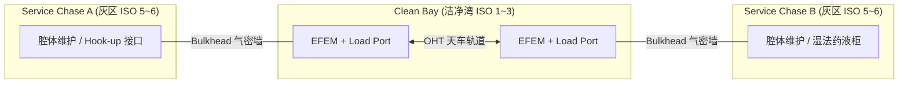

# 现代 12 寸晶圆厂垂直结构与 Bay-Chase 空间布局

- **所属模块**：`02_厂房与厂务系统 / 01_厂房结构与洁净室`

---

## 1. 为什么晶圆厂要建“三明治”多层结构？

一座月产 5~10 万片晶圆（WSPM）的 300mm 先进晶圆厂，总投资常高达百亿美元级别，其中仅厂房土建与厂务系统（Facility）即占总资本支出（CAPEX）的 25%~35%。为了在有限土地内同时满足**亚纳米级抗微振、ISO Class 1~3 超高洁净度、超大排风换气次数以及极高的机台装机密度（Hook-up 效率）**，现代 12 寸晶圆厂普遍采用垂直解耦的**多层“三明治”立体结构**：

```text
+=======================================================================+
|  屋面设备层 (Roof) : MAU 新风箱、中央排风洗涤塔、排风机组、冷却塔     |
+=======================================================================+
|  上层技术夹层 (Upper Plenum, 净高约 3.5~5.0 m)                        |
|  - 正压送风静压箱、大宗气体/UPW/PCW 干管桥架、OHT 独立吊挂钢桁架       |
+-----------------------------------------------------------------------+
|  [天花 FFU + ULPA 过滤阵列]  ↓↓↓ 垂直单向层流 (0.30~0.45 m/s) ↓↓↓     |
|                                                                       |
|  主洁净生产层 (Cleanroom / Fab Floor, 净高约 4.2~4.8 m)               |
|  - 工艺机台主体、EFEM + Load Port (900mm 标高)、顶部 OHT 天车双轨     |
|                                                                       |
|  [600×600mm 穿孔架高铝地板 + 风量调节阀 Damper]  ↓↓↓ 气流下穿 ↓↓↓     |
+-----------------------------------------------------------------------+
|  华夫板结构层 (Waffle Slab, 厚度 600~900 mm 混凝土格构板)             |
|  - 承重 15~25 kN/m² + 高阻尼抗微振 + 均匀阵列落风孔与管线预留孔        |
+-----------------------------------------------------------------------+
|  Sub-Fab 辅助设备层 (Sub-Fab, 净高约 4.5~6.0 m；EUV 区局部可达 8~10 m)|
|  - 干泵 (Dry Pump)、Chiller、Local Scrubber、RF 电源、VMB、配电柜      |
+-----------------------------------------------------------------------+
|  底层公用与回风层 (Basement / Sub-Sub-Fab, 净高约 3.5~5.5 m)          |
|  - 回风竖井通道 (Return Air Shaft)、DCC 干盘管换热区、大宗水电总管    |
|  - 独立孤岛桩基 (直达岩层，与普通结构断缝隔振)                        |
+=======================================================================+
```

### （1）空间分层背后的物理学与经济学根因
1. **洁净容积成本最小化（Cost per $m^2$ 优化）**
   - ISO Class 1~3 级超净区的建设成本和运行电费（依靠数百次/小时的空气循环置换维持）极其高昂，单位面积全寿命成本往往是 Sub-Fab 灰区的 5~10 倍；
   - 机台本体中真正接触裸晶圆的只有反应腔室（Process Chamber）和前端传送模块（EFEM）；
   - 将体积庞大、发热量极高且无需超净环境的**干式真空泵、精密温控冷机（Chiller）、本地尾气洗涤塔（Local Scrubber）、射频电源（RF Generator）及配电柜**全部下沉至 Sub-Fab（仅 ISO Class 6~8 灰区或普通受控区），单台机台在昂贵 Cleanroom 中的占地面积（Footprint）可压缩 40%~60%。
2. **热力学与气动力学解耦（防止涡流扬尘）**
   - 主生产层采用“上送下回”垂直单向流（Vertical Laminar Flow），洁净空气经天花板 FFU 垂直向下吹扫，穿过穿孔铝地板和华夫板落风孔进入 Sub-Fab 回风；
   - 若将高温泵组和冷机留在洁净室地面，设备散热产生的**热羽流（Thermal Plume）**会向上浮升，与 $0.35\,\text{m/s}$ 的下吹气流对冲形成局部涡流（Eddy）和微粒滞留死区（Dead Zone），直接造成晶圆表面颗粒沾污。
3. **非洁净维护与平均修复时间（MTTR）压缩**
   - Sub-Fab 与主洁净室在压差和着装规范上物理隔离；
   - 设备工程师（EE）与厂务人员在 Sub-Fab 维修换泵、清理 Scrubber 或巡检仪表时无需耗费 15~20 分钟穿戴全套连体无尘服（Bunny Suit），大幅缩短故障响应时间并消除维修拆装对洁净区颗粒度的冲击。

### （2）垂直楼板结构、OHT 净空分配与 EUV 挑高特例
- **华夫板（Waffle Slab）模数与 Hook-up 穿透规范**：
  - 通常按 `600 mm` 或 `1200 mm` 网格模数浇筑，网格肋梁之间预留圆形或方形落风孔（有效通风截面积达 25%~40%），同时兼做穿孔电线、气管、排风管和前级真空波纹管通道；
  - 任意二次开孔穿越华夫板后，管壁与混凝土孔隙间必须用**认证防火防气密封泥（FM/UL Firestop & Gas-tight Seal）**严密封堵，既防洁净空调冷量向下短路漏风，又阻止 Sub-Fab 火灾烟气向上蹿入洁净室。
- **Cleanroom 4.2~4.8 m 净空的精确切片分配**：
  - 地面至 2.2~2.5 m：机台主体与 EFEM 高度；
  - 2.5~3.2 m：机台顶盖掀开检修余量、顶部排风接口及人员安全操作净空；
  - 3.2~4.6 m：**OHT（高架天车）行走轨道与垂直抓取 Hoist 行程包络区**；
  - **关键架构禁令**：OHT 轨道吊杆**严禁搭接在 FFU 铝龙骨天花吊架上**，必须独立向上穿越天花板直接锚固在 Plenum 顶部的重型结构钢桁架上，否则天车满载 FOUP 加减速时的冲击震动会沿天花龙骨传播引起 ULPA 滤网震颤脱粉。
- **EUV 光刻机的垂直穿透挑战**：
  - ASML EUV 光刻机（如 NXE:3400/3600D 及 High-NA NXE:5000）将核心曝光光学系统置于洁净层，而庞大的 **LPP 光源驱动 $\text{CO}_2$ 激光器系统（Drive Laser）、电源柜及巨型真空泵组** 重达数十吨，光束传输系统需垂直穿越楼板；
  - 因此先进 Fab 在 EUV 区域必须取消标准华夫板，改建**局部双层打通的深基坑/双层 Sub-Fab（净高 8~10 m）**与独立抗微振沉箱。

---

## 2. Bay & Chase（洁净湾与维护后廊）格局与 Ballroom 演进

传统 8 寸及早期 12 寸晶圆厂广泛采用 **Bay & Chase（指状洁净湾 + 维护后廊）** 布局，其核心思想是利用 **Bulkhead（隔离封板墙）** 实现“操作面与维护面隔离”：



### （1）Bay-Chase 三大功能区解析
- **Clean Bay（洁净操作区，正压最高）**：
  - 维持 ISO Class 1~3 级高洁净度；
  - 墙体前方仅露出机台的 **EFEM（设备前端模块）** 和符合 **SEMI E47.1 / E15.1** 标准的 300mm **Load Port（装载口，距地统一高度 900 mm）**；
  - 上方布置 OHT 天车自动抓取与投递晶圆盒（FOUP），日常量产下洁净区内几乎无人值守。
- **Bulkhead（隔离封板墙）**：
  - 机台采用“嵌墙安装（Through-the-wall）”，墙缝通过硅胶压条或机械压板形成气密隔断，阻断后方灰区的空气、热量与颗粒渗漏。
- **Service Chase（维护后廊/灰区）**：
  - 洁净度放宽至 ISO Class 5~6 级；
  - 机台庞大的工艺腔室（Process Chamber）、机械手真空传输腔（VTM）、化学品分配箱（Gas Box）和全部工艺管线均露在 Chase 中，供设备工程师日常拆腔清灰（PM）和 Hook-up 调试。

### （2）架构演进与选型判断：Bay-Chase vs. 现代开放式 Ballroom（大开间）

随着 **SMIF / FOUP + 机台微环境（Mini-environment，符合 SEMI E19/E44）** 的普及，300mm 晶圆在流片全程超过 99% 的时间都密闭在充氮 FOUP 或内部带独立 ULPA 正压风机的机台内部，外部洁净室环境的影响权重显著下降。TSMC、Samsung 及 Intel 等先进逻辑与存储 Fab 已大规模转向 **Ballroom（开放式大开间）或混合模块化布局**。

| 评估维度 | 传统 Bay-Chase 架构 | 现代 Ballroom（大开间）架构 | 工程选型与物理局限判断 |
| :--- | :--- | :--- | :--- |
| **大环境洁净要求** | Clean Bay 需达 ISO Class 1~3，FFU 满布率 85%~100% | 主空间放宽至 ISO Class 4~5，FFU 满布率可降至 40%~70% | Ballroom 依靠机台自带 EFEM 达到内部 ISO 1，**大幅削减空调风机能耗与建筑 CAPEX** |
| **排布与扩产灵活性** | 机台被 Bulkhead 间距死死锁死（固定 Bay 宽），换代大尺寸机台极难进场 | 无实体隔离墙体，机台可按工艺流向背靠背或任意矩阵自由排布 | 先进逻辑制程机型迭代极快，**Ballroom 重构与扩容适配性远胜 Bay-Chase** |
| **OHT 物流搬运效率** | 天车往往需要沿单一 Bay 绕行至主干道（Spine），Bay-to-Bay 路径长 | OHT 轨道可直接网状直连（Direct Routing），缩短 FOUP 交货时间 | 高吞吐量 Fab 中 Ballroom 可使 OHT 拥堵率下降、AMHS 搬运节拍更快 |
| **交叉污染隔离能力** | 物理隔断强，特别适合高酸雾湿法区或铜污染高风险区 | 全空间连通，必须依赖精细气流控制与局部风幕隔离 | **工程折中方案**：核心干燥机台区采用 Ballroom，**湿法清洗、CMP 及 BEOL 铜制程区仍保留独立墙体或物理隔离区**，防止酸雾/铜离子跨域扩散 |

---

## 3. 洁净度、微环境、AMC 与压差梯度的工程控制

### （1）ISO 14644-1 空气洁净度与压差级联流体力学推演
根据国际标准 **ISO 14644-1**，每立方米空气中粒径 $\ge D$（单位 $\mu\text{m}$）的最大允许颗粒数浓度 $C_n$ 由以下经验公式定义（工程测算标准取整）：
$$C_n = 10^N \times \left(\frac{0.1}{D}\right)^{2.08}$$
其中 $N$ 为 ISO 等级（Class 1 至 Class 9）。

跨区之间必须构建稳定阶梯正压差，通过小孔流体力学伯努利方程可估算门缝或穿孔处的溢出风速 $v$：
$$v = C_d \sqrt{\frac{2\Delta P}{\rho_{\text{air}}}}$$
- **工程算例**：取流量系数 $C_d \approx 0.65$、空气密度 $\rho_{\text{air}} \approx 1.2\,\text{kg/m}^3$，当相邻两区维持 $\Delta P = 10\,\text{Pa}$ 正压差时，门缝溢出风速理论可达 $v \approx 2.65\,\text{m/s}$；
- 即便安全门处于短暂开启状态（有效流道阻损增大、压差瞬间衰减），只要保证门洞断面保留 $\ge 0.25\sim 0.5\,\text{m/s}$ 的外吹风幕速度，即可有效阻止低洁净区粒子向高洁净区逆扩散。

| 管控维度 | 核心国际标准 / 工程目标指标 | 工程控制机理与典型产线应用 |
| :--- | :--- | :--- |
| **ISO Class 1（微环境内部）** | $\ge 0.1\,\mu\text{m}$ 颗粒 $\le 10$ 颗/$m^3$；$\ge 0.2\,\mu\text{m} \le 2$ 颗/$m^3$ | 机台 EFEM、光刻机内部曝光仓及高敏感传送腔体（配备独立超低阻 ULPA + 垂直层流） |
| **ISO Class 3~4（主生产区）** | Class 3: $\ge 0.1\,\mu\text{m} \le 1,000$ 颗/$m^3$；$\ge 0.5\,\mu\text{m} \le 35$ 颗/$m^3$ | 先进制程 Clean Bay / Ballroom 开放区主流环境（Class 4 为 $\ge 0.1\,\mu\text{m} \le 10,000$ 颗/$m^3$） |
| **级联正压差梯度** | Clean Bay (`+15~+20 Pa`) $>$ Chase (`+10 Pa`) $>$ Sub-Fab (`+5 Pa`) $>$ 室外 (`0 Pa`) | 跨区维持 $+5\sim +15\,\text{Pa}$ 压差，保证气闸室（Airlock）与货淋室开启瞬间气流永远由内向外吹 |
| **AMC 分子污染物 (SEMI F21)** | **MA (碱基 $\text{NH}_3$)** `< 0.5~1 ppb`；**MB (酸基)** `< 1 ppb`；**MC (有机物)**、**MD (掺杂 B/P)** | 空气中 `2~5 ppb` $\text{NH}_3$ 即可中和化学放大光刻胶（CAR）表面光致酸导致 **T-top 畸变**；MAU 与 Track 需配改性化学滤网，ULPA 必须采用**低硼 PTFE 滤膜**替代玻纤防意外掺杂 |
| **光刻安全黄光** | 过滤掉 `< 500 nm`（核心 i-line 365nm / g-line 436nm）波段，采用 **589 nm 琥珀黄光** | 防止光刻胶中光敏化合物（PAC）或光产酸剂（PAG）在晶圆传送、涂胶/显影等待期间发生提前意外曝光与交联 |
| **地面微振动（VC 曲线）** | 先进 DUV / EUV 光刻机要求 **VC-E ($3.12\,\mu\text{m/s}$)** 至 **VC-G ($0.78\,\mu\text{m/s}$)** | 独立深桩基 + 华夫板高阻尼基础 + 机台主动气浮隔振台（压电传感器实时反向抵消振动） |

---

## 4. 新机台 Move-in 与空间流场验收（Commissioning）及常见故障排查

### （1）机台进场前后环境验收核心核对点（Buy-off Checklist）
1. **动静压平衡复测**：机台吊装就位且穿孔地板复原后，必须在空转及满载散热条件下复测周边风速均一性（偏差需在目标均值 $\pm 15\%\sim 20\%$ 内），严防大体积机台形成顶部“气流伞状屏蔽死区”。
2. **华夫板穿孔与 Bulkhead 密封检漏**：所有气路、PCW、排风管穿过华夫板及墙体后，使用热像仪和烟雾测试（Smoke Test）确认无冷风短路下泄及灰区倒流点。
3. **AMC 洁净度静置基线测试**：在通电预热（Bake-out）72 小时后，采样确认关键光刻/前端氧化炉周围 $\text{NH}_3$ 与有机硅氧烷未超标，方可放行晶圆试跑（Qualification Run）。

### （2）产线典型空间与流场异常排查（Troubleshooting）
- **案例 1：局部 Bay 颗粒报警或十字交叉污染（Thermal Plume 逆流）**
  - **故障现象**：Cleanroom 某台刻蚀机 EFEM 门上方激光粒子计数器（LPC）突发性颗粒飙升，但检查上方 ULPA 滤网完好且压差正常。
  - **底层机理**：该机台附近高功耗设备散热量超载，或下方穿孔架高铝地板的风量调节阀（Damper）被施工人员误关闭，导致地板回风阻力过大；热空气上升形成“热羽流顶升”，将地面人员走动扬起或地板下方 Sub-Fab 的高浓度颗粒倒吸回流至机台高度（即**层流断裂与热逆流**）。
  - **工程处置**：使用超纯水雾/$\text{CO}_2$ 烟雾发生器进行**可视化流场测试（Smoke Test）**，检查气流下行矢量是否笔直；对穿孔地板进行风速扫描（Hot-wire Anemometer），按热负荷重新调平地板风阀开度并校准周边区域正压差平衡。
- **案例 2：光刻区批量出现 T-top 异常或镜头起雾（Haze）**
  - **故障现象**：在线 CD-SEM 发现光刻线宽异常变粗或断面呈现“T”字形帽状畸变，伴随 Track 内化学微环境报警。
  - **底层机理**：
    - ① **外部入侵**：附近农田施肥、市政工程或周边化工厂上风向突发氨气排放，MAU 初级化学滤网来不及吸收穿透；
    - ② **内部释放源（常被忽略）**：厂房扩建改建时使用的聚氨酯密封胶、环氧自流平地坪或电缆外皮在未充分 Bake-out 前持续释放**硅氧烷（Siloxanes，MC 类有机物）与胺类（MA）**，硅氧烷在 193nm/EUV 高能光子照射下会分解并在昂贵物镜表面沉积出无法擦除的 $\text{SiO}_2$ 雾霾（Haze）。
  - **工程处置**：立即启用在线**离子迁移谱仪（IMS）**巡检追踪污染源点位；将故障区域的 MAU 与机台化学滤网切换至冗余备组；对新施工物料严格执行 **SEMI F21 / Outgassing 实验室预检**，对可疑区增大新风换气比并临时升压吹扫。
- **案例 3：穿墙密封失效导致 Sub-Fab 负压漏风与冷量短路**
  - **故障现象**：多台机台后端 Chase 或 Sub-Fab 出现局部闷热或冷凝滴水，同时 Clean Bay 局部压差跌落，MAU 风机频繁满载仍难以保压。
  - **底层机理**：机台 Move-in 搬入后 **Bulkhead 封板压条未封闭严密**，或华夫板管线穿孔处密封泥开裂脱落，致使洁净室大量昂贵冷空气未经回风口直接“短路泄入”灰区或排风井。
  - **工程处置**：利用红外热像仪配合压差表对 Bulkhead 接缝与华夫板开孔逐一封堵复原，并复核该区排风总量是否超限。
