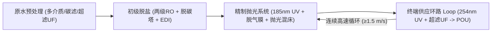
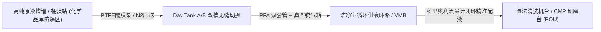

# 超纯水（UPW）、特种气体与中央供液系统（CDS）

- **所属模块**：`02_厂房与厂务系统 / 02_超纯水特气与供液`

---

## 1. 超纯水（UPW, Ultra-Pure Water）

在先进制程晶圆制造中，湿法清洗工序占全流程总步数的 30% 以上，一片 300mm 晶圆从投料到出厂平均消耗 **3~6 吨（3,000~6,000 L）** 超纯水（含机台直接清洗与冷却公用消耗）。在 5nm/3nm 及以下节点，水体中一粒 $15\,\text{nm}$ 的硅胶颗粒或 $10\,\text{ppt}$ 级的微量铁、铜离子，均可能在高温热过程后诱发栅氧化层经时击穿（TDDB）或漏电失效。

### （1）核心水质指标与物理化学意义（参考 SEMI F63 指南）

| 关键控制参数 | SEMI F63 / 先进产线目标限值 | 物理化学原理与对器件良率的致命影响 |
| :--- | :--- | :--- |
| **电阻率 (Resistivity)** | **`18.18~18.24 MΩ·cm` @ 25°C**（POU 实测 $\ge 18.0$） | 源于纯水极微弱自偶电离（$K_w \approx 10^{-14}$）。**热超纯水（Hot DIW, 60~80°C）**因 $K_w$ 指数上升，实测未补偿电阻率会降至 $2\sim 4\,\text{M}\Omega\cdot\text{cm}$，必须开启温度补偿算法切忌误报 |
| **TOC（总有机碳）** | **`< 1 ppb`**（先进前段内控 `< 0.5 ppb`） | 微量有机物在晶圆表面形成疏水碳残斑，后续热氧化/外延中反应生成 $\text{SiC}$ 微缺陷，恶化界面态密度与 TDDB 寿命 |
| **DO（溶解氧）** | 常规 `< 5 ppb`；**先进节点 `< 1 ppb`** | 裸硅疏水表面水滴中的溶解氧会与硅反应生成可溶性硅酸并在干燥瞬间析出，形成无法洗净的 **Watermark（水印）**；在铜互连清洗中诱发 Cu 腐蚀 |
| **二氧化硅与硼 ($\text{SiO}_2 / \text{B}$)** | 溶解硅 `< 1~2 ppb`；硼 `< 50~100 ppt` | **混床树脂穿透的“哨兵指标”**！硅酸和硼酸解离度极弱，在离子交换树脂接近饱和时最先发生泄露（Slippage）；微粒 $\text{SiO}_2$ 直接致短路，硼导致意外掺杂 |
| **痕量金属离子** | 单元素（Na, K, Cu, Fe, Al, Zn 等）**`< 1~10 ppt`** | 碱金属离子造成栅氧阈值电压 $V_{th}$ 漂移；重金属（Fe, Cu）在硅禁带中引入深能级复合中心，大幅拉升暗电流与器件漏电 |
| **颗粒与活菌控制** | 纳米超滤 UF 后目标 **`< 15~20 nm`**；细菌 `< 1 CFU/L` | 细菌代谢分泌的多糖类形成顽固**生物膜（Biofilm）**附着管壁，一旦脱落即造成大面积纳米颗粒（Particle Excursion）灾难 |

### （2）四级典型制备拓扑、水力计算与水回收（Reclaim）

1. **预处理与初级脱盐**
   - 先通过多介质过滤、活性炭吸附余氯及超滤（UF）去除胶体、余氯氧化剂与大分子；
   - 再经过**两级反渗透（2-Pass RO）**脱除 99% 以上溶解盐与有机物；
   - 后经真空脱碳塔（去除溶解 $\text{CO}_2$ 减轻后续阴树脂负荷）与 **EDI（连续电去离子）** 将电阻率初步提升至 $15\sim 17\,\text{M}\Omega\cdot\text{cm}$。
2. **精制抛光链路（Polishing Loop）**
   - **185nm 短波紫外氧化（UV-TOC）**：利用 185nm 高能光子裂解水分子产生强氧化性羟基自由基（$\cdot\text{OH}$），把难去除的小分子有机物彻底氧化分解为 $\text{CO}_2$ 和离子态，再由后级**抛光混床（Polishing Mixed-Bed Resin）**彻底吸附移除；
   - **EDI 电化学持续脱盐 vs. 一次性混床树脂**：EDI 模块利用直流电场驱动阴阳离子穿过选择性渗透膜，同时在浓水室通过水解离生成的 $\text{H}^+/\text{OH}^-$ 原位连续再生树脂，无需酸碱化学再生药剂即可将产水电阻稳定在 $15\sim 17\,\text{M}\Omega\cdot\text{cm}$；而末端抛光混床（Polishing MB）为了绝对防止化学再生引入微粒与杂质溶出，先进 Fab 普遍采用**非再生式核级纯化混床树脂（Non-regenerable Nuclear Grade Resin）**，穿透后直接整罐更换；
   - **膜脱气器（Membrane Contactor）**：在疏水中空纤维膜一侧抽真空配合高纯氮吹扫，高效脱除水中溶解氧（$\text{O}_2$）与游离 $\text{CO}_2$；
   - **254nm UV 杀菌 + 终端超滤（UF）**：灭活微生物并截留树脂碎屑及纳米级颗粒（MWCO 6,000~10,000 Dalton）。
   - **抛光柱失效前兆与哨兵监测**：在实际产线运行中，强碱性阴树脂对弱酸性的硅酸（$\text{H}_2\text{SiO}_3$）与硼酸（$\text{H}_3\text{BO}_3$）亲和力最低。因此当抛光树脂接近饱和时，在线电阻率表往往还稳定在 `18.2 MΩ·cm` 假象中，但**溶解硅与硼浓度已悄悄上升（Silica/Boron Breakthrough）**！因此先进 Fab 抛光柱后必须安装在线微量硅分析仪，以防止硅穿透在热氧化层引发致命颗粒或漏电。
3. **无死角管网准则（Zero Dead-Leg）与雷诺数校验**
   - 必须采用低溶出氟塑料 **PVDF** 或 **PFA**，主管采用**红外线无焊瘤对接焊（IR Beadless Butt Fusion）**确保内壁无缝光滑；
   - 支管长度严守 **$L \le 3D$（3倍管径）** 准则，杜绝一切不流动的盲管（Dead Leg）；
   - 为抑制生物膜附着，全管网内任何时刻水流速度不得低于 **`1.5~2.0 m/s`**。以 DN50（内径约 $0.05\,\text{m}$）PVDF 环路为例，取 $25^\circ\text{C}$ 水运动粘度 $\nu \approx 0.89\times 10^{-6}\,\text{m}^2/\text{s}$，管内雷诺数为：
     $$Re = \frac{v \cdot D}{\nu} = \frac{1.5 \times 0.05}{0.89 \times 10^{-6}} \approx 84,270 \gg 4,000$$
     远超临界值处于强烈湍流冲刷状态，确保管壁滞流边界层极薄、细菌无法挂壁繁衍。
   - **终端高温消毒（Hot Water Sanitization）**：环路设计需预留 $80^\circ\text{C}$ 热纯水消毒能力，无需投加化学杀菌剂即可定期彻底灭活管网内潜伏微生物。
4. **UPW 水回收系统（Reclaim System）**
   - 面对巨额用水成本与环保取水限制，现代 Fab 水回用率普遍达 **65%~75% 以上**；
   - 湿法机台后段较干净的漂洗水（High-Purity Reclaim，电导率 $< 50\,\mu\text{S/cm}$）经专门管路分流回用至 RO 进水箱重新精制为 UPW；
   - 含氟或浓度稍高的废水（Low-Purity Reclaim）经中和混凝后降级补入冷却塔（Cooling Tower）和中央废气洗涤塔（Scrubber）补水。

---

## 2. 大宗气体与特种气体（Bulk & Specialty Gases）

### （1）大宗气体（Bulk Gases）体系与纯度控制
晶圆厂大宗气体通常要求达到 **6N 至 9N（99.9999% ~ 99.9999999%）** 电子级纯度，杂质（$\text{H}_2\text{O}, \text{O}_2, \text{CO}, \text{CO}_2, \text{THC}$）普遍需控制至 `< 1~10 ppb` 级：
- **高纯氮气（$\text{N}_2$）**：全厂用量最大（建有现场深冷空分制氮站 ASU）。用于机台吹扫、气浮减振、特气稀释以及关键的 **FOUP Purge（晶圆盒持续充氮，将盒内湿度压低至 `< 1~5% RH` 与 `< 100 ppm O2`，抑制铜互连氧化、消除残留酸气造成表面晶斑及 AMC 吸附）**；
- **氧化与工艺辅助气体**：$\text{O}_2$（热氧化、去胶灰化）、$\text{Ar}$（PVD 磁控溅射靶材轰击与保护气）、$\text{H}_2$（外延 Epi 还原气及先进退火气，需严密防爆监控）、$\text{He}$（凭借高导热性用于晶圆背面气压传热控温，压力通常 5~30 Torr）；
- **CDA（洁净干燥压缩空气）**：无油螺杆/离心空压机配合吸附式干燥机（露点要求 **$-40^\circ\text{C}\sim -70^\circ\text{C}$**），专供全厂海量气动阀门驱动与气缸吹扫，严禁含油雾和凝结水。

### （2）特种气体（Specialty Gases）危险性分类与工艺化学
特种气体直接参与半导体核心薄膜生长、原子层沉积、离子注入与干法刻蚀，具有极高的热力学反应活性和生理毒性（遵循 **SEMI S2 / NFPA 318** 安全标准）：

| 危险分类 | 代表性气体 | 典型应用工艺 | 核心致命理化危害与防护基准 |
| :--- | :--- | :--- | :--- |
| **自燃性 (Pyrophoric)** | $\text{SiH}_4$（硅烷）、$\text{Si}_2\text{H}_6$、$\text{B}_2\text{H}_6$ | SiN / Poly-Si CVD 薄膜沉积、掺杂 | $\text{SiH}_4$ 浓度在空气中 $> 1.37\%$ 即可遇氧自燃剧烈爆燃，产生大量 $\text{SiO}_2$ 绝缘白烟堵管；换瓶前必须深度置换残气 |
| **剧毒性 (Highly Toxic)** | $\text{AsH}_3$（砷化氢）、$\text{PH}_3$（磷化氢）、$\text{CO}$、$\text{Cl}_2$ | 离子注入 N/P 掺杂源、Al/金属刻蚀 | $\text{AsH}_3$ 容许暴露极限 **TLV-TWA 极低（约 5 ppb）**，极微量吸入即可引发急性溶血和肾衰竭，须在 ppb 级触发声光联锁切断 |
| **强腐蚀/强氧化性** | $\text{WF}_6$、$\text{NF}_3$、$\text{ClF}_3$、$\text{HBr}$、$\text{BCl}_3$、$\text{HF}$ | W 插塞/金属栅沉积、无腔拆洗腔体、Si/SiO2 刻蚀 | $\text{WF}_6$ 极易与微量水分反应生成剧毒 $\text{HF}$ 并析出固态 $\text{WO}_3$ 堵死管路与阀门；$\text{NF}_3$ 和 $\text{ClF}_3$ 为超强氟化氧化剂，严禁接触油脂 |

### （3）特气本安三级输送硬件架构与换瓶吹扫时序
1. **BSGS / Gas Cabinet（特气柜）与 Cross-Purge 置换逻辑**
   - 全封闭负压抽风钢柜（面风速 $\ge 0.5\sim 0.8\,\text{m/s}$），内置 UV/IR 火焰探头及自动水喷淋头；
   - 钢瓶阀口强制加装**限流孔板（RFO, Restricted Flow Orifice）**，从物理横截面死死锁死阀门断裂时的最大泄漏流量；
   - 换瓶作业由 PLC 自动执行 **Cross-Purge（高压脉冲吹扫-抽真空循环置换）**：反复经历“真空泵抽除至 $< 10\,\text{Torr}$ → 充入 5~7 bar 高纯 $\text{N}_2$ 稀释冲刷” 15~30 个循环；
   - 吹扫结束后开展**压升法漏率验证（Rate-of-Rise, ROR）**及氦质谱检漏，确保残余毒气清零且接头 VCR 垫片无微漏渗入水氧。
2. **VIM/VAR 电抛光管路与同轴双套管（Coaxial Tubing）**
   - 采用 316L 双真空熔炼电抛光不锈钢管（内壁粗糙度 $R_a \le 0.13\sim 0.25\,\mu\text{m}$），全自动氩弧轨道焊（Orbital Welding）实现无台阶焊接；
   - 剧毒与自燃特气采用**同轴双套管**（内管走特气，内外管夹层通负压抽风或正压保护 $\text{N}_2$ 监控泄漏）。
3. **VMB（阀门分配箱）与 GMS 三级联锁逻辑**
   - VMB 集中布置紧急切断阀（ESV）；GMS 在柜顶、VMB 与机台排风口高密度部署 **Chemcassette 纸带比色探头**（抗干扰检出 ppb 级 $\text{AsH}_3/\text{PH}_3/\text{HF}$）及电化学探头；
   - **三级应急联锁动作**：**AL1 预警（0.5×TLV，厂务中控预警巡检）→ AL2 切断（1×TLV，毫秒级联动闭锁对应支路气动截止阀）→ AL3 疏散（区域全断气 + 全场声光疏散撤离）**。

---

## 3. 中央供液系统（CDS / SDS）

### （1）CDS（Chemical Delivery System，高纯化学品输送系统）
- **双槽无缝切换与痕量金属控制**：将 $\text{H}_2\text{SO}_4$、$\text{HF}$、$\text{H}_2\text{O}_2$、$\text{NH}_4\text{OH}$、TMAH 显影液及有机溶剂通过 **Day Tank A/B 交替切换** 连续推入机台，管路采用高纯 **PFA 双套管**，将金属离子析出严控至 **SEMI C1 / C30+ 等级（ppt 级）**。
- **双氧水微气泡消除与在线精密配比**：针对极易分解产生 $\text{O}_2$ 微气泡的 **$\text{H}_2\text{O}_2$**（气泡会令质量流量计跳变并在晶圆湿法清洗表面产生“刻蚀盲区缺陷”），管路高位必须设置真空膜脱气器（Degasser）并维持低温避光恒压循环；在机台前段采用**科里奥利质量流量计（Coriolis Flowmeter）**配合电导率/浓度在线传感器实现 $\pm 0.5\%$ 以内的实时配比闭环。

### （2）SDS（Slurry Delivery System，CMP 研磨液输送系统）的独特挑战
CMP 研磨液（Slurry）属于**固-液两相胶体悬浮液**（内部悬浮 $30\sim 150\,\text{nm}$ 的 $\text{SiO}_2$、$\text{CeO}_2$ 或 $\text{Al}_2\text{O}_3$ 磨料颗粒，依赖表面双电层产生较高的 **Zeta 电位** 维持排斥悬浮）。按照 **DLVO 胶体稳定理论**，一旦流速过慢引发沉淀、或泵体机械剪切力过高挤破粒子间排斥势垒，均会导致磨料迅速不可逆聚沉形成大颗粒造成**晶圆致命划伤（Micro-Scratch）**：

| 技术挑战维度 | CDS（纯高纯化学品） | SDS（CMP 含磨料研磨液） | 工程解决架构判断 |
| :--- | :--- | :--- | :--- |
| **流体核心风险** | 微量金属析出、微气泡、局部光解与自聚 | **磨料沉降堵管** 与 **颗粒剪切团聚产生微划伤 (Micro-Scratch)** | SDS 必须保持全管网连续不断流动，**绝对禁止静态憋压死水** |
| **输送泵体选型** | 高纯气动隔膜泵或氮气加压直推 | **低剪切磁悬浮离心泵（如 Levitronix）** 或特殊大阻尼隔膜泵 | 传统高压叶片泵极易产生高机械剪切力，“打碎胶体双电层”使磨料聚集成 $>0.5\,\mu\text{m}$ 硬团聚颗粒直接划伤晶圆 |
| **管路流速窗口** | 按最大需求压降控制，相对宽松 | 维持黄金流速窗口（典型 **`0.8~1.5 m/s`**） | 流速过低磨料迅速沉降结块堵死阀门；流速过高剪应力剧增反而加速颗粒团聚（Agglomeration） |
| **过滤技术路线** | 小孔径绝对截留膜滤芯（如 10~20 nm PTFE） | **深度渐进分级过滤芯（Depth Filter，如 0.3~1.0 $\mu\text{m}$）** | SDS 滤芯必须精准设计：既能拦截大颗粒硬团聚团块，又不能截留正常纳米磨料导致研磨速率（MRR）下降 |

- **POU 过滤压差曲线异常判据（Filter $\Delta P$ Diagnostics）**：
  - **压差缓慢爬升至上限**：属于正常拦截大颗粒团聚物导致的滤孔负荷积累，应按预防性维护（PM）计划切换冗余并联滤筒更换；
  - **压差在平稳期突然断崖下跌**：极端高危信号！意味着滤芯膜层已被压力脉冲或异物**击穿撕裂（Breakthrough）**，未过滤的大颗粒团聚体正直接涌向晶圆表面，必须立刻自动闭锁阀门并停机排查！
- **PFA 管路熔接与防溶出规范**：所有 PFA 高纯化学管材接头必须采用专用**非接触式红外/热风无焊瘤对接（Flare / IR Weld）**，严禁采用含金属垫圈或有微隙的普通卡套接头以防止酸液滞留析出金属杂质。

---

## 4. 管网验收准则与产线异常排查（Commissioning & Troubleshooting）

### （1）特气与高纯水液管路 Hook-up 验收四大铁律（Buy-off Criteria）
- **轨道焊内窥镜检与粗糙度核查**：每条不锈钢特气管焊缝按比例抽检内窥镜照片，严禁焊道氧化变色（泛黄/泛蓝即代表保护气纯度不足，后续运行必定掉渣或腐蚀）；
- **氦质谱负压/正压检漏**：所有特气与前级管路强制要求漏率 **$< 1\times 10^{-9}\,\text{Pa}\cdot\text{m}^3/\text{s}$**，并在保压 24 小时后满足温补压力降合格；
- **水分（露点）与颗粒吹扫达标**：使用高纯氮连续吹扫管路末端，在线分析仪确认出气**水分 $< 10\sim 50\,\text{ppb}$（露点 $<-70^\circ\text{C}$）**、颗粒数 $> 0.1\,\mu\text{m}$ 为零后方可引入工艺特气；
- **UPW 支路菌落与 TOC 静置浸泡测试**：新焊接 PVDF 管路必须经过循环冲洗与取样实验室分析，确认无有机溶剂溶出后方能连接机台清洗槽。

### （2）典型产线供水/特气/供液异常排查（Troubleshooting） & 在线监控仪表选型

#### 常用在线品质监控仪表工程选型对比：
| 监测对象 | 关键指标 | 主流在线仪器技术路线 | 核心运维注意事项 |
| :--- | :--- | :--- | :--- |
| **超纯水 UPW** | TOC / 纳米颗粒 / 痕量离子 | 紫外氧化-电导率差值 TOC 仪；激光液体颗粒计数器（LPC $\ge 20\,\text{nm}$）；在线离子色谱（IC） | 定期校准 LPC 激光光路与防止样水气泡进入产生假颗粒计数峰 |
| **特种气体 GMS** | ppb 级泄漏（$\text{AsH}_3, \text{PH}_3, \text{HF}, \text{SiH}_4$） | **Chemcassette 纸带比色法**；电化学电池传感器；FTIR 傅里叶红外光谱 | 纸带比色抗交叉气体误报率极高，但需定期更换检测纸带耗材；电化学探头须严防高浓度饱和中毒失效 |
| **高纯化学品 CDS / SDS** | 混酸配比、颗粒与流量 | **科里奥利质量流量计**；超声波外夹式流量计（不接触强酸）；在线 NIR 近红外浓度分析仪 | 严防科里奥利测量管在 $\text{H}_2\text{O}_2$ 微气泡冲击下读数剧烈抖动；SDS 仪表死角必须全程可冲洗 |

1. **UPW 末端 TOC 或 20nm 颗粒突发报警（Excursion）**
   - **常见诱因**：185nm UV 灯管老化光强衰减（未按 8,000~10,000 小时寿命定期更换）、抛光混床树脂穿孔漏出或超滤膜丝断裂、支路盲管阀门长周期未启闭滋生生物膜。
   - **处置逻辑**：利用便携式与在线监测点分段排查（RO 产水 → 抛光柱后 → 主环回水 → 机台 POU），定位异常段后立即切换冗余环路，对该段支路进行 80°C 热纯水消毒（Hot Water Sanitization）或更换终端滤芯。
2. **特气换瓶后下游发生流量控制器（MFC）堵塞或芯片金属氧化异常**
   - **常见诱因**：气瓶接头垫片（VCR Gasket）压伤产生微漏，或换瓶时 Cross-Purge 抽真空吹扫次数/时间不足，微量空气和湿气进入管道。在 $\text{WF}_6$ 或 $\text{BCl}_3$ 管路中直接水解生成白色固体粉末堵死 MFC 微通道；在 $\text{N}_2$ 或 $\text{SiH}_4$ 中则导致硅片表面无控长氧化层或粉尘掉落。
   - **处置逻辑**：对相关段管路强制执行氦质谱检漏，测试输出气体露点温度和颗粒测试，必要时拆除更换受污染管段或气阀膜片。
3. **CMP 机台批量爆发晶圆划伤（Micro-Scratch Excursion）**
   - **排查关键**：迅速比对同时期所有共用同一条 SDS 供液环路（Loop）的其他 CMP 机台是否同步爆发——
     - 若**全线同时异常**：大概率为中央 SDS Day Tank 搅拌异常、氧化剂（如 $\text{H}_2\text{O}_2$）加药波动引起 pH 值变化导致 **Zeta 电位失稳凝并**，或主循环 POU 过滤芯压差骤降（滤芯破损穿孔）；
     - 若**仅单台机台异常**：则重点排查机台内部管路干涸结痂、流量计内部结垢或研磨垫（Pad）修整器（Conditioner）掉金刚石颗粒。

---

### （3）工程实践：UPW / 特气 / CDS 日常运行红线备忘
- **绝不带压/带液破拆**：拆换任何 VMB 阀门、特气过滤器或酸碱隔膜泵前，必须由厂务及设备工程师双重核对**已充氮吹扫置换至无毒无压中性**，且现场佩戴对应级别面罩与防化手套；
- **定期盲端排污（Flush Drain）**：对于因产线机台停机改造暂时闲置超过 72 小时的 UPW 或 SDS 支路，必须严格按计划开启末端旁通排泄阀持续冲洗，禁止长期憋死水重新直接注入主芯片槽体。
