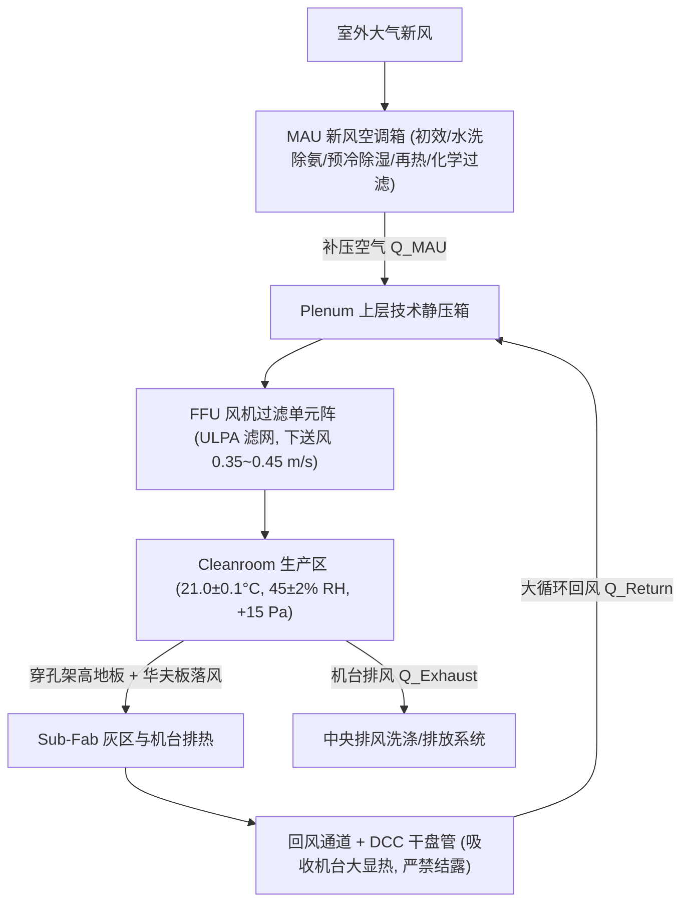
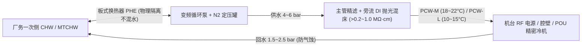

# 洁净空调 HVAC、温湿度精准控制与工艺冷却水（PCW）

- **所属模块**：`02_厂房与厂务系统 / 03_空调真空供电与尾气`

---

## 1. 洁净室 HVAC 系统的“三大梯级循环”

一座 300mm 先进晶圆厂总功耗常高达 50~150 MW，其中 **HVAC 空调系统、冷机站（Chiller Plant）与工艺冷却水（PCW）约占全厂总用电量的 35%~45%**。为了在数万平方米空间内实现超高洁净度、亚度级热力学稳定和严格正压，现代 Fab 采用“新风补压—天花垂直层流—回风干式降温”三大协同梯级架构：

### （1）风量平衡方程与 MAU（Make-up Air Unit，新风空调箱）
洁净室对外正压（+10~+20 Pa）的建立完全依赖严谨的风量平衡物理方程：
$$Q_{\text{MAU}} = \sum Q_{\text{Exhaust}} + Q_{\text{Leakage}} + Q_{\text{Pressurization}}$$
- **负荷构成分析**：由于 Cleanroom 内部拥有数千个湿法排风口、特气柜抽风口与干泵柜排风口，**工艺排风 $\sum Q_{\text{Exhaust}}$ 构成了新风补风量的绝对大头**（总循环风量往往高达数百万 $m^3/h$，而 MAU 补充新风占总循环风量的 5%~15% 左右）。
- **MAU 核心职责**：承担全厂**全部潜热负荷（除湿与加湿）**及正压维持，并将外气过滤除氨（防止外界农田或工业氨气穿透引起光刻畸变）并精密调整含湿量至目标露点。
- **内部多段工艺链路**：
  1. 外气粗效/中效滤网（截留粉尘柳絮）；
  2. **水洗段（Air Washer）**：利用喷淋水溶解去除 $\text{NH}_3$、$\text{SO}_x$ 等水溶性无机分子污染物；
  3. **预冷盘管（Chilled Water 7/12°C）**：强制冷凝深度除湿，锁定空气绝对含湿量即露点温度；
  4. **深度化学过滤段**：改性活性炭/离子交换滤网捕集残余 AMC；
  5. 再热盘管（优先利用冷机热回收热水，避免纯电/蒸汽再热造成“冷热抵消”能效浪费）→ 高效过滤器（HEPA）。

### （2）FFU（风机过滤单元）与低阻无硼 ULPA 选型权衡
- **满布率与换气次数（ACH）**
  - ISO 1~3 区天花板 FFU 满布率达 **80%~100%**，断面风速典型设定在 **$0.35\sim 0.45\,\text{m/s}$**（保证足量垂直推力克服机台热羽流，又不致风速过大浪费电能或吹乱微环境气流）；
  - 以 4.5 m 层高计，对应空间每小时换气次数（ACH）高达 **300~600 次**（远超医院百级手术室标准）。
- **滤材革命（PTFE vs. 玻纤）**
  - 现代先进 Fab 几乎全面放弃传统超细玻璃纤维（Borosilicate Glass Fiber）ULPA，转用**低阻聚四氟乙烯（PTFE）膜 ULPA 滤网**（U15~U17 级，对最易穿透粒径 MPPS $0.12\,\mu\text{m}$ 截留率达 $99.9995\% \sim 99.999995\%$）；
  - **消除硼（Boron）释放**：传统玻纤含硼，释放的微量硼会污染硅片并在热工艺中造成 P 型意外掺杂失效；
  - **极低阻力节能**：相同风速下 PTFE 压降仅为传统玻纤的 50% 左右（约 $60\sim 80\,\text{Pa}$），配合直流无刷电机（EC Fan）群控系统，可令庞大的 FFU 阵群全年能耗降低 **30% 以上**。

### （3）DCC（Dry Cooling Coil，干盘管）的“显热/潜热解耦”与冷机节能架构
DCC 布置在回风竖井或夹层中，专门负责吸收晶圆厂内海量机台散热及照明带来的**巨大显热（Sensible Heat）**。
- **为什么绝对不允许产生凝结水？**
  - 回风风速极快，盘管一旦结露形成水珠，不但会被风机卷吸带入静压箱破坏湿度稳定；
  - 潮湿铝翅片表面更会迅速滋生真菌、细菌与生物异味，引发毁灭性的洁净室生物与颗粒污染。
- **工程边界计算**：
  - 以标准洁净室设定 $T = 21.0^\circ\text{C}$、$\text{RH} = 45\%$ 为例，查湿空气焓湿图得对应空气露点温度为 **$T_d \approx 8.5^\circ\text{C}$**；
  - 考虑到盘管表面与水的传热温差以及传感控制误差，DCC 严禁接入普通 $7^\circ\text{C}$ 冷水，必须独立构建**中温冷冻水系统（MTCHW，典型供水温度 $13^\circ\text{C}\sim 15^\circ\text{C}$ / 回水 $18^\circ\text{C}\sim 20^\circ\text{C}$）**，确保盘管外壁始终高出环境露点 $4\sim 6^\circ\text{C}$ 以上。
- **高低双温冷机站节能架构与算例**：
  - 晶圆厂一年四季 365 天全天候都需要制冷（即使冬季严寒，内部机台散热密度也常达 $1.5\sim 2.5\,\text{kW/m}^2$）；
  - 通过将全厂冷机拆分为 **$7^\circ\text{C}$ 低温冷机（仅负责 MAU 深度除湿）** 和 **$14^\circ\text{C}$ 高温离心冷机（专门服务大流量的 DCC 与 PCW）**，由于蒸发温度显著提高，高温冷机综合性能系数 **COP 可跃升至 7.0~8.5 以上**，较全厂单一供冷模式省电 25%+；并在冬季利用冷却塔开启 **Free Cooling（板换自然冷却）** 进一步节能。

| HVAC 核心子系统 | 承担负荷类型 | 典型工程运行区间 | 全厂空调功耗大致占比 | 核心工程失效风险 |
| :--- | :--- | :--- | :--- | :--- |
| **MAU 新风空调箱** | **全部潜热（除湿/加湿）+ 外气显热** | 占总送风 5%~15%；冷水 $7/12^\circ\text{C}$ | 15%~25% | 外气高湿除湿穿透引起 DCC 结露；化学滤网失效导致 AMC 飙升 |
| **FFU 风机过滤阵** | **提供换气动能与洁净过滤** | 断面风速 $0.35\sim 0.45\,\text{m/s}$；ACH 300~600 | 35%~45% | 滤网压差老化、电机不平衡产生振动或天花龙骨风漏 |
| **DCC 干盘管** | **绝大部分室内机台与人员显热** | 中温冷水 MTCHW $13\sim 15^\circ\text{C}$ | 冷机制冷主力（30%~40%） | 供水过低引发表面凝水生霉，或水流调节阀失灵导致局部室温飘移 |

#### 工程预算算例：一座 $10,000\,\text{m}^2$ 洁净室的冷风负荷拆解
以一座典型 $10,000\,\text{m}^2$（层高 $4.5\,\text{m}$）300mm 生产区为例进行量级估算：
- **循环总风量（FFU 满布率 80%，平均面风速 $0.38\,\text{m/s}$）**：
  $$Q_{\text{Total}} = 10,000 \times 0.8 \times 0.38 \times 3,600 \approx 1.09 \times 10^7\,\text{m}^3/\text{h}$$
  （对应空间换气次数 $\text{ACH} \approx 242\,\text{次/小时}$，高密度核心区可达 400+ 次/小时）；
- **空气侧室内显热负荷（DCC 承担）**：机台散入空气的显热密度约 $1.0\sim 1.5\,\text{kW/m}^2$（另一大部分热负荷直接由 PCW 水冷带走！），叠加人员与照明，DCC 需承担约 **$12\sim 16\,\text{MW}$ 显冷量**；
- **新风除湿潜热负荷（MAU 承担）**：若全区排风及正压新风补风率为 10%（约 $1.1\times 10^6\,\text{m}^3/\text{h}$），在夏季室外湿热工况（焓值约 $85\,\text{kJ/kg}$ 降至目标露点焓值约 $38\,\text{kJ/kg}$）下，MAU 消耗的制冷功率即高达 **$17\,\text{MW}$ 左右**——可见控制机台不必要排风量是降低全厂冷机能耗的核心抓手！

### （4）为什么光刻区对温湿度如此极度苛刻？（物理推演）
光刻区环境通常管控至 **$21.0 \pm 0.05\sim 0.1^\circ\text{C}$**，相对湿度 **$42\% \pm 1\%$**（而机台 Track 内部环保罩控制精度更是达到惊人的 **$\pm 0.01\sim 0.02^\circ\text{C}$**）：

| 物理耦合机制 | 关键量化敏感系数 | $0.1^\circ\text{C}$ / $1\%$ 波动带来的物理恶果 | 先进节点（3nm/5nm）对标约束 |
| :--- | :--- | :--- | :--- |
| **硅晶圆热膨胀** | $\alpha_{\text{Si}} \approx 2.6 \times 10^{-6}\,\text{K}^{-1}$ | 在 300mm 硅片（半径 $r = 0.15\,\text{m}$）上，$\Delta T = 0.1^\circ\text{C}$ 产生边缘膨胀 $\Delta L = r \alpha_{\text{Si}} \Delta T \approx 39\,\text{nm}$；非线性温差畸变无法靠线性算法补偿 | 总套刻误差预算（Overlay Budget）仅 **`1.5~2.5 nm`** |
| **激光干涉仪空气折射率** | $\partial n / \partial T \approx -0.9 \times 10^{-6}\,\text{K}^{-1}$ | 在 $300\,\text{mm}$ 测距行程上，$0.1^\circ\text{C}$ 波动即诱发约 **$27\,\text{nm}$ 虚假定位漂移**（这正是 EUV 光刻机将工件台放进真空腔的核心缘由） | DUV 浸没式工件台独立温控仓控温精度达 **`±0.01°C`** |
| **湿度与光刻胶工艺** | 典型临界窗口 $38\%\sim 48\%$ RH | 湿度 `< 35%` 极易产生静电吸附颗粒与 ESD 击穿；湿度 `> 50%` 破坏 HMDS 粘附致图形剥离（Peeling）并扰动酸扩散速率引起线宽 CDU 波动 | 光刻涂胶显影（Track）单元配置独立高精度加湿/除湿器控制于 **`±0.5~1% RH`** |

---

## 2. 工艺冷却水（PCW, Process Cooling Water）

### （1）PCW 闭式系统架构与普通工业冷冻水的本质差异

工艺冷却水直接进入半导体机台的射频（RF）功率源、腔室水冷夹套、静电吸盘（ESC）热交换器、激光器以及干式真空泵内部，任何漏电、结垢或水温突变都将直接破坏器件良率甚至烧毁硬件。

| 比较维度 | 空调冷冻水 (CHW / MTCHW) | 工艺冷却水 (PCW) | 工程设计关键依据 |
| :--- | :--- | :--- | :--- |
| **水质基础与电导率** | 自来水加缓蚀阻垢剂；电导率高（数百 $\mu\text{S/cm}$） | **去离子超纯水闭环**；要求电阻率 **`> 0.1~1.0 MΩ·cm`**（电导率 `< 1~10 μS/cm`） | PCW 直接流经数千伏高压 RF 电源线圈与电极冷板，水质必须具有高度绝缘性，杜绝水路击穿起弧与杂散电流腐蚀 |
| **管材与防垢要求** | 无缝碳钢管 / 镀锌钢管为主 | **全不锈钢 (316L/304) 或高纯 PVDF/PFA**，严禁碳钢 | 机台冷板多为狭小微通道（宽仅 1~2mm），极微量铁锈或微生物黏泥即可堵死冷板引发腔室过温报警 |
| **温度波动控制** | 供水允许波动 $\pm 0.5\sim 1.0^\circ\text{C}$ | 精密回路供水温度波动控制在 **$\pm 0.1^\circ\text{C}$** 以内 | 直接影响刻蚀腔壁反应粘附系数（Sticking Coefficient）与激光器波长输出功率稳定性 |
| **循环方式与压力控制** | 半开式定压补水箱 | **全封闭板式换热器隔离**；压差 **`2.0~3.5 bar`**，回水背压 $\ge 1.5\,\text{bar}$ | 防止外网污染；维持足够回水背压以杜绝高速通过窄缝时发生**空化气蚀（Cavitation）**击穿铝/铜冷板 |

### （2）热负荷计算、水锤防范与多级双温循环架构
单台设备冷却水流量设计基于基础热平衡方程：
$$\dot{Q} = \dot{m} \cdot c_p \cdot (T_{\text{out}} - T_{\text{in}})$$
- **工程算例**：某高功率 ICP 等离子刻蚀机满载散热量 $\dot{Q} = 45\,\text{kW}$，工程上为防止金属冷板热应力翘曲通常限定温升 $\Delta T = 4^\circ\text{C}$（水比热容 $c_p \approx 4.186\,\text{kJ/(kg}\cdot\text{K)}$），则所需质量流量为：
  $$\dot{m} = \frac{45}{4.186 \times 4} \approx 2.69\,\text{kg/s} \approx 161\,\text{L/min}$$
- **防空蚀、防电偶腐蚀与水锤冲击**：
  - 系统须在主管及分汇管处安装**压差旁通阀（DPV）与氮气膜片式水锤消除器**，消除多台机台气动水阀瞬间快关产生的水锤压力冲击波（Water Hammer）撕裂机台内部硅胶软管或钎焊冷板；
  - 严防不锈钢管道与机台内部铝制冷板在弱纯水中形成**电偶腐蚀**，需严格控制溶解氧、微弱 pH 值及电导率水平，并在特定非高绝缘回路按厂商规范添加专用无硅缓蚀剂；
  - **板式换热器（PHE）结垢诊断**：定期追踪一次侧冷冻水与二次侧 PCW 两侧的**趋近温差（Approach Temperature，设计通常 $1\sim 2^\circ\text{C}$）**及进出压降 $\Delta P$；当压降上升 $> 30\%$ 或趋近温差扩大至 $3\sim 4^\circ\text{C}$ 以上时，说明一次侧冷却板片已发生结垢或生物粘泥堵塞，须在线切出备用板换进行拆洗（CIP）。

现代 Fab 厂务侧普遍分设不同温度等级的 PCW 环路，配合机台级冷机实现梯级控温：
- **中温回路（PCW-M，18~22°C）**：供给 Sub-Fab 干泵（Dry Pump）、真空电源柜和常规电机散热。水温刻意设定得较高（略高于环境露点），是为了避免管道在 Sub-Fab 灰区表面结露滴水造成地面湿滑与设备电气短路。
- **低温回路（PCW-L，10~15°C）**：供给高密度 RF 射频匹配器/电源、PVD 靶材强磁控冷却及光刻机镜头外围恒温控制套；在靠近洁净室冷管段外表面强制包裹封闭式橡塑绝热保温棉（加防潮蒸汽阻隔层）。
- **机台专用精密冷机（POU Precision Chiller，$-20^\circ\text{C}\sim +80^\circ\text{C}$）**：面向先进刻蚀机的静电吸盘（ESC）高低温快切及光刻机超精密光学件（波动要求 $< \pm 0.01\sim 0.05^\circ\text{C}$）。内部使用氟化液（如 Fluorinert / Galden，具有极佳电气绝缘与低温流动性）或乙二醇水溶液作为二次冷媒，由厂务 PCW-L 或 PCW-M 在板换侧为其排热。

---

## 3. 厂务空调与冷冻站全周期节能控制（Energy Optimization）

鉴于 Fab HVAC/Chiller 能耗占比极高，先进晶圆厂在确保环境指标零漂移的基础上普遍实施以下工程节能策略：
- **风机/水泵风压动态重置（Reset Control）**：
  - 由于风机轴功率与风量（转速）呈 **立方关系（$P \propto n^3$）**，即便将非生产维护区或闲置 Bay 的 FFU 转速仅下调 15%，即可削减约 **38% 风机功耗**（仍可充分维持正压）；
  - PCW 与冷冻水系统严防**“大流量小温差综合征”**（低负载时旁通阀大开导致水泵满负荷空转、回水温度过低拉低冷机效率），必须利用压差传感器配合变频泵（VFD）闭环调节维持设计 $\Delta T = 4\sim 5^\circ\text{C}$。
- **MAU 露点追踪与转轮热回收**：结合室外气象湿球温度动态优化预冷盘管设定温度；在 MAU 排风与新风侧耦合热泵热回收系统，把冷却塔端本来要排向大气的 $30\sim 35^\circ\text{C}$ 低品位废热直接提温至 $45\sim 55^\circ\text{C}$，免费供给 MAU 再热盘管与超纯水预热。
- **光刻区高精度温湿度传感器闭环漂移校准**：
  - 由于光刻区对温度（$\pm 0.05\sim 0.1^\circ\text{C}$）与湿度（$\pm 1\%$）要求逼近工业变送器极限，普通电容式湿度探头长期暴露于微酸/碱/有机蒸汽环境会出现缓慢漂移（Sensor Drift）；
  - 工程上必须在 MAU 出风口及关键光刻 Bay 配置**高精度冷镜式露点仪（Chilled Mirror Hygrometer，精度可达 $\pm 0.1\sim 0.2^\circ\text{C}$ 露点）**作为主控标尺，每季度比对校验普通电容传感探头，避免因探头假漂移误导 DCC 结露或光刻胶剥离！

---

## 4. 典型产线故障排查与应急处理（Troubleshooting）

### （1）高湿暴雨季出现 Cleanroom 湿度爬升或 DCC 表面结露滴水
- **故障根因**：外气绝对含湿量突增超出 MAU 预冷盘管设计除湿余量，或 MAU 预冷调节阀机械卡死、CHW 冷水供水温度被意外调高，导致送入室内空气露点突破 $13^\circ\text{C}$ 临界防线而在 DCC 翅片上析水；
- **风险链条**：翅片凝水被吹入风道既破坏光刻 RH 窗口，更会在 48 小时内诱导盘管滋生黑曲霉菌并随循环风散布全厂；
- **应急处理**：立刻将 MAU 冷水旁通/全开并降低 CHW 供水设定值；在安全压差许可范围内略微压低部分非核心区排气与新风比以减轻湿负荷；在 DCC 下方紧急铺设吸水导流盘并重点监控光刻区 Track 湿度曲线，必要时暂停敏感涂胶制程直至露点稳定回落。

### （2）洁净室局部突发正压差跌落报警（Pressure Collapse）
- **故障根因**：某排风系统（如大流量湿法机台酸排总管）变频风机误超频抽吸、MAU 送风机跳闸，或连接洁净室与室外/低洁净区的气闸室防风门长期未闭锁；
- **应急处理**：立即核对风量平衡监控画面，优先拉起备用 MAU 并检查机台排风自动调风阀（VAV Damper）反馈开度；紧急关闭跨区检修门体恢复正压屏障，严禁在负压状态下开启高敏感曝光或开腔维修。

### （3）机台突发 PCW 流量低（Low Flow Interlock）或 RF 电源水路漏电报警
- **故障根因**：
  1. 机台进水侧 Y 型过滤网（典型 25~50 $\mu\text{m}$ 滤网）被冷却水内残留金属腐蚀微粒或微生物菌落堵死；
  2. 不同金属混用（如不锈钢水管接入铝/铜冷板未有效隔离形成电偶腐蚀）；
  3. 旁流抛光混床（Side-stream DI Polisher）树脂失效，引起 PCW 电阻率跌破 $0.1\,\text{M}\Omega\cdot\text{cm}$ 并在高压线圈处漏电触发 GFCI 保护。
- **应急处理**：严禁简单调节旁路阀放大压力（压力过高可能爆破机台内部硅胶水封管！）；首先检测系统主干与支路供回水压差并清洗更换 POU 滤芯；同步化验 PCW 水质金属离子与菌落数，切换备用抛光树脂罐恢复绝缘电阻；针对顽固堵死冷板可启用厂务专用弱酸/专用缓蚀清洗剂配合反向脉冲冲洗抢修。
