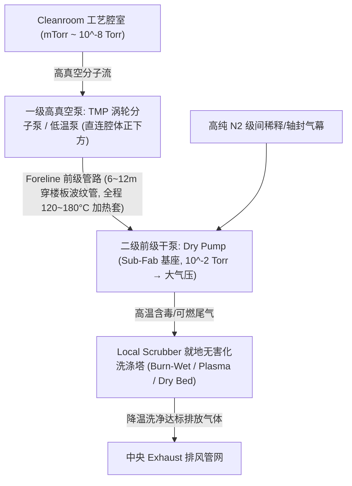
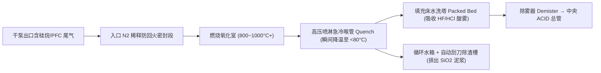

# Sub-Fab 真空泵系统、排气分流与尾气洗涤（Scrubber）

- **所属模块**：`02_厂房与厂务系统 / 03_空调真空供电与尾气`

---

## 1. Sub-Fab 负压真空系统架构与热力学控制

在 300mm 先进晶圆厂的 Sub-Fab 层内，整齐排列着 **1,500~3,000 台以上** 持续满负荷运转的干式真空泵与本地洗涤塔，构成了晶圆加工腔室的“呼吸排泄中枢”。真空压强的稳定性（$\pm 0.5\%$ 以内）直接决定了等离子体的电子密度、自由基驻留时间与膜厚均匀性。

### （1）两级串联架构与流体动力学依据（分子流 vs. 粘滞流）
判断气体处于何种流动形态的核心无量纲数为**克努森数（Knudsen Number, $Kn$）**：
$$Kn = \frac{\lambda}{d}$$
其中 $\lambda$ 为气体分子平均自由程（室温空气近似 $\lambda \approx \frac{6.6\times 10^{-3}}{P(\text{Pa})}\,\text{cm}$），$d$ 为管道或腔室特征尺度。

| 真空工作区段 | 典型绝对气压范围 | 平均自由程 $\lambda$ 估算 | 克努森数 $Kn$ 与流动模态 | 核心工程泵体与管路选型策略 |
| :--- | :--- | :--- | :--- | :--- |
| **高真空 / 超高真空腔室** | $10^{-3}\sim 10^{-8}\,\text{Torr}$ ($0.13\sim 1.3\times 10^{-6}\,\text{Pa}$) | $5\,\text{cm} \sim 500\,\text{m}$ | **$Kn > 0.5$（分子流 Molecular Flow）** | 气体分子彼此不碰撞，压力“吸力”完全失效；必须将 **TMP 涡轮分子泵或低温泵直接贴装于反应腔底阀正下方**，靠高速叶片碰撞传递动量 |
| **前级管道（Foreline）** | $10^{-2}\sim 10\,\text{Torr}$ | $0.5\,\text{mm}\sim 5\,\text{mm}$ | **$0.01 < Kn < 0.5$（过渡流）** | 距离 6~12 米长管线受流阻制约明显，300mm 刻蚀机台前级管径常需采用 **KF40 / ISO63~80 大口径波纹管** 并尽量减少急弯 |
| **干泵压缩排出口** | $10\sim 760\,\text{Torr}$ (常压) | $< 0.05\,\text{mm}$ | **$Kn < 0.01$（粘滞连续流）** | 遵循泊肃叶定律（$C \propto d^4/L$）；通过 **罗茨（Roots）+ 变螺距螺杆（Screw）干泵** 多级机械压缩直排至大气压 |

- **一级高真空泵（TMP 涡轮分子泵 / Cryo 低温泵）脆弱边界**
  - TMP 叶轮转速达 27,000~90,000 RPM（叶尖线速度达 $300\sim 500\,\text{m/s}$）。
  - 一旦前级管压过高超出 TMP 临界背压（典型 $1\sim 5\,\text{Torr}$），分子返流（Backstreaming）和气体摩擦过热将在数秒内击碎叶片；因此后级必须先有干泵建压兜底且串联快速电磁隔离阀。
- **二级前级干泵（Dry Vacuum Pump）无油机制、选型与能效控制**
  - 采用无油干式机械结构（典型抽速 100~1,200+ $m^3/h$），内腔零润滑油直接接触工艺气，彻底根除油气返流污染晶圆；
  - 由于全厂数千台干泵耗电极大，现代智能干泵在机台空闲待料期间支持切换 **Green Mode（变频降速 VFD）** 与动态减小 $\text{N}_2$ 吹扫流量，可在不触发降温结晶的前提下将单泵待机功耗（4~8 kW）压降 40%~60%。

| 真空泵体结构类型 | 典型工作压力区间 | 核心机械特征与抗粉尘/抗腐蚀能力 | 晶圆厂应用场景与替代趋势 |
| :--- | :--- | :--- | :--- |
| **油封旋片泵 (Oil-Sealed)** | $760\sim 10^{-3}\,\text{Torr}$ | 靠机械油密封与润滑，**极易油蒸气返流**且酸雾会乳化废油 | **已被洁净主制程全面淘汰**，仅留用于非核心检测仪表辅助或粗抽实验室 |
| **多级罗茨+螺杆/爪式干泵** | $760\sim 10^{-2}\,\text{Torr}$ | 全干式无油，变螺距螺杆（Screw）排粉尘能力极强，镍合金防腐涂层 | **Sub-Fab 前级主力绝对王者**（广泛配置于刻蚀、CVD、LPCVD 及 Load Lock） |
| **涡轮分子泵 (TMP)** | $10^{-1}\sim 10^{-9}\,\text{Torr}$ | 磁悬浮轴承无油免维护，高转速动量传递，无法承受高压与颗粒 | **Etch / PVD / 离子注入 / EUV 主腔标配高真空泵** |
| **低温冷凝泵 (Cryo Pump)** | $10^{-3}\sim 10^{-10}\,\text{Torr}$ | 靠 $10\sim 20\,\text{K}$ 冷头冻结水汽和气体，**抽水汽速率极快**，无运动部件 | **PVD 金属溅射与高真空离子注入机核心**（须定期升温再生脱附饱和气体） |
- **前级管道（Foreline）流导制约与管径算例**：
  - 在粘滞流状态下，长直圆管（常温空气近似）流导公式符合泊肃叶定律：
    $$C_{\text{viscous}} \approx 135 \cdot \frac{d^4}{L} \cdot \bar{P}\quad (\text{L/s},\ d\text{与}L\text{单位}\text{cm},\ \bar{P}\text{单位}\text{Torr})$$
  - **对比算例**：Cleanroom 腔体到 Sub-Fab 干泵典型长度 $L = 10\,\text{m}\,(1000\,\text{cm})$、平均压力 $\bar{P} = 0.5\,\text{Torr}$。若采用内径 $d = 4\,\text{cm}$ 的 KF40 管，流导仅 $C \approx 135 \times 256 / 1000 \times 0.5 \approx 17.3\,\text{L/s}$；若升级为内径 $d = 6.3\,\text{cm}$ 的 ISO63 管，流导按直径 **4 次方** 暴增至 $C \approx 106\,\text{L/s}$（提升超过 6 倍！），极大降低了 TMP 出口背压过载停机风险。
- **级间氮气吹扫（$\text{N}_2$ Purge）的三大功能**：
  1. 在轴封处形成正压惰性气幕，严防 $\text{Cl}_2$、$\text{HBr}$ 等强酸腐蚀轴承；
  2. 降低泵腔内腐蚀气体和可燃气体（如 $\text{H}_2/\text{SiH}_4$）分压；
  3. 稀释水蒸气或反应物分压以拉低露点，防止气体在压缩升压阶段冷凝为强酸腐蚀转子间隙。

### （2）致命痛点与加热套（Heater Jacket）防凝华策略
- **凝华卡死机理**：半导体蚀刻和薄膜工艺副产物极其复杂，例如铝刻蚀产生 $\text{AlCl}_3$（常压升华点约 $180^\circ\text{C}$）、氮化硅 CVD 副产物 $\text{NH}_4\text{Cl}$、钨 CVD 产物 $\text{WF}_x$ 水解物以及含氟高聚物（$\text{CF}_x$）。这些物质在高温低压腔体内呈气态，一旦离开腔室进入 Foreline 波纹管（压力上升数十倍且管壁向外散热），即迅速越过相变线**凝华为坚硬的固体结晶粉末**。而螺杆干泵转子之间以及转子与泵壳间的机械运转间隙通常仅有 **数十至一百多微米**，结晶碎块落入即可导致转子**瞬间卡死抱轴（Seizure）**，驱动电机过流跳闸甚至拧断主轴！
- **工程对策（消除冷点 Cold Spot）**：
  - 从腔体底阀下缘、穿越华夫板的波纹管直到干泵入口法兰，全程包裹多段精密控温硅胶或玻璃纤维 **加热套（Heater Jacket）**；
  - 常规产线设定保温温度为 **$120^\circ\text{C}\sim 150^\circ\text{C}$**（部分特殊工艺如 W-CVD 或 HKMG 工艺前级需升至 **$180^\circ\text{C}\sim 200^\circ\text{C}$**）；
  - 结合管路定期热氮冲刷与前置旋风粉尘捕集器（Powder Trap），确保副产物以气态顺畅通过泵腔直达洗涤塔。

---

## 2. 晶圆厂排气（Exhaust）的严苛“六分流”体系

半导体废气按化学特性严格隔离，遵循 **NFPA 318** 等洁净室防火安全规范，在中央管网前端绝对**严禁跨线混排**（如强酸与强碱气体在风管相遇会气相生成 $\text{NH}_4\text{Cl}$ 盐晶数周内堵死主风道；可燃/自燃废气与富氧助燃或高温气汇合则会引发管道链式闪爆）：

| 排气管路代号 | 英文全称与类型 | 典型收集工艺与尾气组分 | 管道选材、压力参数与终端处理方案 |
| :--- | :--- | :--- | :--- |
| **ACID / GEX** | General / Acid Exhaust（酸性常规排气） | 湿法刻蚀/清洗机台挥发的 $\text{HCl}, \text{HF}, \text{HNO}_3, \text{H}_2\text{SO}_4$ 酸雾 | **阻燃 FRP 玻璃钢（满足 FM 4922）或 ETFE 内衬镀锌管**；维持负压 $-300\sim -800\,\text{Pa}$；送入**中央湿式碱洗喷淋塔（加 $\text{NaOH}$ 中和至 pH 6~9）** |
| **ALK / AMM** | Alkaline / Ammonia Exhaust（碱性排气） | 湿法清洗 $\text{NH}_4\text{OH}$（SC1）、光刻胶显影区及 CVD 残留 $\text{NH}_3$ | FRP / 不锈钢管材；独立支路接入**中央湿式酸洗中和塔（加稀硫酸 $\text{H}_2\text{SO}_4$ 喷淋捕集氨气）** |
| **VOC / SOL** | Volatile Organic / Solvent（有机溶剂排气） | 涂胶/显影机（Track）、去胶挥发的 PGMEA、NMP、IPA、丙酮 | **全焊接不锈钢管 + 严格防静电跨接接地**；经**沸石浓缩转轮吸附 + RTO（蓄热式热力焚烧炉，> 760°C 彻底氧化为 $\text{CO}_2+\text{H}_2\text{O}$）** |
| **TOX** | Toxic Exhaust（剧毒特种排气） | 离子注入及特种工艺的 $\text{AsH}_3, \text{PH}_3, \text{BF}_3, \text{BCl}_3, \text{CO}$ | 不锈钢管道先经 **Point-of-Use 干式吸附柱** 处理达标并设双监测探头后，才允许汇入后续排放 |
| **PYR** | Pyrophoric / Flammable（自燃/易燃排气） | PECVD / LPCVD 排出的未反应 $\text{SiH}_4$（硅烷）、$\text{H}_2$、$\text{B}_2\text{H}_6$ | 严禁长距离裸管输送！在干泵出口紧邻处直接进入 **Local Burn-Wet 燃烧水洗塔** 焚烧无害化后再排至中央酸排管道 |
| **HEAT** | Heat / Clean Exhaust（热排气） | 高温扩散炉、烘烤箱（Oven）和辅助机柜的干净热风 | 镀锌铁皮/不锈钢管材；风速维持 $8\sim 12\,\text{m/s}$，通过热交换器回收余热预热新风或热水后高空达标排放 |

---

## 3. 本地洗涤塔（Point-of-Use Local Scrubber）技术选型与 ESG 合规

针对自燃气体（$\text{SiH}_4$）、剧毒气体（$\text{AsH}_3$）及全球变暖潜能值极高的**全氟温室气体（PFCs，如 $\text{CF}_4$ 的 GWP 达 6,500+、$\text{SF}_6$ 达 23,500+）**，晶圆厂普遍在紧挨着 Sub-Fab 干泵出口几米内配置 **Point-of-Use 本地洗涤塔**。其中以处理硅烷与氟碳尾气最主流的 **Burn-Wet（燃烧水洗式）** 为例，其内部反应流路如下：

| Scrubber 架构类型 | 核心反应原理与工作温区 | 典型适用工艺与去除效率 (DRE) | 工程局限性与运维 Trade-off 判断 |
| :--- | :--- | :--- | :--- |
| **Burn-Wet（燃烧水洗式）** | 天然气/氢气与助燃氧气形成 **`800~1000°C+`** 富氧火焰，将 $\text{SiH}_4$ 瞬间氧化成 $\text{SiO}_2$，随后急冷水膜洗去粉尘与生成的 $\text{HF}/\text{HCl}$ | 最主流！适合 **$\text{SiH}_4, \text{WF}_6, \text{NF}_3, \text{H}_2$ 及部分 $\text{C}_4\text{F}_8$**；对 $\text{SiH}_4$ 破坏率 **$>99.9\%$**，高温加强型对 $\text{CF}_4$ DRE 可达 **$>90\%\sim 95\%$** | **耗费燃气/水/电且生成大量含 $\text{SiO}_2$ 泥浆**，须配置自动刮刀除渣（Auto-Scraper）定期清理结块，喷嘴极易堵塞；但综合性价比和单台大处理通量最好 |
| **Plasma-Wet（等离子体水洗式）** | 干泵排气通入高频直流电弧或微波等离子体炬（核心区数千度高能态），直接打断极稳固的 **$\text{C-F}$ 共价键**（键能高达 $540\,\text{kJ/mol}$），随即水膜急冷吸收 HF | 专克极难分解的 **$\text{CF}_4, \text{SF}_6, \text{CHF}_3$ 等刻蚀温室气体**；$\text{CF}_4$ DRE 可轻松突破 **$95\%\sim 99\%$**，配合 FTIR 定期抽测满足严苛 ESG 碳排核查 | **无明火且不额外排放燃气 $\text{CO}_2$ 与 $\text{NO}_x$**；但设备采购 CAPEX 昂贵，等离子炬电极与绝缘陶瓷套易受氟等离子侵蚀，需频繁周期性更换 |
| **Dry Bed（常温干式化学吸附柱）** | 废气通过装满改性金属氧化物/活性炭/高锰酸盐颗粒的吸附罐，与毒气发生不可逆化学吸附反应并固定在固相载体中 | 专门针对 **离子注入剧毒源 ($\text{AsH}_3, \text{PH}_3, \text{BF}_3$)** 及小流量腐蚀气体（$\text{Cl}_2, \text{BCl}_3$）；出口可降至 **ppb 级未检出** | **零水耗、零废水、无明火，本安度最高**；**严禁用来处理大流量 $\text{SiH}_4$ 或难裂解 $\text{CF}_4$**（局部反应放热会引发着火且吸附失效），存在吸附饱和寿命限制，需串联双罐监测穿透报警 |
| **Heated Wet / Thermal Wet（无明火电热+水洗）** | 纯电加热丝加热反应腔至 **`650~850°C`** 通水蒸气促进热解和水解氧化，无需外部燃料气体 | 用于 ALD/CVD 某些不耐火源的易水解气体（如 **$\text{TiCl}_4, \text{WF}_6, \text{TEOS}$**）及温和安全规范区域 | 消除了可燃天然气接管进 Sub-Fab 的爆炸安全隐患；但最高温受加热元件材质制约，对极稳定的 $\text{CF}_4$ 几乎无力分解 |

### （2）Local Scrubber 安全旁路（Bypass）与防爆联锁铁律
- **严禁危险气体无条件直排旁路**：针对自燃（PYR）与剧毒（TOX）尾气，若 Local Scrubber 燃烧室熄火或压差超限，控制系统**绝对不允许简单切换旁路阀门把未燃烧的浓 $\text{SiH}_4$ 或 $\text{AsH}_3$ 直接放进中央酸排总管或室外大气**（极易引发总风管爆燃或厂外中毒事故）；
- **标准安全旁路拓扑**：高危工艺腔室必须配置**双向互锁冗余架构**——要么切换至一备一用的热备本地洗涤塔（Dual-chamber Redundancy），要么在单塔故障报警瞬间自动给机台发送 **EMO / Gas Interlock 信号立刻切断工艺特气 MFC 并切入大量高纯 $\text{N}_2$ 稀释吹扫**，直至浓度降至安全下限（$< 25\%\,\text{LEL}$）方准切入备用应急排风通道！

---

## 4. 中央尾气末梢治理（Central Scrubber / RTO）与 Sub-Fab 预测性维护（PdM）

### （1）中央废气总管终端净化架构
经过 Local Scrubber 或直接收集入中央总管的四大类废气，最终必须在楼顶或厂外废气站完成环保超低排放处理：
- **中央湿式洗涤塔（Central Acid / Alkaline Wet Scrubber）**：内部填充大比表面积 PP 拉西环或鲍尔环填料床，逆流喷淋药液；**酸排塔加注 $\text{NaOH}$ 维持循环液 $\text{pH} = 7.5\sim 9.0$**，**碱排塔加注稀 $\text{H}_2\text{SO}_4$ 维持 $\text{pH} = 4.0\sim 6.0$**；若含有氧化性气体（如 $\text{Cl}_2/\text{Br}_2$），需协同 **ORP（氧化还原电位）闭环加注还原剂（如亚硫酸氢钠 $\text{NaHSO}_3$）** 将卤素彻底还原为无毒卤离子排入废水站；塔顶设折流除雾器防止酸碱雾随排风烟囱飘散腐蚀周边厂房。
- **沸石浓缩转轮 + 蓄热式氧化炉（Zeolite Rotor + RTO）**：专治低浓度大风量的光刻有机废气（VOC）。涂胶/显影区排风先经过疏水性分子筛沸石转轮吸附，再用一小股 **$180\sim 220^\circ\text{C}$ 热风** 将转轮高倍浓缩脱附（风量压缩 10~20 倍），送入三床式 **RTO 蓄热焚烧炉（燃烧室温度 $760\sim 850^\circ\text{C}$）** 彻底氧化成 $\text{CO}_2$ 与水蒸气，依靠蜂窝陶瓷蓄热体实现 **$\ge 95\%$ 热能回收率**，大幅降低天然气消耗。

### （2）Sub-Fab 预测性维护（PdM / FDC）与常见宕机排查（Troubleshooting）
现代先进晶圆厂利用 **FDC（故障侦测与分类）** 实时采集 Sub-Fab 干泵的多维指纹曲线，在物理卡死发生前 2~4 周预警更换：
- **电流谐波与功率爬升趋势**：转子间隙开始挂壁积垢时，干泵电机运行电流呈现“锯齿状爬升”与周期性波动；
- **泵体外壳温度与振动加速度**：轴承缺油或轻微擦碰转子会提前数天引起高频振动峰（Acceleration RMS）与尾气轴承端温升异常；
- **$\text{N}_2$ 吹扫背压异常**：轴封堵塞或排气管道开始凝华结盐会造成级间 Purge 压力抬升；
- **Sub-Fab 热排风与机柜微负压协同**：每台干泵与本地洗涤塔在运转中会向 Sub-Fab 散发数千瓦显热及高温潜在微漏风险，因此所有干泵机架和 Local Scrubber 均被封装在接有 **Sub-Fab 机柜散热排风口（Cabinet Exhaust）** 的封闭/半封闭底座中，既带走热量减轻楼层 DCC 负载，又保证万一发生法兰垫片微漏时有害废气被第一时间负压抽走，防止伤及 Sub-Fab 巡检人员。

#### 典型产线急停故障应急排查：
1. **干泵转子瞬间抱死跳闸（Dry Pump Seizure）导致反应腔紧急中止**
   - **现象与诱因**：监控系统显示干泵电流波形陡升（Over-current）并触发热过载保护。极高概率发生于：① Foreline 某处 **Heater Jacket 温控器或热电偶失效形成“冷点”**，积聚的大块结晶在振动下瞬间掉落卡死转子；② 湿法清洗或腔室破真空大修后未充分抽气除水直接切换主干泵；③ 冷却水 PCW 意外停流引起泵壳热变形抱轴。
   - **处置准则**：**严禁现场人员多次强制上电复位重启**（强行合闸极大概率烧毁驱动电机甚至扭断联轴器）；先检查机台隔离阀闭锁正常与吹扫氮气正常，测量加热套表面温度分布定位冷点位置，再执行 LOTO 安全泄压置换后更换备用泵，并拆检清扫受堵 Foreline 波纹管。
2. **Burn-Wet Scrubber 压差飙升报警（High $\Delta P$）或燃烧室熄火**
   - **现象与诱因**：在 $\text{SiH}_4$ 薄膜（PECVD/LPCVD）产区最常见。燃烧生成的高密度纳米 $\text{SiO}_2$ 烟尘若水幕冲洗覆盖不全，会在燃烧室出口喉管处不断堆积生长，形成坚硬的**玻璃态二氧化硅“搭桥（Bridging/Clogging）”**，憋高干泵排气背压甚至触发燃烧回火熄火与机台 Interlock 停机。
   - **应急处理**：立刻锁定工艺腔停止充气（进入惰性氮气保护 Idle 模式）；若配置有双塔冗余则热切换至备用塔；对故障塔进行氮气安全吹扫并确认温度冷却后，佩戴防粉尘防酸面具开启清渣口机械打通结晶块，重点疏通急冷高压喷淋水嘴，核查水封溢流液位正常后方能重新点火上线。
3. **中央排风支管负压失稳或出现晶状积灰堵塞**
   - **现象与诱因**：多源于工艺排气误并网（酸碱废气同流结晶）或局部手动风阀（Damper）震松滑落关闭，导致特定机台排风报警 Interlock 锁机。
   - **应急处理**：采用微压差计沿分支管路从尾端向主干管逐段测量静压分布定位堵塞点；排查湿法台排风中是否异常混入氨气，并对高危酸碱交汇段定期内窥镜巡检清洗，严把新机台 Hook-up 排风管道分类接驳复核关。
4. **低温冷凝泵（Cryo Pump）抽速缓慢与极限真空度变差**
   - **现象与诱因**：Cryo 泵冷头经长时间连续运行后，内部活性炭阵列已吸满氢气/氦气等不凝性气体或积聚大量冰霜，导致热容恶化；
   - **应急处理**：按工艺排期及时执行全自动 **Regeneration（升温脱附再生）流程**（加热并通高纯热氮吹扫排出吸附气体后用干泵粗抽至 $< 50\,\text{mTorr}$，再重新开机降温至 $10\sim 15\,\text{K}$），切忌强行超期服役引起片间真空交叉污染。
