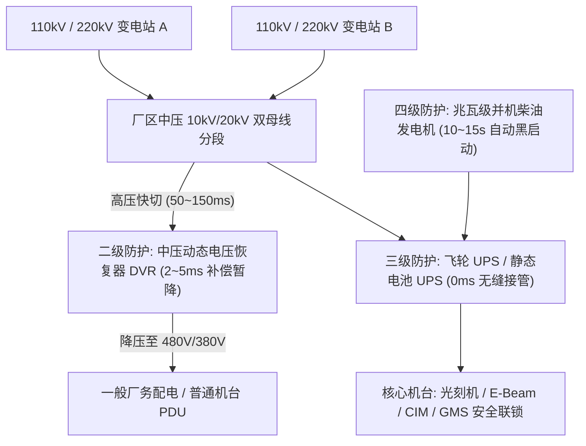

# 晶圆厂供电稳定性、SEMI F47 电压暂降抑制与抗微振基座

- **所属模块**：`02_厂房与厂务系统 / 03_空调真空供电与尾气`

---

## 1. 为什么“闪烁一下”（电压暂降）会让晶圆厂损失数亿元？

在现代 300mm 晶圆厂中，外部公共电网遭受雷击、架空线短路或大型负荷启停时，最常发生的是仅持续 **50~500 毫秒的电压暂降（Voltage Sag / Dip）** 而非彻底停电。普通工厂仅表现为照明闪烁或电机略微减速，但在纳米尺度连续制造的 Fab 中，一次百毫秒级电压暂降即可诱发灾难性的**“异步撕裂”停机**：

1. **涡轮分子泵（TMP）及磁悬浮轴承硬着陆**
   - 高速旋转（数万 RPM）的 TMP 逆变控制器直流母线跌破欠压锁存点，磁悬浮主动定心控制失稳；
   - 转子触发机械应急保护轴承（Touchdown Bearing）产生剧烈干摩擦碰撞，不仅损坏昂贵轴承组件，还会因主轴减速导致前级气路瞬间反冲污染超高真空腔室。
2. **射频（RF）等离子体熄弧与非均匀电损伤**
   - 在先进制程高深宽比刻蚀（HARC）或外延沉积中，RF 电源电压暂降导致腔体内等离子体在毫秒级瞬间熄灭（Plasma Extinguishment）；
   - 带电粒子和自由基在晶圆表面引发剧烈局部电荷积聚击穿（PID）以及腔壁高聚物剥落（Flaking），整炉整批高价值在制品（WIP）当场报废。
3. **光刻机双工件台（Twin-Scan Stage）失锁撞击**
   - 光刻机工件台以 $5\sim 10\,g$ 的超高加速度纳米级步进扫描，完全依靠空气/磁悬浮与高速闭环反馈稳住位置；
   - 控制板低压失稳后工件台触发硬件硬刹车抱死，复机需要进行长达数十小时的激光干涉仪全基线校准与重新曝光验证，直接造成千万美元级别的产能空耗。

---

## 2. SEMI F47 标准深度解析与厂务供电防护矩阵

为了统一晶圆制造设备自身硬件的“抗电网波动底线”，SEMI 组织制定了强制性的 **SEMI F47（Semiconductor Processing Equipment Voltage Sag Immunity）标准**，明确了工艺设备必须具备在额定电压跌落时“挺住不停机”的穿透曲线（Sag Ride-Through）：

| 电压暂降深度（剩余电压百分比） | 50 Hz 电网强制最小耐受周期 | 60 Hz 电网强制最小耐受周期 | 强制持续时间 | 设备端与厂务端工程配合要点 |
| :--- | :--- | :--- | :--- | :--- |
| **50% 剩余电压** | 10 周波 | 12 周波 | **$\ge 200\,\text{ms}$** | 内部控制板电源加装大容量维持电容，**核心交流电磁接触器改用直流吸合或加装防晃电模块**（普通交流接触器跌落至 70% 仅 20ms 即脱扣跳闸！） |
| **70% 剩余电压** | 25 周波 | 30 周波 | **$\ge 500\,\text{ms}$** | 变频器与伺服驱动器调低欠压跳闸阈值或启用直流母线动态动能缓冲 |
| **80% 剩余电压** | 50 周波 | 60 周波 | **$\ge 1000\,\text{ms}$ (1s)** | 严禁在此区间发生温度控制器报错、质量流量计（MFC）清零复位或软件联锁停机 |
| **100% 跌落 (即 0% 短时中断)** | — | — | **由厂务端兜底** | 20ms 以内由机台开关电源储能支撑；**超过 20ms 的彻底断电必须由厂务飞轮 UPS / 静态电池 UPS 接管** |

```text
电网剩余电压百分比
 100% |------------------------------------------------- (正常运行区间)
      |
  80% |                    |============================ (必须持续耐受 ≥ 1,000 ms)
  70% |           |--------+
      |           |
  50% |===========+ (50% 残压下必须耐受 ≥ 200 ms)
      |
   0% +-----------+--------+--------+-------------------> 持续时间 (ms)
      0          200      500     1000
```

- **入厂检验与涌流（Inrush Current）隐患**：新购机台进厂验收时必须经过标准 **电压暂降发生器（Voltage Sag Generator）** 测试，不仅考核单相、两相及三相同时跌落的成败，还必须重点检验电压恢复瞬间设备电源电容和变压器铁芯饱和产生的**瞬间涌流冲击**是否会反向触发上游断路器跳闸。

### 厂务侧四级立体供配电防护工程架构



| 防护层级 | 关键厂务设备方案 | 响应时间与补偿能力 | 工程优缺点与产线配置策略 |
| :--- | :--- | :--- | :--- |
| **一级：多路高压独立电源** | 双回路/三回路 110kV/220kV 不同上级变电站专线进线 | 高压快切装置耗时约 **50~150 ms** | 解决大区域停电，但传统机械断路器切换过程仍会产生短暂电压跌落，不能替代中低压级抗晃电装置 |
| **二级：动态电压恢复器 (DVR)** | 串联在中压配电母线上的大功率 IGBT 逆变变流器 + 储能电容/变压器 | **2~5 ms 极速响应**；可在电网跌落至 50% 时瞬间串联注入 50% 补偿电压拉平波形 | **全厂能效性价比最高**！正常供电时旁路运行损耗 $< 1\%$，能一举保护全厂大宗机台、干泵群与空调风机抵御 **90% 以上的电网瞬时暂降** |
| **三级：动态飞轮储能 UPS vs. 静态电池 UPS** | 飞轮 UPS（靠高速磁悬浮飞轮机械动能发电）或双变换锂电/铅酸电池 UPS | **0 ms 零切换中断时间**；彻底扛住 100% 断电（0% 剩余电压） | **飞轮 UPS**：占地紧凑、无化学热失控爆炸风险、寿命 20 年，可持续输出 **10~30 秒**，精准覆盖柴油发电机启动并网（10~15s）空窗期；**电池 UPS**：可持续供电 15~30 分钟，专供 **EUV/DUV 光刻机、CIM/MES 服务器与 GMS 毒气安全联锁系统** |
| **四级：柴油发电机组 (Diesel Generator)** | 多台 MW 级大功率并机柴油发电机阵列 | 自动黑启动并接管负荷约 **10~15 秒** | 保障一旦外部多回市电全部瘫痪，重要工艺排风 Scrubber、洁净区照明与核心机台保持不间断安全运行数天 |

> **谐波治理与接地抗干扰**：刻蚀与沉积机台海量 RF 电源与变频器会产生严重的 5、7、11 次非线性谐波电流，厂务低压配电柜须并行加装**有源电力滤波器（APF）**，依据 **IEEE 519** 标准将总谐波电流畸变率（THDi）压低至 `< 5%`，避免谐波叠加引发电容器爆裂或敏感量测设备信号漂移。

---

## 3. 抗微振结构设计与 VC 标准曲线深度拆解

先进节点光刻套刻（Overlay）公差已逼近 **$1.5\sim 2.0\,\text{nm}$**，无论是几十米外高速公路重型卡车驶过、数公里外地铁穿梭产生的 **2~15 Hz 地面瑞利面波**，还是厂房内部 MAU 风机转动、水泵流体脉动甚至清洁区顶部 OHT 天车加减速运行，均可通过大地与楼板耦合进机台结构。

### （1）BBN / IEST 振动判据（VC Curves）与声学耦合防护
- 在半导体的主要结构共振敏感频带（$1\sim 80\,\text{Hz}$，采用 1/3 倍频程频谱分析）中，**均方根速度（RMS Velocity，$v = 2\pi f \cdot x$）**与振动能量密度直接挂钩；在同一速度阈值下，频率越高意味着物理振幅位移 $x$ 越呈反比急剧缩小，这种分布刚好贴合光刻机镜筒及电子束柱对不同频段振动的敏感包络规律。
- 此外，对于 EUV 光刻机与精密光学检测仪，还需严控洁净室**空气声学噪声（Acoustic Noise $< 60\sim 65\,\text{dBA}$，NC-55~60）**，防止 50~500 Hz 高能量机械噪音通过空气声波直接激振悬空反射镜支架！

| VC 等级 | 均方根速度阈值 ($\mu\text{m/s}$, $8\sim 80\,\text{Hz}$) | 相对上一级衰减 | 晶圆厂典型适用核心区域与设备 |
| :---: | :--- | :--- | :--- |
| **VC-A** | $50.0\,\mu\text{m/s}$ | 基准 | 普通光学显微镜、通用实验室、研发辅助分析区 |
| **VC-B** | $25.0\,\mu\text{m/s}$ | $-6\,\text{dB}$ | 常规金相检验、一般低倍率缺陷检测台 |
| **VC-C** | $12.5\,\mu\text{m/s}$ | $-6\,\text{dB}$ | 绝大多数干法刻蚀、PVD/CVD 薄膜沉积与离子注入机台 |
| **VC-D** | $6.25\,\mu\text{m/s}$ | $-6\,\text{dB}$ | 高精度套刻测量、薄膜厚度光学量测（OCD）、常规 CD-SEM |
| **VC-E** | **$3.12\,\mu\text{m/s}$** | $-6\,\text{dB}$ | 高分辨电子束检测（E-Beam Inspection）、前代 DUV 光刻机 |
| **VC-F / VC-G** | **$1.56\,\mu\text{m/s} \sim 0.78\,\mu\text{m/s}$** | $-6\,\text{dB}$ | **现代 ArF 浸没式与 EUV 极紫外光刻机台专属严苛标准**（ASML 等厂商在 $1\sim 4\,\text{Hz}$ 极低频另有更严格的独立包络线约束） |

### （2）晶圆厂“四位一体”抗微振工程实现
1. **选址频谱评估与岩层孤岛沉箱桩基（Isolated Foundation）**：建厂前开展长达数周的 24 小时地质微振环评测试，主动避开铁路、地铁线路和高压破碎带；主厂房核心光刻区下方打设**独立超深钻孔灌注桩**直达坚硬地下基岩，并且光刻机支撑混凝土基座（Pedestal）与周围常规地面结构之间**预留 25~50 mm 物理断缝（仅填充极柔软低阻尼密封条，严禁混入混凝土残渣）**，形成完全结构隔离的“振动孤岛”。
2. **高阻尼高刚度华夫板地面（Waffle Slab）**：在非独立基座区普遍浇筑 600~900 mm 厚钢筋混凝土华夫板，通过巨大的质量阻尼和格构刚度将楼板一阶固有频率推高至 **$25\sim 35\,\text{Hz}$ 以上**，避开人类走动（~2 Hz）及常规旋转设备（10~20 Hz）最易发生放大共振的危险低频区。
3. **机台级主动式隔振系统（Active Vibration Isolation, AVC）**：经典被动弹簧-阻尼隔振（固有频率 $f_0 = \frac{1}{2\pi}\sqrt{k/m}$）仅在 $\sqrt{2} f_0$ 以上才有效衰减，在自身 $1.5\sim 3\,\text{Hz}$ 共振峰处反而会把外界振动**放大 2~4 倍**！因此高端光刻机与 E-Beam 均自带高灵敏度速度传感器 + 压电陶瓷/洛伦兹力音圈作动器，引入虚拟“天棚阻尼（Skyhook Damping）”与前馈控制算法，在 $0.5\sim 100\,\text{Hz}$ 全频段发出等幅反向微力，同时抵消地振及双工件台加减速产生的内部反作用力晃动。
4. **防刚性管路搭桥（Avoid Vibration Short-Circuit）**：接入光刻机或孤岛基础上的所有 PCW 水管、排气风管与特种气管必须全部安装**高柔性金属波纹管（Flexible Bellows）或硅胶软连接，并配合弹簧阻尼吊架**；哪怕有一根刚性金属管硬连接在孤岛基座与普通楼板之间，都会形成“振动短路桥梁”，让外部风机泵组的噪音顺着水管直灌光刻镜头！

---

## 4. 供电异常与微振干扰实战排查（Troubleshooting）

1. **电网 300ms 瞬时 70% 电压暂降后，同一区域新机台安然无恙，唯独老旧辅助设备/干泵停机**
   - **排查链路**：比对电能质量录波仪（PQ Analyzer）波形确认残压与时间完全处于 SEMI F47 包络线以内，排除厂务 DVR 彻底失效；检查发现跳机设备内部主电路接触器线圈仍采用**交流电直接吸合**，暂降瞬间磁力不足直接释放断电，且变频器内部未激活低电压穿越（LVRT）或动能缓冲（Kinetic Buffering）功能。
   - **解决手段**：将敏感接触器控制回路改造为由直流 24V 稳压电源（自带缓冲电容或小型 DC-UPS）驱动，或加装抗晃电延时保持继电器，并对老旧关键辅机逐台进行模拟暂降验证。
2. **雷雨季短暂晃电后，某炉管/薄膜机台并未报警停机，但次日出片出现膜厚或温度漂移异常**
   - **隐蔽机理**：部分晶闸管（SCR）加热温控板或辅机水泵变频器在电网闪断恢复过零点瞬间进入假死锁态或降频保护，而机台主机通讯轮询存在延迟或未将该子模块联锁至主报警树。
   - **解决手段**：建立厂务 **PMS（电力监控系统）毫秒级事件时间戳** 与机台历史传感器曲线（FDC, Fault Detection and Classification）自动交叉比对规则，一经发生厂外电压事件立即自动扫描全厂高敏感晶圆批的加热电流、真空度与水流量曲线。
3. **光刻机突发周期性图像模糊或 E-Beam 扫描照片出现规则“波浪纹重影”**
   - **排查链路**：利用高分辨率三维加速度计在机台基座附近进行 **FFT（快速傅里叶变换）频谱采集**。假设在频谱图上捕捉到一个突出的单频尖峰位于 **`24.7 Hz`**，立刻反推旋转机械频率 $f \times 60 = 24.7 \times 60 = 1,482\,\text{RPM}$——高度指向附近运转的四极交流异步电机（额定约 1480 RPM 的水泵或 MAU 风机）！
   - **物理定位**：顺着对应频率检查附近水泵减振弹簧是否老化压死，或者巡检光刻机周围抗震断缝内部：实操产线最常见元凶往往是**装修或机台安装期间，工人不慎将水泥块、螺栓或支撑角钢掉入并卡死在光刻孤岛基础与常规华夫板的 30mm 伸缩隔振缝中**，或者新拉的一条不锈钢 PCW 支管未装软节形成“硬搭桥”，清理异物与补加波纹管后频谱峰值即可瞬间回落至 VC-F/G 安全包络内。
