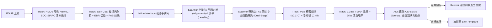

# 光刻基础原理：瑞利公式、DUV/ArFi/EUV 与 Track 联机流程

- **所属模块**：`03_七大核心工艺 / 01_光刻工艺`

---

## 1. 核心定位与光学物理本质

> 光刻（Photolithography）是半导体制造中**电路图形定义的唯一源头**，占先进晶圆厂总制造成本的 $30\%\sim 35\%$ 与生产周期（Cycle Time）的 $40\%$ 以上。其物理本质是一套**高数值孔径部分相干投影成像系统**：光源透过掩模版（Reticle），经庞大物镜组缩小投影（常规 $4:1$ 等比，High-NA EUV 为 $4\times/8\times$ 变形缩小）至晶圆表面的光刻胶层，显影形成三维抗蚀剂图形，再由刻蚀或离子注入接力刻入硅片。

从傅里叶光学与线性空间滤波视角看，投影物镜本质上是一个**空间低通滤波器**：
- **掩模衍射频谱展开**：掩模上的周期性图形（节距 Pitch 为 $P$）将入射平面波衍射为 $0$ 级直流光（携带平均背景能量）与 $\pm 1, \pm 2, \dots$ 级高阶衍射光（携带边缘高频细节，衍射角满足 $\sin\theta_m = m\lambda / P$）。
- **物镜孔径截断（Pupil Filtering）**：投影物镜最大可接收半角受限于数值孔径 $NA = n\sin\theta_{\max}$，系统截止空间频率为：
  $$f_c = \frac{NA(1+\sigma)}{\lambda}$$
  其中 $\sigma$ 为部分相干因子（照明张角与物镜孔径之比）。
- **成像物理底线**：只有当 $\pm 1$ 级衍射光至少有一侧落入物镜瞳面内并与 $0$ 级光发生相干干涉时，晶圆平面才能重建出明暗条纹；若全部高阶衍射光均飞出孔径之外，晶圆上仅存均匀直流光强，图形彻底丢失。

```text
[傅里叶光学投影成像与孔径截断物理示意]
  准分子/EUV光源 ---> [掩模版 Reticle (节距 P)] ---> 衍射分裂为 0级 与 ±1级 (sinθ = λ/P)
                                                          |
                          +-------------------------------+-------------------------------+
                          | (物镜有限孔径 NA = n·sinθ_max)                                |
                   若 sinθ_1 ≤ NA(1+σ)                                             若 sinθ_1 > NA(1+σ)
                   ±1级光进入物镜瞳面并干涉                                        ±1级光飞出物镜之外
                          v                                                               v
                晶圆上形成高对比度明暗条纹                                        晶圆上仅剩均匀白光，图形消失！
```

---

## 2. 两条决定一切的瑞利公式（Rayleigh Criteria）

Ernst Abbe 与 Lord Rayleigh 奠定了衍射受限光刻的两大基本控制方程：

1. **最小可分辨特征尺寸 / 半节距（CD / Half-Pitch）**：
   $$CD = k_1 \cdot \frac{\lambda}{NA}$$
2. **焦深（DOF, Depth of Focus）**：
   $$DOF = k_2 \cdot \frac{\lambda}{NA^2}$$

### 2.1 浸没式光刻（Immersion Lithography）对折射与焦深的物理重构
2003–2004 年，林本坚（Burn J. Lin）主导推动了 $193\,\text{nm}$ 水浸没式光刻（ArFi）的产业化突破，在末片投影透镜与晶圆间填充折射率 $n_{\text{H}_2\text{O}} \approx 1.44$（@ $193\,\text{nm}$）的超纯水：
- **突破空气折射率上限**：依据斯涅尔折射定律（$n_1\sin\theta_1 = n_2\sin\theta_2$），跨过水-胶界面后横向波矢连续，有效数值孔径突破空气折射率极限（$NA_{\text{dry}} < 1$）跃升至 **$NA = 1.35$**。
- **大角度浸没焦深增益**：按瑞利 $\lambda/4$ 波前光程差判据，高折射率液体传播下的精确焦深修正为：
  $$DOF_{\text{imm}} \approx k_2 \cdot \frac{\lambda_0}{n_{\text{water}}\!\left(1 - \sqrt{1 - (NA/n_{\text{water}})^2}\right)} \approx k_2 \cdot \frac{n_{\text{water}} \cdot \lambda_0}{NA^2}\ (\text{小角度近似})$$
  在**相同目标特征尺寸下，ArFi 不仅提供了更高分辨率，实际焦深反而比干法 ArF 扩大了近 $n_{\text{water}}$ 倍**，成为 28nm~7nm 时代的核心柱石。

### 2.2 三大分辨率武器与工程代价（Trade-off）

| 变量 | 技术演进路径与量级 | 工程师的核心约束与物理代价 |
| :--- | :--- | :--- |
| **$\lambda$**<br>（曝光波长） | g-line ($436\,\text{nm}$) $\to$ i-line ($365\,\text{nm}$) $\to$ KrF ($248\,\text{nm}$) $\to$ ArF ($193\,\text{nm}$) $\to$ **EUV ($13.5\,\text{nm}$)** | 缩短波长是兼顾高分辨率与较大相对 DOF 的最佳路径；但石英与 $\text{CaF}_2$ 在 $157\,\text{nm}$ 以下强吸收，$13.5\,\text{nm}$ 必须转向全真空多层布拉格反射镜，造价与能耗指数攀升。 |
| **$NA$**<br>（数值孔径） | 干法 ArF（$\le 0.93$）$\to$ **ArFi（$1.35$）** $\to$ EUV（$0.33$） $\to$ **High-NA EUV（$0.55$）** | **致命瓶颈**：$DOF \propto \lambda/NA^2$。在 ArFi（$1.35\,\text{NA}$）及 High-NA EUV（$0.55\,\text{NA}$）下，量产可用 DOF 被压缩至 **$50\sim 120\,\text{nm}$**，倒逼全片 CMP 平坦度与吸盘平整度进入纳米级管控。 |
| **$k_1$**<br>（工艺因子） | 单次曝光物理衍射极限 **$0.25$**（双光束极限）；量产单次稳定窗口 $0.28\sim 0.32$ | 靠 OAI、PSM、OPC/SMO 压近 $0.25$。**副作用**：$k_1 \to 0.25$ 时，掩模误差增强因子（MEEF）飙升至 $3\sim 6$，放大掩模版偏差；突破 $0.25$ 必须依赖 SADP/SAQP 多重曝光。 |

### 2.3 世代光刻核心指标演进量级（工程参考）

| 光刻世代 | 波长 $\lambda$ | 典型 $NA$ | 单次极限半节距 ($\text{HP}$) | 典型量产 DOF 窗口 | 主流光源与光学介质 |
| :--- | :---: | :---: | :---: | :---: | :--- |
| **KrF 干法** | $248\,\text{nm}$ | $0.60\sim 0.85$ | $\sim 80\sim 110\,\text{nm}$ | $300\sim 500\,\text{nm}$ | KrF 准分子激光 / 熔融石英 |
| **ArF 干法** | $193\,\text{nm}$ | $0.75\sim 0.93$ | $\sim 55\sim 65\,\text{nm}$ | $180\sim 250\,\text{nm}$ | ArF 准分子激光 / 石英+$\text{CaF}_2$ |
| **ArFi 浸没式** | $193\,\text{nm}$ | **$1.35$** | $\sim 36\sim 40\,\text{nm}$ | **$80\sim 120\,\text{nm}$** | ArF + 脱气超纯水 ($n=1.44$) |
| **Low-NA EUV** | $13.5\,\text{nm}$ | **$0.33$** | $\sim 13\sim 16\,\text{nm}$ | **$80\sim 110\,\text{nm}$** | LPP 锡等离子体 / 6 镜 Mo/Si 真空反射 |
| **High-NA EUV** | $13.5\,\text{nm}$ | **$0.55$** | $\sim 8\sim 10\,\text{nm}$ | **$40\sim 60\,\text{nm}$** | 高功率 LPP / 8 镜 $4\times/8\times$ 变形反射 |

---

## 3. 光刻区（Litho Bay）标准作业全流程（Track + Scanner 联机）

在 300mm 晶圆厂中，涂胶显影机（**Track**，如 TEL LITHIUS Pro Z / SCREEN RF3）与步进扫描光刻机（**Scanner**，如 ASML TWINSCAN）通过符合 SEMI 标准的接口机械手无缝联机，实现高节拍（ArFi **$250\sim 300+\,\text{WPH}$**，EUV **$160\sim 200\,\text{WPH}$**）与严格温湿度/时序闭环：



### 3.1 HMDS 气相增粘与抗反射层（BARC / Tri-layer）
- **HMDS 气相处理**：在 $90\sim 150^\circ\text{C}$ 密闭烘烤腔通入六甲基二硅氮烷蒸气，将亲水硅烷醇基（$\text{Si}-\text{OH}$）转化为疏水三甲基硅氧基（$\text{Si}-\text{O}-\text{Si(CH}_3)_3$）。
  - *工程作用*：提升界面粘附功，防止显影液渗入胶-硅界面引发线条漂浮脱落（Resist Lifting）。
- **BARC / 三层掩模（SOC + SiARC）**：精确匹配底层光学常数 $(n,k)$ 与四分之一波长厚度（工程典型 $20\sim 80\,\text{nm}$）。
  - *工程作用*：借助界面反射相消干涉将基底反射率压制至 **$< 1\%$**，消除垂直驻波效应（Standing Wave）与反射凹口（Notching）。

### 3.2 Spin Coat 旋涂、EBR 切边与背面清洗
- **成膜流体动力学**：遵循 Emslie-Bonner-Peck 方程，胶厚满足 $h \propto \omega^{-1/2}\eta^{1/3}$（典型转速 $1000\sim 3000\,\text{rpm}$）。
  - *工艺指标*：全片厚度均匀性 $3\sigma$ 必须控制在 $< 0.5\sim 1.0\,\text{nm}$。
- **EBR（边缘去胶）与 Backside Rinse**：喷射溶剂精准切掉晶圆外缘 $1\sim 2\,\text{mm}$ 凸起胶边，同步高压冲洗背面。
  - *失效防御*：若背面粘附 $> 0.5\sim 1\,\mu\text{m}$ 颗粒，在光刻机真空吸盘上会局部顶起硅片突破景深边界，制造灾难性 **Focus Hot Spot（局部圆斑失焦）**。

### 3.3 PAB（前烘 / Soft Bake）与曝光后烘烤（PEB）
- **PAB（$90\sim 130^\circ\text{C}, \sim 60\,\text{s}$）**：挥发铸膜溶剂（如 PGMEA）至残余 $< 2\%\sim 5\%$，锁定胶膜密度及游离体积。
- **PEB（$90\sim 130^\circ\text{C}$）热板精密控制**：化学放大胶（CAR）热催化脱保护的决定性步骤，直接锁死最终线宽。
  - *温控指标*：多区独立 PID 热板均匀性达 **$\pm 0.05\sim 0.1^\circ\text{C}$**（因 CAR 温敏系数典型达 $1\sim 5\,\text{nm}/^\circ\text{C}$）。
  - *传片同步*：机械手从热板抓取转入冷却板（Chill Plate）的时间偏差须锁定至 $\pm 0.1\,\text{s}$。

### 3.4 Exposure（TWINSCAN 双工件台并发架构与浸没头控制）
- **双工件台并发机理**：1 号台位于**测量侧**执行多色光学对准（Alignment）与气动/光学多点调平调焦（Leveling），生成全片纳米高度地图；与此同时 2 号台在**曝光侧**扫描曝光上一片晶圆，两台互换彻底隐蔽了测量时间损耗。
- **同步扫描精度**：掩模台与晶圆台以严格 **$4:1$ 逆向高速同步扫描**（晶圆台速度 $600\sim 900\,\text{mm/s}$），激光干涉仪将同步移动标准差（MSD）锁死在亚纳米级。
- **ArFi 浸没头（Immersion Hood）**：末片透镜下方由高速超纯水供排系统（流量约 $1.5\sim 3\,\text{L/min}$，脱气至溶解气 $< 1\,\text{ppb}$）与外围高速气体密封帘（Air Curtain）共同约束液态弯月面，保证高速往复扫掠时不漏液、不产生微气泡。

### 3.5 Develop 显影与 ADI 低成本 Rework 安全阀
- **显影过程**：使用 $2.38\,\text{wt}\%$（$0.26\,\text{N}$）TMAH 水溶液形成水坑（Puddle）或动态流洗，配合超纯水漂洗甩干。
- **ADI 低成本返工（Rework）**：送检 CD-SEM、Overlay 与宏观缺陷后若超标，可在进刻蚀前直接用湿法洗胶重涂——这是七大核心工艺中**唯一几乎零硅片损耗的低成本容错安全阀**。

---

## 4. DUV（ArFi）vs Low-NA EUV vs High-NA EUV 架构演进与物理极限

| 工程维度 | ArFi（$193\,\text{nm}$ 浸没式） | Low-NA EUV（$13.5\,\text{nm}, 0.33\,\text{NA}$） | High-NA EUV（$13.5\,\text{nm}, 0.55\,\text{NA}$） |
| :--- | :--- | :--- | :--- |
| **典型量产机型** | ASML NXT:2050i / 2100i | ASML NXE:3600D / 3800E | ASML EXE:5000 / 5200 |
| **光源产生** | ArF 准分子激光器（$4\sim 6\,\text{kHz}$ 脉冲，$\text{F}_2/\text{Ar}/\text{Ne}$ 混合气） | **Cymer LPP 双脉冲锡等离子体**：$\text{CO}_2$ 激光轰击每秒 ~5 万滴液态锡（Sn）滴发射 $13.5\,\text{nm}$ 光 | 升级高功率 LPP 光源（总电-光转换效率通常仅 $4\%\sim 6\%$，整机功耗 $> 1\,\text{MW}$） |
| **投影光学** | 折射+折反式熔融石英 / $\text{CaF}_2$ 透镜，水浸没；能量透过率高 | **全反射式 Mo/Si 布拉格多层镜**（6 镜投影，单镜反射率 $\sim 70\%$），全腔高真空 | **8 镜 $4\times/8\times$ 变形光学（Anamorphic）**，视场减半为 **$26\times 16.5\,\text{mm}$** |
| **掩模与保护** | 透射式 $6\%$ MoSi 相移掩模 + 成熟有机 Pellicle | 反射式多层膜掩模（TaBN/低 $n$ 吸收体）+ $\text{pSi/CNT}$ Pellicle | 沿用反射式掩模；超大芯片必须跨半场执行 **Field Stitching 拼接** |

### 4.1 LPP 锡滴双脉冲光源与碎屑抑制物理
- **双脉冲打靶机理**：锡滴直径仅数十微米且以近百米/秒下落。首先发射低能量预脉冲（Pre-pulse）将球形锡滴压扁为圆盘薄饼以最大化吸收截面；间隔数十纳秒后发射高功率主脉冲 $\text{CO}_2$ 激光（$10.6\,\mu\text{m}$）将其电离至 $\text{Sn}^{8+}\sim \text{Sn}^{14+}$ 高价等离子体，辐射出中心波长 $13.5\,\text{nm}$（$2\%$ 带宽）的 EUV 光子。
- **收集镜寿命防护**：腔室通入低压高纯 $\text{H}_2$ 缓冲气与锡捕集器，减缓高速锡离子撞击并把沉积在多层反射镜表面的锡膜氢化为挥发性 $\text{SnH}_4$ 抽走。

### 4.2 Mo/Si 布拉格反射镜与极端能量损耗
- **为什么必须高真空与全反射？** $13.5\,\text{nm}$ 光子能量高于绝大多数材料电离能，空气及一切玻璃透镜均剧烈吸收。反射镜依赖 **40+ 对 $\text{Mo/Si}$ 交替纳米薄膜**（周期约 $6.9\,\text{nm}$）实现布拉格干涉反射。
- **极低光子传输效率**：即便每面镜子达到理论极限反射率 $\sim 70\%$，全光路经 10~11 面反射（含收集镜、照明镜、反射掩模与投影镜组）后，$0.7^{11} \approx 1.98\%$——**到达晶圆表面光强不足光源发射总量的 $2\%$**！这直接倒逼光刻胶敏度提升并诱发严重的散粒噪声。

### 4.3 High-NA EUV（$0.55\,\text{NA}$）变形光学根因与半场拼接
- **为何必须改为 $4\times/8\times$ 变形缩小？** 若在 $0.55\,\text{NA}$ 下维持传统 $4\times$ 等比，掩模面反射光锥角会过陡导致主光线斜角碰撞多层布拉格反射带宽崩溃并引发剧烈的 3D 掩模阴影效应（Mask Shadowing）。因此 ZEISS 设计了 **Y 扫描向 $4\times$、X 狭缝向 $8\times$ 的变形物镜**。
- **工程代价（Field Stitching）**：保留现有 6 英寸标准掩模尺寸导致晶圆单次曝光场面积减半（$26\times 16.5\,\text{mm}$）。对于大面积 AI/GPU 算力芯片，必须在芯片中间执行**半场拼接曝光**，引入额外的拼接套刻误差与产能损失。

---

## 5. 光刻产线典型缺陷与 Troubleshooting 速查

| 异常指纹（ADI / 量测） | 物理/化学根因定位 | 产线排查与工程解决对策 |
| :--- | :--- | :--- |
| **Focus Hot Spot（局部圆斑失焦）** | 晶圆背面或光刻机 Chuck 凸点粘附 $> 0.5\sim 1\,\mu\text{m}$ 微粒，局部顶起硅片超景深 | 调取 Scanner 调平高度残差图定位坐标；执行 Chuck Clean 并核查 Track 背面洗嘴压力与抓片机械手 |
| **Immersion Watermark（圆环水斑）** | ArFi 扫描换向时浸没头气帘外缘漏出微水滴，溶出光刻胶 PAG 或改变表面溶解度 | 提高胶面含氟助剂/Topcoat 后退接触角（$> 75^\circ$）；降低边界扫描加速度，校验供排水真空度及脱气器（$< 1\,\text{ppb}$） |
| **驻波波纹 / 薄膜厚度 CD 漂移** | BARC 膜厚偏离 $1/4\lambda$ 干涉极小点，衬底反射光在胶膜内形成垂直驻波或 Swing Curve 漂移 | 用椭偏仪重新标定底层 $(n, k)$ 与涂胶转速曲线，精准调整 BARC 厚度回落至反射率波谷 |
| **T-top（蘑菇顶）或 Footing（底脚）** | 洁净室 AMC 氨气/胺类中和表层光生酸（T-top）；底层 $\text{SiN/TiN}$ 碱性界面中毒消耗底部酸（Footing） | 核查化学过滤网维持 **AMC $< 1\,\text{ppb}$**，严格锁死曝光到 PEB 排队时间（PED $< 15\,\text{min}$）；底层改用酸性屏障 BARC |
