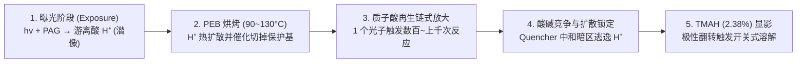

# 光刻胶化学机理：CAR 化学放大胶与 EUV 金属氧化物胶（MOR）

- **所属模块**：`03_七大核心工艺 / 01_光刻工艺`

---

## 1. 为什么传统 DNQ-Novolac 光刻胶满足不了深紫外（248nm/193nm）？

早期 g-line（$436\,\text{nm}$）/ i-line（$365\,\text{nm}$）制程的主力正胶是 **DNQ-Novolac（重氮萘醌-酚醛树脂）** 体系。曝光时，DNQ 感光分子吸收光子发生 **Wolff 重排反应**，经微水合转为可溶于碱液的茚羧酸：
$$\text{DNQ（疏水阻溶）} \xrightarrow{h\nu} \text{Ketene 中间体} \xrightarrow{+\text{H}_2\text{O}} \text{Indene Carboxylic Acid（亲水易溶）}$$
该机理属于典型的 **1:1 非放大光化学反应**，量子效率 $\Phi \le 1$（工程实际仅 $0.2\sim 0.3$），因此需要高达 $100\sim 300\,\text{mJ/cm}^2$ 的曝光剂量。

步入深紫外 KrF（$248\,\text{nm}$）与 ArF（$193\,\text{nm}$）时代后，DNQ-Novolac 撞上两大无法绕过的物理壁垒：
1. **光学完全不透明（强紫外吸收）**：
   - 酚醛树脂骨架富含芳香族苯环，其在 $248\,\text{nm}$ 与 $193\,\text{nm}$ 存在极强的 $\pi \to \pi^*$ 共轭吸收（线性吸收系数 $> 20\,\mu\text{m}^{-1}$）。
   - 曝光光束在胶膜表层数十纳米内便被吸光耗尽，底层光刻胶几乎未曝光，显影后形成严重倒梯形斜坡甚至底膜残留。
2. **光子通量受限引发产能崩盘**：
   - 深紫外准分子激光器单光子能量高但平均输出功率与光子通量有限。
   - 若继续依赖量子效率 $< 1$ 的非放大体系，单片晶圆曝光耗时将长达数分钟，机台吞吐量（WPH）彻底失去商业价值。

1982 年，IBM 科学家 **Hiroshi Ito 与 C. Grant Willson** 发明了革命性的 **CAR（Chemically Amplified Resist，化学放大光刻胶）**，将光生酸催化与热驱动链式脱保护分离，把光刻胶曝光剂量骤降至 **$10\sim 40\,\text{mJ/cm}^2$**，等效量子增益提高 **$10^2\sim 10^3$ 倍**！

### 1.1 树脂分子骨架演进与 Ohnishi 耐刻蚀判据
- **KrF（$248\,\text{nm}$）**：以透光窗改善的聚对羟基苯乙烯（**PHS**）替代酚醛树脂，引入酸敏感叔丁氧羰基（t-BOC）或缩醛保护基团。
- **ArF（$193\,\text{nm}$）**：芳香苯环在 $193\,\text{nm}$ 彻底不透明，必须完全清除苯环，转向**丙烯酸酯/甲基丙烯酸酯共聚主链**，并大量引入**刚性脂环族基团（Alicyclic，如金刚烷基 Adamantyl、降冰片烯与内酯 Lactone）**。
- **Ohnishi 经验参数（抗刻蚀量化指标）**：工程师常用 Ohnishi 参数权衡“透光率”与“抗等离子体干法刻蚀轰击能力”：
  $$P_O = \frac{N_{\text{total}}}{N_C - N_O}$$
  其中 $N_{\text{total}}$ 为单体总原子数，$N_C$ 与 $N_O$ 分别为碳、氧原子数。脂环族高碳低氧骨架可有效压低 $P_O$ 值（典型降至 $2.5\sim 3.5$），维持足够的抗干法刻蚀选择比。

---

## 2. CAR（化学放大正胶）的多元组成与催化放大闭环

### 2.1 核心配方体系与各组分角色

| 核心组分 | 典型质量占比 | 分子设计与产线工程作用 |
| :--- | :---: | :--- |
| **基体树脂（Resin）** | $70\%\sim 85\%$（固含） | 集成三类单体：酸敏保护基（封锁溶解）、极性内酯基（增强硅片/BARC 附着）、含羟基单体（维持 $T_g \approx 130\sim 170^\circ\text{C}$） |
| **光产酸剂（PAG）** | $1\%\sim 5\%$（固含） | 锍盐/碘鎓盐（如 TPS-Nonaflate），吸光产超强质子酸 $\text{H}^+$；先进胶采用**聚合物键合 PAG** 或大体积阴离子抑制扩散 |
| **淬灭剂（Quencher）** | $0.1\%\sim 1\%$（固含） | 微量有机胺或**光解碱（PDQ，曝光区失活、暗区保碱性）**，中和暗区逃逸游离酸，充当“阈值刹车片”陡峭化轮廓 |
| **疏水剂 / Topcoat** | 微量（ArFi 专用） | 旋涂时上浮形成疏水膜：阻断 PAG 渗漏污染镜头（Leaching），并将**后退接触角拉高至 $> 75^\circ\sim 80^\circ$** 防甩水水印 |
| **铸膜溶剂（Solvent）** | 涂布液余量 | PGMEA、PGME 或乳酸乙酯，精细调节旋涂流体粘度，在 PAB 前烘阶段挥发 |

### 2.2 Dill-Mack 动力学推导与两步催化放大闭环

1. **Dill 曝光动力学模型**：
   - 光刻胶光吸收随曝光光漂白由 Dill 三参数 $(A, B, C)$ 描述（$A$ 为可漂白吸收项，$B$ 为不可漂白基底吸收项，$C$ 为光敏分解率）。
   - 光产酸浓度 $[H^+]_0$ 遵循一级动力学：
     $$\frac{d[M]}{dt} = -C \cdot I \cdot [M] \quad \Longrightarrow \quad [H^+]_0 = [PAG]_0 \left(1 - e^{-C \cdot \text{Dose}}\right)$$
   - 此时树脂保护基未切断，物理轮廓无肉眼变化，称为**化学潜像（Latent Image）**。
2. **PEB（曝光后烘烤）热催化放大与扩散控制**：
   - 在 $90\sim 130^\circ\text{C}$ 热板加热约 $60\,\text{s}$ 时，游离 $\text{H}^+$ 向周围扩散并催化切掉保护酯键生成亲水羧酸（$-\text{COOH}$）及挥发性烯烃，**同时再生出 1 个新的 $\text{H}^+$ 质子催化剂**：
     $$\text{Polymer}-\text{COOR} + \text{H}^+ \xrightarrow{\Delta (90\sim 130^\circ\text{C})} \text{Polymer}-\text{COOH} + \text{Alkene}\uparrow + \text{H}^+$$
   - 反应速率与 Fickian 扩散系数均呈 Arrhenius 指数温敏依赖：
     $$\frac{dP}{dt} = -k_{\text{amp}}(T) [H^+]^m P, \qquad D_H(T) = D_0 \exp\!\left(-\frac{E_a}{k_B T}\right)$$
   - **工程红线**：PEB 热板偏置 $1^\circ\text{C}$ 即导致 **$1\sim 5\,\text{nm}$ 的 CD 漂移**；且离去基团挥发引起曝光区胶厚收缩 $10\%\sim 20\%$（Resist Shrinkage）。
3. **Mack 非线性开关显影**：
   - 保护度跌破阈值后，羧酸基团与 $2.38\,\text{wt}\%$（$0.26\,\text{N}$）TMAH 水溶液瞬间酸碱中和成盐溶出，溶解速率 $R(M)$ 遵循 Mack 模型发生 **$10^3\sim 10^4$ 倍阶跃**：
     $$R(M) = R_{\max} \frac{(a+1)(1-M)^n}{a + (1-M)^n} + R_{\min}$$
     高对比度斜率 $n \approx 5\sim 15$ 将正弦空间像“切”出垂直陡峭的侧壁。

### 2.3 ArFi Leaching 防护与 AMC / PED 产线管控
- **Topcoat vs Topcoatless**：早期 ArFi 需另涂一层顶涂保护膜阻止 PAG 渗入水膜污染镜头；现代产线普遍采用内嵌含氟单体的 **Topcoatless 光刻胶**，省去额外涂烘步骤降低成本。
- **AMC 氨气中毒**：洁净室微弱碱性氨气（$\text{NH}_3$）或剥胶残余胺（NMP）渗入胶表层会中和 $\text{H}^+$ 催化剂，导致顶部保护基切不净形成 **T-top（蘑菇顶）缺陷**；底层若为碱性 $\text{SiN/TiN}$ 膜则引发底部 **Footing（底脚拖尾）**。
- **严苛控制指标**：光刻区化学过滤器必须维持 **AMC $< 1\,\text{ppb}$**，并在 MES 中强制锁死 **曝光至 PEB 的排队滞留时间（PED Q-time $< 15\sim 30\,\text{min}$）**。

---

## 3. EUV 时代的材料革命：从 CAR 到 MOR（金属氧化物光刻胶）

跨入 $13.5\,\text{nm}$ EUV 时代后，曝光物理机理发生根本翻转，传统有机 CAR 陷入 **RLS 三角死锁（Resolution - LER - Sensitivity Trade-off）**：
- **光子散粒噪声（Shot Noise）剧增**：单个 $13.5\,\text{nm}$ 光子能量高达 **$91.8\,\text{eV}$**，是 $193\,\text{nm}$ 光子（$6.4\,\text{eV}$）的 **$14.3$ 倍**！在同等曝光剂量（$30\,\text{mJ/cm}^2$）下，单位面积落下的 EUV 光子数目骤降至 DUV 的 $1/14$，泊松统计涨落（$\sigma_N = \sqrt{N}$）急剧放大，诱发随机微断线（Micro-break）与随机桥接（Micro-bridge）。
- **二次电子级联模糊（Secondary Electron Blur）**：$91.8\,\text{eV}$ 光子首先电离释放高能光电子，并在胶膜内部激发出能量 $5\sim 30\,\text{eV}$ 的级联二次电子（散射模糊半径 $1.5\sim 3\,\text{nm}$）再去触发 PAG 产酸。叠加 PEB 阶段 $\text{H}^+$ 酸 $3\sim 5\,\text{nm}$ 的随机扩散，总化学模糊量在 $10\sim 14\,\text{nm}$ 线宽下严重恶化 LWR。
- **低吸光率与图形倒塌两难**：C/H/O 原子对 $13.5\,\text{nm}$ 光子截获截面极低，传统 CAR 线性吸收系数仅 **$\alpha_{\text{CAR}} \approx 3\sim 5\,\mu\text{m}^{-1}$**。胶厚压薄至 $25\,\text{nm}$ 防倒塌时只能吃下约 $10\%$ 光子；若加厚至 $50\,\text{nm}$ 以上提高吸收，显影甩干时毛细力又会瞬间拉倒高深宽比胶墙。

### 3.1 MOR（Metal Oxide Resist，如 Inpria 锡氧簇 $\text{SnO}_x$）的物理化学破局

| 对比维度 | 有机 EUV CAR（正胶主流） | 金属氧化物 MOR（如 $\text{SnO}_x$ 负胶） |
| :--- | :--- | :--- |
| **线性吸收系数 $\alpha$ (@13.5nm)** | **$3\sim 5\,\mu\text{m}^{-1}$**（C/H/O 原子低吸收截面） | **$15\sim 20\,\mu\text{m}^{-1}$**（Sn 原子 $4d$ 壳层强共振吸收，高 **$3\sim 5$ 倍**） |
| **光化学成像机理** | 曝光产酸 $\to$ PEB 酸催化长程扩散脱保护 | **局域配体裂解与脱水缩合交联**：$92\,\text{eV}$ 光子与二次电子直接打断锡氧笼外围有机配体（如丁基 $\text{Sn}-\text{C}$ 键），PEB 驱动羟基缩合为致密不溶的 **$\text{Sn}-\text{O}-\text{Sn}$ 无机网络**（无长程酸扩散模糊！） |
| **典型膜厚与耐刻蚀性** | $25\sim 35\,\text{nm}$（受限于吸光与倒塌两难） | **$15\sim 22\,\text{nm}$ 超薄涂布**，对碳下层（SOC）刻蚀选择比高达 **$10\sim 40\times$**，直接充当薄硬掩模并**彻底消除倒塌** |
| **显影介质与演进** | $2.38\%$ TMAH 水溶液（溶解曝光区） | 专用有机溶剂（PGMEA / 2-庚酮，洗去未曝光区）；前沿亦配套**全干法显影（Dry Develop）** |

### 3.2 MOR 产线落地关键瓶颈与工程管控清单
1. **Beer-Lambert“吸收悖论”**：高达 $20\,\mu\text{m}^{-1}$ 的 $\alpha$ 使 $20\,\text{nm}$ 膜厚顶部到底部产生近 $20\%$ 的光强衰减；一旦涂布超过 $40\,\text{nm}$ 就会引起底部欠曝倒梯形或浮胶，必须严格锁死超薄涂布工艺。
2. **重金属锡（Sn）交叉污染防线**：含锡化学品严禁窜入前段硅通道与高温炉管区。12 寸产线启用 MOR 必须在 Track 配置**专用隔离 Sn 废液管路（Sn Drain）**、含锡专属 EBR 与背面清洗程序，并物理隔离专用量测与剥胶通道。
3. **湿敏稳定性与微环境控制**：MOR 锡氧簇涂布后对水汽极其敏感，微环境相对湿度（RH）微弱漂移即触发暗态配体水解导致溶解漂移；须严格控制涂烘腔露点，并收紧 Coat-to-PEB 排队时间。

### 3.3 产线光刻胶常见缺陷与 Troubleshooting 速查

| 异常缺陷现象（CAR / MOR） | 物理/化学根因定位 | 产线排查与工程解决对策 |
| :--- | :--- | :--- |
| **EUV 随机微断线 / 桥接** | 曝光剂量偏低导致光子散粒噪声过大，或 PAG/金属簇微观分散不均 | 提高曝光剂量增加光子计数，或由 CAR 升级至高吸收 MOR；优化下层表面能改善成膜均匀性 |
| **CAR T-top / Footing** | AMC 碱性胺中毒表层酸 / 底层 $\text{SiN/TiN}$ 碱性界面消耗底部酸 | 检查化学过滤网维持 AMC $< 1\,\text{ppb}$，缩短 PED 时间 $< 15\,\text{min}$，切换酸性屏障 BARC |
| **MOR 暗区洗不净残渣（Scumming）** | 涂布后环境湿度过高诱发暗态预缩合，或有机显影液温度/喷洗时间失准 | 排查 Track 腔内露点湿度与氮气吹扫稳态，校验有机显影液温控及 EBR 溶剂残留 |
| **图形倒塌（Pattern Collapse）** | 胶厚过大导致深宽比超限，纯水漂洗甩干时毛细管吸力拉断光刻胶墙 | 压薄胶厚（切换高吸收胶或三层硬掩模）并在显影末步引入表面张力极低的特种清洗/干燥液 |
