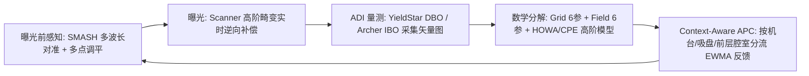

# 套刻精度（Overlay）数学建模、测量原理与高阶修正

- **所属模块**：`03_七大核心工艺 / 01_光刻工艺`

---

## 1. 为什么 Overlay（套刻）往往比 CD（线宽）更难控？

先进集成电路拥有数十层立体互连与有源器件，光刻不仅要“印得细（CD）”，更要求**上下数十层严丝合缝对得准**。传统经验准则给出：
$$\text{Overlay Budget} \le \frac{1}{4}\sim\frac{1}{3}\,\text{Minimum Half-Pitch}$$
跨入 $5\,\text{nm}/3\,\text{nm}/2\,\text{nm}$ 节点（最密金属层 Pitch 仅 **$18\sim 24\,\text{nm}$**，Half-Pitch $9\sim 12\,\text{nm}$）后，孤立管控套刻均值已不足以防止电性失效，产线全面启用统筹预算标尺——**EPE（Edge Placement Error，边缘放置误差）**：
$$\text{EPE}_{3\sigma} = |\text{OVL}_{\text{mean}}| + \sqrt{(3\sigma_{\text{OVL}})^2 + \left(\frac{3\sigma_{\text{CD},A}}{2}\right)^2 + \left(\frac{3\sigma_{\text{CD},B}}{2}\right)^2 + (3\sigma_{\text{LWR/LCDU}})^2}$$

### 1.1 3nm 节点关键层（如 M0-to-Via0）典型 EPE 预算拆解（量级参考）

| EPE 误差分量 | 典型工程分配量级 | 管控主体模块 | 超标引发的失效模式 |
| :--- | :---: | :--- | :--- |
| **光刻套刻误差 ($\text{OVL}_{3\sigma+\text{Mean}}$)** | **$1.2\sim 1.8\,\text{nm}$** | Litho Scanner / APC | 通孔扎偏引发相邻低-$k$ 介质击穿（TDDB）或高阻开路 |
| **下层金属线宽误差 ($\text{CD}_A/2$)** | $0.8\sim 1.2\,\text{nm}$ | Litho + Etch + CMP | 线宽缩水减小 Via 着陆面积（Landing Area） |
| **上层通孔孔径与粗糙度 ($\text{CD}_B/2 + \text{LWR}$)** | $1.0\sim 1.5\,\text{nm}$ | EUV Stochastic + Etch | 随机偏移或椭圆度偏置刺穿隔离间距 |
| **总 $\text{EPE}_{3\sigma}$ 预算上限** | **$3.0\sim 4.0\,\text{nm}$** | 全工艺整合（PI） | 超出半间距隔离底线即导致批量良率崩盘 |

**为什么 Overlay 比单层 CD 更难掌控？**
- CD 主要局限于单层光刻与刻蚀过程；
- Overlay 则是**全厂跨模块形变的物理叠加态**：前道刻蚀侧壁倾角畸变、CMP 抛光碟形凹陷与应力释放、高温快速退火（RTP/Spike Anneal）引发的晶圆热翘曲与滑移（Wafer Bow/Slip）、双台面真空吸盘形变以及跨机台物镜畸变指纹。

---

## 2. 三大套刻量测技术：IBO vs DBO 与 HV-SEM 校验

| 对比维度 | IBO（图像套刻，Image-Based） | DBO（衍射套刻，Diffraction-Based） | HV-SEM / E-Beam 在线套刻 |
| :--- | :--- | :--- | :--- |
| **代表设备** | KLA Archer 系列 | ASML YieldStar 系列 | 高压穿透式 CD-SEM（$10\sim 30\,\text{keV}$） |
| **靶标图形** | **Box-in-Box**（早期）或 **AIM / rAIM**（先进周期条栅光学成像靶标） | 成对叠置微米光栅（**Grating-over-Grating**），附带对称预设偏移 $+d$ 与 $-d$（典型 $\pm 15\sim 20\,\text{nm}$） | 直接量测芯片核心有源区内的**真实器件图形**（Via-on-Metal / Gate-on-Fin） |
| **测量原理** | 明场光学显微镜直接成像，计算外框与内框几何中心像素差；经 $0^\circ/180^\circ$ 旋转校准剥离**工具诱导偏差（TIS）** | 偏振光照射光栅，收集 $+1/-1$ 级衍射光强差： $A_+ = I_{+1}(+d) - I_{-1}(+d) = K(\text{OVL}+d)$ $A_- = I_{+1}(-d) - I_{-1}(-d) = K(\text{OVL}-d)$ | 高能电子束穿透顶层胶或介质，直接成像提取下层实体金属与上层图形的中心距 |
| **优缺点与布置** | 直观、抗多层膜厚光学干涉畸变较强；靶标尺寸大（$> 20\,\mu\text{m}$）通常仅能放在划片道（Scribe Line） | **重复精度极高（$< 0.15\,\text{nm}$）且极快**；靶标可缩至 $10\times 10\,\mu\text{m}$（**$\mu\text{DBO}$**）植入 **In-Die 芯片区内部**，消除划片道与芯片区偏移 | **绝对真值基准（Golden Reference）**，不受光学靶标不对称干扰；产能极低且带局部损伤，仅作光学靶标定期 Offset 标定 |

### 2.1 DBO 的定量求解与“靶标不对称（Target Asymmetry）”陷阱
- **数学抗扰消元**：通过成对对称预设偏置 $+d$ 与 $-d$ 测量，未知的薄膜光学灵敏度因子 $K$ 被精确消去：
  $$\text{OVL} = d \cdot \frac{A_+ + A_-}{A_+ - A_-}$$
- **靶标不对称性（Target Asymmetry）陷阱**：当下层光栅经过 CMP 抛光或刻蚀后发生**侧壁角度不对称（SWA Asymmetry）**或**底部倾斜**时，即使真实物理套刻误差为零，也会激发出非零衍射不对称信号 $A_0$，导致 DBO 误报高达数纳米假偏移！
- **产线标定解法**：启用 YieldStar 多波长扫频功能（Swing Curve 筛选抗不对称扰动的稳定波长与偏振组合），并定期抽检高压穿透 **HV-SEM** 实测真实器件结构套刻来建立长期 Offset 修正表。

---

## 3. 光刻机预对准感知与高阶数学分解（Linear $\to$ HOWA $\to$ CPE）

### 3.1 曝光前全片地形感知（Scanner Alignment & Leveling）
- **离轴相位光栅对准（如 ASML SMASH / ORION）**：采用 $532 / 633 / 780 / 850\,\text{nm}$ 多色激光与双偏振态同时采集分布于全片的 $20\sim 60+$ 个相位光栅对准标记（提取 $1,3,5,7$ 级高阶衍射相位）。多波长加权能自动屏蔽特定透明膜厚干涉盲区与 CMP 金属粗糙噪点。
- **多点调平调焦（Leveling Sensor）**：结合光学三角测量与气动测微计（Air-gauge）扫描全片高度，消除透明光刻胶与氧化层造成的光学穿透虚焦假象，确保暴露面稳稳落入纳米级景深窗口。

### 3.2 基础 12 参数线性分解模型
采集全片量测矢量 $(\Delta X, \Delta Y)$ 后，APC 系统将其拆分为晶圆网格走位与掩模/物镜场内变形两大类：
- **片间网格模型（Inter-field / Grid 6 参数）—— 控制晶圆工件台步进轨迹**：
  $$\Delta X_{\text{grid}}(X,Y) = T_x + S_x X - (R_w + \theta) Y, \qquad \Delta Y_{\text{grid}}(X,Y) = T_y + S_y Y + R_w X$$
  对应全片平移 $(T_x, T_y)$、由高温或薄膜应力引起的全局膨胀缩放 $(S_x, S_y)$、晶圆旋转 $R_w$ 及 X/Y 导轨正交性误差 $\theta$。
- **曝光场内模型（Intra-field 6 参数）—— 控制掩模台与投影物镜倍率**：
  $$\Delta x_{\text{field}}(x,y) = t_x + m_x x - r_y y, \qquad \Delta y_{\text{field}}(x,y) = t_y + m_y y + r_x x$$
  通过精细微调物镜内部可动镜片间距调整场放大倍率（$m_{x,y}$），并通过调控掩模台与晶圆台同步扫描速度比修正各向异性缩放及梯形畸变（Trapezoid）。

### 3.3 高阶非线性建模与逐场实时补偿（HOWA & CPE）
在 $14\,\text{nm}$ 及以下先进节点，晶圆热翘曲、边缘 CMP 坍塌以及连续曝光导致的**透镜热像差（Lens Heating）与掩模热膨胀（Reticle Heating）**会残留下 $2\sim 4\,\text{nm}$ 非线性误差，必须启用高阶补偿：
- **HOWA（High-Order Wafer Alignment，高阶晶圆对准）**：使用 3 阶至 5 阶二维径向/方位角多项式（$K_1\sim K_{20}+$ 切比雪夫/泽尼克正交基）拟合全片非线性网格变形，曝光前加密采样晶圆外沿标记。
- **CPE（Correction Per Exposure，逐曝光场独立高阶修正）**：针对片边曝光场（Edge Fields）与中心场应力完全不同的特点，APC 为片上 **80~100 个曝光场分别下发独立的场内高阶拟合矩阵**。扫描曝光瞬间，物镜内部压电致动变形镜片与双工件台联动在毫秒级狭缝行程内实时扭曲波前，实现**点对点亚纳米级畸变抵消**。
- **PDO（图形相关套刻补偿）**：针对投影物镜奇次泽尼克像差（如彗差 Coma）引起的不同周期图形相对偏移，须在 APC 中加入特征节距相关的偏移前馈补偿。

---

## 4. 产线 APC 闭环、MMO vs SMO 及工程权衡

### 4.1 Context-Aware APC（上下文分流闭环架构）
- **为何严禁全局混跑反馈？** 在 300mm 晶圆厂中，不同的刻蚀腔室（Etcher A vs B）、不同 CMP 抛光头（Platen 1/2/3）及光刻机本身的双吸盘（**Chuck 1 vs Chuck 2**）各自携带独特的物理形变指纹。
- **线程隔离实现**：APC 的 EWMA 指数加权控制器（$u_k = u_{k-1} - g \cdot e_{k-1}$）必须在 MES/APC 中严格按照 `Layer + Scanner ID + Chuck ID + 前道关键腔室 ID` 切分独立线程（Context Threading），自动实现精确的批间反馈与跨前道腔室前馈（Feed-Forward）。

### 4.2 MMO vs SMO 与 Tool Dedication（专机专用）权衡
- **SMO（Single-Machine Overlay）**：前后关联关键层锁定在同一台光刻机甚至同一块 Chuck 上曝光，彻底消除跨机台物镜固有畸变指纹差，套刻精度通常优于 **MMO（Matched-Machine Overlay）** 约 $0.5\sim 1.0\,\text{nm}$。
- **产线容量 Trade-off**：若将十几个关键层全部死锁单台专机（Strict Tool Dedication），一旦专机计划保养（PM）或宕机，整条产线在制品（WIP）瞬间停摆阻塞、Cycle Time 失控。因此先进厂采用**分层柔性匹配策略**：借助 Fleet Matching / GridMapper 高阶镜头匹配标定缩小同群组机台指纹差；仅对最极限的 **2~3 个极密互连与有源层**（如 Fin-to-Gate、M0-to-Via0）锁死 Dedicated Scanner/Chuck，其余层放开同群组混跑，兼顾良率与 WPH。

### 4.3 套刻异常产线 Troubleshooting 速查

| 异常套刻残差指纹 | 物理根因定位 | 工程排查与处置方案 |
| :--- | :--- | :--- |
| **全片径向缩放（$S_x, S_y$）突发跳变** | 前道退火炉温漂、高应力 $\text{SiN}/$金属层膜厚偏离，或晶圆发生边缘塑性滑移翘曲 | 核对前道薄膜应力与 RTP 温度日志；确认光刻机是否成功激活最新高阶网格拟合（HOWA） |
| **片边边缘场（Edge Fields）独立甩尾失准** | 边缘 CMP 抛光坍塌（Edge Roll-off）或光刻机 Chuck 外圈微粒/真空度泄露 | 比对 Chuck 1 与 Chuck 2 残差：若单 Chuck 异常，立即执行 Chuck Clean 并排查边缘密封与真空传感器 |
| **DBO 读数偏移但电性/HV-SEM 正常** | 下层光栅经 CMP 或刻蚀后出现结构侧壁不对称（SWA Asymmetry）诱发虚假光强差 | 启动 YieldStar 多波长扫频筛选稳定抗扰波长，并用 HV-SEM 校准长期 Offset 补偿 |
| **整批第 1 片到第 25 片线性漂移（Lot Drift）** | 连续高剂量扫描引发投影物镜或反射掩模热膨胀（**Lens / Reticle Heating**） | 校准光刻机动态热前馈补偿模型系数，排查物镜超纯水冷却温度与掩模台热控环路稳态 |
