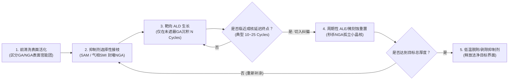

# 选择性区域沉积（ASD, Area-Selective Deposition）前沿机制

- **所属模块**：`03_七大核心工艺 / 03_薄膜沉积`

---

## 1. 为什么传统“Top-Down”在 2nm 节点迫近物理极限？

### 1.1 EPE（边缘放置误差）失控与范式转移

过去半个世纪，半导体图形化始终遵循 **“Top-Down（自上而下）”** 范式：整面沉积薄膜 $\rightarrow$ 涂胶曝光 $\rightarrow$ 干法刻蚀剥除多余部分。然而进入 3nm / 2nm / 1.4nm 节点，当金属节距（Metal Pitch）缩至 **$16\sim 24\,\text{nm}$** 时，单凭多步光刻对准与刻蚀已陷入**边缘放置误差（EPE, Edge Placement Error）**的数学死胡同：
$$\text{EPE}_{3\sigma} = |\text{Bias}_{etch}| + \sqrt{(3\sigma_{\text{OVL}})^2 + \left(\frac{3\sigma_{\text{CDU}}}{2}\right)^2 + (3\sigma_{\text{LWR}})^2 + \dots}$$
即使采用最尖端 High-NA EUV 光刻机将套刻误差（Overlay, $3\sigma$）压至 `1.5 nm` 量级，叠加线宽粗糙度（LWR）和刻蚀偏差后，上下层通孔（Via）边缘极易越界侵占相邻金属线之间的极窄介质隔墙（剩余距离 $< 3\sim 4\,\text{nm}$），直接引发 **TDDB（时间相关介质击穿）短路**或开路良率崩盘。

**ASD（Area-Selective Deposition，选择性区域沉积）则是一场“Bottom-Up（自下而上）”的原子级自对准革命**：直接读取下层暴露不同材质（如铜/钌金属线 vs $\text{SiO}_2/\text{SiCOH}$ 介质）的表面化学官能团差异，让目标材料**精确长在指定生长区（GA, Growth Area）**，而在旁边的**非生长区（NGA, Non-Growth Area）实现“零成核”**——天然消除套刻误差（Overlay Error $\equiv 0$）。

### 1.2 选择性核心度量指标与物理天花板

1. **选择性因子（Selectivity, $S$）**：工程上常用生长区覆盖度/厚度 $\theta_{GA}$ 与非生长区成核覆盖度/厚度 $\theta_{NGA}$ 定义：
   $$S = \frac{\theta_{GA} - \theta_{NGA}}{\theta_{GA} + \theta_{NGA}} \in [0, 1]$$
   晶圆厂量产合格标准通常要求：在达到目标膜厚（如 $3\sim 10\,\text{nm}$）时，$S > 0.99$（对应非生长区每平方厘米缺陷颗粒/杂散晶核数 $< 10^2\sim 10^3\,\text{defects/cm}^2$，满足高密度逻辑电路良率底线）。
2. **两大物理天花板**：
   - **成核延迟（Nucleation Delay）的非线性崩塌**：非生长区并非“绝对永久不长”，而是存在一段成核潜伏期（如 15~30 个 ALD 循环）；一旦某个表面缺陷（如一个孤立羟基或悬挂键）捕获到前驱体形成第一颗 $1\,\text{nm}$ 杂散晶核，该晶核表面会变成强活性中心，迅速诱发指数级失控生长！
   - **“蘑菇效应”（Mushrooming / Lateral Overgrowth）**：由于 ALD/CVD 本质上为各向同性生长，当生长区垂直长高厚度 $t$ 时，膜层边界也会同步向非生长区横向外扩约 $t$ 的宽度（形成类似蘑菇顶盖的外扩肩部），在极窄 Pitch 结构中直接导致线间桥接（Bridging）短路——这就限制了多数无辅助 ASD 的单次极限有效厚度一般小于沟槽半节距（典型 $3\sim 8\,\text{nm}$）。

---

## 2. ASD 三大工业实现路径与表面化学机理

### 2.1 路径一：本征选择性（Inherent Selectivity）

不依赖外部保护剂，直接依靠生长区与非生长区表面**电子能态密度及化学键解离活化能（$E_a$）**的天然热力学差异实现自发区分：
- **微观机理**：裸金属（如 Cu、Co、Ru、W）及单晶 Si 表面拥有丰富的费米能级电子态或悬空共价键，可在低温下（$150\sim 350^\circ\text{C}$）直接催化解离前驱体配体；而洁净 $\text{SiO}_2$ 或疏水低 $k$（SiCOH）表面化学键极稳定且活性反应位点极稀少，前驱体仅发生弱物理吸附（Physisorption）并迅速热脱附，无法跨越成核能垒。
- **典型成熟量产案例**：
  - **选择性钨覆盖层（Selective W CVD）**：通入 $\text{WF}_6 + \text{H}_2 / \text{SiH}_4$，在金属表面还原出钨膜，在热氧化硅上因缺乏还原电子而不反应（但极易在氧化硅缺陷处穿透，选择性窗口窄）。
  - **选择性外延（SEG, Selective Epitaxial Growth）**：在 $\text{SiH}_2\text{Cl}_2 + \text{GeH}_4 + \text{HCl}$ 体系中，$\text{HCl}$ 持续刻蚀 $\text{SiO}_2/\text{SiN}$ 侧墙上的亚稳态硅晶核，仅让源漏裸硅区外延生长厚膜。

### 2.2 路径二：表面钝化抑制剂（SAMs / SMI）+ 周期性 ALE 纠偏（Supercycle ASD）

针对绝大多数介质长在介质上（DoD）或难以靠本征差异撑过 $>20$ 个循环的体系，业界（AMAT、Lam、TEL、ASM 及 imec）主流采用**“先阻断、再生长、定期微清洗重置”的 Supercycle 超循环策略**：



#### 两代抑制剂分子的化学特性与工程 Trade-off

| 抑制剂体系 | 典型代表分子 | 接枝靶向与屏蔽机制 | 核心优势 | 工程局限性与产线痛点 |
| :--- | :--- | :--- | :--- | :--- |
| **自组装单分子层<br>(SAMs)** | 长链膦酸（ODPA）、烷基三氯硅烷（OTS）、硫醇（R-SH） | 头部功能基（$-\text{PO(OH)}_2$ 粘金属氧化物/高 $k$，或 $-\text{SiCl}_3$ 粘 $\text{SiO}_2$）发生化学键合，长链烷基尾端（$C_{12}\sim C_{18}$）借范德华力密集直立成致密疏水屏蔽伞 | 屏蔽效能极强，可支撑连续 $50\sim 100+$ 个 ALD 循环零成核穿透 | 分子长且大（$>2\,\text{nm}$），在 $<10\,\text{nm}$ 窄槽内产生空间堵塞；需湿法浸泡或长达数分钟至数十分钟气相吸附，**WPH 极低**且易随高温（$>250^\circ\text{C}$）分解 |
| **小分子抑制剂<br>(SMIs)** | 二甲氨基三甲基硅烷（DMA-TMS）、乙酰丙酮（Hacac）、三甲基氯硅烷 | 气相脉冲瞬间与非生长区表面硅醇基（$-\text{OH}$）或金属表面强配位反应，封死活性位点并形成紧凑空间位阻（如 $-\text{Si(CH}_3)_3$） | **蒸气压高，可在标准 ALD 真空腔内以 $1\sim 5\,\text{s}$ 气相脉冲完成接枝**；完美契合 300mm 真空集束机台（Cluster Tool），无几何空间位阻 | 屏蔽致密度低于长链 SAMs，耐受前驱体冲击能力弱（通常仅维持 $10\sim 25$ 个 ALD Cycle 即开始穿透），必须结合定期 ALE 纠偏使用 |

#### 周期性微刻蚀纠偏（Selectivity Reset）的物理巧思
当 NGA 区域因少数抑制剂分子空缺而冒出孤立的 $0.5\sim 1\,\text{nm}$ 杂散小晶核时，如何只洗掉这些零星晶核而不伤及 GA 区主膜层？
- **Gibbs-Thomson 尺寸效应**：孤立纳米小晶核比表面积巨大、配位数极低，其化学势远高于 GA 区的连续平整致密薄膜，**热力学刻蚀活化能显著更低**；
- 产线每跑 $10\sim 25$ 个 ALD Cycle，立即原位切入 $1\sim 2$ 个极温和的 **各向同性热原子层刻蚀（Thermal ALE，如 HF/TMA 或配体交换反应）** 或极低能远程自由基微刻蚀：虽然主生长区膜厚会同步损失约 $0.1\sim 0.3\,\text{nm}$（净增速略有牺牲），但 NGA 区的杂散萌芽晶核会被瞬间“斩草除根”，随后重新补涂 SMI 抑制剂即可将选择性无损重置为 $S \approx 1.0$，突破原本厚度的限制一路长至 $10\sim 20\,\text{nm}$！

### 2.3 路径三：前清洗化学态预处理（Area Activation / Deactivation）

ASD 成败的 $50\%$ 取决于**进沉积腔前的第一道前清洗（Pre-clean）**。暴露在大气中的 Cu/Co 线顶面常覆有一层致密自然氧化物，而相邻低 $k$ 介质刚经过刻蚀灰化表面充满硅醇基，二者化学性质反而趋同。
- **典型前置调控方案**：在集束机台预处理腔室先通入低温远程 **$\text{H}_2$ / $\text{NH}_3$ 或甲酸（HCOOH）气相还原**：将金属表层氧化物彻底还原回零价纯金属面，同时不损伤（甚至进一步还原稳定）低 $k$ 介质表面的 $-\text{CH}_3$，瞬间拉大两侧化学反应电位差，使后续 DMA-TMS 抑制剂能 $100\%$ 精准识别表面。

### 2.4 热原子层刻蚀（Thermal ALE）与 Supercycle 净增速平衡

要使周期性选择性重置（Selectivity Reset）在量产线上可控且高收益，主流切入的是**无方向性的热原子层刻蚀（Thermal ALE，区别于需要离子轰击的物理 RIE/PE-ALE）**：
- **典型反应机理（以 $\text{Al}_2\text{O}_3$ 或 $\text{HfO}_2$ 杂散晶核去除为例）**：
  1. **氟化半反应**：通入 $\text{HF}$ 气体将表面氧化物转化为固态氟化层（$\text{Al}_2\text{O}_3 + 6\text{HF} \to 2\text{AlF}_3 + 3\text{H}_2\text{O}\uparrow$）；
  2. **配体交换挥发半反应**：通入气相金属前驱体如 **$\text{TMA}$ 或 $\text{Sn(acac)}_2$ / $\text{DMAC}$（氯化二甲基铝）**，与氟化铝发生配体交换生成易挥发的铝甲基氟络合物挥发脱离，每次单循环精准剥离约 **`0.05 ~ 0.15 nm`**。
- **工程净有效生长速率（$GPC_{net}$）权衡**：假设每做 $N=20$ 次 ALD（单次 $0.1\,\text{nm}$，共长 $2.0\,\text{nm}$）切入 $M=2$ 次 Thermal ALE 剥除 $0.2\,\text{nm}$：在 GA 主生长区净增厚仍达 $1.8\,\text{nm}$，而 NGA 抑制区本来仅仅零星成核了 $<0.2\,\text{nm}$ 的高化学势孤立微晶核，因此会被彻底“归零清场”。切忌纠偏周期间隔 $N$ 设得过大——一旦 NGA 微晶核尺寸超过 $1\sim 2\,\text{nm}$ 接近块体晶体稳定性，ALE 便无法无伤擦除而必须整片报废。

---

## 3. 在 2nm / CFET / 先进互连中的四大核心工业应用场景

```text
  [1. 传统 EUV 通孔误对准导致短路]             [2. DoD ASD 自对准完全通孔 (FAV)]
        金属通孔 (偏差1.5nm)                         金属通孔 (自然自对准填满凹槽)
        ┌────────┐                                  ┌────────┐
        │  Via   │  ← 击穿风险!              DoD    │  Via   │   DoD
     ┌──┴─────┬──┴───┬──────┐             ┌─────────┼────────┼─────────┐
     │  ILD   │  M1  │ ILD  │             │ 选长介质│   M1   │ 选长介质│
     └────────┴──────┴──────┘             └─────────┴────────┴─────────┘
```

### 3.1 四大核心工业应用场景解析

```text
  [1. 传统 EUV 通孔误对准导致短路]             [2. DoD ASD 自对准完全通孔 (FAV)]
        金属通孔 (偏差1.5nm)                         金属通孔 (自然自对准填满凹槽)
        ┌────────┐                                  ┌────────┐
        │  Via   │  ← 击穿风险!              DoD    │  Via   │   DoD
     ┌──┴─────┬──┴───┬──────┐             ┌─────────┼────────┼─────────┐
     │  ILD   │  M1  │ ILD  │             │ 选长介质│   M1   │ 选长介质│
     └────────┴──────┴──────┘             └─────────┴────────┴─────────┘
```

1. **DoD（Dielectric-on-Dielectric）自对准完全阻挡通孔（FAV, Fully Aligned Via）**：
   - **实施逻辑**：在已做好 CMP 抛光的下层金属线（M1）与介质（ILD）共面表面，利用金属靶向抑制剂（如 $\text{Hacac}$ 或磷硅酸酯类 SMI）遮蔽金属顶面，随后仅在 ILD 表面通过 ALD 选择性增高生长一层 $3\sim 6\,\text{nm}$ $\text{AlO}_x$ 或 $\text{SiO}_2$ 介质墙；
   - **工程收益**：下层金属线自然深陷形成“自对准凹槽”！哪怕上层光刻套刻偏斜了半个孔径，通孔刻蚀和铜填充也会被两侧增高的介质墙精准导流至底部 M1 顶面，**彻底抹除通孔对准边缘的 EPE 短路风险并放宽 EUV Overlay 容差**。
2. **MoM（Metal-on-Metal）选择性阻挡层与 Co/Ru 抗电迁移帽**：
   - **导电截面积危机**：当金属线宽缩至 $< 12\,\text{nm}$ 时，传统整面 PVD/ALD 沉积的 $1.5\,\text{nm}$ TaN/TiN 阻挡层就直接吞噬了高达 $25\%\sim 35\%$ 的铜线截面积，迫使导线电阻率指数攀升；
   - **自对准金属帽与无底阻挡层**：利用 MoM ASD 只在铜线顶面选择性沉积 `1~2 nm` **钴（Co）或钌（Ru）抗电迁移保护帽**（锁死 Cu 界面原子扩散，将 EM 寿命延长 $10\times+$），同时确保绝不长在介质表面导致线间漏电；或者配合 **DoM**（仅在通孔介质侧壁沉积阻挡层，底部纯铜不长高阻 TaN），使通孔接触电阻暴降 $30\%\sim 50\%$。
3. **CFET（互补场效应晶体管）垂直叠层双功函数精准隔离**：
   - **空间涂胶失效**：2nm 之后进入 **CFET（NFET 与 PFET 垂直堆叠在同一垂直柱体上）**，上下两层沟道间隙垂直方向被周围高结构紧紧包夹，光刻胶既涂不进去、EUV 曝光光线也斜射不到底层阴影，无法采用常规光刻剥离区分 N/P 型功函数金属（WF Metal）；
   - **ASD 破局方案**：利用底层沟道与顶层沟道不同的牺牲衬层预处理或选择性钝化剂（结合垂直定向/自由基调谐），在垂直叠层内部自发实现底层 P-WF 金属屏蔽保护、顶层单独置换 N-WF 金属的原子级自对准分化。
4. **自对准金属硬掩模（Tone Inversion / Patterning）**：在极细间距图形化中利用选择性金属或介质生长反转或加厚核心光刻模板，替代高成本的双重/四重 EUV 图形转移。

```text
  [CFET 垂直栅极剖面 (上下通道间隔仅 10~15 nm)]
        ┌───────────────┐
        │  Top NFET 沟道 │ ──▶ 无抑制剂阻挡: 选择性生长 N型功函数金属 (如 TiAlC)
        ├───────────────┤
        │ 中间垂直隔离墙  │
        ├───────────────┤
        │ Bot PFET 沟道 │ ──▶ SMI选择性钝化遮蔽后保留先入的 P型金属 (如 TiN)
        └───────────────┘
```

### 3.2 产线集群工具典型工艺流与窗口（以 DoD 选择性介质为例）

| 工艺步序 | 腔室与工作条件（工程典型区间） | 核心作用与控制红线 |
| :--- | :--- | :--- |
| **Step 1 表面预处理** | Pre-clean 腔：远程 $\text{H}_2/\text{Ar}$ 等离子体或 $\text{HCOOH}$ 蒸汽，$150\sim 220^\circ\text{C}$ | 彻底还原 Cu/Co 表面氧化物，确保金属呈零价纯态且不损伤 ILD |
| **Step 2 抑制剂接枝** | 真空传片进 SMI 腔：$\text{Hacac}$ 或 $\text{DMA-TMS}$ 脉冲，$120\sim 180^\circ\text{C}$ | 精准钝化金属面（或介质面），温度过高会导致抑制剂热分解失效 |
| **Step 3 靶向 ALD** | ALD 腔：金属有机源 + 水/臭氧交替脉冲，$150\sim 250^\circ\text{C}$（$< 25$ 循环） | 在 GA 区实现原子级生长，温度须严守抑制剂热稳定上限以下 |
| **Step 4 纠偏 Reset** | Thermal ALE 或低温微湿法/自由基刻蚀，$100\sim 200^\circ\text{C}$ | 剥离 $0.1\sim 0.3\,\text{nm}$ 清零 NGA 萌芽微核，而后返回 Step 2 闭环 |
| **Step 5 退火剥离** | 后处理腔：低温 $\text{H}_2/\text{N}_2$ 退火（$250\sim 350^\circ\text{C}$） | 脱附残留抑制剂有机碳链，恢复纯洁接口防止接触电阻恶化 |

---

## 4. ASD 量产落地挑战与表征评价体系

- **多维度表征手段协同**：由于 NGA 区早期成核缺陷往往仅为单原子层或亚纳米孤立岛状颗粒（常规明场光学检测与普通 SEM 极易漏检），研发与量产监控必须联合四大精密表征工具：
  1. **LEIS（低能离子散射谱）**：对材料最表层单个原子层极度敏感，用于直接检验前清洗及 SMI 接枝覆盖完整性（覆盖度需 $> 98\%$）；
  2. **XPS（X 射线光电子能谱）**：通过元素光电子特征峰定量计算非生长区残余目标元素原子比（如评估选择性崩塌临界 Cycle 数）；
  3. **截面 TEM / 高分辨 AFM**：直观量测生长区边缘“蘑菇效应”的横向扩展尺度（Lateral Overgrowth）及 NGA 表面晶核颗粒形貌；
  4. **短节距梳状/蛇形电性测试结构（Comb / Serpentine Test Vehicle）**：最终在晶圆接受标准微纳制造考验时，通过大面积极细节距金属线间漏电流（Line-to-Line Leakage）与 TDDB 击穿寿命统计来裁决 ASD 是否达到大批量量产良率门槛。
- **跨工艺腔室队列等待时间（Q-Time）极严**：金属或硅表面暴露在洁净室微量水汽或空气有机挥发物（AMC）中超过 $1\sim 2$ 小时便会形成污染层，直接摧毁 ASD 选择性窗口。产线必须将 Pre-clean、SMI 脉冲、ALD 沉积及 ALE 修复高度集成在**同一台高真空多腔集群设备（Integrated Vacuum Cluster Tool）**内，在 $10^{-7}\,\text{Torr}$ 高真空下连续无接触流转，才能锁住量产一致性。
