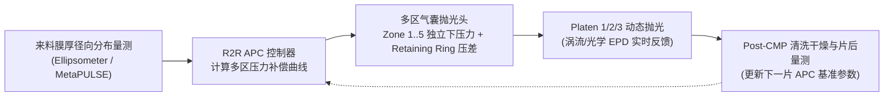

# CMP 核心机理：Preston 公式、耗材系统与工艺缺陷控制

- **所属模块**：`03_七大核心工艺 / 05_CMP平坦化`

---

## 1. 为什么先进芯片厂必须用 CMP？

### 1.1 光刻焦深（DOF）物理极限与宏观平坦化需求
随着后段铜互连（BEOL）层数叠加至 10~20 层以上，下层金属布线与介质填充留下的微米/亚微米级台阶起伏会逐层累积放大并向上传递。与此同时，光刻机（Scanner）为突破分辨率极限持续拉高数值孔径（$NA$）并缩短曝光波长（$\lambda$），根据瑞利焦深判据：

$$
DOF = k_2 \frac{\lambda}{NA^2}
$$

以 193nm 浸没式光刻（ArFi，$NA = 1.35$）与 High-NA EUV（$\lambda = 13.5\,\text{nm}, NA = 0.55$）为例，晶圆厂可用工艺焦深（DOF）已被压缩至 **`30~80 nm`** 量级。结合 `SEMI M1` 标准对硅片局部场地平坦度（SFQR）与全局平坦度（GBIR）的严苛约束，只要同一曝光场（Exposure Field，典型 `26 × 33 mm`）内存在超出焦深预算的地形落差，光刻曝光就会大面积离焦（Defocus），直接诱发关键尺寸（CD）漂移与图形桥接断线。

常规 Spin-on-Glass（SOG）旋涂或 RIE 等离子体回刻只能提供 `1~10 μm` 尺度的**局部平滑（Local Smoothing）**；唯有 **CMP（Chemical Mechanical Planarization）** 能依托半刚性抛光垫的宏观载荷分布，实现毫米级（**平坦化特征长度 $L_p \sim 1\text{–}10\,\text{mm}$**）的**全局纳米级平坦化**。

### 1.2 化学钝化与机械磨削“削高填低”底层机理
CMP 绝非单纯化学湿法腐蚀（各向同性掏蚀无法拉平高低差），也非单纯机械磨削（直接刮碎脆性硅与低 k 介质），而是两者的动态精密耦合：

1. **金属 CMP 钝化-磨削模型（Kaufman 1991 模型）**：
   - **氧化成膜**：研磨液中的氧化剂（$\text{H}_2\text{O}_2$、$\text{KIO}_3$、$\text{Fe(NO}_3)_3$）将高硬度纯金属表层氧化为疏松、低剪切强度的多孔氧化膜；
   - **络合溶解**：络合剂（甘氨酸 Glycine、柠檬酸、草酸等）与氧化态金属离子形成水溶性络合物，防止产物重新沉降；
   - **缓蚀钝化**：缓蚀剂（如苯并三氮唑 BTA）与 $\text{Cu}^+$ 反应生成厚度约 `1~5 nm` 的致密疏水 **$\text{Cu-BTA}$ 聚合物保护层**；
   - **差速去高留低**：凸起高处（Up-area）承受高接触应力，磨料与抛光垫微凸体迅速刮破钝化膜暴露新鲜金属加速溶解；低洼凹处（Down-area）免受挤压，钝化膜保持完整从而抑制化学腐蚀速率（$R_{\text{down}} \ll R_{\text{up}}$）。
2. **介质 CMP 水解与“化学齿”机制（Cook 1990 模型）**：
   - $\text{SiO}_2$/TEOS 表层在水环境发生硅氧网络水解反应，形成软化水合硅酸凝胶层：
     $$
     \equiv\text{Si}-\text{O}-\text{Si}\equiv + \text{H}_2\text{O} \longrightarrow 2\equiv\text{Si}-\text{OH}
     $$
   - 采用 $\text{CeO}_2$（氧化铈）磨料时，其表面高活性 $\text{Ce}^{3+}/\text{Ce}^{4+}$ 羟基位点与 $\text{SiO}_2$ 瞬间形成“**化学齿（Chemical Tooth）**”共价桥键（$\text{Ce}-\text{O}-\text{Si}$），在切向拖拽下直接拔除硅氧键，使其对 $\text{SiO}_2$ 去除效率及对 $\text{Si}_3\text{N}_4$ 停层选择比远超常规 $\text{SiO}_2$ 磨料。

### 1.3 产线主流 CMP 工艺层典型工艺窗对比

| 工艺层 | 主导研磨液体系 | 典型去除速率 ($MRR$) | 核心选择比目标 | 抛光垫与下压力工程窗口 |
| :--- | :--- | :---: | :--- | :--- |
| **STI（浅槽隔离）** | $\text{CeO}_2$ + 聚丙烯酸（PAA）抑制剂 | `2500~5000 Å/min` | $\text{SiO}_2 : \text{Si}_3\text{N}_4 \approx 30:1\text{–}100:1$ | 高模量硬垫（IC1000）；`2.5~4.0 psi` |
| **ILD0 / PMD（前金属介质）** | 胶体/气相 $\text{SiO}_2$（碱性体系） | `2000~4000 Å/min` | 无特殊停层（靠时间/光学干涉控制） | 硬垫 + 弹性底层（Suba IV）；`2.5~4.5 psi` |
| **W-Plug（钨栓塞）** | $\text{Fe(NO}_3)_3$ / $\text{KIO}_3$ + $\text{H}_2\text{O}_2$ + 酸性磨料 | `1500~3500 Å/min` | $\text{W} : \text{TEOS} > 10:1$（主抛） | 中硬垫；`2.0~3.5 psi`（防 Seam 打开） |
| **BEOL Cu Step 1/2** | 胶体 $\text{SiO}_2$ + $\text{H}_2\text{O}_2$ + 甘氨酸 + BTA | `4000~7000 Å/min`（P1） | $\text{Cu} : \text{TaN} > 50:1$（P2 清残） | 硬垫；P1 `2.5~3.5 psi`，P2 `0.8~1.3 psi` |
| **BEOL Barrier（阻挡层）** | 胶体 $\text{SiO}_2$ + 特种选择比调控剂 | `300~800 Å/min` | $\text{Cu} : \text{TaN} : \text{ULK} \approx 1:1:1$ | 软垫（Politex）；`< 1.2 psi`（防 ULK 分层） |

---

## 2. Preston 经验公式与现代接触力学修正

### 2.1 经典 Preston 方程
1927 年 F. W. Preston 在玻璃光学抛光研究中提出材料去除速率（$MRR$）与正压力及相对速度成正比：

$$
MRR = K_p \cdot P \cdot V
$$

- **$MRR$**：材料去除速率（Material Removal Rate，产线常用 $\text{\AA/min}$）；
- **$P$**：抛光头施加的名义下压力（Downforce，典型工程窗 `0.5~4.5 psi`）；
- **$V$**：晶圆表面微元与抛光垫的相对线速度（典型 `0.5~2.5 m/s`；机台使 Platen 与 Carrier 同向等角速度近似旋转，确保晶圆中心到边缘各点线速度近似一致）；
- **$K_p$**：Preston 系数，打包了 Slurry 化学配方、反应温度、磨料粒径/固含量、抛光垫硬度与表面沟槽状态。

### 2.2 线性模型在先进节点失效的接触力学修正
量产实测 $MRR$ 曲线常出现**非零阈值起步**与**高压区非线性饱和**，由三大微观机制主导：

1. **Greenwood-Williamson（GW）微凸体接触与 Luo-Dornfeld（2001）模型**：
   聚氨酯抛光垫表面随机分布着微米级微凸体（Asperities），晶圆-磨料-微凸体构成**三体弹塑性接触（Three-body Contact）**。弹性接触下实际承载面积 $A_{\text{real}} \propto P^{2/3}$，嵌入有效磨料数也随载荷呈亚线性增长，且切向摩擦必须先克服钝化膜临界剪破阈值压强 $P_{\text{th}}$：
   $$
   MRR = K_p' \cdot (P - P_{\text{th}})^{\alpha} \cdot V^{\beta} \quad (\alpha \approx 0.5\sim 0.85)
   $$
2. **Stribeck 润滑曲线与流态切换**：
   界面润滑状态由无量纲 Sommerfeld / Hersey 数决定：
   $$
   So = \frac{\mu V}{P \cdot \delta_{\text{eff}}}
   $$
   其中 $\mu$ 为研磨液动力粘度，$\delta_{\text{eff}}$ 为等效液膜厚度：
   - **边界润滑 $\to$ 混合润滑（理想工作区）**：固体微凸体承担主要法向载荷并挤压磨料切入晶圆，平坦化效率最优；
   - **流体动压润滑（Hydroplaning 浮水失稳区）**：若 $V$ 过高且 $P$ 过低，楔形液膜动压将晶圆“浮水托起”，磨料失去有效法向力，$MRR$ 骤降且边缘极易飞片或失控。
3. **台阶高度衰减动力学（Step-Height Attenuation）**：
   随抛光推进，凸起与凹谷的初始台阶高度 $H_0$ 近似呈指数衰减：
   $$
   H(t) = H_0 \exp\left(-\frac{t}{\tau_p}\right), \quad \tau_p \propto \frac{L_p}{K_p P V}
   $$
   高刚度硬垫能有效缩小时间常数 $\tau_p$，从而用更小的总膜厚牺牲实现快速削平。

### 2.3 多区气囊抛光头（Multi-Zone Carrier Head）闭环调控
为补偿来料薄膜（如 ECP 铜或 HDP-CVD 氧化硅）固有中心/边缘分布不均以及晶圆边界突变（Edge Rebound），现代 300mm 抛光头内集成 **5~7 个同心独立压力气囊（Zone 1 Center ~ Zone Edge）** 与独立控压 **Retaining Ring 保持环**：

- **实操补偿策略**：当来料呈现“中心厚、边缘薄”分布时，APC 自动将 Zone 1 下压力调高 `0.3~0.5 psi`、将外区微降；同时始终维持 Retaining Ring 压强高于最外圈膜压 **`0.5~1.5 psi`**，提前将抛光垫边缘弹性凹陷回弹卸载在保持环底面，把晶圆边缘报废区（Edge Exclusion）压窄至 **`1.5~3.0 mm`**。

---

## 3. 300mm CMP 机台架构、四大耗材与终点检测（EPD）

### 3.1 主流三抛光盘（3-Platen）分工与集成架构
以主流 300mm 量产设备（AMAT Reflexion LK、Ebara F-REX、华海清科 Universal-300）为例，采用**干进干出（Dry-In / Dry-Out）**架构：
- **Platen 1（Bulk Removal 主抛）**：高压高转速快速切削掉过载铜余量，涡流 EPD 在距阻挡层约 `500~1000 Å` 时刹车切换；
- **Platen 2（Soft-Landing 清残）**：下压力压低至 `0.8~1.3 psi` 保护多孔 Low-k，光学 EPD 触发瞬间精确停在 TaN/Ta 阻挡层顶面；
- **Platen 3（Barrier & Buffing 阻挡层精抛）**：采用软垫与 `1:1:1` 平衡配方磨除阻挡层并擦除微划伤。

### 3.2 四大核心耗材特性与选型 Trade-off

| 核心耗材 | 典型材质/体系与微结构 | 核心物理/化学作用 | 工程选型 Trade-off |
| :--- | :--- | :--- | :--- |
| **Slurry（研磨液）** | 胶体/气相 $\text{SiO}_2$（`20~80 nm`）、$\text{Al}_2\text{O}_3$、$\text{CeO}_2$ | 化学软化 + 纳米磨削；决定多材料间**选择比** | $\text{CeO}_2$ 选择比极高但易诱发划伤与难清化学残留；胶体 $\text{SiO}_2$ 缺陷率极低但速率略低 |
| **Polishing Pad（抛光垫）** | **硬垫**（IC1000+Suba IV） / **软垫**（Politex）；表面开同心圆/XY/网格槽 | 输运 Slurry、排屑散热、决定宏观刚度 | 硬垫全局平坦化效率最优但划伤率略高；软垫缺陷率极低但易陷入宽线加剧 Dishing |
| **Diamond Conditioner（修整盘）** | 钎焊/电镀单晶金刚石（`80~150 μm`），*In-situ* / *Ex-situ* 修整 | 微切削消除磨屑堵塞与聚氨酯塑性流变引起的**釉化（Glazing）** | **Cut Rate（`μm/hr`）博弈**：修整太狠加速耗垫与掉钻；太轻致釉化使 $MRR$ 衰减、划伤暴增 |
| **Retaining Ring & Membrane** | PPS/PEEK 塑料环（底面开导流槽）+ 硅橡胶多区柔性膜 | 限位防飞片、引导边缘 Slurry 流场、补偿边缘应力跳变 | 导流槽磨平后排液受阻致 Edge Roll-off 骤变，须按跑片小时（`150~300 hrs`）强制更换 |

### 3.3 实时终点检测（EPD）技术深度对比

| EPD 类型 | 传感物理原理 | 有效检测窗口与灵敏度 | 工程局限与产线工位 |
| :--- | :--- | :--- | :--- |
| **涡流传感（Eddy Current）** | Platen 内埋高频线圈激励磁场并在金属膜内感生涡流，反测阻抗/相位偏移 | 金属残余厚度 **`10000 Å → < 50 Å`** 连续定量实时反馈 | **完全免疫 Slurry 浑浊与垫窗磨损**；对极薄阻挡层（< 3 nm）或介质失明 $\implies$ **Platen 1 主力** |
| **光学反射光谱（Optical EPD）** | 透过抛光垫蓝宝石窗照射宽带白光，实时捕捉反射率跳变与介质薄膜干涉光谱 | 对不透明金属磨穿露底瞬间极度敏锐 | 易受窗口起雾及浆料透光衰减干扰 $\implies$ **Platen 2 & Platen 3 刹车主力** |
| **电机扭矩/摩擦力传感** | 监测主轴驱动电机电流波动，捕捉摩擦系数 $\mu$ 跨越材料界面的跳变 | 响应极快、零额外硬件成本 | 信噪比相对偏低、受修整盘扫掠扰动 $\implies$ **常作双保险安全阈值** |

### 3.4 SDS 供液循环与抛光垫热管理（Thermal Runaway）
1. **SDS（Slurry Delivery System）供液环路管控**：
   - 双组份研磨液（磨料原液 + $\text{H}_2\text{O}_2$ 氧化剂）在机台前端混合桶（Day Tank）按配比在线混匀，在循环泵驱动下高速流经使用点过滤器（**POU Filter，`0.1~0.5 μm`**）滤除大团聚颗粒（监控 **LPC, Large Particle Count**）；
   - 氧化剂 $\text{H}_2\text{O}_2$ 具有自然分解半衰期，混配液罐严禁超时滞留以免铜去除率漂移。
2. **摩擦生热与热失控（Thermal Runaway）防护**：
   - 抛光接触面瞬时摩擦功耗高达数百至上千瓦，垫面温度从室温飙升至 **`40~60 °C`**；
   - 根据阿伦尼乌斯方程 $K_p \propto \exp(-E_a / k_B T)$，温度升高急剧加速化学反应同时使聚氨酯抛光垫软化（模量下跌），引发 $MRR$ 与 Dishing 漂移甚至垫面烧焦；
   - **工程对策**：Platen 内部强制通入闭环恒温冷却水（Chilled DIW），并依靠抛光垫 XY/同心沟槽保持足量新鲜 Slurry 流量（`200~350 mL/min`）带走摩擦热。

---

## 4. 关键缺陷机理与产线 Troubleshooting

| 缺陷现象 | 底层物理/化学根因 | 在线表征证据（KLA / DR-SEM / 膜厚） | 产线工程排查与根治手段 |
| :--- | :--- | :--- | :--- |
| **Micro-Scratch / Chatter Mark（划伤/颤纹）** | 1. SDS 环路磨料团聚（LPC 超标）； 2. 修整盘掉金刚石或保持环磨屑剥落； 3. 待机时垫面 Slurry 干涸结晶 | 暗场呈现长弧形刮伤（Arc Scratch）或周期微凹坑链；EDS 检出 $\text{SiO}_2$/$\text{Al}_2\text{O}_3$/C 碎屑 | 核查 POU 过滤器压差与在线 **LPC 计数**；执行 Conditioner 胶带剥离测试并换盘；启用待机自动 DIW 保湿喷淋；严控保持环 PM 寿命 |
| **Cu Pitting / Galvanic Corrosion（铜点蚀/电偶腐蚀）** | 1. $\text{Cu}/\text{TaN}$ 暴露界面电位差组成微电池； 2. Slurry 内 $\text{H}_2\text{O}_2$ 过量或 BTA 浓度不足失效 | DR-SEM 显示铜线表面或边角出现密集黑坑，伴随断线与线阻异常飙高 | 滴定核查 Slurry 混配比（$\text{H}_2\text{O}_2$ 与 BTA 有效浓度）；压缩 Platen 2 $\to$ Cleaner 等待时间；切换除氧纯水与 $\text{N}_2$ 保护模式 |
| **Under-Polish / Metal Residue（欠抛金属残余短路）** | 1. 抛光垫局部釉化致边角速率掉档； 2. 来料局域极厚超出 EPD 过抛窗； 3. 多区气囊微漏或气压漂移 | 电学 WAT 测试相邻导线大规模短路，明场可见反光金属残膜 | 静态保压检漏校准多区气囊；增加 Conditioner 扫频消除釉化；优化 Platen 2 过抛比例与光学 EPD 灵敏度 |
| **Edge Roll-Off / ULK Delamination（边缘过抛/低k分层）** | 1. 保持环磨损致边缘应力集中； 2. 多孔 ULK（$k<2.5$）在切向剪切力与高压下脱层 | 边缘 3~5 mm 膜厚断崖减薄，或显微可见薄膜成片起皮撕裂 | 压低 Platen 2/3 下压力至 `< 1.2 psi` 并增大 Slurry 润滑剂比例；重调 Zone Edge 与 Retaining Ring 压差阶梯；排查前道粘附层沉积应力 |
