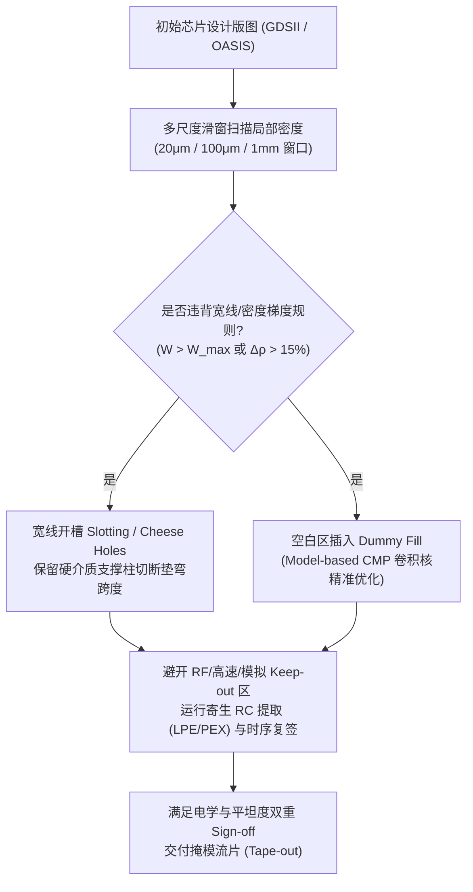

# Dishing（碟形凹陷）、Erosion（侵蚀）与 Dummy Fill 协同规则

- **所属模块**：`03_七大核心工艺 / 05_CMP平坦化`

---

## 1. 为什么图形密度不均会导致 CMP “磨偏”？

在理想力学模型中抛光垫维持绝对刚性平面；但产线聚氨酯抛光垫具有显著的**粘弹性（Viscoelasticity）**，在抛光头法向载荷（`1~4 psi`）与切向剪切力作用下会产生亚微米至微米级的局部弹性弯曲变形。叠加软质金属（Cu/Co/W 化学活性高、硬度低）与硬质介质（$\text{SiO}_2$/Low-k 硬度高、耐磨）之间的巨大去除速率差异，版图上图形密度的空间不均必然转化为纳米级的表面拓扑失真（Topography Loss）。

### 1.1 MIT Boning / Stine 图形密度接触力学模型
MIT 的 D. Boning 与 B. Stine 等人建立的经典 CMP 图形密度拓扑演化模型揭示了载荷分布的两阶段物理机理：

1. **平坦化特征长度 $L_p$ 与有效图形密度 $\rho_{\text{eff}}(x,y)$**：
   将抛光垫近似为弯曲刚度由弹性模量 $E_{\text{pad}}$ 与底层厚度决定的弹性地基（Winkler Foundation），应力横向平缓扩散的特征尺度称为**平坦化特征长度 $L_p$**（硬垫典型 `2~5 mm`，软垫 `< 1 mm`）。空间任一点的实际有效图形密度 $\rho_{\text{eff}}(x,y)$ 是版图金属分布经 $L_p$ 尺度卷积平滑后的加权平均值。
2. **第一阶段（阻挡层未裸露，凸起金属承担全部载荷）**：
   设全局名义压强为 $P_0$，由于凹陷区悬空未承压，局部凸起金属承受的实际接触压强被图形密度反比放大：
   $$
   P_{\text{eff}}(x,y) \approx \frac{P_0}{\rho_{\text{eff}}(x,y)}
   $$
   - **稀疏孤立区（$\rho \to 10\%$）**：极少凸起支撑全部下压力，局部压强放大近 10 倍，去铜极快并**最先磨穿露出阻挡层**；
   - **高密度密集区（$\rho \to 85\%$）**：海量金属线分摊压力，初期去铜极慢。为了把高密度密集区最后的残铜磨光，早已露底的稀疏区和宽线区**被迫承受漫长的过抛（Overpolish）**——这正是 Dishing 与 Erosion 产生的物理根源！
3. **第二阶段（过抛阶段，弹性弯折主导掏蚀）**：
   当某区域进入过抛后，粘弹性抛光垫向下陷入凹槽的弯曲挠度随沟槽跨度线宽 $W$ 与下压力剧增，直接把软抛光垫压进宽线中心或压塌密集区细窄介质脊柱。

### 1.2 Dishing 与 Erosion 的微观机理及定量电学危害

| 拓扑失真类型 | 典型发生区域与几何特征 | 接触力学微观成因 | 对芯片电学与良率的致命后果 |
| :--- | :--- | :--- | :--- |
| **Dishing（碟形凹陷）** | **宽孤立金属线**（线宽 $W \approx 5\text{–}100\,\mu\text{m}$ 的电源总线、I/O 焊盘、片上电感）； *亦发生于 FEOL STI 隔离槽* | 过抛期间，粘弹性抛光垫向下弯曲鼓入软质宽铜线中心区域（且中心离两侧硬阻挡层支撑最远），掏挖成碟状凹坑 | 1. **导线电阻暴涨与 IR Drop**：有效导电截面积大幅缩水； 2. **次层残留短路（Puddle Short）**：凹陷超出上层光刻 DOF 窗口并积存残金属，诱发**层内致命桥接** |
| **Erosion（侵蚀）** | **极高金属密度精细阵列区**（如高密度 SRAM Cell、紧密总线阵列，$\rho > 70\%$） | 密集区铜磨净后，残余介质绝缘脊（Oxide Ridge）宽度极窄（`15~50 nm`），独自承受全区高压，连带四周介质整片磨薄下陷 `15~60 nm` | 1. **层间电容与串扰恶化**：介质厚度 $d_{\text{IMD}}$ 剧减，$C_{\text{IMD}} \propto \varepsilon/d_{\text{IMD}}$ 陡增； 2. **TDDB 击穿风险**：电场集中引发早衰击穿； 3. 最终金属高度失真，电阻剧增 |

### 1.3 经验标度律与定量电学危害算例
在工程评估中，Dishing 与 Erosion 随版图几何参数及过抛时间（$t_{\text{OP}}$）近似满足如下强敏感标度规律：

$$
\Delta h_{\text{dish}} \propto W^{\alpha} \cdot \left(\frac{P}{E_{\text{pad}}}\right) \cdot t_{\text{OP}}, \qquad \Delta h_{\text{erosion}} \propto \frac{\rho}{1 - \rho} \cdot K_{\text{ILD}} P V \cdot t_{\text{OP}}
$$

注意到当高密度阵列局部金属密度 $\rho$ 从 `60%` 升至 `85%` 时，负责支撑抛光垫的残余介质占比 $(1 - \rho)$ 从 `40%` 暴跌至 `15%`，侵蚀放大因子 $\frac{\rho}{1 - \rho}$ 从 `1.5` 狂飙至 `5.7`！

**定量危害算例（以典型 M1 铜互连层为例）**：
- 假设设计沟槽高度 $H_0 = 100\,\text{nm}$、层间介质标称厚 $d_0 = 80\,\text{nm}$；
- 若某高密度电源总线周围同时发生 $\Delta h_{\text{erosion}} = 20\,\text{nm}$ 阵列侵蚀与 $\Delta h_{\text{dish}} = 30\,\text{nm}$ 碟形凹陷；
- 最终有效导电铜厚度骤降至 $H_{\text{eff}} = 100 - 20 - 30 = 50\,\text{nm}$，有效截面积缩水一半，**薄层电阻 $R_s$ 直接飙升至设计预期值的 `2.0 倍`（+100%）**，直接破坏关键路径时序收敛（Timing Closure）并引发严重供电 IR Drop。

---

## 2. 跨部门（Fab + EDA）协同策略：DFM 可制造性设计

单靠 CMP 机台调参数无法解决同一芯片左边金属密度 `85%`、右边空白区密度 `5%` 的极端拓扑落差。先进晶圆厂在 PDK/DRC 签核（Sign-off）中执行严密的 Fab-EDA 协同可制造性设计：

### 2.1 Dummy Metal / Dummy STI Oxide Fill 工程细则与寄生 Trade-off
流片前物理验证工具（Calibre / ICV）按多尺度滑窗（Multi-Scale Sliding Window）全片扫描各层版图：
1. **三代填充技术对比与电学寄生权衡**：

| 填充方案 | 工作原理与算法机制 | 平坦化控制能力 | 对芯片寄生电容与射频特性的影响（Trade-off） |
| :--- | :--- | :---: | :--- |
| **Rule-based 规则均匀填充** | 机械地向所有空地插入固定尺寸/间距的方形浮空 Dummy 小岛 | 中等（无法感知下层累计地形传递） | 若过于靠近高速信号线，显著推高耦合电容 $C_{\text{couple}}$；在螺旋电感下方感生涡流压低 $Q$ 值 |
| **Model-based CMP Fill** | 将 Fab 标定的 **Boning 物理卷积核** 嵌入 EDA 引擎，逐层仿真抛光后高度场 $H(x,y)$，仅在预测凹陷高风险区按需动态填充 | **极高**（大幅压缩全局 TIR） | 避免安全区冗余金属堆砌，将额外寄生耦合电容增幅削减 **`30%~50%`** |
| **Grounded / Active Fill** | 将 Dummy 金属经微通孔接至电源/地平面（VSS/VDD）并配合错位栅格排布 | 高 | 消除浮空电势不确定性，方便 PEX 寄生提取精准建模，但占用一定绕线资源 |

2. **关键设计规则实例（典型先进节点 PDK 约束窗口）**：

| 检查维度 | 工程滑窗尺度 | 典型安全约束区间（随层厚微调） | 核心工程物理意图 |
| :--- | :--- | :---: | :--- |
| **局部金属密度范围** | `20×20 μm` / `100×100 μm` | **`20% ~ 65%`**（典型目标 `35%–55%`） | 防止局部极疏区先磨穿或极密区产生整片 Erosion |
| **宏观平滑梯度（Gradient）** | 相邻 `50×50 μm` 步进窗口 | 相邻窗口密度差 **`Δρ < 10%~15%`** | 消除密度台阶边界上的陡峭局部应力突变与残余台阶 |
| **全局尺度密度** | `500×500 μm` / `1×1 mm` | **`25% ~ 60%`** | 匹配硬垫平坦化长度 $L_p$，保证芯片间与曝光场级平坦度 |
| **禁止填充区（Keep-out）** | 绕电感 / SerDes / 模拟匹配对 | 距敏感器件外扩 **`3~15 μm`** | 屏蔽涡流损耗与耦合电容恶化高速信号完整性与模拟匹配 |
| **多层错位（Staggering）** | 相邻层 $M_n$ 与 $M_{n+1}$ | 上下 Dummy 中心**错开半周期** | 防止多层金属块垂直堆垛成“硬钢柱”引发局部凸起与层间寄生暴增 |

### 2.2 Wide-Line Slotting / Cheese Holes（宽金属线开槽与开窗）
- **设计红线**：DRC 严禁直接绘制超过最大实心线宽 $W_{\max}$（底层薄金属典型限制 `2~5 μm`，顶层厚电源铜线限制 `10~15 μm`）的连续实心金属块。凡超过 $W_{\max}$ 的宽线，必须沿电流流向每隔几微米挖出一排错列细长介质小窗（**Slotting / Cheese Holes**）；
- **支架支撑效应**：开槽内保留下来的硬质 $\text{SiO}_2$/Low-k 柱像桥墩般撑住上方弯曲的聚氨酯抛光垫，把抛光垫悬空跨度从几十微米分割成 `2~3 μm`，一举将 Dishing 深度削减 **`60%~85%`**；
- **版图工程禁忌**：开槽约折减 `5%~15%` 的有效导电截面积；且**绝不允许将开槽尖角正对高电流密度通孔（Via）落点**，防止局部电流绕流拥挤（Current Crowding）加速电迁移早期断线。

---

## 3. CMP 工艺端协同控制与 FEOL STI 延伸应用

### 3.1 多步抛光与“1:1:1 非选择比”平衡调平
在版图 DFM 就绪基础上，CMP 工艺工程师在机台端执行三步降压接力把残余失真压缩到底：
1. **Step 1（Bulk Cu 高压快抛）**：高下压力快速磨削电镀凸起，于涡流 EPD 测得残铜约 `~600 Å` 时提前刹车，缩短后续过抛窗口；
2. **Step 2（Soft-landing 低压清残）**：下压力跌至 **`0.8~1.3 psi`**，提高 BTA 缓蚀剂比重并在先露底的宽线凹槽内维持稳固 $\text{Cu-BTA}$ 保护膜压制凹蚀；
3. **Step 3（Barrier / Buffing“1:1:1 平衡选择比”归零）**：
   - 若阻挡层研磨液 $\text{Cu 速率} \gg \text{TaN/ILD}$ $\implies$ 剧烈加重 **Dishing**；
   - 若 $\text{TaN/ILD 速率} \gg \text{Cu}$ $\implies$ 周围介质磨低使铜线相对凸起，产生致命 **Copper Protrusion（铜凸起）** 引发下层击穿；
   - **产线黄金调配**：精准控制 Slurry 配方实现 **`Cu : TaN : ILD/Low-k ≈ 1 : 1 : 1`**（或令介质微幅略快以吃平 Step 2 遗留微凹），均匀磨除 `15~30 nm` 阻挡层与表皮介质并将整片纳米台阶完全“归零抹平”。

### 3.2 FEOL STI（浅槽隔离）中的 Dishing 与氮化硅损失类比
Dishing 与 Erosion 在前道隔离 **STI CMP** 中同样具备极高破坏力：
- 若开阔隔离区缺失足够有源硅岛（STI Dummy OD），抛光垫凹陷会掏空槽内氧化硅（STI Oxide Dishing），导致后续多晶硅/金属栅极沿着下陷的氧化硅沟槽侧壁下探包裹硅角，诱发晶体管寄生双阈值拐点漏电（Kink / Hump 效应）；
- 若高密度有源区顶部发生严重 $\text{Si}_3\text{N}_4$ Erosion 损失，硬掩模厚度大幅失真将直接毁坏后续 Fin 有效高度片内均匀性——因此 STI 必须同样叠加 Dummy OD Fill 与高选择比 $\text{CeO}_2$ 精准停层。

---

## 4. 产线拓扑监控表征与 Troubleshooting

### 4.1 专用测试结构与在线量测工具
切割道（Scribe Line）与 PCM 内常规内置覆盖线宽 $W = 0.1\sim 100\,\mu\text{m}$ 与密度 $\rho = 10\%\sim 90\%$ 阶梯矩阵的 **MIT/CMP 特征图形阵列**：
- **微触针/原子力轮廓仪（HRP / AFP）与白光干涉仪（WLI）**：直接扫描台阶高度差，输出每组阵列单线 Dishing 与密度区 Erosion 深度；
- **皮秒激光超声（MetaPULSE）**：非接触反演不同密度区金属最终残余绝对厚度（Thickness Loss），与电学 WAT 薄层电阻 $R_s$ 相互校验。

### 4.2 产线常见异常 Troubleshooting

| 异常警报现象 | 物理/版图根因定位 | 产线工程纠正手段 |
| :--- | :--- | :--- |
| **宽线 Dishing 超标引发下层 Metal Bridging 短路** | 1. Platen 2 过抛比例过大或光学 EPD 迟钝； 2. 某关键大电源网申请了 DRC Slotting 豁免； 3. 抛光垫偏软或 BTA 浓度不足 | 重校光学 EPD 算法将 Platen 2 Overpolish % 从 `30%` 压缩至 `15%`；驳回宽线 Waiver 强制加 Slotting；上调 Platen 3 适度 ILD 去除量吃平凹陷 |
| **密集 SRAM 区 Erosion 剧增伴随 $R_s$ 飙升与漏电** | 1. Platen 3 阻挡层 Slurry 老化致选择比失控； 2. SRAM 与外围空白区密度落差巨大且边缘缺失渐变过渡 Dummy | 离线检测 Platen 3 Slurry 实际 $\text{Cu}:\text{TaN}:\text{TEOS}$ 选择比并刷新槽液；版图上在密集区边界外环加插**渐变密度过渡环（Halo Dummy Fill）**；更换高模量硬垫缩短 $L_p$ 坡度 |
| **晶圆最外圈边缘 Die 局部残铜或边缘过抛并存** | 保持环磨损引发边缘流场停滞，或抛光头最外圈气囊（Edge Zone）补偿失调 | 检查保持环底槽残深并及时 PM 更换；重调 Edge Zone 与 Retaining Ring 压差曲线；核查晶圆最外缘废 Die 区是否遗漏边缘封环 Dummy |
