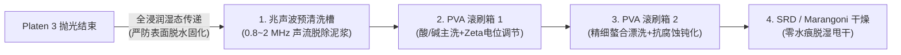

# CMP 后清洗（Post-CMP Clean）：PVA 刷洗、Zeta 电位与防划伤控制

- **所属模块**：`03_七大核心工艺 / 05_CMP平坦化`

---

## 1. 为什么 CMP 抛光刚结束的晶圆是晶圆厂最“脏”且最脆弱的？

刚脱离 Platen 3 的晶圆表面承载着高浓度四重污染物：
1. **纳米级固体磨料**：$\text{SiO}_2, \text{CeO}_2, \text{Al}_2\text{O}_3$（浓度高达 $10^{10}\sim 10^{12}$ 颗/mL）；
2. **金属离子及氧化物碎屑**：$\text{Cu}^+, \text{CuO}_x, \text{WO}_x$ 及难溶金属氢氧化物；
3. **有机缓蚀剂残胶**：高度疏水粘稠的 $\text{Cu-BTA}$ 聚合物保护层及表面活性剂残留；
4. **耗材磨屑**：抛光垫受修整盘切削脱落的微米/亚微米聚氨酯微粒。

### 1.1 吸附力学定量解析：为什么绝对不能让晶圆“带液风干”？
纳米颗粒能否被流体带走，取决于**流体剥离曳力 $F_{\text{drag}}$** 是否胜过**界面粘附总力 $F_{\text{adh}}$**：
- **机械压嵌与范德华引力**：抛光高压（`1~4 psi`）将纳米磨料压入软质铜线与多孔 Low-k 表层微孔。接触间距 $d$ 跌入亚纳米级时，范德华引力呈反平方激增：
  $$
  F_{\text{vdW}} = \frac{A_H R}{6 d^2}
  $$
  以半径 $R = 30\,\text{nm}$、间距 $d = 0.4\,\text{nm}$ 的 $\text{SiO}_2$ 颗粒为例，$F_{\text{vdW}}$ 高达数十纳牛（`~10–50 nN`），折合局部接触粘附压强超过数百个大气压；
- **脱水风干缩合固化（不可逆死刑）**：若磨完几秒内让水膜在空气中风干蒸发，三相弯月面收缩产生的巨额**毛细管拉应力（Capillary Force）**会将颗粒拉入亚埃级接触；更致命的是，$\text{SiO}_2$ 磨料表面硅醇基与介质硅醇基瞬间脱水缩合形成极其牢固的**共价硅氧键**：
  $$
  \equiv\text{Si}-\text{OH} + \text{HO}-\text{Si}\equiv \longrightarrow \equiv\text{Si}-\text{O}-\text{Si}\equiv + \text{H}_2\text{O}
  $$
  颗粒粘附力瞬间从纳牛（nN）跃升至微牛（μN）量级！一旦形成共价键粘死，后续任何不破坏芯片结构的常规清洗均无法将其剥离。

### 1.2 “干进干出（Dry-In / Dry-Out, DIDO）”湿态集成架构
现代 300mm CMP 机台全部采用全闭环湿态传递设计：晶圆自 Platen 3 抬起瞬间即进入去离子水（DIW）雾化喷淋与水淹缓冲槽（Wet Transfer Tank），全程隔绝空气浸润送入同一机台内置的 **Post-CMP Cleaner 清洗模块**，经四段清洗干燥后干爽出片。

---

## 2. Post-CMP 标准四段清洗工艺与物理化学机理

### 2.1 第一段：兆声波预清洗（Megasonic Pre-Clean）
- **高频稳态微流机理**：采用 `0.8~2.0 MHz` 高频压电陶瓷换能器激发流体声流（Acoustic Streaming）与柔和的稳态微气泡振荡（Stable Cavitation）。不同于低频超声（20~100 kHz）因瞬态空化气泡剧烈内爆产生摧毁性微射流（直接击碎亚 20nm 栅极线条或击塌脆弱多孔 Low-k），兆声波能将滞留流体边界层厚度压缩至亚微米级：
  $$
  \delta_{\text{ac}} = \sqrt{\frac{2\nu}{\omega}} < 0.5\,\mu\text{m}
  $$
  在零结构损伤前提下提前松动并冲走 `70%` 以上的游离研磨液泥浆与大颗粒，大幅减轻后续滚刷的颗粒负担与划伤风险。

### 2.2 第二/三段：PVA 多孔海绵双面滚刷擦洗与防交叉污染 SOP
常规前道（FEOL）清洗忌讳固体触碰晶圆，唯独 Post-CMP 必须采用物理滚刷，根因在于压嵌深颗粒与粘稠 $\text{Cu-BTA}$ 膜的剥离门槛极高，非接触液流剪切力不足以突破 $F_{\text{vdW}}$。

1. **PVA 滚刷微结构与工艺窗**：
   - 采用开孔率 `80%~90%` 的医用级亲水聚乙烯醇（PVA）多孔海绵，表面模塑数千个均匀凸起微柱（Nodules）用于引流排屑；
   - **典型机台控制窗**：晶圆自转 `50~150 RPM`，上下双面滚刷反向高速旋转 `150~400 RPM`，精准控制机械**压入干涉量（Interference，`0.5~2.0 mm`）**，并经中空芯轴高压泵入**穿刷化学液（Through-the-Brush, TTB，流量 `500~1500 mL/min`）**。
2. **弹流润滑（EHL）剪切剥离机理**：
   - 吸水软化的 PVA 微柱顶端与晶圆之间形成约 **`1~5 μm`** 厚的连续动态液膜；
   - 极薄液膜内的超高流速剪切梯度（$\dot{\gamma} = \Delta v / h_{\text{film}}$）产生极强的流体动力学曳力（Hydrodynamic Drag）把压嵌颗粒掀翻冲走，而海绵体本身几乎不直接硬刮薄膜。
3. **交叉污染“刷痕（Brush Scratch）”与滚刷维护 SOP**：
   - **传染机制**：若前片晶圆掉落的单颗金刚石微粒或硬质铜屑嵌死在 PVA 微孔里，此后每片经过该刷子的晶圆都会被周期性划出数百条致命 **Brush Scratch**（呈现独特的螺旋或同心圆环状刮伤）；
   - **产线标准 SOP**：
     - **Break-in（新刷磨合）**：新刷装机先在纯水与稀氨水/柠檬酸中浸泡自转排出出厂疏松微粒与硅氧烷残余；
     - **In-situ Conditioning（片间自清）**：片与片间隔期间开启高压 TTB 喷淋并与石英/PVC 修整辊压挤排出嵌粒；
     - **寿命管控与在线监控**：严格执行片数上限（典型 `1500~3000 Wafers`）或暗场巡检发现微划伤抬头立即强制换刷，换后必须通过光片粒子加增（Adders `< 10 pcs @ 45nm`）验收方能放行量产。

### 2.3 Zeta 电位调控（DLVO 理论）与 Cu-BTA 剥离化学
被刷毛掀起的磨料颗粒若因静电引力立刻扑回晶圆（Re-deposition），清洗随即失效。根据 **DLVO 胶体交互理论**，颗粒与表面总势能 $V_{\text{total}} = V_{\text{vdW}} + V_{\text{EDL}}$ 由范德华引力和双电层（EDL）排斥力共同主宰。调配药液 **pH 值** 远离等电点（IEP），令颗粒与晶圆表面带**同号强静电电荷**：

| 衬底/磨料体系 | 典型等电点（IEP, $\zeta = 0$） | 清洗液 pH 调控与表面化学实战方案 |
| :--- | :---: | :--- |
| **$\text{SiO}_2$（介质 & 胶体磨料）** | `pH ≈ 2.0~3.0` | **强碱性体系（稀释 $\text{NH}_4\text{OH}$ / TMAH，`pH 9~11`）**：介质表面与 $\text{SiO}_2$ 磨料同呈强负电位（$\zeta < -30\text{ mV}$），靠巨大静电排斥墙令颗粒漂走 |
| **$\text{Cu} / \text{CuO}_x$（铜互连）** | `pH ≈ 7.0~9.0` | **弱碱性有机胺（MEA/TMAH `pH 8.5~10`） vs 弱酸性柠檬酸/草酸（`pH 3~5`）**： 碱性配方利于磨料负电排斥但易引发氨络合腐蚀，必须复配强还原剂与高效缓蚀剂；酸性配方能极速螯合溶解 $\text{CuO}_x$ 与顽固 $\text{Cu-BTA}$ 残胶，但需添入表面活性剂反转调节表面电位防回吸 |
| **$\text{CeO}_2$（STI 氧化铈磨料）** | `pH ≈ 6.5~8.5` | $\text{CeO}_2$ 在中性区易团聚且与介质形成强共价 $\text{Ce}-\text{O}-\text{Si}$ 键。产线必加**抗坏血酸/羟胺类还原剂 + 螯合剂**，将 $\text{Ce}^{4+}$ 还原成易溶的 $\text{Ce}^{3+}$ 切断化学键，同时拉大斥力彻底清除 |

- **Cu-BTA 聚合物残胶剥离机理**：Cu CMP 后铜表面附着致密的 $\text{Cu-BTA}$ 疏水膜，若不洗净会直接破坏后续 $\text{SiCN}$ 阻挡帽粘附力引发电迁移退化；Brush Box 1 中的有机胺/羧酸络合剂与 $\text{Cu}^+$ 强配位竞争，置换打断 $\text{Cu-BTA}$ 聚合物链使其整体剥脱。

### 2.4 Cu 防电偶腐蚀与“光致腐蚀（Photo-Corrosion）”防护
1. **电偶腐蚀抑制（Galvanic Corrosion）**：Cu（标准电极电位 `+0.34 V`）与暴露在表面的 TaN/Co 阻挡层共处于导电清洗液中构成原电池。机台必须借助中空纤维脱气膜将纯水**溶解氧（DO）压降至 `< 10 ppb`** 并全程充 $\text{N}_2$ 保护，扼杀氧去极化腐蚀驱动力；在 Brush Box 2 补加微量无残留新型三氮唑（如 1,2,4-Triazole）构建原子级钝化膜；
2. **光生电偶腐蚀（Photo-induced Corrosion）消除**：当铜线直连下方硅 P-N 结时，洁净室白光/蓝绿光激发 P-N 结产生光电压，会把连通特定极性的铜线驱动为阳极剧烈腐蚀发黑。故 Post-CMP Cleaner 的上盖、观察窗与内腔照明**必须全部采用滤除短波长高能光子的琥珀色避光材质（Dark-box Enclosure）**。

### 2.5 第四段：干燥技术（SRD vs Marangoni IPA 蒸气干燥）
- **高速离心甩干（SRD）**：`1500~3000 RPM` 伴随热 $\text{N}_2$ 甩干。亲水 $\text{SiO}_2$ 表面运行稳定；但面对先进节点疏水多孔 Low-k（ULK），高接触角导致水膜撕裂成微液滴，蒸发浓缩固化出硅酸凝胶**水痕印（Watermark）**引起短路；
- **Marangoni 效应 IPA 蒸气干燥**：利用异丙醇（IPA）极低表面张力（`~21 mN/m` vs 纯水 `~72 mN/m`），随热 $\text{N}_2$ 吹扫晶圆表面形成稳定的表面张力梯度（Marangoni 切应力 $\tau_M = \nabla\gamma$），把表层薄水膜连续平滑地拉回主液相排干，实现**零水痕干燥**。

---

## 3. 清洗方式对比与常见异常 Troubleshooting

### 3.1 Post-CMP 清洗技术对比

| 清洗技术方案 | 强嵌入式磨料去除率（PRE） | 脆弱三维结构/ULK 损伤风险 | 产线工程适用分工 |
| :--- | :---: | :---: | :--- |
| **PVA 双面接触滚刷** | **极高**（弹流剪切边界层最薄最强） | 中等（压入失控或染污即发划伤/倒塌） | 28nm~3nm 所有铜/钨/介质 CMP 产线绝对主力 |
| **纯兆声波 + 高压二流体喷雾** | 中等（难撼动强键合 $\text{CeO}_2$ 或厚 $\text{Cu-BTA}$） | 极低（无接触固体摩擦风险） | 常作滚刷前置预洗模块，或用于脆弱图形表面辅助 |
| **低温气溶胶 / 超临界 $\text{CO}_2$** | 较高（靠冰晶微粒动量剥离） | 极低（完全避开液相表面张力塌陷） | 先进封装混合键合（Hybrid Bonding）及极疏松超低 k 前沿应用 |

### 3.2 产线常见异常 Troubleshooting

| 异常警报（Surfscan / Brightfield / WAT） | 物理/化学根因排查 | 工程纠正与处置措施 |
| :--- | :--- | :--- |
| **全片规律性环形或放射状 Brush Scratch 爆发** | PVA 滚刷吸收前片脱落金刚石碎屑或大块铜屑；或滚刷寿命超限老化掉粉 | 立即溯源同批前片对应 Platen 修整盘；**强制更换 PVA 滚刷**并完成 Break-in 洁净验证；校验气缸气压与压入干涉量 |
| **铜面大面积麻坑发黑或特定管脚连线蚀断** | 1. 自动混配化学液浓度/pH 飘移； 2. 脱气膜失效致纯水溶解氧超标； 3. 暗箱避光门未合严触发光致电偶腐蚀 | 现场滴定核对清洗液 pH/ORP 与缓蚀剂含量；在线测进水 DO 确认 `< 10 ppb`；检修 Cleaner 外罩遮光状态及传感器联锁 |
| **ULK 表面出现环状水印或颗粒大面积回吸** | 1. IPA 鼓泡器异常致 Marangoni 干燥失败； 2. 药液 pH 漂移靠近磨料等电点引发静电排斥崩溃 | 检查 IPA 液位、加热温控及氮气载气流量；复测 Brush Box 1/2 药液 pH 拉回远离 IEP 安全区；缩短 Platen $\to$ Cleaner 传递滞留时间 |
