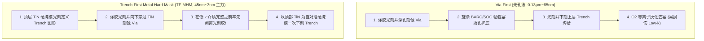

# 金属化与铜电镀：双大马士革（Dual Damascene）与 ECP 超填机理

- **所属模块**：`03_七大核心工艺 / 06_金属化与电镀`

---

## 1. 为什么业界被迫从“铝减法刻蚀”转向“铜双大马士革”？

### 1.1 铝减法刻蚀的微缩物理极限
在 `0.25 μm` 及更早技术节点，后段互连（BEOL）普遍采用“**PVD 整面溅射 Al-Cu $\to$ 光刻 $\to$ 氯基干法刻蚀（RIE） $\to$ 填充氧化硅介质**”的减法工艺（Subtractive Etch）。进入 `0.18 μm / 0.13 μm` 节点后，芯片互连线寄生 $RC$ 延迟超越晶体管本征门延迟成为主频瓶颈，铝体系在以下三大物理维度彻底触顶：

1. **体电阻率与 $RC$ 延迟瓶颈**：
   - 纯铜体电阻率仅 **`1.68 μΩ·cm`**，显著低于铝铜合金（`~2.65–2.8 μΩ·cm`），可将等截面金属线的 $RC$ 延迟压低 **`35%~40%`**；
   - 在高密度细线场景下，铝互连极易因高电流密度而提前发生断线。
2. **熔点与抗电迁移（EM）寿命差距**：
   - 铜熔点高达 **`1085 °C`**（铝仅 **`660 °C`**），金属晶格键能更强、室温原子自扩散系数低几个数量级，天然抗电迁移能力远胜于铝。
3. **硅器件的“深能级剧毒”**：
   - 铜原子在单晶硅与常规 $\text{SiO}_2$ 中的间隙扩散速率极快，哪怕极痕量穿透进入有源区，会在硅禁带正中引入致命的**深能级复合陷阱**，瞬间拉爆结漏电与少子寿命。

### 1.2 为什么铜不能用传统干法刻蚀，必须采用“大马士革镶嵌工艺”？
- **卤化物挥发性物理壁垒**：铝与氯等离子体生成的 $\text{AlCl}_3$ 在 `~180 °C` 即可升华抽走；而铜与氯、氟反应生成的 $\text{CuCl}_x$、$\text{CuF}_x$ 饱和蒸气压极低，必须加热至 **`200~250 °C` 以上** 才开始挥发——远超光刻胶热变形塌陷温度且伴随剧烈侧壁腐蚀。
- **IBM 1997 CMOS 7S 里程碑与双大马士革降本增效**：
  1997 年 IBM 率先将“先挖沟槽、后裹阻挡层、电镀填铜、再 CMP 磨平”的**铜大马士革（Damascene）**工艺导入量产。相较于**单大马士革**（通孔 Via 与导线槽 Trench 分开各做 1 次阻挡层/种子层/ECP/CMP），**双大马士革（Dual Damascene）**一次电镀同步填满下层 Via 与上层 Trench：
  - 直接省去 **1 次 Barrier/Seed、1 次 ECP 与 1 次 CMP** 的巨额制造成本；
  - 彻底消除了 Via 顶面与 Trench 底面之间的金属接触氧化界面，显著压降通孔接触电阻与 EM 断路风险。

---

## 2. 双大马士革（Dual Damascene）集成架构与 6 步标准流程

### 2.1 三大图形化集成架构流程对比

| 集成路线 | 核心工艺优势 | 致命痛点与工程局限 | 适用技术节点 |
| :--- | :--- | :--- | :--- |
| **Via-First（先孔法）** | 涂胶平面高度平坦，深通孔套刻最容易；无需额外金属硬掩模 | 牺牲塞（SOC/BARC）回刻深浅极难拿捏，Via 口边缘极易冒出尖刺残墙（**Fence**）；后续 $\text{O}_2$ 去胶直接破坏多孔 Low-k 抬高 $k$ 值 | `0.13 μm ~ 65 nm` |
| **Trench-First（先槽法）** | 不需填充牺牲塞，避免孔口 Fence 残留 | 必须在已刻好深沟槽的起伏地形上再次涂布光刻胶，造成胶厚极不均匀且通孔曝光严重离焦（DOF 失控） | 极少直接用于先进窄线距 |
| **TF-MHM（先槽金属硬掩模）** | 剥离光刻胶早于多孔超低 k（ULK）最终成型，**彻底保护 ULK 免遭灰化损伤**；同时根绝含胺 Low-k 引发的**光阻中毒（PR Poisoning）** | 需增设 PVD TiN 硬掩模沉积及刻蚀后精细湿法剥离；但线宽精度、侧壁垂直度与通孔套刻裕度最优 | **`45 nm` 以下至 `3 nm` 绝对主流** |

### 2.2 6 步标准金属化全流程细节
1. **ULK 介质沉积与双图形刻蚀**：
   - 沉积多孔 SiCOH（$k \approx 2.2\text{–}2.5$）与 $\text{SiCN}$ 底部刻蚀阻挡层，按 TF-MHM 完成刻蚀后用稀 HF/有机胺清洗去除聚合物残渣并封堵多孔侧壁。
2. **阻挡层与润湿衬垫（Barrier & Liner）沉积**：
   - **扩散阻挡层（Barrier）**：用高致密非晶 **PVD / ALD TaN**（厚度 `1.5~3.0 nm`）严密封死铜向 Low-k 扩散的通道；
   - **润湿衬垫（Liner）**：原位铺设 **PVD Ta** 或 **CVD/ALD Co / Ru（`1~2 nm`）**。纯 TaN 表面能偏低易使铜成核团聚，Co/Ru 极佳的晶格润湿性大幅提升了铜侧壁连续性与回流填隙能力；
   - **iPVD 悬垂削薄（Resputter）**：高电离度物理气相沉积施加射频晶圆偏压吸引 $\text{Ta}^+/\text{Cu}^+$ 垂直轰击孔底，同时借由 Ar 离子反溅射削平沟槽入口角尖悬垂（Overhang）并将原子推至深侧壁，保障底部角覆盖率。
3. **铜种子层（Cu Seed Layer）沉积**：
   - 利用 iPVD / SIP 在非导电 TaN 表面铺出连续导电阴极（表面典型 `15~40 nm`，深孔底壁连续有效厚度需 **`> 2~3 nm`**）；
   - 先进节点常改用 **CuMn 合金种子层**：退火时微量 Mn 原子主动向外偏析并与介质氧反应生成超薄自对准 $\text{MnSiO}_x$ 阻挡层，允许把高阻 TaN 减薄一半。
4. **电化学电镀（ECP）自底向上超填**（详见第 3 节）。
5. **低温退火（Post-Plating Anneal）**：
   - 在 `100~350 °C`（$\text{N}_2/\text{H}_2$ 还原气氛）退火 `15~60 min`。刚镀完的细晶铜在室温下就会持续发生“**自退火（Self-Anneal）**”引发薄膜硬度与 CMP 去除率随排队等候时间（Q-Time）剧烈波动；
   - 强制退火可瞬时定格晶体结构，驱动晶粒长大成贯穿线宽的**“竹节状晶粒（Bamboo Structure）”**将有效电阻率压低 **`15%~20%`**，但温度不可过高以免冷却拉应力诱发通孔底空洞（SIV）。
6. **多步 Cu CMP 平坦化**。

---

## 3. ECP 电镀“自底向上超填（Superfilling）”物理化学与硬件控制

### 3.1 等角电镀为什么一定封口留空洞？
在纯 $\text{CuSO}_4 + \text{H}_2\text{SO}_4$ 无添加剂酸性电镀液中，高深宽比（$AR > 3\text{–}6:1$）深沟槽的顶部拐角电力线高度集中且液相 $\text{Cu}^{2+}$ 扩散距离最短。结果就是顶部开口处沉积速率远快于扩散受阻的深孔底部，底部尚未填满，顶部槽口便率先融合封死——在导线正中永久留下一条致命的**中心缝隙空洞（Seam / Keyhole Void）**。

### 3.2 三大有机添加剂与 Moffat CEAC 超填动力学方程
2000 年前后，NIST 的 T. P. Moffat、Josell 与 Columbia 大学的 A. C. West 共同提出了**曲率增强加速剂覆盖度模型（CEAC, Curvature-Enhanced Accelerator Coverage）**，完美揭示了工业界超填配方运转的电化学奥秘：

- **抑制剂（Suppressor，高分子聚醚 PEG/PPG + 氯离子 $\text{Cl}^-$）**：
  - 分子量高达 `2000~10000 Da`，液相扩散极慢；借助约 `50 ppm` $\text{Cl}^-$ 桥联快速吸附于晶圆上表面与槽口上部，构筑致密高极化阻抗 $\text{Cu}^+\text{-Cl-PEG}$ 膜，将表层过电位拉高数百毫伏，**强力压死槽口顶部的镀铜速率**。
- **加速剂（Accelerator / Brightener，含硫小分子如 SPS 二硫代丙烷磺酸钠）**：
  - 分子量极小、扩散速度比 PEG 快一个数量级以上，率先穿入深孔底部吸附于铜种子表面并置换掉抑制剂膜，大幅降低界面电荷转移电阻。
- **CEAC 曲率正反馈动力学机制**：
  记表面局部吸附加速剂覆盖度为 $\theta_{\text{acc}}$，法向生长速度为 $v_n$，局部几何平均曲率为 $\kappa$，其随时间的演化解方程为：
  $$\frac{\mathrm{d}\theta_{\text{acc}}}{\mathrm{d}t} = k_{\text{ads}} C_{\text{acc}}(1 - \theta_{\text{acc}}) - k_{\text{des}}\theta_{\text{acc}} + \kappa v_n \theta_{\text{acc}}$$
  在沟槽**内凹底部（Concave Bottom, $\kappa > 0$）**，随着铜向外生长，**凹面几何表面积剧烈收缩（$\mathrm{d}A/\mathrm{d}t < 0$）**！而极难脱附的已吸附 SPS 被迫向更小的表面积挤靠浓缩（$\kappa v_n \theta_{\text{acc}} > 0$），推动底部 $\theta_{\text{acc}}$ 迅速冲向饱和！覆盖度越高 $\to$ 底部沉积电流越猛 $\to$ **实现彻底无空洞的自底向上超填（Bottom-up Superfilling）**。
- **整平剂（Leveler，含氮阳离子聚合物/杂环染料如 Janus Green B）**：
  - 当深沟槽被底部加速剂猛推填满冲出表面时，过度浓缩的加速剂惯性会在密集窄线上方继续飞速拱出高凸数百纳米的铜鼓包（**Momentum Plating / Overplate Hump**），严重拖累后续 CMP。受传质扩散控制的阳离子整平剂专被高曲率凸起峰尖强电场吸引吸附，**定点毒化过剩加速剂**，将过载顶面削平。

### 3.3 现代 ECP 机台硬件与波形控制（Lam Sabre / AMAT Raider）
1. **喷泉式镀液槽（Fountain Cell）与不溶阳极隔膜系统**：
   - 晶圆面朝下高速旋转作阴极，电解液穿过均流多孔板自下而上均匀喷涌排走微气泡；
   - 早期磷铜可溶阳极极易产生阳极泥颗粒污染；现代 300mm 机台普遍采用**微孔阳离子交换膜隔离 + 铱涂覆钛不溶性阳极（$\text{IrO}_2/\text{Ti}$）+ 独立外挂 $\text{CuO}$ 粉末自动补铜回路**，彻底根绝阳极颗粒并精准稳住镀液组分。
2. **多区虚拟分段阳极（Segmented Concentric Anodes）**：
   - 超薄铜种子层（`10~20 nm`）自身存在明显片内薄膜电阻，全部电流从晶圆外周金属触指（Contact Finger）注入向中心传导，产生强烈的 **Terminal Effect（终端电压降效应：边缘电压高镀厚、中心电压低镀薄）**；
   - 通过同心分环的独立供电分区阳极与屏蔽环精准调节径向电流密度分布，将整片 300mm 镀层均匀性压控至 **`< 1.5%~2.0% (1σ)`**。
3. **热入槽（Hot Entry）与在线 CVS 浴液监控**：
   - 极薄铜种子层接触强酸性镀液（pH `< 1`）在数百毫秒内就会被化学溶穿断路！机台必须在晶圆倾斜入液瞬间提前施加以保护负偏压（**Hot Entry**），立即确立阴极还原防溶环境；随后切入“低电流保形打底 $\to$ 中电流激活 CEAC 超填 $\to$ 高电流高速铺平（或脉冲反向电镀 PRP）”；
   - 产线串联 **CVS（循环伏安溶出分析仪）** 实时滴定监控 SPS/PEG/Leveler 活性并自动执行排老补新（**Bleed & Feed**）。

---

## 4. 常见电镀缺陷与产线 Troubleshooting

| 缺陷现象 | 微观物理/化学根因 | 在线表征（FIB-SEM / CVS / E-Test） | 产线工程排查与解决对策 |
| :--- | :--- | :--- | :--- |
| **Overhang Pinch-off Void（上部封口水滴空洞）** | 1. 前道 iPVD 种子层槽口悬垂过厚阻塞入口； 2. 抑制剂浓度跌落或 Step 1 大电流触发过早 | FIB-SEM 切面显示 Via 颈部或窄槽中上部留有水滴状中心闭合空洞；开尔文电阻飘高 | 强化 iPVD 反溅射削薄入口悬垂；利用 **CVS 在线监控** 校准 SPS/PEG/Leveler 配比并补足抑制剂；下调 Step 1 初始电流密度延长 CEAC 启动窗 |
| **Bottom Seed-Dissolve Void（孔底种子层溶解空洞）** | 极细深孔底角铜种子太薄（`< 2 nm`）或入槽氧化，遇强酸镀液瞬间溶断失去阴极导电性 | 孔底角出现不规则贴壁空洞；WAT 电学测试成片 **Via Open（通孔开路）** | 提高 Hot Entry 保护偏压与入液斜率角速度；切用低酸高铜配方减弱腐蚀性；在 Cu Seed 前导入 **ALD Co/Ru 辅助衬垫**兜底导电 |
| **Overburden Mound（密集线区上方巨型铜包）** | **Momentum Plating 失控**：整平剂因高电流电解降解或被过滤芯吸附耗尽，止不住密集窄槽过冲 | 轮廓仪/MetaPULSE 测得高密度 SRAM 上方比空白区高凸 `> 250~400 nm`，拖垮 CMP 平坦度 | 通过 CVS/HPLC 补充 Leveler 浓度并加速 Bleed & Feed 换液；提升喷泉流泵转速增强整平剂向凸峰的传质输送 |
| **Pinhole / Organic Inclusion（微针孔与有机杂质夹杂）** | 晶圆表面微疏水滞留纳米气泡，或 SPS 降解有机副产物共沉积在铜晶界中 | 退火后铜面鼓出微泡，CMP 后导线出现黑洞缺口且有效电阻率异常高于 `~1.9 μΩ·cm` | 检查入槽前真空脱气水预润湿模块及液路脱泡泵状态；追踪镀液累积安培小时数（Amp-Hrs），及时排废清除裂解产物 |
