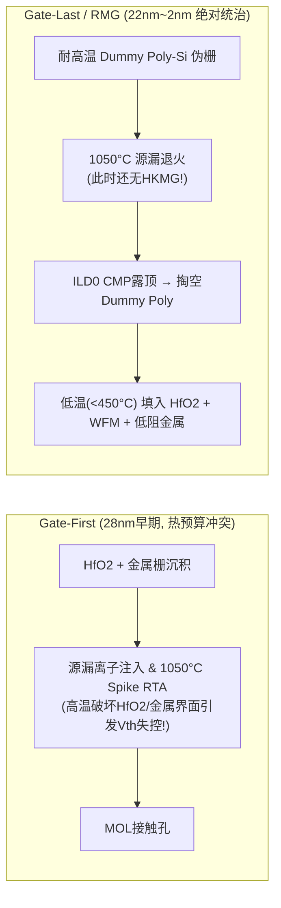

# 钨栓塞（W-Plug）CVD 填充与替换金属栅（RMG）功函数控制

- **所属模块**：`03_七大核心工艺 / 06_金属化与电镀`

---

## 1. 中段 MOL 的核心角色：为什么接触孔（Contact）长期用钨（W）而不用铜？

在晶体管硅源/漏极硅化物（NiSi / $\text{TiSi}_2$）以及多晶硅/金属栅顶部与第一层铜互连（M1）之间，中段工艺（MOL, Middle of Line）需垂直打通几十亿个直径仅十余纳米、深宽比高达 **`8:1~18:1`** 的接触孔（Contact / M0）。

### 为什么接触孔不能直接沿用铜双大马士革？
1. **硅器件的“深能级复合剧毒”**：
   - 接触孔底部直抵极脆弱的掺杂单晶硅超浅结与栅氧化层近邻区域。铜在硅中的扩散系数极高，哪怕极痕量铜原子穿过底部渗透入有源区，会在硅禁带中央引入致命的**深能级复合中心**，瞬间摧毁少子寿命与晶体管关态漏电（$I_{\text{off}}$）。
2. **PVD 物理溅射的保形极限**：
   - Cu ECP 高度依赖直视性物理溅射（PVD）沉积连续导电阴极，但在高深宽比超窄接触孔深底侧壁，PVD 台阶覆盖率急剧萎缩至 `< 10%`，极易断层生成空洞。
3. **极佳的热机械稳定性匹配**：
   - 钨熔点高达 **`3422 °C`**、热膨胀系数（CTE $\approx 4.5\text{ ppm/K}$）十分贴近单晶硅（`2.6 ppm/K`，而 Cu 高达 `16.5 ppm/K`），可承受后道多层低 k 介质沉积热循环而不产生热挤压损伤；
   - 钨抗电迁移（EM）与应力迁移（SM）能力远超传统铜和铝。
4. **CVD / ALD 保形无缝填充天赋**：
   - 含钨气相前驱体可在动力学控制区实现接近 **`100%` 台阶覆盖率的极高保形填充**。

---

## 2. 钨栓塞（W-Plug）四步工艺化学、动力学与无氟演进

```text
[1. Ti/TiN 粘附阻挡] ─▶ [2. ALD W 成核层 (B2H6/SiH4)] ─▶ [3. Bulk CVD W (WF6+H2)] ─▶ [4. W CMP 磨平露出独立钨柱]
```

### 2.1 第一步：Ti / TiN 粘附与抗氟侵蚀盔甲层
先沉积超薄 **PVD / PECVD Ti** 与硅反应形成低阻欧姆接触，紧接着沉积高致密 **MOCVD / ALD TiN** 阻挡层（厚度 `2~5 nm`）。
- **TiN 的物理生死防线**：后续主前驱体六氟化钨（$\text{WF}_6$）具有极强腐蚀性！一旦孔底角部 TiN 覆盖出现微米/纳米级针孔裂隙，$\text{WF}_6$ 立即长驱直入啃噬单晶硅：
  $$2\text{WF}_6 + 3\text{Si} \longrightarrow 2\text{W}\downarrow + 3\text{SiF}_4\uparrow$$
  反应逸出的挥发性 $\text{SiF}_4$ 气体在晶体管源/漏区掏出形似蛀虫蛀空的**“虫洞（Wormholes）”或硅侵蚀（Si Encroachment）**，直接刺穿浅结导致器件短路报废！同时游离氟原子扩散穿透至邻近 HKMG 的 $\text{HfO}_2$ 层内还会引发显著的阈值电压 $V_{\text{th}}$ 漂移。

### 2.2 第二步：成核层（Nucleation Layer, ALD W）工程对比
Bulk CVD 的氢气还原反应在导电氮化钛阻挡层表面的成核能垒极高、孵育延迟极长。因此必须先采用强还原剂脉冲打底沉积 **`1.5~3.0 nm`** 细晶粒连续钨成核层：

| 成核还原体系 | 核心化学反应与温压窗 | 微观结构与体电阻率特征 | 先进产线工程选型判断 |
| :--- | :--- | :--- | :--- |
| **$\text{SiH}_4$（硅烷）还原法** | $2\text{WF}_6 + 3\text{SiH}_4 \to 2\text{W} + 3\text{SiF}_4\uparrow + 6\text{H}_2\uparrow$（`300~400 °C`） | 生长速率快，但 Si 原子易残留固溶于钨晶格形成硅化钨相，成核层电阻率高达 `~15–25 μΩ·cm` 且粗糙度较大 | 适用于早代宽接触孔与大通孔，先进节点逐步淘汰 |
| **$\text{B}_2\text{H}_6$（乙硼烷）ALD 法** | $\text{B}_2\text{H}_6$ 与 $\text{WF}_6$ 脉冲交替表面自限制反应（`300~350 °C`） | 生成极平整致密的**纳米非晶硼化钨成核模板**，无 Si 掺杂干扰并引导后续大晶粒钨柱状生长，将接触孔总电阻压低 **`20%~30%`** | **`28 nm` 以下先进逻辑 MOL 与 3D NAND 绝对主力**（严控硼脉冲时间防止过硼增阻） |

### 2.3 第三步：主填充（Bulk CVD W）传质动力学与“缝隙打开（Seam Opening）”困局
在 `350~420 °C`、腔体气压 `20~90 Torr` 下采用过量氢气还原 $\text{WF}_6$：
$$\text{WF}_6 + 3\text{H}_2 \longrightarrow \text{W}\downarrow + 6\text{HF}\uparrow$$
- **克努森扩散（Knudsen Diffusion）与表面反应限制区调控**：
  在十余纳米窄孔道内，前驱体分子与侧壁碰撞频率远高于分子间碰撞（克努森扩散主导）。工程上必须锁定**较低温度、较高反应分压的表面反应速率限制区（Surface-Reaction Limited，Damköhler 数 $Da \ll 1$）**，保证气体分子来得及经历数十次碰撞深入孔底再均匀还原；若温度过高掉入传质限制区，孔口瞬间早封形成大空洞；
- **中心接缝（Center Seam）与 W CMP 漏斗惨案**：
  即便实现了 100% 完美的等角保形生长，两侧壁同步向孔正中心合拢时，正中心必然会留下一条原子级低密度接缝（**Center Seam**）。在随后的 **W CMP** 中，强氧化性研磨液（$\text{H}_2\text{O}_2$ + 硝酸铁/碘酸钾催化剂）会沿着这条中心接缝疯狂向内垂直刻蚀，将一条 1nm 缝隙腐蚀挖成上宽下窄的漏斗黑洞（**Seam Opening / Keyhole**），大幅拉高接触电阻并截留清洗残液！
- **先进节点无缝/无氟三大破局路线**：
  1. **抑制剂定向填孔（Selective Inhibitor Treatment）**：在填孔中途向孔口表面注入氮/氨等离子体抑制顶部晶核生长，强行实现底部快于顶部的**自底向上无接缝填充（Seam-Free Bottom-up W）**；
  2. **沉积-刻蚀循环（Dep-Etch-Dep）**：交替通入 $\text{NF}_3/\text{ClF}_3$ 刻蚀削宽收缩的孔口再续填，消除合拢缝隙；
  3. **无氟钨前驱体（Fluorine-Free W, FFW）**：在亚 15nm 接触孔导入五/六氯化钨（**$\text{WCl}_5 / \text{WCl}_6$**）替代 $\text{WF}_6$，从源头上消灭 $\text{HF}$ 与氟向 $\text{HfO}_2$ 扩散的毒害！

### 2.4 第四步：W CMP 平坦化
使用含强氧化剂（$\text{H}_2\text{O}_2$ + 铁盐/碘酸钾）的酸性胶体 $\text{SiO}_2/\text{Al}_2\text{O}_3$ 研磨液持续将硬质钨表面氧化成疏松三氧化钨（$\text{WO}_3$）再机械剥净，露出与介质齐平的独立钨柱。

---

## 3. 替换金属栅（RMG, Replacement Metal Gate）与功函数工程

### 3.1 为什么 28nm/22nm 以下放弃 Gate-First 转向 Gate-Last（RMG）？
在早期先栅极（Gate-First）HKMG 架构中，$\text{HfO}_2$ 栅介质与金属栅电极必须共同经历后续源漏区高达 **`1000~1050 °C` 的尖峰退火（Spike RTA）**。极端高温诱发 $\text{HfO}_2$ 生成大量氧空位并触发金属栅与介质的界面原子互混及**费米能级钉扎（Fermi-Level Pinning）**，导致 PMOS 阈值电压 $V_{\text{th}}$ 严重偏移失控！



**RMG（后栅极替换工艺）** 用廉价耐高温的**伪多晶硅栅（Dummy Poly-Si）**独自扛过所有高温活化退火，待源漏定型后再挖空伪栅，在 **`< 450 °C` 极温和热预算**下精确填入脆弱的 HKMG 多层三明治叠层！

### 3.2 RMG 6 步核心工艺流与“三明治”功函数调制架构
1. **ILD0 填充与 CMP 露顶（Open Gate）**：沉积介质层并 CMP 磨出 Dummy Poly 顶面；
2. **伪栅剥离（Dummy Poly Pull）**：采用高选择比 TMAH / $\text{NH}_4\text{OH}$ 湿法刻蚀或精密干法刻蚀彻底拔净多晶硅，完美保护两侧 Spacer 侧墙与沟道；
3. **超薄界面层与高 k 栅介质**：化学清洗生长极均匀 **`0.6~0.8 nm` 界面氧化硅（IL $\text{SiO}_2$）** $\to$ ALD 沉积 **`1.5~2.0 nm` $\text{HfO}_2$** $\to$ 低温后沉积退火（PDA）修补氧空位；
4. **多层 ALD 功函数金属（WFM）精确调控 $V_{\text{th}}$**：
   ```text
   ┌────────────────────────────────────────────────────────────┐
   │  [顶层低阻主填充金属: Al (28nm) → CVD W → Co/Ru (FinFET/GAA)] │ ── 压低栅极横向抵抗 Rg
   │  [阻挡润湿胶水层: ALD TiN (~1.0 nm)]                         │
   │  [NMOS 功函数层: ALD TiAlC / TiAl (~1.0–2.0 nm)]             │ ── 活泼 Al 调控有效功函数 ~4.1–4.3 eV
   │  [PMOS 功函数层: ALD TiN / TaN (~1.0–3.5 nm)]                │ ── 富氮 TiN 调控有效功函数 ~4.9–5.1 eV
   │  [高 k 栅介质层: ALD HfO2 (~1.6 nm)]                         │
   │  [界面缓冲氧化层: Chemical SiO2 (~0.6 nm)]                   │
   └────────────────────────────────────────────────────────────┘
                         单晶硅 Fin / GAA 纳米片沟道
   ```
   - **Multi-$V_{\text{th}}$ 阶梯调制技巧**：同一芯片需同时集成 uLVT、LVT、SVT、HVT 等 4~6 档性能晶体管。传统 FinFET 靠**多张光刻掩模配合湿法选择性剥离（例如利用稀释 SC1 精准剥薄特定区域的 TiN 厚度）**，通过改变 TiN/TiAlC 厚度组合产生不同界面耦合功函数阶梯；
5. **低阻填栅主金属（Low-R Gap-Fill）**：在内腔填满低阻 Al、无氟 W 或 Co/Ru 以压低栅电极横向电阻 $R_g$；
6. **Metal Gate CMP（MG CMP）**：非选择性精抛磨除沟槽外全部多余多层金属并维持栅高均一性。

### 3.3 3nm/2nm GAA Nanosheet 时代的“空间体积危机”与偶极子破局
进入全环绕栅极（GAA Nanosheet）后，上下堆叠的硅纳米片之间的垂直沟槽缝隙（$T_{\text{sus}}$）收窄至仅 **`8~12 nm`**！扣除上下双面合计约 `4 nm` 的 IL + $\text{HfO}_2$ 后，留给金属栅填充的净高度只剩极狭窄的 **`4~8 nm`**！传统总厚度高达 `5~8 nm` 的“多套 WFM 金属叠层”根本无法钻入缝隙，一沉积立刻**在入口夹断封口（WFM Pinch-off）**导致内部空洞及多阈值调档失效！

**先进产线核心突破——介电偶极子工程（Dipole-First Engineering）**：
在 $\text{HfO}_2$ 沉积之后，仅利用 ALD 铺设厚约 **`0.1~0.5 nm` 的原子级氧化物偶极子超薄层**：
- **$\text{La}_2\text{O}_3$（氧化镧）**：经轻微退火向 $\text{HfO}_2$/IL 界面扩散形成负向偶极矩，把 NMOS 阈值电压向低侧精确拉移数百毫伏；
- **$\text{Al}_2\text{O}_3 / \text{Ga}_2\text{O}_3$**：产生反向界面偶极矩调节 PMOS 阈值；
- **工程收益**：靠介电偶极子在原子层层面完成了 4~6 档 $V_{\text{th}}$ 分级后，全片随后只需覆盖一层极薄 **`~1.5 nm` 的单一超薄金属 WFM** 与低阻填充金属，彻底解放了宝贵的 GAA 纳米片空间体积！

---

## 4. W-Plug 与 RMG 产线常见异常 Troubleshooting

| 异常警报现象 | 底层物理/化学根因 | 工程验证与修复举措 |
| :--- | :--- | :--- |
| **接触孔电阻 $R_c$ 异常飙高伴随源漏结漏电（Wormholes）** | 1. 孔底侧壁 PVD TiN 覆盖裂断，$\text{WF}_6$ 钻入啃噬单晶硅；<br>2. 前清洗未净，硅化物表面残留氟氧高阻层 | 通过 **FIB-TEM EELS/EDX** 检视孔底是否存在虫洞与氟侵蚀；将 PVD TiN 升级为高保形 **ALD TiN**；降低初始 $\text{WF}_6$ 分压或导入 **$\text{WCl}_5$ 无氟钨** |
| **W CMP 后栓塞正中央出现黑洞（Seam Opening）** | 1. Bulk CVD W 温度过高掉入传质控制区，孔口早封留大缝；<br>2. W CMP 强氧化液沿缝隙过深掏蚀 | 调低 Bulk W 温度恢复表面反应动力学保形性，导入 **Inhibitor/Dep-Etch-Dep 无缝填孔**；降调 W CMP $\text{H}_2\text{O}_2$ 浓度或过抛比例 |
| **RMG NMOS 阈值电压大幅正向漂移（Vth Spike）** | 含活泼铝的 **TiAlC 层在腔室转移期间发生微弱氧化失活**（Al 变成 $\text{AlO}_x$ 失去低功函数特性） | 严控集群机台（Cluster Tool）真空传输排队时间，保证 $\text{HfO}_2$、TiN、TiAlC 及阻挡层在**超高真空不停顿连续沉积（Vacuum Break-Free）** |
| **RMG 栅电阻 $R_g$ 波动或 GAA 区域局部阈值失控** | 1. MG CMP 过度抛光 Dishing 磨薄顶层填充金属；<br>2. 狭缝内 WFM 过厚发生夹断或湿法剥离毛细残留 | 优化 MG CMP 1:1 非选择比终点停机窗压低 Dishing；全面切换 **Dipole-First 偶极子调阈方案** 压缩金属厚度；湿法剥离后切用 IPA Marangoni 无水痕干燥 |
