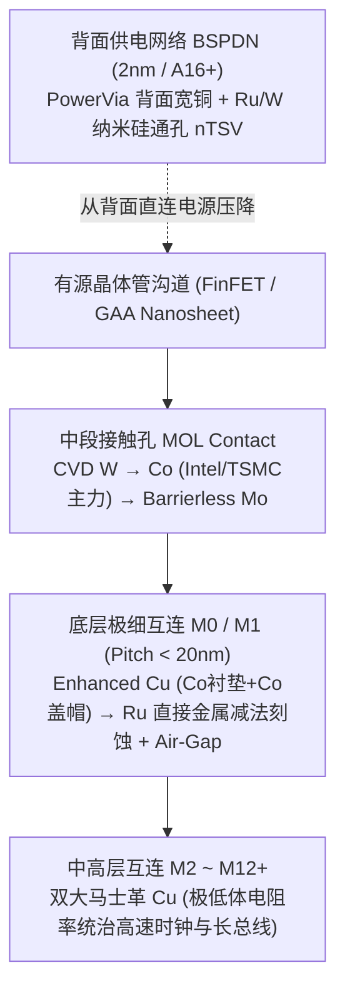

# 先进节点互连演进：Co / Ru / Mo 替代趋势与电迁移可靠性

- **所属模块**：`03_七大核心工艺 / 06_金属化与电镀`

---

## 1. 为什么在 10nm 以下，“导电之王”铜开始撑不住了？

在宏观块体世界里，纯铜电阻率（`1.68 μΩ·cm`）仅次于银，远远将钨（`5.3 μΩ·cm`）、钴（`6.2 μΩ·cm`）和钌（`7.1 μΩ·cm`）甩在身后。但当先进逻辑节点最底层金属线（M0 / M1）关键线宽微缩至 **`10~15 nm`** 以下时，铜遭遇了由量子尺寸散射与扩散动力学支配的**“三重尺寸效应（Size Effect）”全面崩溃**。

### 1.1 有效电阻率飙升的三大定量物理机制
1. **阻挡层有效截面积挤压效应**：
   铜极易向多孔 Low-k 介质快速扩散引发击穿，沟槽两侧和底部必须强制包裹高阻 TaN/Ta 阻挡与衬垫层（总厚通常难以缩至 `2~3 nm` 以下）。以一条线宽 $W = 10\,\text{nm}$、线高 $H = 20\,\text{nm}$ 的 M0 金属线为例：
   $$A_{\text{Cu}} = (W - 2t_b)(H - t_b) = (10 - 5) \times (20 - 2.5) = 87.5\,\text{nm}^2$$
   相较于理想 $200\,\text{nm}^2$ 截面，**超 `56%` 的宝贵导电截面积直接被高阻 TaN（体电阻率 `~200 μΩ·cm`）抢占**！
2. **表面散射（Fuchs-Sondheimer, FS）与晶界散射（Mayadas-Shatzkes, MS）暴击**：
   根据 Matthiessen 定则，纳米受限金属线的有效电阻率 $\rho_{\text{eff}}$ 可表征为：
   $$\rho_{\text{eff}} \approx \rho_0 \left[ 1 + \frac{3}{8}(1 - p)\frac{\lambda_{\text{mfp}}}{w_{\text{eff}}} + \frac{3}{2}\frac{R}{1 - R}\frac{\lambda_{\text{mfp}}}{d_g} \right]$$
   - $\lambda_{\text{mfp}}$：室温电子平均自由程；
   - $p$：侧壁界面镜面反射系数（粗糙 TaN 界面令 $p \to 0$ 呈现全漫反射）；
   - $d_g$：平均晶粒尺寸（被狭窄沟槽宽度 $w_{\text{eff}}$ 物理限制无法充分长大）；
   - $R$：晶界反射系数。
   **纯铜在 300 K 下的电子平均自由程高达惊人的 `39 nm`**！在仅 `5~8 nm` 宽的铜芯内，自由电子每奔跑数纳米便狠狠撞击在侧壁与密集晶界上，**使铜线真实有效电阻率飙升至体材料值的 `6~10 倍`（`10~16 μΩ·cm`）**！叠加截面积减半效应，单位长度线电阻 $R/L = \rho_{\text{eff}} / A_{\text{Cu}}$ 比宏观理论值暴涨 **`15~20 倍` 以上**！
3. **电迁移（EM）电流密度雪崩**：
   工作电压难以等比例下降，线宽减半令局部直流电流密度 $J$ 轻易突破 **`10^6 A/cm²`**。澎湃传导电子风（Electron Wind）剧烈撞击并带走铜原子，在阴极端迅速掏空断线（Void Open），在阳极端挤出铜晶须刺穿超薄层间介质短路（Extrusion Short）。

---

## 2. 金属新星物理指标（$\rho_0 \times \lambda_{\text{mfp}}$）与 Co / Ru / Mo 深度对比

在亚 15nm 互连赛道上，决定金属线导电胜负的物理判据不再是单一的体电阻率 $\rho_0$，而是**体电阻率与电子平均自由程的乘积品质因数（$\rho_0 \cdot \lambda_{\text{mfp}}$）**以及**能否彻底省去厚重阻挡层（Barrierless）**：

| 金属材料 | 体电阻率 $\rho_0$ ($\mu\Omega\cdot\text{cm}$) | 电子平均自由程 $\lambda_{\text{mfp}}$ ($\text{nm}$) | 品质因数 $\rho_0 \cdot \lambda$ ($10^{-16}\Omega\cdot\text{m}^2$) | 阻挡层需求与扩散稳定性 | 先进产线真实定位与工程 Trade-off |
| :--- | :---: | :---: | :---: | :--- | :--- |
| **Cu（铜）** | **1.68** | **39.0**（极长，散射灾难） | `6.55` | **必须**（TaN/Ta `~2–3 nm`） | **M2 以上高层走线绝对霸主**；底层 M0/M1 依靠 ALD 超薄阻挡与 Co 衬垫/盖帽强行延寿 |
| **W（钨）** | 5.3 | ~15.5 | `~8.2` | 必须（TiN） | 传统 Contact 与早代 3D NAND 字线主力；狭缝中阻挡层占位高且含氟侵蚀严重 |
| **Co（钴）** | 6.2 | **~10–14**（各向异性） | `~6.2–7.4` | **超薄衬垫**（`~1 nm` TiN） | **MOL Contact 主力**：熔点高 `1495 °C`，超细高深宽比接触孔填充稳、抗 EM 优于铜数倍；但 CMP 易腐蚀且 M0 线电阻优势有限 |
| **Ru（钌）** | 7.1 | **~6.6（极短！）** | **`4.69`（全场最优！）** | **可无阻挡层（Barrierless）** | **亚 10nm 节距底层线 & 背面供电（BSPDN）终极王牌**：几乎不扩散进低 k 介质，且支持**直接减法刻蚀（DME）+ 空气隙（Air-gap）** |
| **Mo（钼）** | 5.3 | ~11.2 | `~5.9` | **可无阻挡层** | **200+ 层 3D NAND 字线 & 逻辑 MOL 新星**：无需 TiN 阻挡层即可无氟 ALD 生长，在窄字线中综合电阻比钨狂降 **`30%~50%`** |

### 2.1 产线分层金属化演进路线（Hybrid Metallization Roadmap）

- **Co 在产线的真实进退复盘**：
  Intel 10nm / Intel 7 曾在 M0/M1 率先全面导入 Co 替代 Cu，有效消除了超细沟槽填充空洞并大幅提高抗 EM 裕度；但工程量产证实，在 `18~22 nm` 半节距处 Co 较难取得比“超薄阻挡层改良铜”更低的线电阻，且 Co CMP 过程极易受微小电位差触发溶解腐蚀、拖慢良率爬坡。因此业界（包括 Intel 4 / TSMC / Samsung）普遍形成共识：**把 Co 稳固用于极高深宽比 MOL Contact 接触孔**，而 M0/M1 则采用 **Enhanced Cu（Cu + 超薄 Co 衬垫 + 选择性 Co 盖帽）** 强行压榨潜力，直到线距跨越 **`16~18 nm` Pitch 交叉点** 再全面切换至 **Ru**。
- **Ru 直接金属减法刻蚀（Direct Metal Etch, DME）+ 空气隙（Air-Gap）**：
  不同于铜找不到易挥发刻蚀产物，Ru 在氧气/氯气等离子体下能生成挥发性 $\text{RuO}_4$（需严格密封尾气除毒与防腔室沉积）。由此工艺流程得以“返璞归真”回归减法路线：
  1. 先整面沉积纯 Ru 并高温退火长出极大晶粒；
  2. 光刻 + RIE 直接自上而下刻出陡直 Ru 导线（零凹陷且极度均匀）；
  3. 用非保形介质封顶或刻意在极窄线间留出真空/空气间隙（**Air-gap, $k = 1.0$**）！
  这不仅彻底甩掉了阻挡层挤压、大马士革空洞与 Ru CMP Dishing 三座大山，还顺带将线间寄生电容砍低 **`25%~35%`**。
- **Mo 在 200+ 层 3D NAND 与 MOL 的崛起**：
  随着 3D NAND 堆叠迈向 200~400 层，横向字线（Word Line）狭缝越压越窄，传统 TiN + $\text{WF}_6$ 面临“TiN 抢占大半通道 + $\text{WF}_6$ 含氟损伤周边高 k $\text{Al}_2\text{O}_3$ 阻挡氧化层”双重窘境。导入无氟氯化物前驱体（$\text{MoCl}_5 / \text{MoO}_2\text{Cl}_2$）沉积无阻挡层 **ALD Mo** 后，整条狭缝全归高电导 Mo 所有，有效电阻骤降 `30%~50%`，已成为前沿存储产线升级标配。

---

## 3. 电迁移（EM）失效物理与界面延寿工程

### 3.1 布莱克方程（Black's Equation）与 Blech 临界不死长度
1969 年 J. R. Black 提出评估互连电迁移平均无故障时间（$MTTF$）的工业界黄金公式：

$$MTTF = \frac{A}{J^n} \exp\left(\frac{E_a}{k_B T}\right)$$

- **$J$**：工作电流密度；**$n$**：电流密度加速指数（空洞形核速率主导时 $n \approx 2$，既有空洞扩展主导时 $n \approx 1$，先进双大马士革铜通常实测取 **`1.0~1.5`**）；
- **$E_a$**：原子扩散激活能；$T$ 为叠加局部焦耳自热温升（Self-Heating）后的真实导线绝对温度。可靠性部门在 `250~350 °C` 及数倍加速电流密度下跑片测得失效分布，再依 $E_a$ 与 $n$ 外推核验 `105 °C` 工作温度下能否满足 `> 10 年` 的失效率（FIT）红线。
- **Blech 效应与“不死短线（Immortal Wire）”**：
  电子风把原子推向阳极堆积时，阳极产生压应力梯度 $\partial\sigma/\partial x$ 反推原子回流抵消电子风。依据 Korhonen 应力平衡模型，只要线段长度 $L$ 与电流密度 $J$ 的乘积低于 **Blech 临界值**：
  $$(J \cdot L) < (J \cdot L)_c = \frac{\Omega \Delta\sigma_{\text{crit}}}{Z^* e \rho} \approx 1500\text{–}3000\,\text{A/cm}$$
  反向应力将彻底平衡电子风，该线段在理论上变为**永不电迁移断线的“不死导线”**——这正是 EDA 后端布线限制超长高流单段金属线并插入通孔打断的物理根基！

### 3.2 界面扩散短板与 CoWP / 选择性 Co 盖帽延寿机理
铜大马士革架构内部不同扩散通道的激活能悬殊巨大：

| 铜互连中的原子扩散通道 | 典型激活能 $E_a$ ($\text{eV}$) | 对 EM 寿命的主导地位与工程改良路径 |
| :--- | :---: | :--- |
| 铜晶格体内扩散（Bulk Lattice） | `~2.1 eV` | 极慢，可完全忽略 |
| 晶界扩散（Grain Boundary） | `~1.0–1.2 eV` | 依靠电镀后退火生长贯穿线宽的“竹节状晶粒”切断纵向连续晶界 |
| **铜顶面 / $\text{SiCN}$ 介质盖帽界面** | **`~0.7–0.9 eV`（致命短板！）** | **90% 以上铜线 EM 断线均沿 CMP 抛平后的顶面与介质界面飞速滑移！** |
| **升级方案：铜顶面 + 选择性 Co Cap / CoWP** | **`~1.2–1.5 eV`** | 在 Cu CMP 清洗并经 $\text{H}_2/\text{NH}_3$ 等离子还原表面后，使用选择性化学镀（CoWP）或选择性 CVD Co 在裸铜顶面精准长出 **`1.5~3.0 nm`** 钴帽（介质表面零沉积），把 $E_a$ 抬升 **`0.4~0.6 eV`**，在指数律放大下将 **EM 寿命强行拉长 `10~80 倍`**！ |

---

## 4. 新金属导入失效风险与 Troubleshooting

| 异常失效现象 | 物理/化学根因分析 | 工程排查与产线解决对策 |
| :--- | :--- | :--- |
| **选择性 Co Cap 引发相邻铜线漏电或 TDDB 击穿** | 选择性 CVD Co 在受损多孔 Low-k 介质或表面碳氟残渣处发生非预期“误成核桥接（Loss of Selectivity）” | 引入前驱体脉冲阻滞剂（Inhibitor）先钝化介质表面羟基；强化 Post-CMP 表面碳氢残渣清除；用梳状电容测试结构（Comb-Serpentine）卡控线间漏电 |
| **Co 接触孔在 Post-CMP 清洗后整根被淘蚀凹陷（Co Loss）** | 钴标准电极电位远负于铜，与 TiN 组成强电动势腐蚀微电池，极易在含微量溶氧或偏酸洗液中瞬间溶解 | 全部切换至超低溶氧水（DO `< 5 ppb`）与专用有机胺弱碱缓蚀清洗体系；压缩 CMP 完结到干燥区的等候滞留时间（Q-Time） |
| **无阻挡层 Ru 金属线经退火后界面大面积起皮剥落（Peeling）** | 惰性 Ru 与氧化硅/Low-k 之间缺乏强劲化学键合，高温退火释放内拉应力引起界面脱层 | 在 Ru 下方先沉积原子级 **`0.3~0.5 nm` TiN/TaN 或硅烷自组装粘附层**，在几乎不侵占截面积的前提下牢固锚定界面结合能 |
| **通孔底部产生无通电烘烤空洞（Stress-Induced Voiding, SIV）** | 高温烘烤（Bake Test）下铜与周围低 k 介质热膨胀失配积累巨额三轴拉应力，晶体空位汇向孤立通孔底部形成断路 | 改用 ALD Co Liner 增强铜粘附润湿；避免在超大面积实心铜片正下方放置单个孤立细小 Via（版图增设冗余双通孔 Redundant Vias） |
