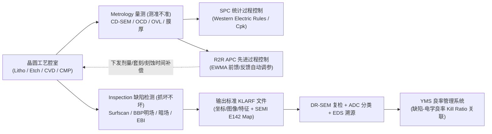

# 产线量测（Metrology）与缺陷检测（Inspection）全景解析

- **所属模块**：`03_七大核心工艺 / 07_量测与缺陷检测`

---

## 1. 工程边界辨析与 APC / SPC 闭环控制体系

在现代 300mm 先进晶圆厂中，量测与检测设备虽然不直接对硅片执行沉积、刻蚀或曝光等增值加工，却占据了全厂 **`20%~30%` 的设备资本开支（CapEx）与超 `30%` 的制造周期时间（Cycle Time）**。芯片制造是一条由上千道工序串联而成的复杂系统，根据良率连乘定律：

$$
Y_{\text{total}} = \prod_{i=1}^{N} Y_i
$$

只要有一台关键腔室发生微小参数漂移而未被拦截，几小时内便可能报废价值数百万美元的整批在制品（WIP）。

### 1.1 Metrology（量测）vs Inspection（检测）核心差异
- **Metrology（量测 — 测“准不准”）**：
  - 在晶圆切割道（Scribe Line）或专用测试框（Target Pad）的有限采样点（每片典型 `5~21` 点）上高精度测量连续物理参数；
  - 典型指标包括关键尺寸（CD）、膜厚（Thickness）、套刻偏差（Overlay）、侧壁倾角（SWA）与应力翘曲度（Bow/Warp）；
  - 数据实时传输至 **SPC（统计过程控制）** 监控过程能力指数（先进产线要求 $C_{pk} \ge 1.33\text{–}1.67$）与 **R2R APC（批次间先进过程控制）**，通过指数加权移动平均（EWMA）控制器动态计算工艺偏置，自动补偿下一批光刻机的曝光剂量/焦距、刻蚀时间或 CMP 多区气囊压力。
- **Inspection（缺陷检测 — 抓“坏不坏”）**：
  - 高速大面积扫描整片晶圆有效芯片区（Active Die Area），搜寻随机或系统性物理异常；
  - 典型抓捕对象包括纳米颗粒（Particle）、划伤（Scratch）、光刻桥接（Bridge）、断线（Open）与深孔未刻穿死孔；
  - 输出业界通用的 **KLARF（KLA Results File）** 坐标数据（结合 `SEMI E142` 晶圆分布图标准），交由复检系统判定缺陷杀伤率（Kill Ratio）并溯源停机。

### 1.2 抽检策略（Sampling Plan）的经济与风险博弈
全片 100% 检虽最稳妥，但会令检测设备投资成倍膨胀、交货周期急剧拉长；抽检过稀则会放大异常批次暴露风险（Risk at Bay）。产线普遍采用分级抽检机制：
1. **Monitor 控片每日体检**：用光片（Bare Si）或单层膜片每日监测清洗机台、CVD 喷淋头与机械手掉粉及片内均匀性；
2. **Product 产品片动态抽检**：
   - 关键 EUV 光刻层、栅极层、M0/M1 实行 **`100% Lot 必检`**（每 Lot 抽取 `2~4` 片产品晶圆）；
   - 非关键层或工艺高度稳态层采用**跳批抽检（Skip-Lot）**与基于设备健康度（FDC）触发的**动态智能抽检（Smart Sampling）**。

---

## 2. 核心量测（Metrology）工具箱底层物理原理

### 2.1 形貌与三维结构量测（CD-SEM vs OCD）
- **CD-SEM（临界尺寸扫描电镜）**：
  - **原理**：采用低着陆能量（Landing Energy，`300~800 eV`）电子束垂直扫描，降低向绝缘介质深层注入造成的静电充电畸变；高灵敏收集线条边缘剧增的二次电子（SE）溢出峰，通过阈值或导数波形算法提取线宽与线边缘粗糙度（LER / LWR）；
  - **指标与痛点**：静态精度达 **`0.1~0.3 nm (3σ)`**，是 ADI（显影后）和 AEI（刻蚀后）线宽反馈基石；但仅提供正上方 2D 俯视投影，看不见底脚（Footing）与掏蚀（Undercut），且电子束能量会使脆弱 ArF/EUV 光刻胶不可逆收缩 **`1~3 nm`**。
- **OCD / Scatterometry（光学临界尺寸散射测量）**：
  - **原理**：宽带偏振光（`190~1000 nm`）射向周期性光栅靶标，测量反射偏振光谱（$\Psi, \Delta$ 与 $4\times 4$ 穆勒矩阵），基于严格耦合波分析（RCWA）逆向反演三维结构；
  - **优势**：完全非破坏、零缩水、极快（`~1–3 s/点`），一次测量同时输出 Top/Mid/Bottom CD、SWA、鳍片高度（Fin Height）与下层各膜厚。

### 2.2 膜厚、组分与金属无损量测
- **光谱椭偏仪（SE）与反射谱仪（Reflectometry）**：
  - SE 以斜入射（`~65°–75°`）测量 $p$、$s$ 偏振反射振幅比（$\Psi$）与相位差（$\Delta$），对透明/半透明超薄膜具备 **亚埃级（`< 0.1 Å`）** 重复精度；
  - Reflectometry 采用垂直入射宽带干涉光谱，擅长高速测量数微米级厚氧化硅或光刻胶。
- **皮秒激光超声（Picosecond Laser Ultrasonics，如 MetaPULSE）**：
  - 传统四探针必须物理扎破金属且无法测小区域，面对 `10×10 μm` 的小焊盘或高阻阻挡层束手无策；
  - 皮秒超声利用超快泵浦激光脉冲在金属表面瞬间热弹激发 **GHz 级纵向声波应变脉冲**，声波在 $\text{Cu}/\text{TaN}/\text{ILD}$ 等声阻抗（$Z = \rho v_s$）失配界面产生回波反射，由延迟探测光精准测出声波往返时间 $t = 2d / v_s$，实现**全非接触、亚纳米精度的不透明金属绝对厚度量测**。
- **在线 X 射线表征（Inline XRR / XPS / XRF）**：
  - **XRR（X 射线反射率）**：利用掠入射 X 射线在多层膜界面的电子密度反射干涉直接算厚度，**完全不依赖材料光学常数 $(n,k)$ 模型**；
  - **Inline XPS / XRF**：分别监测 `1~3 nm` ALD $\text{HfO}_2$ 化学键合态、TiN 氮碳比及外延 SiGe 沟道的 **Ge 组分百分比（Ge%）**。

### 2.3 套刻对准（Overlay：IBO vs DBO）与晶圆翘曲监控
- **IBO（Image-Based Overlay，基于图像）**：
  - 用高倍光学显微镜同时成像本层光刻胶靶标与下层已刻蚀靶标（如 Box-in-Box 或 AIM 靶），计算两者的图像几何中心偏差 $\Delta X, \Delta Y$；工艺适配性强、不受底层膜厚剧变盲区影响，但靶标占地较大且极限精度受光学像差约束。
- **DBO（Diffraction-Based Overlay，基于衍射，如 ASML YieldStar $\mu\text{DBO}$）**：
  - 在测试框内制作两组叠加亚波长光栅并分别引入已知对称偏置（$+d$ 与 $-d$），直接测量正负一级衍射光强不对称度 $\Delta I = I_{+1} - I_{-1}$，从而线性解出套刻偏差：
    $$
    \text{OVL} \propto \frac{\Delta I_{+d} + \Delta I_{-d}}{\Delta I_{+d} - \Delta I_{-d}}
    $$
  - 精度高达 **`< 0.15~0.25 nm (3σ)`** 且靶标极小可直接塞入芯片有效区（In-Die）；但极度敏感于底层光栅非对称刻蚀/CMP 引发的衍射畸变。
- **晶圆翘曲度（Bow / Warp）与破坏性剖析（FIB-TEM）**：
  - 激光干涉面形仪监测高低温沉积导致的晶圆翘曲（通常严控 `< 100~150 μm`），防止 EUV 真空吸盘吸附报错或引起高阶不可校套刻残差；
  - **Dual-Beam FIB + STEM / EELS / EDS** 负责切割出 `30~50 nm` 薄片直视原子晶格，作为全厂物理定标金标准（Golden Reference）。

---

## 3. 核心缺陷检测（Inspection）与复检闭环流水线

1. **无图形晶圆检测（Unpatterned Inspection，如 KLA Surfscan SP 系列）**：
   - 采用深紫外激光（`266 nm` / `193 nm`）同时斜入射与正入射照射光滑控片，依据瑞利/米氏散射收集纳米颗粒信号；
   - 经标准聚苯乙烯乳胶球（PSL）等效粒径标定，现代机台检测极限已逼近 **`10~15 nm` LPD（光点缺陷）**；
   - **双通道特征分离**：通过对比窄角与宽角收集通道的散射能量比，自动区分表面颗粒（Particle）、硅晶体原生坑（COP）、微划伤以及表面微观粗糙度散射雾度（**Haze**）。
2. **有图形晶圆光学检测（Patterned Inspection）**：
   - **明场（Brightfield, BBP）**：宽带等离子体正反射显微成像，空间分辨率极限逼近 10nm 级，主攻 EUV 光刻、Fin/GAA 栅极与 M0/M1 层的微桥接/断线拦截；
   - **暗场（Darkfield）**：单色激光大斜角收集散射光子，吞吐速度极快（20~60 WPH），主攻全片 CMP 划伤、清洗颗粒与薄膜剥落拦截。
3. **复检与电学捕获闭环（KLARF $\to$ DR-SEM $\to$ EBI）**：
   - 光学机台将疑点位置汇总写入标准 **KLARF 文件** 后交由 **DR-SEM** 自动跳点拍照，利用深度学习 **ADC** 淘汰掉 70%~90% 无害背景噪点（Nuisance），并用 **EDS** 能谱元素指纹锁死作案腔室；
   - 针对深孔底部 2nm 未刻穿隐性死孔，启动 **电压衬度电子束检测（VC-EBI）** 完成在线无损电学通断排查。

---

## 4. 量测质量考核体系（TMU / P/T Ratio）与产线 Troubleshooting

量测仪器自身的噪声或漂移一旦超出控制边界，R2R APC 就会变成向光刻机/刻蚀机发送反向错误指令的“良率破坏者”。产线新配方上线必须严苛验收四大核心统计基准：

| 考核指标 | 定义与数学判定准则 | 产线合格红线参考 | 工程核心意义 |
| :--- | :--- | :---: | :--- |
| **Precision（重复/再现性）** | 同一晶圆连续多次静态及动态上下片测量的 $3\sigma$ 离散度 | CD `< 0.1–0.3 nm`； OVL `< 0.15–0.25 nm` | 验证设备硬件稳定性与寻靶算法抗噪声能力 |
| **P/T 比（Precision-to-Tolerance）** | $\text{P/T} = \frac{6\sigma_{\text{metrology}}}{\text{USL} - \text{LSL}}$ | **`< 10% ~ 20%`** | 确保量测仪器自身的误差远小于工艺公差窗口，避免“拿尺子误差当工艺波动” |
| **TMU（总测量不确定度）** | 基于 Mandel 正交线性回归，将在线量测与参考金标准（TEM/CD-SEM）比对并剥离参考误差后的综合不确定度 | 先进逻辑 CD TMU **`< 0.5–1.0 nm`** | 综合反映量测偏差（Offset）、斜率失真（Slope $\neq 1$）与非线性残差 |
| **Fleet Matching（机群匹配）** | 同一车间内 5~10 台同型号量测机台测量同批晶圆的均值差与方差差 | 系统偏置 `< 5%` 工艺公差 | 防止同一批芯片跨机台抽检时触发假性 SPC 跳线警报 |

### 产线常见量测/检测异常 Troubleshooting

| 异常警报现象 | 底层工程排查方向 | 现场验证与解决对策 |
| :--- | :--- | :--- |
| **Surfscan 无图形监控片突然爆发海量颗粒警报** | 真实大颗粒并未暴增，而是前道湿法清洗（如 SC1 药液浓度/温度漂移）把硅面腐蚀粗糙，拉高背景雾度（Haze）并淹没阈值 | 调出机台 **Haze（雾度）分布图** 核对是否全片均匀飙升；抽取控片测 AFM 粗糙度 RMS；校准 SC1 配比及机台激光功率衰减 |
| **DBO 套刻读数完美，但芯片实际良率却大面积套刻错位** | **TDO（Target-to-Device Offset）失配**：刻蚀或 CMP 在切割道大周期 DBO 光栅靶标处造成不对称侧壁斜坡，扭曲了 $\pm 1$ 级衍射光强对称性欺骗光学算法 | 对切割道靶标与芯片内部真实晶体管栅/孔区同时做 **FIB-TEM 剖面校准**；切换多波长模式剔除底层膜厚波动造成的衍射非对称误判，向光刻 APC 输入校准偏置 |
| **同一批晶圆在 A/B 两台 CD-SEM 上出现 1.5 nm 系统跳变** | 电子束剂量标定偏移（致光刻胶缩水率不同）或电子枪物镜散光/束流老化导致边缘波形斜率改变 | 使用标准硅光栅校准片核查像素放大倍率与像散；清查电子枪真空室碳氢沉积污染并执行清洗；重新跑通 **Fleet Matching** 偏置标定表 |
