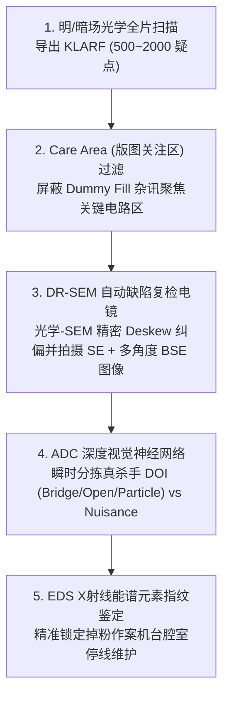

# 明场（Brightfield）vs 暗场（Darkfield）检测与电子束复检（DR-SEM）

- **所属模块**：`03_七大核心工艺 / 07_量测与缺陷检测`

---

## 1. 在数千亿周期图案中抓一颗 15nm 缺陷有多难？

在一张 300mm 晶圆表面铺满了节距低至十几纳米的周期性晶体管光栅阵列与多层半透明薄膜。要在 1~3 分钟内把全片扫完并准确捕获一颗仅 `10~20 nm` 的微粒或桥接缺陷，本质上是在挑战极端的**极低信噪比（SNR）空间提取极限**。

### 1.1 光学检测面对的四大物理障碍
1. **瑞利散射 $d^6$ 断崖惩罚**：
   当待测微粒或结构突起尺寸 $d$ 远小于探测光波波长 $\lambda$ 时，有效光学散射截面遵循瑞利散射六次方定律：
   $$
   \sigma_{\text{scat}} \propto \frac{d^6}{\lambda^4}
   $$
   举例而言：缺陷粒径仅从 `30 nm` 缩半至 `15 nm` 时，散射回物镜的有效光子数量便瞬间暴跌至原来的 **`1/64`（约 `-18 dB`）**！这迫使产线光学检测仪持续向深紫外短波长（`190~266 nm`）与超大物镜数值孔径（$NA > 0.9$）狂奔。
2. **背景“噪音森林（Pattern Noise）”淹没**：
   正常芯片制造固有且完全无害的微弱线边缘粗糙度（LER）、多层薄膜厚度片内缓慢梯度（$\Delta t$ 引发干涉色差）以及铜晶粒反光差异，往往在探测器上产生比 15nm 真缺陷强出数倍的背景杂讯。
3. **透明介质薄膜的“相消干涉光学盲区”**：
   当缺陷刚好埋藏于特定厚度的透明 $\text{SiO}_2$/$\text{SiN}$ 介质底部，若单色激光恰好满足相消干涉条件：
   $$
   2 n d \cos\theta = m\lambda
   $$
   缺陷所在平面的合成入射电场振幅接近于零（驻波波节）——**缺陷会彻底在镜头下“光学隐身”**！
4. **傅里叶平面空间滤波（Fourier Spatial Filtering）**：
   高度周期性排布的 SRAM 或 Fin 光栅会在物镜后焦面（傅里叶空间频率平面）会聚成位置固定且亮度极高的离散**布拉格衍射级次斑点**；而随机孤立颗粒则把光线漫散射到全角度空间频率平面。检测仪在傅里叶平面插入精密可编程空间滤波遮挡光阑（Aperture）与偏振控制片，**物理挡死周期电路的强背景衍射光**，让原本淹没在强背景下的微弱缺陷在黑暗视场中瞬间脱颖而出！

---

## 2. 明场（Brightfield）vs 暗场（Darkfield）硬件架构与图像对比模式

量产晶圆厂核心图形缺陷检测设备以 **KLA 29xx/39xx（宽带明场 BBP）** 与 **KLA Puma/Voyager、AMAT UVision（高通量暗场激光）** 为代表：

| 对比维度 | 明场检测（Brightfield, BBP） | 暗场检测（Darkfield） |
| :--- | :--- | :--- |
| **光源与光学收集几何** | **激光维持宽带等离子体光源（BBP, `190~700 nm` 连续光谱）** 垂直照明；搭配窄带光谱选择器与高速 **TDI（时间延迟积分）传感器** 采集**正反射像光与低级衍射光** | **高功率单色 DUV/UV 激光（`266 nm` / `355 nm` / `193 nm`）** 大斜角/垂直照射；中心光路**物理挡死**镜面直射反射光，由**多方位多仰角环形传感器阵列**仅捕获空间散射光子 |
| **抗薄膜干涉干扰能力** | **极强**：遇到某波段处于相消干涉盲区时，算法自动切换窄带波长与偏振组合，立刻激活隐身缺陷信噪比 | 受限于固定单色激光波长（极少数型号配置双波长）；遇到特定厚度膜层偶发盲区时需依赖斜入射角补偿 |
| **极限灵敏度与缺陷偏食** | **空间分辨极限最高（可达 `< 10 nm`）**：专精抓捕隐藏在深窄沟槽内侧、平齐于表面的**微桥接（Micro-bridge）、窄颈断线（Pinch）、光刻局部畸变** | 对三维凸起颗粒、薄膜剥落与微划伤（Scratch）极其敏锐；但对平坦且位于深槽内壁的微小横向线宽畸变相对迟钝 |
| **晶圆吞吐量（WPH）与成本** | 光学像素极小（`20~50 nm`），扫描较慢（典型 **`~3–15 WPH`**）；机台极精密且单价常高达 **数千万美元** | 激光功率密度极高、扫描策略高效（典型 **`~20–60 WPH`**），单位扫描成本远低于明场 |
| **产线核心分工** | **研发良率爬坡侦探、EUV 关键层（ADI/AEI）、Fin/GAA 栅极与 M0/M1 金属层死守致命图形缺陷** | BEOL 高层金属、Post-CMP 划伤全片抽检、薄膜沉积与湿法清洗设备常态化颗粒拦截 |

### 三大图像差分对比模式：抓“随机颗粒” vs 抓“重复性掩模版缺陷”
1. **Die-to-Die（D2D，邻芯对比）**：
   - 将第 $N$ 颗 Die 的图像分别与左侧 $N-1$ 及右侧 $N+1$ 颗 Die 的相同坐标逐像素相减，采取三芯交叉投票（Double Detection）确定异物究竟归属于哪颗 Die；
   - **致命短板**：如果 **EUV/ArF 掩模版（Reticle）本身受损或落尘**，导致晶圆上每一颗 Die 的相同坐标都印出一模一样的缺陷（**Repeating Reticle Defect**），D2D 邻芯相减结果恒等于零——**100% 漏检致全片报废！**
2. **Cell-to-Cell（C2C，阵列单元对比）**：
   - 在高度重复的 SRAM、DRAM 或 3D NAND 存储阵列区，直接在微米级相邻存储单元间进行差分对比，彻底消除中心-边缘缓慢工艺膜厚梯度，把检测灵敏度逼入物理极限。
3. **Die-to-Database（D2DB，设计版图对比）**：
   - 利用高性能光刻与光学物理引擎把 GDSII/OASIS 原始设计版图实时渲染为“理想参考图像”，再与晶圆实拍图像对齐比对；
   - **量产线唯一能在线捕获重复性掩模版致命印刷缺陷（Repeating Defect）的终极防线**！

---

## 3. 光学扫描之后：KLARF $\to$ DR-SEM $\to$ ADC $\to$ EDS 复检闭环

为了不错放任何一颗 15nm 杀手缺陷，光学检测阈值往往贴着噪声边缘设定，导致导出的标准 **KLARF 文件**（记录片号、Die 与精确 XY 坐标、光学切片、散射属性及多通道特征）中往往夹杂着 **`70%~90%` 的虚假误报（Nuisance Defects，如晶粒起伏或局部膜厚微色差）**。产线依靠以下四级漏斗实现高效闭环：

### 3.1 Care Area（关注区）与 Nuisance 抑制
工程师利用芯片版图划分不同灵敏度等级区域：对密布核心栅极、接触孔与狭窄线距区赋予最高灵敏度（**Critical Care Area**），对空白区铺设的无功能 Dummy Fill 区域放宽阈值。这能在确保致命缺陷捕获率（Capture Rate）的前提下大幅削减无用 Nuisance 误报数，节省宝贵的 DR-SEM 机台抽检时间。

### 3.2 DR-SEM（自动缺陷复检电镜）三维地形定性与 ADC 分类
- **Deskew 坐标纠偏**：光学机台坐标系与电镜坐标系存在热膨胀和机械偏差，DR-SEM 读取 KLARF 后必须先借助全局与局部光学对齐基准将重定位精度纠偏至 **`< 0.5 μm`** 以内，确保电子枪一枪直落亚微米视野正中；
- **SE + 多象限倾斜 BSE 三维地形判别**：垂直二次电子（SE）探测器呈现清晰精细表面边界，而分置在四周的多象限倾斜背散射电子（BSE）探测器则投射出类似侧面打光的立体阴影差——借此一眼看穿异常点究竟是向上凸起的**附着颗粒（Bump/Particle）**还是向下凹陷的**腐蚀坑洞（Pit/Void）**；
- **ADC（自动缺陷分类）**：内置 CNN / Vision Transformer 深度视觉分类模型毫秒级判定分类标签（`Bridge`、`Open`、`Particle`、`Residue`、`Scratch` 与 `Nuisance`）。产线工程考核常严苛要求目标缺陷**分类准确率（Accuracy）`> 90%`** 与 **提纯率（Purity）`> 95%`**，并将提纯后的真杀手缺陷 **DOI（Defect of Interest）** 导入良率管理系统绘制 Pareto 报警图。

### 3.3 EDS 元素指纹溯源实战字典
对抓现行的真杀手颗粒，原地激发 X 射线能谱（EDS）直接锁定源头机台：

| EDS 检出核心特征元素指纹 | 产线最大嫌疑污染源与物理化学机理 | 紧急停机排查动作 |
| :--- | :--- | :--- |
| **`Al + F`** | 刻蚀机台 $\text{Al}_2\text{O}_3$ / 阳极氧化铝腔室内壁遭氟等离子体长期剥蚀生成氟化铝掉粉 | 核查刻蚀机台腔室射频累积小时数并安排湿法洗腔及内衬更换 |
| **`C + O`（无硅）** | 光刻胶去胶灰化残渣、机械手有机传输皮带磨损碎屑或 FOUP 晶圆盒脱气有机物凝结 | 排查灰化/显影腔室参数及传片机械手末端执行器（End-Effector）洁净度 |
| **`Cu + Ta + Si + O`** | Cu CMP 抛光浆料磨料与铜阻挡层残渣在 Post-CMP 刷洗中未洗净并干涸粘死 | 立即检查 CMP Cleaner PVA 滚刷寿命、喷淋液流量与湿态传递时间 |
| **`Ce + O`** | 前道 STI CMP 氧化铈磨料颗粒强键合残余 | 抽检 STI Post-CMP 还原清洗药液浓度及兆声波功率 |
| **`Fe + Cr + Ni`** | 316L 不锈钢特种气体阀门、MFC 或机械摩擦组件发生腐蚀或微颗粒磨损 | 对相关气体管路过滤器（POU Filter）与阀门执行颗粒计数查漏并更换部件 |

---

## 4. 电子束检测（EBI）的绝杀技：电压衬度（Voltage Contrast, VC）

在 3D NAND 几十比一超深通道孔或先进逻辑节点 Contact / Via 刻蚀后，**光学检测仪从上方俯视只能看见一排极其圆润规整的孔口——完全看不穿孔底究竟有没有残留 `2 nm` 厚的透明氮化硅阻挡层导致彻底电学开路！**

### 4.1 电压衬度的二次电子发射 $\delta(E_p)$ 物理原理
**EBI（Electron Beam Inspection）** 巧妙利用电子束照射表面时激发出的**二次电子产额系数 $\delta(E_p)$** 随入射能量 $E_p$ 变化的静电平衡特性，实现了在线非接触“隔空测通断”：
- 根据材料二次电子产额曲线，在第一临界交叉能量 $E_1$ 与第二临界交叉能量 $E_2$ 之间（典型着陆能量 **$E_p \approx 500\text{–}1500\,\text{eV}$，此时 $\delta > 1$**），每注入 1 个初级电子平均会打出多于 1 个二次电子逃逸：
  - **正常导通接地的通孔（Grounded / Normal）**：表面失去负电子后，立刻由下方硅衬底源源不断补充电荷，孔顶表面电位始终稳定在近零伏（$V_s \approx 0\,\text{V}$），新产生的低能二次电子畅通无阻逃进探测器 $\implies$ **图像呈明亮对比点（Bright Contrast）**；
  - **底部未刻穿/断路悬空的通孔（Floating / Open）**：被绝缘残膜切断接地通道，无法获得电荷补给，持续失电子导致孔顶面快速积累高达数伏特的正电位（$+V_s$），形成强静电正势阱把刚激发出的低能二次电子（`< 50 eV`）强行拽回表面！探测器收不到电子 $\implies$ **该死孔在一片亮孔中瞬间显现为刺眼的纯黑对比点（Dark Contrast）**！
  - *注：切换至 $\delta < 1$ 负充电能量窗口或反转抽取电极偏压时，亮暗对比极性互换；失效定位中还可引入探针施加主动偏压（AVC, Active Voltage Contrast）提升隐性高阻漏电识别率。*

### 4.2 单束 EBI 产能瓶颈与多束（Multi-Beam）演进
由于电子束必须逐像素物理偏转扫描，单束 EBI 的吞吐速度比光学机台慢 **`100~1000 倍`**（全片扫描典型仅 `0.1~1 WPH`）。产线工程落地采取两条路径突破：
1. **热点抽样扫描（Hotspot Inspection）**：利用 EDA 规则与光刻模拟找出极易断路/桥接的脆弱热点区域坐标，EBI 仅重点扫查这些高风险窗口，把单片耗时长压至数分钟内；
2. **多电子束并联（Multi-Beam EBI）**：以 ASML HMI eScan 系列为代表，采用 MEMS 微孔透镜阵列将电子枪束流分裂成 **`9~25+` 束并行微电子束**同步覆扫（失效分析领域 ZEISS MultiSEM 更做到 `61~91` 束），成倍推高产能使其成为 3nm/2nm 关键层在线良率防线的标配。

---

## 5. 产线检测常见异常 Troubleshooting

| 异常警报现象 | 底层物理/算法根因 | 工程排查与解决措施 |
| :--- | :--- | :--- |
| **明场检测突然爆出大量“颜色反差伪缺陷（Color Nuisance）”** | 前道介质或光刻胶存在片内厚度微梯度，在选定检测波长恰好踩在薄膜干涉斜率最陡峭处，微弱 $\Delta t$ 引发相邻 Die 亮度剧烈反差 | 切换明场 **BBP 多波段光谱**，选用对膜厚微变不敏感的“消色盲稳态波长窗口”；微调偏振器方位角抑制下层薄膜反射干扰 |
| **DR-SEM 自动复检频频“抓空靶”（Empty Site / Deskew Miss）** | 光学与电镜坐标系 Deskew 对准漂移，或者光学抓到的其实是埋在透明氧化层下方的地下空洞/折射率畸变（表面 SE 看上去完全光滑） | 重校准光学-SEM 全局与局部 **Deskew 基准标记**；在 DR-SEM 切入高穿透 **高加速电压 BSE（背散射电子）模式** 检查是否存在嵌入式地下缺陷（Subsurface Defect） |
| **EBI 电压衬度图像全片发灰丧失亮暗区分能力** | 电子束流密度过高造成绝缘介质区长期电荷积聚饱和（Charging Saturation），或真空腔微量有机污染结碳改变了表面 $\delta$ 发射率 | 压低单像素驻留时间（Dwell Time）并微调着陆电压与抽取栅压（Extractor Bias）重锁 $\delta$ 平衡点；定期开启真空室原位等离子体洗碳除污 |
