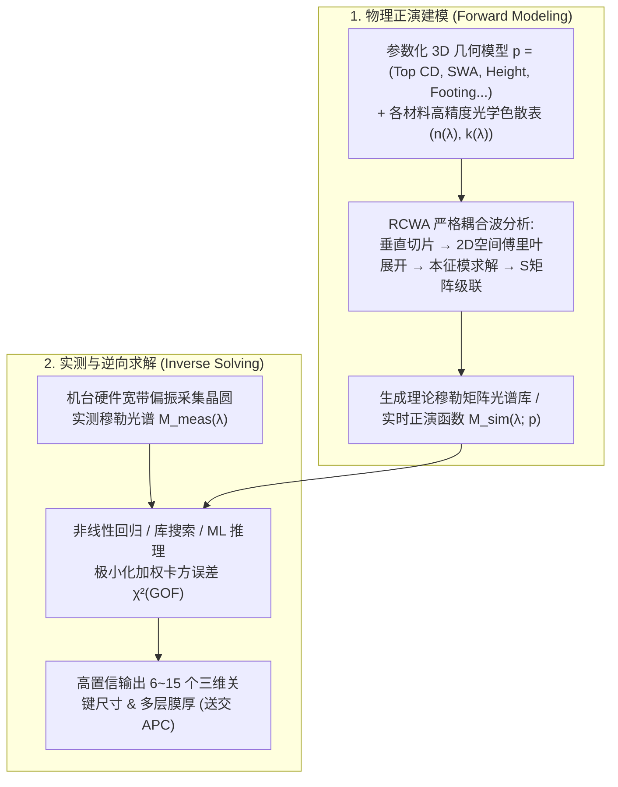

# 光学关键尺寸量测（OCD / Scatterometry）与椭偏反演原理

- **所属模块**：`03_七大核心工艺 / 07_量测与缺陷检测`

---

## 1. 为什么 CD-SEM 不能包打天下？OCD 解决什么不可替代的刚需？

在进入高深宽比 3D FinFET、200+ 层 3D NAND 与全环绕栅极（GAA Nanosheet）时代后，传统 **CD-SEM（扫描电镜）** 的二维投影局限性全面暴露，**OCD（Optical Critical Dimension，光学关键尺寸/散射测量 Scatterometry）** 凭借**非破坏、零缩水损伤、完整三维截面解析与极高测量通量**，跃升为 20nm 以下先进产线在线三维形貌监控的绝对核心：

| 对比维度 | CD-SEM（扫描电镜） | OCD / Scatterometry（光学散射） | 原子力显微镜（CD-AFM） | 剖面电镜（FIB-TEM） |
| :--- | :--- | :--- | :--- | :--- |
| **物理测量空间维度** | **正上方 2D 俯视投影**（完全盲区：看不到侧壁底部掏蚀 Undercut、底座脚 Footing 与深鳍垂直高度） | **完整 3D 横截面尺寸**（一次测量同步吐出 Top/Mid/Bottom CD、SWA、深/高度及下层各膜厚） | 机械探针 3D 触探（针尖粗且脆，钻不进亚 20nm 深窄缝与 GAA 悬空狭腔） | 原子级真实 2D/3D 截面 |
| **样片破坏性与失真** | 电子束高能轰击导致 **ArF/EUV 光刻胶不可逆收缩 `1~3 nm`**（测完即毁）；介质易积累静电充电漂移 | **纯光学非接触、零光损伤、零缩水**，同一片产品晶圆可在光刻前后、刻蚀前后连续无损串联追踪 | 物理接触极易磨损探针，且存在机械刮伤脆弱图形风险 | **彻底破坏切碎整片晶圆** |
| **产线吞吐速度** | 偏慢（`~5–15 s/点`，多次平均降噪耗时更久） | **极快（`~1–3 s/点`）**，高吞吐量支撑全厂 APC 实时前馈/反馈闭环 | 极慢（每点耗时数十秒至分钟级，仅作辅助校验） | 单点制样加拍摄耗时数小时至一天 |
| **待测靶标要求** | 可直接扎入芯片**内部任意随机孤立逻辑线条** | 必须依赖切割道或专用测试框内的**周期性光栅靶标**（典型 `40×40 μm` 或微光斑 `10×10 μm`） | 需有探针足够落脚的开阔周期槽 | 任意位置精准定点切片 |

---

## 2. 光学硬件原理：从标准椭偏（SE）到穆勒矩阵椭偏（MMSE）

十几纳米乃至数纳米宽的 Fin 鳍片与栅极节距远小于探测波长（`190~1000 nm`），受阿贝光学衍射极限封锁，任何常规光学镜头都不可能直接拍出分辨线条的图像——**OCD 测量的是宽带偏振光照射到周期性纳米光栅后发生零级反射衍射携带出的“偏振光谱指纹”！**

### 2.1 标准光谱椭偏（SE）物理表达
一束已知精确偏振态的宽带光以斜入射角 $\theta_i$（典型 `60°~75°`）射向硅片表面，测量零级反射光中平行入射面分量（$p$ 偏振）与垂直入射面分量（$s$ 偏振）的复反射系数比：

$$
\rho = \frac{r_p}{r_s} = \tan(\Psi) \cdot e^{i\Delta}
$$

其中 $\Psi(\lambda)$ 表征两正交偏振光的振幅衰减比，$\Delta(\lambda)$ 表征相位差偏移。对于均匀平整各向同性介质薄膜（交叉偏振项 $r_{ps} = r_{sp} = 0$），仅靠 $(\Psi, \Delta)$ 即可反算出薄膜厚度与折射率消光系数 $(n,k)$。

### 2.2 为什么三维纳米器件必须升级为穆勒矩阵椭偏（MMSE）？
当探测光束以非对称方位角（Azimuth Angle $\phi \neq 0^\circ, 90^\circ$）照射立体纳米光栅，或者三维器件存在**任意几何不对称性（如 Fin 侧壁单向歪斜 Fin Tilt、上下两层光栅存在亚纳米套刻错位 Overlay Shift、GAA 左右侧壁掏蚀不均）**时，入射光的 $p$ 分量与 $s$ 分量会发生剧烈的交叉偏振耦合（$r_{ps}, r_{sp} \neq 0$）并伴随部分退偏振（Depolarization）！此时仅凭传统 $(\Psi, \Delta)$ 不仅丢掉大量结构信息，还会算得严重失真的结果。

现代高端 OCD 量测机台（如 KLA SpectraShape、Onto Atlas、Nova PRISM）全部配备**双旋转补偿器穆勒矩阵椭偏仪（Dual-Rotating-Compensator MMSE）**。通过两个同步差速旋转的四分之一波片对入射及反射光的斯托克斯偏振矢量 $\mathbf{S} = [S_0, S_1, S_2, S_3]^T$ 进行全态调制与解调：

$$
\mathbf{S}_{\text{out}} = \mathbf{M} \cdot \mathbf{S}_{\text{in}} =
\begin{pmatrix}
M_{11} & M_{12} & M_{13} & M_{14} \\
M_{21} & M_{22} & M_{23} & M_{24} \\
M_{31} & M_{32} & M_{33} & M_{34} \\
M_{41} & M_{42} & M_{43} & M_{44}
\end{pmatrix}
\mathbf{S}_{\text{in}}
$$

单次高速扫描即可测全 16 个实数元素（归一化后含 15 条独立光强光谱特征通道）：
- **主对角区块元素（如 $M_{12}, M_{33}, M_{34}$ 等）**：主要映射线宽（CD）、高度（Height）、底膜厚度等常规对称结构响应；
- **非对角交叉偏振元素（$M_{13}, M_{14}, M_{23}, M_{24}$）**：天然的“**非对称性放大器**”！若三维结构绝对左右对称，这些非对角通道信号严格归零；只要纳米线条发生哪怕 `0.1°` 轻微歪斜（Tilt）或上下层发生亚纳米套刻错位，非对角元素立刻跳出极其锐利的共振峰——**在物理采集通道层面直接将对称尺寸与非对称畸变彻底解耦**！

---

## 3. 正演建库（RCWA）与逆向反演（Regression / ML）算法全流程

### 3.1 正演物理引擎：严格耦合波分析（RCWA）
1981 年由 M. G. Moharam 与 T. K. Gaylord 创立的 **RCWA（Rigorous Coupled-Wave Analysis）** 是半导体界求解周期性纳米光栅电磁散射最精准高效的麦克斯韦方程严密数值解法：
1. **垂直阶梯切片（Staircase Approximation）**：将带有任意倾斜侧壁、底部圆角或梯形截面的三维周期光栅沿垂直 $z$ 方向切分成 $L$ 层足够薄的均匀矩形平面切片；
2. **二维空间傅里叶谐波展开**：在每一切片层内部，将随横坐标周期变化的介电常数 $\varepsilon(x,y)$ 以及电磁场分量 $\mathbf{E}, \mathbf{H}$ 展开成截断阶数为 $\pm N$ 的二维傅里叶空间谐波级数；
3. **本征模计算与散射矩阵（S-Matrix）级联**：把麦克斯韦旋度微分方程组转化为代数矩阵本征值问题，求得切片内的传播与消逝波本征模式；随后采用数值绝对稳定的**散射矩阵（S-Matrix）算法**自下而上逐层匹配切向电磁场连续边界条件（防止传统传输矩阵 T-Matrix 在百层厚 3D NAND 堆叠中发生指数爆炸数值溢出），算出理论零级反射穆勒矩阵光谱 $\mathbf{M}_{\text{sim}}(\lambda; \mathbf{p})$；
4. **物理精度 vs 算力 Trade-off**：三维周期计算中矩阵求逆复杂度随保留谐波总数呈 **$O(N^3)$** 爆炸增长（例如截断阶数翻倍，单次计算耗时暴涨 8 倍以上！）。模型工程师必须做严格的谐波收敛性测试（Convergence Test），在保证数值误差 `< 0.05 nm` 条件下压低到最小可行谐波阶数。

### 3.2 逆向反演三大求解模式对比
逆向求解的核心目标是在参数空间内寻找使理论光谱与实测光谱加权残差极小化的几何向量 $\mathbf{p}$：

$$
\chi^2(\mathbf{p}) = \sum_{\lambda_i} w_i \left\| \frac{\mathbf{M}_{\text{meas}}(\lambda_i) - \mathbf{M}_{\text{sim}}(\lambda_i; \mathbf{p})}{\sigma_i} \right\|^2
$$

| 逆向求解模式 | 核心算法工作机制 | 在线响应速度 | 核心工程优缺点与适用节点 |
| :--- | :--- | :---: | :--- |
| **建库查表法（Library Search）** | 提前数小时至数天在超算集群算好覆盖全工艺波动的百万条光谱库；量测时直接做近邻匹配加局部插值 | **极快（毫秒级）** | 当自由参数 $\le 6\sim 8$ 个时极稳；但面对 15 个以上自由度，光谱库体积发生“维度灾难（TB 级）”彻底不可行 |
| **实时非线性回归（Real-Time Regression）** | 在线调用 **Levenberg-Marquardt / Gauss-Newton** 优化算法从初值迭代逼近全局最小 $\chi^2$（通常需 10~20 步 RCWA） | 中等（`~1–3 s/点`，需 GPU 加速） | 彻底摆脱海量建库预计算，适合复杂 FinFET 实时调优；但若初值离谱存在陷入局部极小值风险 |
| **机器学习辅助模型（ML / Model-Free OCD）** | 利用覆盖工艺 DOE 拉偏实验的 **真实 TEM / CD-SEM 物理截面作训练锚点**，通过深度神经网络/SVR 直接将原始偏振光谱映射为目标 3D 尺寸 | **极快（毫秒级）** | 专治 200+ 层 3D NAND 与多层 GAA 极其复杂结构（RCWA 算不动且材料微弱 $n,k$ 难建模），绕开模型近似误差；缺点是对未知超界极端工艺外推弱 |

---

## 4. 先进节点工程瓶颈：多解相关性危机与混合量测（Hybrid Metrology）

### 4.1 高维参数相关性（Parameter Correlation / Cross-talk）困局
在 3nm/2nm GAA Nanosheet 工艺中，单一测量光斑下方同时叠压 3~4 层悬空硅片、被选择性刻蚀回缩的 $\text{SiGe}$ 内侧墙掏蚀深度（$D_{\text{recess}}$）、多层 $\text{HfO}_2$/TiN 栅叠层及底部隔离介质（BDI）——待测几何及色散自由度瞬间膨胀至 **`15~25` 个**！
从数学逆问题本质来看，极易诱发严重的**“多解简并（Multi-solution Degeneracy）”**：两组完全不同的物理尺寸组合（例如底层氧化层加厚 `0.5 nm` 同时把鳍片高度削低 `1.0 nm`），算出的光谱几乎一模一样（协方差矩阵相关系数 $|r| > 0.95$），哪怕仪器极微小的白噪声也会推着求解器在两个简并极小值之间跳跃，导致输出结果呈现“**一升一降反向剧烈波动**”的虚假串扰（Cross-talk）！

### 4.2 破局三板斧：多通道扩容 + 混合量测 + 微负载偏置补偿
1. **硬件多维度信息扩容**：
   - 同时采集 **$0^\circ, 45^\circ, 90^\circ$ 多方位角** 与 **多入射角（Multi-AOI）** 光谱，把传统单角度单方位信息量翻倍；
   - 将探测波段向 **真空深紫外（VUV `140~190 nm`）** 甚至 **小角 X 射线散射（CD-SAXS）** 延伸，利用短波高穿透力与各材料共振吸收峰错位强行打破多解简并。
2. **混合量测（Hybrid Metrology）—— 产线标准终极解**：
   - 借用正交无相关干扰的独立量测机台预先测准部分变量，作为**刚性/柔性强先验约束（Fixed / Constrained Priors）**直接喂给 OCD 求解引擎：
     - 用 **XRR / Inline XPS** 精准锁定 $\text{HfO}_2$ 物理厚度与 $\text{SiGe}$ 中的 **Ge 组分%**；
     - 用无图形控片或开阔区 **SE** 锁死各底层介质厚度；
     - 将 **CD-SEM** 测得的精准 Top CD 作为强先验约束输入 OCD 拟合；
     - 最后用稀疏破坏性 **TEM** 截面校准绝对零点偏置；
   - 产线实测证明 Hybrid Metrology 可把高维参数相关性骤降 **`70%` 以上**，直接释放其余核心隐藏参数（如 GAA 内部 $D_{\text{recess}}$ 掏蚀深）的亚纳米分辨能力。
3. **测试靶标微负载偏差（Pad-to-Device Offset）补偿**：
   - 切割道内 `40×40 μm` 专用周期光栅周围通常比芯片核心 SRAM 阵列更空旷，等离子体刻蚀耗散与微负载效应（Microloading）会导致光栅 CD 和蚀刻深度与真实逻辑器件产生系统性偏置。研发定标必须在光栅四周铺设拟真 Dummy 环境并靠 TEM 标定出稳态补偿系数；更前沿节点直接部署光斑缩至 **`10×10 μm`** 的 **In-Die Micro-Spot OCD** 扎入有效芯片功能阵列内部直测！

---

## 5. OCD 产线建模与日常运行 Troubleshooting

| 异常警报现象 | 底层物理/光学根因 | 工程排查与解决措施 |
| :--- | :--- | :--- |
| **$\chi^2$（GOF 拟合优度）突发性全面恶化** | 1. 前道刻蚀/灰化更改气体配方，改变光刻胶/SiN/Low-k 的实际光学色散 $(n,k)$； 2. 底层薄膜厚度飘出模型搜索上下界； 3. 光栅靶标被划伤或落上大颗粒 | 提取实测与模型光谱残差分布波形定位偏离波段；取单层控片用 **SE 重测并更新材料 $(n,k)$ 色散文件**；适当放宽浮动底膜搜寻边界；用机台自带高倍光学相机查验测试 Pad 表面是否污染 |
| **两个关键输出参数出现明显“镜像反向同步跳动”** | 典型**高相关性串扰（Cross-talk）**：如 Bottom CD 与 Footing 或某底层介质厚度高度耦合，微小光学噪声触发反演掉进不同局部极小值 | 调阅建模报告中的灵敏度矩阵（Jacobian）与相关系数表；**果断将其中一项波动极小或可独立量测的膜厚固定（Fix）或导入 SE/CD-SEM 构成 Hybrid Metrology**；开启 45° 非对角穆勒矩阵通道强力解耦 |
| **OCD 监控全部达标，电学芯片却出现大片过刻/欠刻良率跌落** | **Pad-to-Device 微负载偏移漂移**：刻蚀腔室长期积碳或射频漂移改变了微负载斜率，切割道靶标不再忠实映射芯片核心区状态 | 立即取样送交 **FIB-TEM 对比测试光栅与芯片核心区真实截面差异**；检查刻蚀腔室清洁状态及射频匹配；条件允许时切用直接入芯测量的 **In-Die Micro-Spot OCD** |
