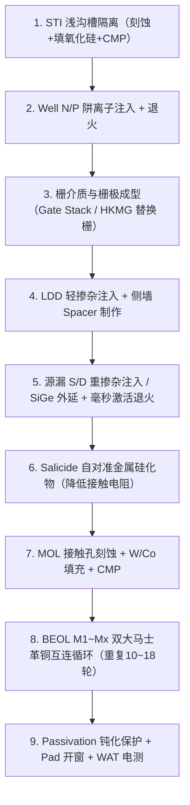

# 完整 CMOS 工艺流串联：FEOL → MOL → BEOL 与重入式流转

- **所属模块**：`04_工艺整合与节点 / 01_CMOS全流程串联`

## 1. 三大宏观区段划分

1. **FEOL（前道工艺，Front-End-of-Line）**：在硅衬底上制造晶体管本身（从光片到源/漏极与金属硅化物完成），工艺温度最高（可达 1000°C+）。
2. **MOL / MEOL（中段工艺，Middle-of-Line）**：在晶体管与第一层金属之间做绝缘层、接触孔（Contact / Trench Silicide）连接栅极和源漏，通常填充 W 或 Co。
3. **BEOL（后道工艺，Back-End-of-Line）**：制作 10~18 层铜/低 k 介质互连网络（M1 → M2 → ... → 顶层厚铜线与铝焊盘 Pad），温度必须严格限制在 `400°C` 以下以免破坏前段晶体管掺杂分布与熔化低熔点材料。

---

## 2. 经典 CMOS 制造全流程串联（高阶逻辑视角）

---

## 3. 什么是晶圆厂的“重入式（Re-entrant）制造”？
与汽车流水线“从 A 车间接力走到 Z 车间”完全不同，晶圆不是线性走一遍设备就出厂，而是**不断回到同一批核心设备区域循环加工**：
- 每做一层金属互连或每一次掩模定义，晶圆盒子（FOUP）都要回到 **Litho 光刻区 → Etch 刻蚀区 → Clean 清洗区 → Deposition 薄膜区 → CMP 区 → Metrology 量测区**；
- 先进节点单批次晶圆（Lot）往往要经过 **60~90+ 张掩模版**、**800~1500 道工序**、历时 **2~3 个月**，光是在厂房头顶坐 OHT 天车跑动的里程就可达数公里。
- 这也是为什么**调度派工（RTD）和光刻机产能瓶颈控制**是晶圆厂运营的命脉。
