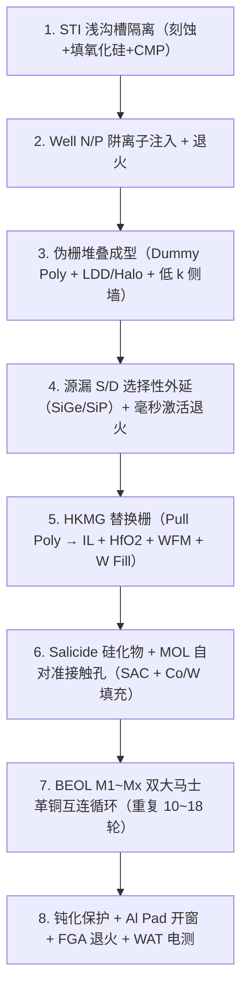

# 完整 CMOS 工艺流串联：FEOL → MOL → BEOL 与重入式流转

- **所属模块**：`04_工艺整合与节点 / 01_CMOS全流程串联`

---

## 1. 三大宏观区段划分与热预算/污染隔离边界

在 12 英寸（300mm）先进逻辑晶圆厂中，一颗现代 CMOS 芯片的制造并非单向直通，而是被严格切分为 **FEOL、MOL/MEOL、BEOL** 三大工艺区段。这种切分背后有两条不可违背的物理与工艺铁律：

### （1）热预算（Thermal Budget）单调递减约束
晶体管沟道与源漏的超浅结掺杂分布受 Fick 扩散定律支配，特征扩散长度 $L_D = \sqrt{4 \int D(T(t))\,dt}$，其中扩散系数遵循指数级 Arrhenius 规律：

$$D(T) = D_0 \exp\left(-\frac{E_a}{k_B T}\right)$$

温度每升高 $100^\circ\text{C}$，硼（B）、磷（P）等掺杂原子的热扩散速率可飙升数个数量级。因此，产线必须遵循**“高温前做、低温后做”**的不可逆热预算梯度：
- 一旦前道完成金属硅化物（Salicide）和后栅替换金属栅（RMG），温度必须骤降至 $450^\circ\text{C}$ 以下，否则会触发 $\text{NiSi}$ 团聚断链、$\text{HfO}_2$ 氧空位再分布及功函数金属铝扩散；
- 一旦进入后道多孔超低 $k$ 介质（ULK）与铜（Cu）互连区段，工艺峰值温度必须死守在 $380\sim 400^\circ\text{C}$ 以内，防止 ULK 孔隙坍塌（导致 $k$ 值反弹）与铜热应力挤出。

### （2）金属与碱金属污染物理分区管控（SEMI 产线隔离）
铜（Cu）在单晶硅中具有极高的间隙扩散系数（$400^\circ\text{C}$ 以上即可快速穿透硅体），并在硅禁带中央形成深能级复合中心（Lifetime Killer），引爆 PN 结漏电并大幅缩短栅氧经时击穿（TDDB）寿命。
- 依据 SEMI E1.9/E47.1 等产线洁净度与物流隔离规范，300mm 晶圆厂在物理机台、机械手（EFEM）乃至晶圆传送盒（FOUP）层面严格执行 **FEOL（Non-Cu 洁净区）与 BEOL（Cu-Contaminated 铜污染区）物理隔绝**；
- 在重入铜互连循环中，几乎每次铜电镀或沉积后均强制插入 **Bevel Clean（晶圆边缘 $1.5\sim 2\text{ mm}$ 湿法去铜与背面清洗）**，杜绝边沿铜箔片剥落并在光刻/量测公用机台发生跨片交叉污染。

| 宏观区段 | 物理边界（起始 → 终止） | 最高允许温窗（工程典型值） | 主导材料体系 | 核心寄生/电学瓶颈 | 污染管控红线 |
| :--- | :--- | :--- | :--- | :--- | :--- |
| **FEOL（前道）** | 裸片清洗 → STI → Well → HKMG/Fin/GAA → S/D 外延 → Salicide | **$1000\sim 1320^\circ\text{C}$**（RTP/LSA 毫秒退火） | 单晶 Si/SiGe、$\text{SiO}_2/\text{Si}_3\text{N}_4$、$\text{HfO}_2$、TiN/TaN/W/NiPt | 短沟道效应（DIBL/SS）、沟道迁移率、$I_{on}/I_{off}$ 权衡 | 严禁 Cu、Au、Na/K 碱金属进入（表面金属 $<10^{10}\text{ atoms/cm}^2$） |
| **MOL / MEOL（中段）** | CESL/ILD0 → 栅/源漏接触孔（CA/TS/M0A）→ V0 通孔 | **$400\sim 500^\circ\text{C}$** | 低 $k$ $\text{SiOCN}$ 侧墙、FCVD/PECVD $\text{SiO}_2$、Ti/TiN、W/Co/Ru | **接触电阻 $R_c$**（占总导通电阻 $30\%\sim 45\%$）与栅-漏电容 $C_{gd}$ | 严防 $\text{WF}_6$ 氟残留腐蚀金属栅；严控前清洗后 Q-Time |
| **BEOL（后道）** | M1 互连 → M2~Mx 双大马士革铜互连循环 → Passivation/Pad | **$\le 380\sim 400^\circ\text{C}$**（受 ULK 与 Cu 约束） | PECVD ULK（$k \approx 2.4\sim 2.7$）、$\text{SiCN}$、TaN/Ta、Cu（低层引入 Co/Ru） | **RC 信号延迟**（$\tau_{RC} \propto \rho \cdot k_{eff}$）、电迁移（EM）与 TDDB | 防止 Cu 渗入 ULK；严格控制晶圆边缘去边（EBR/Bevel Clean） |

> **工程演化注记（为什么 MOL 会独立切出？）**：在 28nm 以前，接触孔只是连接硅化物与 M1 的简单 W 钨塞。进入 20nm/14nm/7nm 后，栅极节距（CPP）缩至 $45\sim 64\text{ nm}$，接触孔 CD 降至 $10\sim 15\text{ nm}$。依据室温电子平均自由程 $\lambda_e$（工程量级：$\text{Cu}\approx 39\text{ nm}$、$\text{W}\approx 15\sim 20\text{ nm}$、$\text{Co}\approx 10\sim 12\text{ nm}$、$\text{Ru}\approx 6.6\text{ nm}$），当孔径逼近 $\lambda_e$ 时，Fuchs-Sondheimer 表面散射与 Mayadas-Shatzkes 晶界散射叠加厚阻挡层（TiN）挤占效应，令 W 塞电阻率暴涨，且 $\text{WF}_6$ 极易腐蚀超薄栅帽。因此业界将 MOL 独立切出，在 TS/M0 层逐步引入 **Co 或无阻挡层 Ru** 替代 W。

```text
[CMOS 三大区段纵向结构与核心寄生 RC 网络分布]
  BEOL (M2~Mx) ──┬── [ Cu Line + ULK (k=2.4~2.7) ] ──► 关注：导线 RC 延迟、EM 电迁移、层间 TDDB
  BEOL (M1/V0) ──┤── [ 极细间距 Cu / Co / Ru ]
  MOL  (CA/TS) ──┼── [ Co/W 接触栓 + SAC SiN 帽层 ] ──► 关注：接触电阻 Rc、CA-to-Gate 寄生电容与漏电
  FEOL (Device)──┴── [ HKMG + SiGe/SiP S/D + STI ]  ──► 关注：Rch 沟道电阻、DIBL/SS、Vth 匹配与结漏电
```

---

## 2. 经典 CMOS 制造全流程串联（高阶整合视角）



### （1）FEOL 核心步序、工艺窗口与整合风险
1. **STI（浅沟槽隔离）**：
   - **关键步序**：热生长垫氧化层（Pad Oxide, $5\sim 10\text{ nm}$）缓冲氮化硅压/张应力 → LPCVD 沉积 $\text{Si}_3\text{N}_4$ 硬掩模（$80\sim 120\text{ nm}$）→ 干法刻蚀深 $250\sim 350\text{ nm}$ 硅沟槽（倾角控制 $82^\circ\sim 87^\circ$ 防填充空洞）→ **$1000\sim 1050^\circ\text{C}$ 衬垫氧化（Liner Ox）** → FCVD/HARP 填充氧化硅并高温蒸汽致密化 → 高选择比二氧化铈（Ceria, $\text{SiO}_2:\text{Si}_3\text{N}_4 > 30:1$）CMP 停在 SiN 上并剥离。
   - **整合失效风险**：若衬垫氧化未能钝化沟槽顶角，栅极电场在尖角集中导致寄生边角管提前开启，转移曲线呈现典型的 **Double-Hump（双驼峰）漏电**。
2. **Well 注入与防沟道效应**：
   - **关键步序**：分别光刻 N-Well（P/As）与 P-Well（B/BF₂），采用多能量链式注入构建**逆行阱（Retrograde Well）**——深部高浓度抑制体硅闩锁（Latch-up），表层低浓度保障载流子迁移率与 $V_{th}$ 稳定。
   - **防沟道对策**：注入晶圆卡盘必须倾斜 $7^\circ$（Tilt）并旋转特定方位角（Twist），打断单晶硅 $\langle 100\rangle/\langle 110\rangle$ 低指数晶向原子通道，防止离子长程穿行（**Channeling Effect**）引发结深失控与穿通漏电。
3. **伪栅、LDD/Halo 与低 $k$ 侧墙**：
   - **LDD 与 Halo 注入**：以多晶硅伪栅为掩模注入超浅轻掺杂漏（LDD），再以 $25^\circ\sim 40^\circ$ 大倾角执行反向 **Halo/Pocket 注入**，在沟道两端局部抬高势垒，强力抑制短沟道漏致势垒降低（DIBL）。
   - **低 $k$ 侧墙**：ALD 沉积 $\text{SiOCN}/\text{SiBCN}$ 侧墙（$k \approx 4.5\sim 5.5$，较 $\text{Si}_3\text{N}_4$ 的 $k \approx 7.5$ 大幅削减栅-源漏密勒寄生电容 $C_{gs}/C_{gd}$），同时精确隔离栅极与后续外延源漏。
4. **选择性外延源漏（S/D Epi）与毫秒级激活（LSA）**：
   - **应力工程**：凹槽刻蚀后，PMOS 选择性外延 $\text{Si}_{1-x}\text{Ge}_x\text{:B}$（Ge 摩尔分数 $30\%\sim 50\%$）施加单轴压应力提升空穴迁移率；NMOS 外延 $\text{Si:P}$ 或 $\text{Si:CP}$ 施加拉应力并降阻。
   - **毫秒激活窗口**：采用 Spike RTA（$\sim 1050^\circ\text{C}$）+ **激光尖峰退火（LSA / DSA，峰值 $1250\sim 1320^\circ\text{C}$ 持续 $0.2\sim 1\text{ ms}$）**，突破平衡固溶度极限实现 $>10^{20}\text{ cm}^{-3}$ 激活率，同时将硼的瞬态增强扩散（TED）死死限制在 $1\sim 2\text{ nm}$ 内。
5. **替换金属栅（RMG, Gate-Last）**：
   - 沉积 ILD0 并 CMP 露出伪栅顶面，采用 TMAH/氨水湿法配合各向同性干法掏空多晶硅。
   - 生长化学界面层（IL $\text{SiO}_x \approx 0.6\sim 0.8\text{ nm}$）→ ALD 沉积 $\text{HfO}_2$（$1.5\sim 2.0\text{ nm}$）→ 后沉积退火（PDA）消除氧空位 → 分区调节功函数金属（WFM：TiN/TaN 用于 PMOS 高功函数，TiAlC/TiAl 用于 NMOS 低功函数）→ 低阻 W/Al 填满。

### （2）MOL 与 BEOL 关键步序、RC 缩放与金属材料演进
6. **Salicide 硅化物与 MOL 自对准接触孔（SAC）**：
   - **SAC 刻蚀**：金属栅顶面回刻后填满 $\text{Si}_3\text{N}_4$ 帽层；利用高碳氟比等离子体（$\text{C}_4\text{F}_6/\text{C}_4\text{F}_8/\text{Ar}/\text{O}_2$）确保氧化硅对 $\text{Si}_3\text{N}_4$ 选比 $>15:1$，令窄节距下的接触孔刻蚀即使轻微偏心也不致切穿帽层引发栅源短路。
   - **硅化物成型**：孔底沉积 Ti/NiPt 经两步 RTP（$280^\circ\text{C}$ 成相 → 选择性剥离未反应金属 → $450^\circ\text{C}$ 转为低阻 $\text{NiSi}$；掺入 $5\%\sim 10\%$ Pt 抑制高温向高阻 $\text{NiSi}_2$ 相变与沿 $\langle 111\rangle$ 刺穿 PN 结的 Piping 漏电），随后沉积 TiN 并填入 Co 或低氟 W。
7. **BEOL 双大马士革（Dual Damascene）与电化学镀铜**：
   - 阻挡层 PVD TaN/Ta（TaN 阻 Cu 扩散，Ta 增进润湿）+ PVD Cu 种子层后进入 ECP 镀液，依靠加速剂（SPS）、抑制剂（PEG）与整平剂（JGB）协同实现**自底向上超填（Bottom-up Superfilling）**。
   - 铜线可靠性受 **Black 电迁移方程**支配：$\text{MTTF} = A \cdot J^{-n} \exp(E_a / k_B T)$。CMP 后以 $\text{NH}_3/\text{H}_2$ 等离子体还原表面氧化物（或加 CoWP 封帽），再沉积 $\text{SiCN}$ 介质阻挡层将界面激活能 $E_a$ 提升至 $>0.9\sim 1.0\text{ eV}$。
   - **RC 延迟墙与铜替代探索**：互连特征延迟服从 $\tau_{RC} = R \cdot C \propto \rho_{eff} \cdot k_{eff} \cdot \frac{L^2}{W \cdot S}$。当 M0/M1 线宽缩至 $10\sim 15\text{ nm}$ 以下时，TaN/Ta 阻挡层挤占截面积使 Cu 有效电阻率 $\rho_{eff}$ 暴增数倍。业界在 M0/M1 低层开始导入无阻挡层或超薄衬底的 **Co 与 Ru**（兼顾高电迁移抗性与低尺寸效应电阻），并在 $M2\sim M4$ 局部探索 **Air-Gap（空气隙）** 将 $k_{eff}$ 压降至 $2.0$ 以下。

| BEOL 双大马士革工艺路线 | 核心步序特征 | 工程优势与局限性（选型判断） |
| :--- | :--- | :--- |
| **Via-First Trench-Last** | 先光刻并刻穿通孔 → 再涂 BARC 填充通孔并光刻刻蚀金属沟槽 | 早期 130nm~45nm 主流；在多孔 ULK 介质中 BARC 填孔不均易留“栅栏残余（Fence）”，且孔底遭两次轰击受损 |
| **Trench-First Metal Hard Mask（TFMHM）** | 先用 **TiN 金属硬掩模**定义金属沟槽（先不刻介质）→ 再涂 SOC/胶打通孔 → 双向自对准转移 | **28nm 以下先进节点绝对主力**：TiN 硬掩模隔绝 ULK 脱气中的胺类物质防止光刻胶“T-Topping 毒化”；显著提升 Via-Trench 套刻裕度 |

8. **钝化保护与 FGA 退火**：制作 $1\sim 3\,\mu\text{m}$ 顶层厚铜与 Al-Cu 焊盘后覆盖 USG/SiN/PI 钝化层开窗，最后执行 **$400\sim 430^\circ\text{C}$ 合成气退火（FGA, $\text{H}_2/\text{N}_2$）**，让氢扩散至前道栅氧界面饱和悬挂键（$D_{it} < 10^{10}\text{ cm}^{-2}\text{eV}^{-1}$），稳定晶体管参数并交付 WAT 电测。

### （3）WAT（晶圆验收测试）PCM 监控全矩阵
出厂前必须在划线槽（Scribe Line）PCM 结构上完成 WAT 全套电学卡控，定位缺陷归属区段：

| WAT 核心测试参数 | 物理表征对象 | 敏感工艺区段与整合失效映射 |
| :--- | :--- | :--- |
| **$V_{th,lin} / V_{th,sat}$、$SS$、DIBL** | 晶体管静电控制与开启特性 | FEOL 阱注入剂量、Halo、IL/$\text{HfO}_2$ 厚度、RMG WFM 功函数厚度 |
| **$I_{dsat}$、$I_{doff}$、$R_{sd}$** | 驱动电流与源漏串联寄生电阻 | S/D e-SiGe/SiP 外延组分与体积、LSA 激活率、NiPtSi 硅化物界面质量 |
| **Kelvin $R_c$、$R_v$（Via Chain）** | 单接触孔/通孔接触电阻及通孔串良率 | MOL/BEOL 刻蚀清洗 Q-Time、孔底残余物、阻挡层厚度与 ECP 填孔空洞 |
| **Snake / Comb 漏电与 Ramp-$V$ TDDB** | 密集金属线桥连、断线与介质击穿强度 | Litho EPE 误差、CMP 划伤残留、SAC 帽层损失、ULK 吸湿与 Cu 封帽前还原质量 |

### （4）先进节点核心区段典型膜厚与特征工艺窗口参考（工程典型量级）

| 工艺区段 / 关键层 | 核心膜层与结构参数 | 工程典型工艺窗口与控制精度要求 |
| :--- | :--- | :--- |
| **FEOL STI / 伪栅** | 浅沟槽深度 / Pad Ox / SiN HM | 沟槽深 $250\sim 350\text{ nm}$，倾角 $82^\circ\sim 87^\circ$；CMP 后台阶高度差 $< 3\sim 5\text{ nm}$ |
| **FEOL RMG 栅堆叠** | 界面层 IL + $\text{HfO}_2$ + WFM | IL $\text{SiO}_x$ $0.6\sim 0.8\text{ nm}$ + ALD $\text{HfO}_2$ $1.5\sim 2.0\text{ nm}$；EOT 控制 $\pm 0.03\text{ nm}$ |
| **FEOL 源漏活性化** | Spike RTA + LSA 激光尖峰退火 | Spike $\sim 1050^\circ\text{C}$ + LSA $1250\sim 1320^\circ\text{C}$ ($0.2\sim 1\text{ ms}$)，扩散增宽 $<1\sim 2\text{ nm}$ |
| **MOL 硅化物与接触** | Ni(Pt)Si + TiN + Co/W | 硅化物厚 $8\sim 15\text{ nm}$（Pt $5\%\sim 10\%$）；两步 RTP $280^\circ\text{C} \to 450^\circ\text{C}$ |
| **BEOL M1~Mx 铜互连** | ULK 介质 + TaN/Ta + ECP Cu + SiCN | 阻挡层 $<1.5\sim 2.5\text{ nm}$；全流程片内金属线厚均匀性 $< 5\%\sim 8\%$，温度上限 $\le 380\sim 400^\circ\text{C}$ |

---

## 3. 晶圆厂的“重入式（Re-entrant）制造”与整合失效排查

### （1）重入式流转架构、设备重入频次与 APC 闭环控制
与汽车装配线“单向直通”截然不同，晶圆制造是典型的**多阶段重入式作业车间（Re-entrant Job Shop）**：
- **百次循环回流**：每制作一层掩模图形或一层铜互连，装有 25 片晶圆的 FOUP 都需经 OHT 天车重复返回同一批昂贵设备区：**光刻（Track/Scanner）→ 刻蚀（Etch）→ 湿法清洗（Clean）→ 薄膜（CVD/PVD/ALD）→ CMP → 量测（Metrology）**。先进节点单批经历 **$60\sim 95+$ 张掩模版、$900\sim 1500+$ 道工序、周期长达 $60\sim 100$ 天**，天车累计里程达数公里。

| 晶圆厂核心设备区域 | 单批全流程重入次数（典型） | 生产调度约束与产线运营瓶颈特征 |
| :--- | :---: | :--- |
| **Litho 光刻区（EUV / 193i）** | $60\sim 95+$ 次 | **全厂绝对产能瓶颈**：单台造价极高，要求 OEE $>85\%\sim 90\%$；频繁切换不同层级光罩与配方损失极大有效机时 |
| **Etch & Clean 刻蚀清洗区** | $150\sim 250+$ 次 | **Q-Time 高发区**：干法刻蚀残留聚合物极易吸湿腐蚀金属，刻后至湿洗及膜沉积之间受强时效队列死线卡控 |
| **CVD/PVD/ALD 薄膜区** | $120\sim 200+$ 次 | **Batch 炉管 vs 单片机台缓冲冲突**：LPCVD/退火炉管一次性拼批 100~150 片运行数小时，易制造在制品“WIP 气泡”冲击下游 |
| **CMP 平坦化区** | $25\sim 45+$ 次 | **跨区污染隔离红线**：STI/ILD0 抛光（Non-Cu）与 BEOL 铜抛光（Cu）机台与废液管路完全物理切断隔离 |

- **Little's Law 与 FAB 运营指标**：由利特尔法则 $\text{WIP} = \text{TH} \times \text{CT}$，定义制造周期倍率 $\text{X-Factor} = \text{实际周期} / \text{理论纯加工时间}$（先进逻辑厂典型值 **$2.5\sim 3.5\times$**）。RTD 实时派工系统必须在减少光罩切换损耗、抢救紧急 Q-Time 批次与压制 WIP 气泡之间实时动态博弈。
- **刚性 Q-Time（时效窗口）死线**：重入循环存在不可逆化学时效窗——HF-Last 去氧化层至栅氧/外延 $<2\sim 4\text{ h}$；硅化物预清洗（Siconi）至 NiPt PVD $<1\sim 2\text{ h}$；ULK 刻蚀至 PVD TaN/Cu $<4\sim 6\text{ h}$（防吸湿引起剥离）。超窗即触发系统 Q-Time Hold。
- **Run-to-Run APC 跨区域闭环反馈**：重入流程中量测区（CD-SEM / OCD / Ellipsometer）数据实时经 APC 控制器前馈/反馈修正机台配方（例如前层 CMP 膜厚偏移直接前馈调整本层刻蚀过刻时间；前批刻蚀 CD 偏细则反馈调高光刻曝光剂量 Dose）。

### （2）跨段整合失效耦合与 PI Split 实验实战

1. **Case 1：CA-to-Gate 密集漏电短路（Wafer Map 多呈边缘环状或局部偏移区）**
   - **跨段耦合根因**：FEOL 伪栅侧墙膜厚偏薄 + S/D 预清洗 HF 过洗损失侧墙 + MOL SAC 刻蚀对 $\text{Si}_3\text{N}_4$ 选择比不足，最终使接触孔切穿栅帽与金属栅发生直通短路。
   - **Split 实验设计**：`Split 1`: Spacer 沉积厚（$\pm 1\text{ nm}$）；`Split 2`: SAC 刻蚀 $\text{C}_4\text{F}_6/\text{O}_2$ 气比与过刻时间（$-15\% / 0 / +15\%$）。
   - **验证与对策**：检查 WAT 密集梳状漏电（$I_{leak, CA-Gate}$）及截面 TEM 残余帽层厚（要求 $\ge 8\sim 10\text{ nm}$），通过抬高高聚物钝化气比与严控前清洗蚀刻量收敛良率。
2. **Case 2：器件 $V_{th}$ 在 BEOL 后全片漂移（Post-M1 正常而终测偏移）**
   - **跨段耦合根因**：BEOL 15 层累积 $380^\circ\text{C}$ 热循环叠加最终 FGA 退火，引发前段 RMG $\text{HfO}_2$ 氧空位再分布或功函数层 Al 向下扩散改变有效功函数。
   - **Split 实验设计**：`Split 1`: RMG PDA 氮化/退火温度窗口；`Split 2`: 模拟 BEOL 顶层热循环次数（$0\times / 1\times / 2\times$）+ FGA 时长。
   - **验证与对策**：对比 Post-M1 与 Post-Passivation 的 WAT $V_{th}$ 差值（死守 $|\Delta V_{th}| < 10\sim 15\text{ mV}$），在 WFM 间插入超薄阻挡 TiN 遏制金属互扩散。
3. **Case 3：源漏接触电阻 $R_{sd}$ 尾部翘起（呈批内片间离散与队列强相关）**
   - **跨段耦合根因**：NiPt 预清洗至 PVD 之间 Q-Time 超窗重新长出氧化皮，或后段热预算导致超薄 $\text{NiSi}$ 团聚（Agglomeration）高阻断链。
   - **Split 实验设计**：`Split 1`: Pre-clean Q-Time 梯度（$1\text{ h} / 4\text{ h} / 12\text{ h}$）；`Split 2`: Pt 合金掺杂比（$5\% \text{ vs } 10\%$）与 RTP2 退火温度。
   - **验证与对策**：追踪 Kelvin 单孔 $R_c$ 尾部分布及方块电阻 $R_s$，收紧 Q-Time 派工优先级并调整 Pt 比例稳定 $\text{NiSi}$ 相态。
4. **Case 4：密集金属层间 TDDB 早期失效（中心/边缘缺陷点）**
   - **跨段耦合根因**：BEOL CMP 碟形凹陷残留微划伤，叠加光刻套刻偏心导致线间距 $S_{min}$ 缩水，强电场引爆 Cu 离子沿着顶部 $\text{Cu}/\text{SiCN}$ 界面迁移击穿。
   - **Split 实验设计**：`Split 1`: Litho Overlay 人为偏置（$\pm 3\text{ nm}$）；`Split 2`: 封帽前 $\text{NH}_3/\text{H}_2$ 等离子体还原时长。
   - **验证与对策**：$125^\circ\text{C}$ 下执行高压 Ramp-$V$ / TDDB 加速寿命测试（10 年外推电场裕度 $>2\sim 3\text{ MV/cm}$），优化 CMP 过抛量与封帽前还原去铜氧化物工艺。
