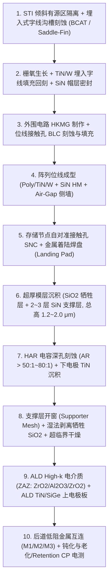

# 1T1C DRAM 制造全流程、深圆筒微电容与微缩挑战

- **所属模块**：`04_工艺整合与节点 / 03_存储器制造全流程`

---

## 1. DRAM 单元核心物理架构：1T1C 电荷共享与漏电机制

每一个 DRAM 存储位（Bit）由 **1 个高阈值低漏电的存取晶体管（Access Transistor）** 与 **1 个垂直立体的存储电容（Storage Capacitor, $C_s$）** 构成：

### （1）电荷共享读写原理与读出裕度（Sensing Margin）
- **写入状态**：写“1”时向存储电容充电至高压 $V_{array}$（$\sim 1.0\sim 1.2\text{ V}$）；写“0”时放电至 $0\text{ V}$。
- **读出过程与电容下限约束**：读取前，寄生电容高达 $C_{BL} \approx 30\sim 60\text{ fF}$ 的长位线（BL）预充电至 $V_{array}/2$；当字线（WL）升压至过驱动电压 $V_{PP} \approx 2.5\sim 3.0\text{ V}$（消除 NMOS 阈值电压损失）开启存取管时，微小单元电容与高位线电容发生电荷共享，在位线上感生微小压变 $\Delta V_{BL}$：
  $$\Delta V_{BL} = \frac{C_s}{C_s + C_{BL}} \left(V_{cell} - \frac{V_{array}}{2}\right)$$
  为了抵抗敏感放大器（Sense Amplifier）失调电压、邻近位线耦合噪声以及宇宙射线引起的软错误（SER），业界必须死守 **$\Delta V_{BL} \ge 80\sim 120\text{ mV}$**。即使通过降低位线寄生电容全力压低 $C_{BL}$，单个微小占地内的存储电容仍必须维持在 **$C_s \approx 8\sim 15\text{ fF}$**（早年节点为 $20\sim 25\text{ fF}$）。

### （2）动态刷新（Refresh）与四大漏电流失路径
依据 JEDEC DDR4/DDR5 规范，常规温度下全阵列每隔 **$32\text{ ms}$ 或 $64\text{ ms}$（$85^\circ\text{C}+$ 高温缩半至 $16\sim 32\text{ ms}$）** 须执行全量重刷新（Retention Time 是 DRAM 良率绝对死穴）。存储电荷主要通过四条物理路径流失：

| 漏电路径名称 | 底层物理机理 | 温度/偏置依赖性与工艺治理对策 |
| :--- | :--- | :--- |
| **1. PN 结热生漏电（SRH）** | 存储节点（SN）反偏 PN 结耗尽区内的晶体缺陷与微量金属杂质激发电子-空穴对 | 随温度指数飙升；需严控注入退火残留位错与硅界面重金属污染 |
| **2. 栅致漏极漏电（GIDL）** | 存取管关断时字线施加负偏压（$V_{WL,off} < 0$），栅-SN 交叠区强电场诱发带间隧穿（BTBT）与陷阱辅助隧穿（TAT） | 对 SN 掺杂浓度梯度与字线边缘氧化层质量极其敏感；采用低浓度渐变 SN 注入（LDD）减缓电场尖峰 |
| **3. 可变数据保持时间（VRT）** | 硅体或界面单原子级缺陷（如氧-空位复合体）在亚稳态之间随机热跳变，使少数单元随机突发性极速漏电 | 极难在常规电测中被完全筛除；需严格优化高温氢/氘（$\text{H}_2/\text{D}_2$）退火钝化降低界面深能级缺陷态 |
| **4. 行锤效应（Rowhammer）** | 高频反复开关相邻字线，向受害单元沟道及埋入沟槽界面注入或释放捕获载流子，加速相邻存储单元电荷掉失 | 通过优化字线侧壁/埋入隔离介质厚度与界面态控制抑制载流子逃逸，并结合系统端 TRR 刷新保护 |

---

## 2. 经典 300mm DRAM 全流程串联（6F² 埋入式字线架构）

```text
[1T1C 6F² 现代 DRAM 单元纵向剖面结构示意]
          ┌───────┐       ┌───────┐   ◄── 上电极板 (Top Electrode Plate: TiN/SiGe)
          │  TiN  │       │  TiN  │   ◄── 高 k ZAZ 介质包覆实心柱状下电极 (AR 60:1~80:1)
   ═══════╪═══════╪═══════╪═══════╪═══════  SiN Supporter Mesh (2~3 层横向拉结防倒塌)
          │Pillar │       │Pillar │
          └───┬───┘       └───┬───┘
         [Landing Pad]   [Landing Pad] ◄── 六角密排着陆焊盘 (EUV 单次曝光 / SAQP+Cut)
              │   ┌───┐       │
              │   │BL │       │        ◄── 位线 (TiN/W) + 两侧 Air-Gap 降容侧墙
            [SNC] └───┘     [SNC]      ◄── 存储节点自对准接触孔 (SNC)
  ───┬───────┴───┬───────┬───┴───────┬───  硅衬底表面 (倾斜有源区 AA)
     │  [SiN Cap]│       │  [SiN Cap]│
     │  [埋入 W ] │       │  [埋入 W ] │ ◄── BCAT / Saddle-Fin 埋入式字线 (WL)
  ───┴───────────┴───────┴───────────┴───
```



### （1）关键区段与 Array / Periphery 整合协同
1. **倾斜有源区与 BCAT / Saddle-Fin 埋入字线**：
   - 现代 DRAM 普遍采用 **$6F^2$ 开放位线架构**（有源区 AA 以倾斜角密排布局最大化压缩特征面积）。
   - 为在 $15\text{ nm}$ 级平面宽度下压制短沟道漏电，在硅衬底刻蚀出 U 型沟槽，同时局部下凹沟槽周围 STI 氧化物露出硅鳍两侧形成 **Saddle-Fin（鞍形鳍）** 三面包裹增强栅控，维持 $>40\sim 60\text{ nm}$ 有效沟长。
   - 沉积 $4\sim 5\text{ nm}$ 栅氧及 TiN/W 填充后，必须将钨金属精确回刻（Recess）至硅表面以下 $40\sim 60\text{ nm}$ 并用 $\text{Si}_3\text{N}_4$ 帽层彻底封顶平坦化，使高电压字线深埋地下，避免与上层位线及 SNC 短接。
2. **Array 与 Periphery（外围电路）热预算整合冲突**：
   - 同一片晶圆上，阵列单元要求耐高压厚栅氧与 W 字线承受后期高温；而外围的敏感放大器、译码器及 DDR5/LPDDR5X 高速接口迫切需要媲美先进逻辑的 **HKMG 高速低功耗 CMOS**（如 Samsung 1z/1a、SK Hynix 1a/1b 均在外围导入 HKMG）。
   - **整合核心难点**：后续电容 ZAZ 介质晶化退火（$500\sim 600^\circ\text{C}$）的热预算极易损伤外围 HKMG 功函数金属并漂移 $V_{th}$。产线通过将外围栅极区置后完成或采用高热稳定性金属氮化物功函数叠层来协调矛盾。
3. **位线（BL）与空气隙（Air-Gap）降容**：
   - 位线两侧采用“$\text{SiN}-\text{牺牲 }\text{SiO}_2-\text{SiN}$”三明治侧墙，在后续开孔后用高度选择性湿法/气相刻蚀掏空中间 $\text{SiO}_2$ 并顶部不保形密封，引入真空/空气隙（$k \approx 1.0$ 取代 $\text{SiO}_2$ 的 $k=3.9$），直接砍掉 $20\%\sim 30\%$ 的寄生电容 $C_{BL}$。
4. **着陆焊盘（Landing Pad, LP）光刻演进**：
   - SNC 自对准挤在两根位线中间连接硅面，顶部向外扩展成六角密排（Honeycomb）的着陆焊盘以承接深圆筒电容。由于 LP 二维节距极度拥挤，已成为 DRAM 制造中**最先采用 EUV 单次曝光替代复杂 SAQP + 多张 Cut 掩模的关键层**（Samsung 1z/1a、SK Hynix 1a/1b 已导入 EUV；Micron 在 1a/1b 深挖 SAQP 并向 1c 切换 EUV）。

### （2）DRAM 世代微缩关键整合指标演进（工程典型量级）

| DRAM 制程世代 | 最小半节距 $F$ (nm) | 存储电容几何结构 | 电容高 / 深宽比（典型） | 关键工艺架构跃迁特征 |
| :--- | :---: | :--- | :---: | :--- |
| **1x / 1y (18~16nm)** | $\sim 16\sim 18$ | OCS 空心圆筒 → 过渡 Pillar | $\sim 1.5\sim 1.8\,\mu\text{m}$ ($AR\sim 50:1$) | 193i SAQP 多重曝光极限；双层 SiN Supporter 全面标配 |
| **1z / 1a (15~14nm)** | $\sim 14\sim 15$ | 实心 TiN 柱（Pillar） | $\sim 1.6\sim 2.0\,\mu\text{m}$ ($AR\sim 60:1\sim 70:1$) | 着陆焊盘（LP）导入 EUV；位线侧墙切入 **Air-Gap**；外围全面升级 **HKMG** |
| **1b / 1c (12~10nm)** | $\sim 10\sim 12$ | 极细高密度 TiN 柱 + 超临界干燥 | $\sim 1.5\sim 1.9\,\mu\text{m}$ ($AR > 70:1\sim 85:1$) | 多层 EUV 扩张；ZAZ 逼近 $0.4\text{ nm}$ 极限（探索新型 $\text{HfZrO}$ / 钙钛矿叠层与 Ru 电极） |

### （3）晶圆级冗余修复（Redundancy）与 KGD 良率门控
在完成 BEOL 布线后、进入 CP 晶圆针测阶段，由于几十亿颗电容中哪怕存在几颗微弱的漏电尾端单元（Retention Tail Bits）都会导致整颗芯片报废，晶圆厂普遍设置高比例行/列冗余阵列：
- **电编程反熔丝修复（eFuse / Anti-Fuse）**：CP 测试机台测出全片失效位图后，向特定氧化层反熔丝施加大电压击穿形成低阻永久通路，将坏字线/坏位线映射切换至备用冗余行/列；
- **片上 ECC（DDR5 On-Die ECC）与工艺容差协同**：自 DDR5 起，DRAM 芯片内部原生集成片上纠错码（ECC）电路自动纠除孤立单比特软错误与轻微 VRT 抖动，这在工艺整合端为微缩节点进一步逼近 $C_s$ 物理下限留出了宝贵的良率安全垫；
- **HBM 晶圆级的极端 KGD 门控**：面向 AI 封装堆叠的 HBM 晶圆，由于后期需经 TSV 垂直键合 8~16 层，一旦第 11 层存在未检出的 VRT 潜伏缺陷将拖垮整套昂贵芯片，因此必须在高温老化测试（Wafer-Level Burn-In）与多温区 Retention 严酷筛查后方能放行成为 **已知合格裸片（KGD）**。

---

## 3. DRAM 晶圆厂核心痛点、良率排查与 3D 演进

### （1）高深宽比电容防倒塌（Leaning）、HAR 刻蚀耦合与 Pillar 转型
在 $6F^2$ 单元面积微缩至 1b/1c 节点时，单电容占地直径跌破 $12\sim 18\text{ nm}$，为了保住 $C_s \ge 8\sim 12\text{ fF}$，只能拔高至 **$1.2\sim 2.0\,\mu\text{m}$**（深宽比 **$AR > 50:1\sim 80:1$**）：
- **Cylinder → Pillar 转折物理**：早年节点采用空心圆筒（Cylinder，内外双面利用面积），但外径低于 $20\text{ nm}$ 后，扣除两侧 $4\sim 5\text{ nm}$ 厚的 TiN 下电极，内孔已不剩多少空间填充 ZAZ 与上电极。现代 1y/1z/1a/1b 节点已普遍转型为**实心 TiN 柱状下电极（Pillar）**，结构抗弯刚度成倍提升且依赖外柱面与更高 $k$ 介质取容。
- **HAR 模层刻蚀与 ALD TiN 填充耦合窗口**：
  - 模层由 $1.5\sim 2.0\,\mu\text{m}$ 厚氧化硅夹多层氮化硅支撑层组成，顶层配 $400\sim 700\text{ nm}$ 非晶碳硬掩模（ACL）；
  - 采用高偏压 $\text{C}_4\text{F}_8/\text{C}_4\text{F}_6/\text{O}_2/\text{Ar}$ 脉冲等离子体直切深孔时，不仅需防止中部鼓肚引发邻孔穿通，更需严格守住孔底着陆 CD（与下方 Landing Pad 充分接触防开路）；
  - 随后的 ALD TiN 采用 $\text{TiCl}_4 + \text{NH}_3$（$400\sim 450^\circ\text{C}$）在 $AR > 70:1$ 极细深孔内实现 $>98\%$ 阶梯覆盖率，并严控氮化反应彻底去除高阻、易诱发腐蚀的氯元素残留。
- **毛细拉弯（Leaning）与防倒塌双保险**：湿法（BOE/DHF）剥离模层 $\text{SiO}_2$ 后，相邻高柱间隙仅 $5\sim 8\text{ nm}$。常规干燥时水膜表面张力产生巨型毛细吸力（$F_c \propto \gamma \cos\theta / d$），将相邻高柱拉弯粘连。产线防线包括：
  1. 在模层不同高度预插 **2~3 层超薄 $\text{Si}_3\text{N}_4$ 横向支撑网格（Supporter Mesh）**，半开窗蚀刻留桥将相邻柱体顶部与中部锁死；
  2. 剥离清洗后立即进入**超临界 $\text{CO}_2$ 干燥腔**，利用超临界态零表面张力（$\gamma \to 0$）无损脱液。

### （2）ZAZ High-$k$ 介质晶相调控与材料权衡
为了让总厚度仅 $4\sim 6\text{ nm}$ 的 ZAZ 实现极高容值并压制漏电，晶圆厂必须精细控制 ALD 沉积（$250\sim 320^\circ\text{C}$）与沉积后退火（PDA $500\sim 600^\circ\text{C}$）的热预算平衡：
- 若退火温度过低，$\text{ZrO}_2$ 保持无定形或单斜相（$k \approx 18\sim 22$），无法达到所需 $C_s$；
- 经精确退火后 $\text{ZrO}_2$ 转化为四方相（Tetragonal，$k \approx 35\sim 40$），但晶界极易滋生穿通漏电，必须依靠中央 $0.5\sim 1.0\text{ nm}$ 非晶 $\text{Al}_2\text{O}_3$ 物理打断晶界，且退火温度不得过度冲击外围 HKMG 与 TiN 电极引发低 $k$ 界面氧化死层。

| 介质与电极组合 | 核心物相与物理参数 | 等效 EOT（典型量级） | 工程优势与漏电/集成局限 |
| :--- | :--- | :---: | :--- |
| **$\text{ZrO}_2-\text{Al}_2\text{O}_3-\text{ZrO}_2$ (ZAZ) / TiN** | 四方相 $\text{ZrO}_2$ ($k\approx 35\sim 40$) 夹 $0.5\sim 1\text{ nm}$ 非晶 $\text{Al}_2\text{O}_3$ ($E_g\approx 8.8\text{ eV}$) | **$0.4\sim 0.5\text{ nm}$** | **量产绝对主力**：$\text{Al}_2\text{O}_3$ 夹层阻断贯通晶界并抬高导带势垒压制 Poole-Frenkel 漏电；但插太厚会拖累有效 $k$ 值 |
| **Ti 掺杂钙钛矿 / $\text{SrTiO}_3$ (STO) / Ru** | 超高介电钙钛矿（$k > 100$）配高功函数 **Ru / $\text{NbN}$** 电极 | **$< 0.3\text{ nm}$**（研发目标） | 1c/1d 备选路线，容值极高；但材料禁带偏窄引发肖特基发射漏电偏高，且需较高退火温度结晶威胁外围 HKMG |

### （3）整合 Bit-Map 失效排查（Troubleshooting）与 Split 矩阵
1. **Case 1：孤立单比特保持时间失效（Single-Bit Retention Tail Fail）**
   - **耦合根因**：埋入 WL 刻蚀微损伤激发强 GIDL、SNC 注入偏移造成结漏电，或 HAR 电容孔底部刻蚀停止（Not-Open）导致 $C_s$ 折半。
   - **Split 与 FA**：调节埋入 WL 回刻深与侧壁氧化厚、SNC 注入倾斜角、以及 HAR 过刻时间（$+10\% / +20\%$）；结合 CP 坐标定位做截面 **TEM** 检查 HAR 孔底着陆状态。
2. **Case 2：成簇或双比特短路（2-Bit / Cluster Short）**
   - **耦合根因**：湿法剥离模层后局部 Leaning 粘连、Supporter 开窗过大削弱边缘拉结强度，或 Landing Pad 套刻错位导致残铜桥连。
   - **Split 与 FA**：增加 Supporter $\text{Si}_3\text{N}_4$ 膜厚（$+1\text{ nm}$）并缩减开窗比率；核对超临界干燥腔压力曲线；采用 **Nano-probing（纳米探针）** 直接测量异常电容漏电流与容值。
3. **Case 3：整排位线或字线读出失效（BL/WL Row/Column Fail）**
   - **耦合根因**：位线 Air-Gap 掏空药液沿 SiN 侧墙针孔渗入 SNC 区引起金属灌入短路，或 BLC 孔底残留氧化皮引发接触电阻开路。
   - **Split 与 FA**：加厚 Air-Gap 侧墙 SiN 阶梯覆盖并缩短 BOE 掏空时间；电学分离 $R_{BLC}$ 串联阻值与 $I_{leak, BL-SNC}$ 精准锁定渗漏层级。

### （4）微缩终点：$4F^2$ VCAT 与 3D DRAM 架构演化对比
当平面微缩逼近 $10\text{ nm}$ 以下（1c/1d 节点），HAR 电容纵横比突破工艺与力学极限，行业正并行孵化三大次世代替代架构：

| 下一代 DRAM 架构 | 核心结构创新 | 密度与工艺红利 | 核心工程挑战 |
| :--- | :--- | :--- | :--- |
| **$4F^2$ 垂直沟道晶体管（VCT）** | 将存取管垂直立起（底层埋位线 → 垂直硅柱沟道 → 环绕字线 → 顶部直接坐电容） | 同等光刻下单元格从 $6F^2$ 直缩至 $4F^2$（面积直省 $33\%$） | 垂直硅柱直径与高密埋入位线集成极难；面临浮体效应（Floating Body Effect）引发的阈值漂移 |
| **水平堆叠 3D DRAM** | 类似 3D NAND 用 $\text{Si}/\text{SiGe}$ 超晶格交替外延堆叠数十层水平单元，横向掏空做电容 | 摆脱平面尺寸限制，向纵深空间叠层倍增存储密度 | 水平细腔体内的精确掺杂、低阻金属字线成膜与 ZAZ 电容高温热预算统筹极度复杂 |
| **无电容 2T0C IGZO DRAM** | 采用非晶氧化物半导体（IGZO）晶体管极低关态漏电（$<10^{-18}\text{ A}/\mu\text{m}$）直接在栅电容存电荷 | 彻底取消复杂深圆筒电容、可多层立体堆叠兼容 BEOL 低温集成 | IGZO 载流子迁移率（$\sim 10\sim 30\text{ cm}^2/\text{V}\cdot\text{s}$）远低于单晶硅，写入速度与长期 BTI 可靠性仍待突破 |
