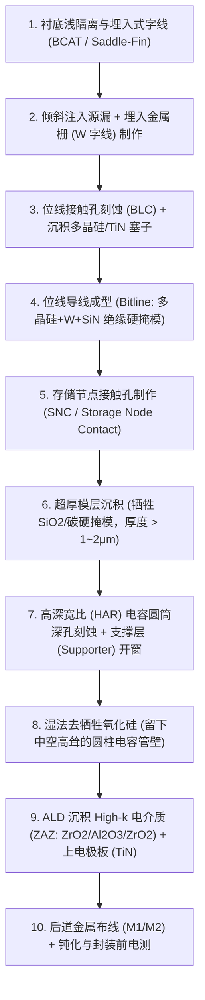

# 1T1C DRAM 制造全流程、深圆筒微电容与微缩挑战

- **所属模块**：`04_工艺整合与节点 / 03_存储器制造全流程`

---

## 1. DRAM 单元核心物理架构：1T1C

每一个 DRAM 存储位（Bit）由 **1 个访问晶体管（Access Transistor）** 和 **1 个存储电容（Storage Capacitor）** 构成：
- **存 "1"**：往微小电容中充入电荷（通常仅几十飞法 $C_s \approx 10\sim 25\,\text{fF}$）；
- **存 "0"**：电容放电（低电位）；
- **读出过程**：开启字线（Wordline, WL），晶体管导通，电容中微量电荷与高寄生电容的位线（Bitline, BL）共享，导致位线产生仅数十毫伏的微小压降变动，由敏感放大器（Sense Amplifier）捕获放大；
- **动态刷新（Refresh）**：由于反向 PN 结微弱漏电与介质漏电，电容电荷会在数十毫秒内漏光，因此必须每隔 32ms 或 64ms 进行一次全阵列数据回写刷新（Retention Time 测试是良率死穴）。

---

## 2. 经典 300mm DRAM 全流程串联（6F² / 4F² 架构）

---

## 3. DRAM 晶圆厂制造核心痛点

1. **高深宽比圆柱电容防倒塌（Capacitor Leaning / Sticking）**：
   - 电容高度 $1.5\sim 2.0\,\mu\text{m}$，直径仅 $15\sim 20\,\text{nm}$，深宽比 **$AR > 50:1\sim 80:1$**！
   - 细长空心圆柱在湿法腐蚀掉模层介质干燥时，毛细表面张力会把相邻两个电容吸附粘在一起造成短路。
   - **对策**：在高度不同位置插入 2~3 层超薄 **$\text{Si}_3\text{N}_4$ 支撑网格（Supporter Layer）** 像手拉手一样横向拉住所有圆筒，并采用 IPA 超临界干燥。
2. **极限介质漏电与 ZAZ High-k 膜**：
   - 传统 $\text{SiO}_2$ 太薄时会发生剧烈直接量子隧穿漏电，电容几毫秒就漏完；
   - 业界全面采用 **$\text{ZrO}_2 - \text{Al}_2\text{O}_3 - \text{ZrO}_2$（ZAZ）** 或含钛新型钙钛矿高介电常数材料（$k > 40$），通过 ALD 实现原子级平整且极低漏电。
3. **微缩终点：3D DRAM 演进趋势**：
   - 当平面单元尺寸微缩至 10nm 以下（1b / 1c 节点），电容无法再做得更细更深，业界正在加速研制类似 3D NAND 的**多层水平堆叠 3D DRAM** 或无电容双栅 2T0C 架构。
