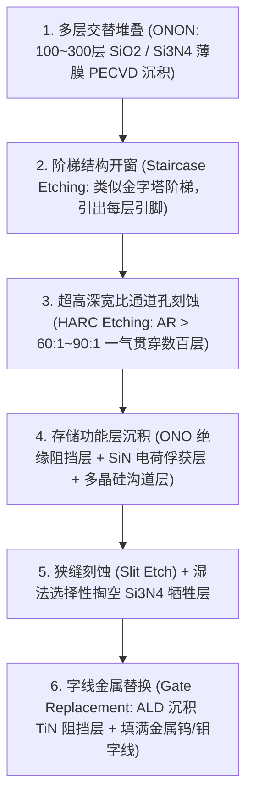

# 3D NAND 百层制造全流程、超高深宽比孔刻蚀（HARC）与字线替换

- **所属模块**：`04_工艺整合与节点 / 03_存储器制造全流程`

---

## 1. 2D 平面闪存走向 3D 堆叠的物理必然

2D NAND 微缩至 15nm 时遭遇双重死锁：
1. **电荷干扰（Cross-talk）**：相邻浮栅（Floating Gate）间距仅几个纳米，电荷耦合导致严重串扰误读；
2. **极小电子数**：一个存储单元浮栅里只有区区数十个电子，只要漏掉几个电子，数据立刻翻转丢失。

**解法**：不再在平面拼命做细，而是将单元做大（从浮栅改为绝缘体**电荷俘获层 Charge Trap Nitride, CTN**），然后像盖摩天大楼一样向空中堆叠 64 层、128 层、232 层、300+ 层！

---

## 2. 3D NAND 晶圆厂制造 6 大关键战役

### （1）第一战：百对 ONON 多层薄膜交替沉积（PECVD）
- 在 12 寸晶圆上连续交替沉积 100~300 层超薄 $\text{SiO}_2$ 与 $\text{Si}_3\text{N}_4$（每层仅 20~30nm）；
- **极限痛点**：薄膜总厚度达到 $5\sim 8\,\mu\text{m}$，若每一层膜内应力控制稍有偏差，累计应力会把整片 775μm 厚的单晶硅晶圆**压弯翘曲（Wafer Bow > 150μm）**，导致后续光刻机根本无法平整吸附（Chuck Error）！

### （2）第二战：超高深宽比通道孔刻蚀（HARC, High Aspect Ratio Contact）
- 在微米级厚度的多层介质堆叠中，垂直刻蚀出数千万个直径仅几十纳米的通孔，深宽比 **$AR > 70:1\sim 100:1$**：
- **腔体严酷挑战**：
  - 离子需要穿过几微米极深孔道，孔口电荷积累会排斥后续离子，导致底部无离子轰击停止刻蚀（Etch Stop）；
  - 容易出现**孔壁鼓肚（Bowing）**、**底部倾斜扭曲（Twisting）**导致与下层电极失配对不准；
  - **主流对策**：采用 **-60°C ~ -80°C 极低温刻蚀（Cryogenic Etch）**，或采用 **双层堆叠拼接（String Stacking）**：先做 100 层打通，上面再盖 100 层继续打通对接。

### （3）第三战：金字塔阶梯蚀刻（Staircase Etch）
- 如何引出 200 多层字线信号？必须在阵列边缘像切蛋糕一样切出一级级的台阶（Staircase），每层露出一个小平台供钨垂直接触栓扎入。
- 采用 **光刻胶反复回缩（PR Slimming）+ 阶梯递进刻蚀**，一张掩模版多次微步下切完成几十级阶梯。

### （4）第四战：字线置换（Gate Replacement / Wordline Fill）
- 打出纵向主狭缝（Slit），灌入高温热磷酸，高选择比掏空全部 $\text{Si}_3\text{N}_4$ 牺牲层（氧化硅骨架保留）；
- 掏空后在几百层中空狭缝缝隙中，通过 ALD 极保形地镀上高 k 阻挡层（$\text{Al}_2\text{O}_3$）、TiN 导电层，并用 $\text{WF}_6$ 还原完全填满金属钨（W），形成最终导电字线。
