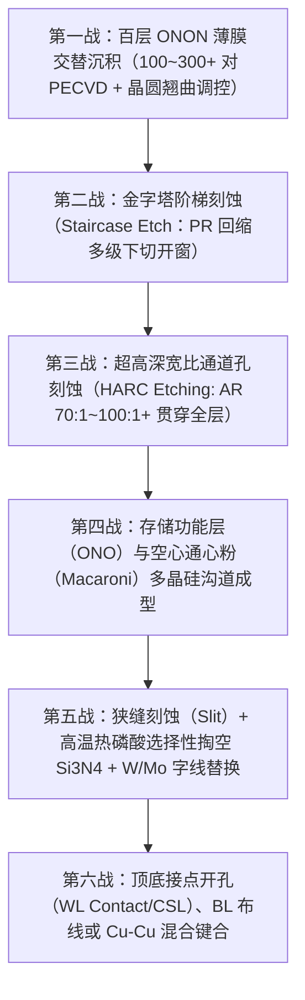

# 3D NAND 百层制造全流程、超高深宽比孔刻蚀（HARC）与字线替换

- **所属模块**：`04_工艺整合与节点 / 03_存储器制造全流程`

---

## 1. 2D 平面闪存走向 3D 堆叠的物理必然

当 2D 平面浮栅（Floating Gate）NAND 闪存微缩至 $15\text{ nm}$ 节点时，遭遇了不可逆转的双重物理死锁：
1. **邻近单元电荷耦合串扰（Cell-to-Cell Interference）**：相邻浮栅间距缩至仅十余纳米，横向寄生电容耦合比率（Coupling Ratio）剧增。向某一单元编程写入高电荷态会直接拉偏周边邻胞阈值电压 $\Delta V_{th}$，在 TLC（3-bit，8 态）与 QLC（4-bit，16 态）极窄的电平窗口下彻底丧失读取裕度。
2. **极小电子数统计涨落（Few-Electron Problem）**：$15\text{ nm}$ 浮栅内分隔相邻逻辑状态的电子数差仅剩 **$10\sim 30$ 个电子**！隧穿氧化层一旦出现单原子级陷阱辅助漏电路径（SILC），整个导电多晶硅浮栅内储存的电子将瞬间通过该单点漏洞泄光，造成数据翻转失效。

**破局之道**：放弃平面 2D 极限缩放，在 3D 架构中将单元特征孔径重新**放宽至 $60\sim 100\text{ nm}$ 量级**以容纳充足电子数，并将存储介质全面切换为**绝缘体电荷俘获氮化硅层（Charge Trap Nitride, CTN）**：
- **局部陷阱抗漏电**：电荷被束缚在绝缘 $\text{Si}_3\text{N}_4$ 深能级陷阱中互不导通，单点氧化层缺陷至多损失局部几个电子而不会牵连全单元；
- **GAA 圆柱电场梯度增益**：垂直环绕栅极（Cylindrical GAA）在同轴几何下天然形成“内壁（隧穿层）电场强、外壁（阻挡层）电场弱”的梯度分布，加快编程擦除速率同时大幅压制栅极反向电子注入；
- **能带工程隧穿层（Bandgap-Engineered ONO）**：传统单一 $\text{SiO}_2$ 很难同时兼顾“低电场下 10 年不漏电”与“高电场下毫秒级快速 FN 隧穿擦除”。3D CTN 采用极薄 $\text{SiO}_2 / \text{Si}_3\text{N}_4 / \text{SiO}_2$ 三明治复合隧穿势垒，利用中间氮化硅较低的空穴势垒高度在擦除脉冲下开启共振辅助空穴隧穿，同时在静态保存期维持高势垒锁住电荷。

```text
[3D NAND 多电平阈值电压分布（TLC 8-态）与工程窗口示意]
  Cell 数量
    ▲   ┌─┐     ┌─┐ ┌─┐ ┌─┐ ┌─┐ ┌─┐ ┌─┐ ┌─┐  ◄── QLC (16 态) 分布窗口窄至仅 ~100~150 mV!
    │   │E│     │A│ │B│ │C│ │D│ │E│ │F│ │G│      (要求极高 HAR 孔径均匀性与低 RTN 噪声)
  ──┴───┴─┴─────┴─┴─┴─┴─┴─┴─┴─┴─┴─┴─┴─┴─┴─┴───► Vth
```

---

## 2. 3D NAND 晶圆厂制造 6 大关键战役与主流路线分化

投产前，主流存储大厂的底层结构选型直接决定了晶圆厂核心设备配置、热预算上限与良率风险点：

| 架构维度 | 主流厂商阵营 | 核心工艺路线与工程 Trade-off |
| :--- | :--- | :--- |
| **堆叠置换方案（ONON RG）** | Samsung / SK Hynix / Kioxia-WD / Micron（176L+） | **ONON 电荷俘获置换栅**：先交替沉积 $\text{SiO}_2/\text{Si}_3\text{N}_4$，再掏空氮化硅填金属字线；工艺链长、掏空失稳与金属填充风险高，但字线电阻极低且层厚更紧凑 |
| **早期浮栅直成（OPOP FG）** | Micron / Intel（至 96L，128L 后转 RG） | **OPOP（Oxide-Polysilicon）**：多晶硅直接做字线，省去掏空与金属替换；但超百层后多晶硅电阻过大、电学串扰加剧，已全面向 RG 收敛 |
| **外围逻辑整合架构** | Samsung / SK Hynix / Micron：**CuA / PUC**<br>YMTC：**Xtacking 混合键合** | **CuA/PUC（CMOS under Array）** 将外围逻辑压在阵列正下方，外围晶体管需硬扛后期数千小时高堆叠热预算；**Xtacking** 在两片晶圆上独立最优制造逻辑与存储阵列，最后通过 **Cu-Cu 混合键合**对接，I/O 速率与存储密度占优，但增加双片制造与对准键合成本 |



### （1）第一战：百对 ONON 交替沉积与晶圆翘曲（Wafer Bow）调控
- **工艺窗口**：以 200~300 层 ONON（单层膜厚 $20\sim 28\text{ nm}$，单对周期 $45\sim 55\text{ nm}$）为例，介质总厚度高达 **$8\sim 13\,\mu\text{m}$**！多腔体连续 PECVD（$380\sim 500^\circ\text{C}$）快速切换 $\text{SiH}_4/\text{N}_2\text{O}$ 与 $\text{SiH}_4/\text{NH}_3$ 交替沉积，单层厚度非均匀性必须控制于 $<1\%$ 以防深孔底端字线偏位。
- **Wafer Bow 物理模型与治理**：薄膜残余应力 $\sigma_f$ 对单晶硅片产生的弯曲曲率受 **Stoney 公式**支配：
  $$\sigma_f = \frac{E_s}{6(1-\nu_s)} \frac{t_s^2}{t_f} \cdot \frac{1}{R} \implies \text{Bow} \propto \sigma_f \cdot t_f$$
  当叠层总厚 $t_f$ 从 64L 的 $\sim 3\,\mu\text{m}$ 猛增至 256L 的 $10\,\mu\text{m}+$ 时，即使单膜应力控制不变，整片 Bow 也会暴涨至 **$150\sim 300\,\mu\text{m}+$**，直接触发光刻机静电/真空吸盘报警（Chuck Error）与边缘失焦。产线必须：
  1. 通过**双频射频（HF/LF RF 调节离子轰击）**把 $\text{Si}_3\text{N}_4$ 本征张应力微调至近零或微压应力；
  2. 在晶圆**背面预先沉积厚达数微米的反向应力补偿膜（Backside Stress Balance）**，将全流程 Wafer Bow 锁死在 $<50\sim 80\,\mu\text{m}$ 安全窗口内。

### （2）第二战：金字塔阶梯蚀刻（Staircase Etch）
为将百余层水平字线分别引出至顶部金属布线，必须在阵列边缘切出微米级“百级台阶”。
- **工艺逻辑**：采用一张光刻掩模，循环执行 **“$\text{O}_2$ 等离子体光刻胶回缩（PR Slimming）→ 各向异性刻蚀 1 对 ON 层”**（一轮光刻连续切出 $8\sim 16$ 级微台阶），再协同多级大台阶掩模（Chop Mask）倍增出 $200\sim 300$ 级独立着陆平台。
- **工程难点**：$10\,\mu\text{m}$ 级深地形落差极难实现后续厚氧化硅填充的 CMP 平坦化（需结合多层旋涂碳/介质涂布 + 反色调掩模辅助回刻），且各台阶转角极易残留 $\text{Si}_3\text{N}_4$ 尖刺围栏（Fence）诱发垂直接触孔跨层短路。

### （3）第三战：超高深宽比通道孔刻蚀（HARC, $AR > 70:1\sim 100:1$）
借助 $2\sim 4\,\mu\text{m}$ 厚非晶碳硬掩模（ACL），使用高偏压脉冲 CCP 等离子体（$\text{C}_4\text{F}_8/\text{C}_4\text{F}_6/\text{CH}_2\text{F}_2/\text{O}_2/\text{Ar}$）在 $8\sim 12\,\mu\text{m}$ 介质中一气穿透数千万个直径仅 $60\sim 90\text{ nm}$ 的深孔。
- **同步射频脉冲（Sync-Pulsed RF）解耦机理**：为压制孔内**差分荷电（Differential Charging）**导致的离子束偏斜，现代 HARC 刻蚀机台（如 Lam / TEL 高压 CCP）将射频源与偏压射频以 kHz 级频率同步脉冲调制——在射频关断期（Pulse-Off），等离子体电子温度骤降使负离子或冷电子得以进入深孔底部中和累积的正电荷，从而显著压低底端扭曲（Twisting）与刻蚀停止（Etch Stop）。

```text
[HARC 通道孔常见刻蚀剖面失效示意]
  (a) 理想垂直孔         (b) 顶部鼓肚 (Bowing)      (c) 底部扭曲 (Twisting)     (d) 停刻 (Etch Stop)
     │     │                │     │                    │     │                     │     │
     │     │               /       \  ◄─高能离子反射    │     │                     │     │
     │     │               \       /    蚀扩易邻孔短路  │     │                     │     │
     │     │                │     │                    │    /  ◄─底端正电荷偏转       └───┘ ◄─未打通 CSL
  ───┴─────┴───          ───┴─────┴───              ───┴───┴───                 ─────────────
```

| 3D NAND 世代演进典型尺度 | 64L ~ 96L | 128L ~ 176L | 232L ~ 300+L |
| :--- | :---: | :---: | :---: |
| **ONON 总厚度 / 拼接次数** | $3\sim 5\,\mu\text{m}$（单叠层为主） | $6\sim 8\,\mu\text{m}$（1~2 Deck） | **$9\sim 13\,\mu\text{m}$（2~3 Deck 或 Cryo 低温直穿）** |
| **HARC 深宽比（AR）与字线金属** | $AR \approx 50:1\sim 65:1$ / W | $AR \approx 65:1\sim 80:1$ / W | **$AR > 85:1\sim 110:1$ / W 向无阻挡层 Mo 过渡** |

| 突破百层 HARC 的主流工艺路径 | 核心原理与产线实现 | 工程对比与选型权衡（Trade-off） |
| :--- | :--- | :--- |
| **多叠层拼接（String Stacking, 2-Deck/3-Deck）** | 先堆 100~128 层打孔填牺牲塞，再续堆 100~128 层二次打孔对准对接（Samsung V7/V8、SK Hynix 238L 主力） | 单次刻蚀深宽比减半、良率最稳妥；但双倍增加了光刻/CMP/清洗成本，且拼接界面套刻偏移（需 $<5\sim 8\text{ nm}$）极易在接缝处产生电阻畸变 |
| **极低温刻蚀（Cryogenic HARC, $-60\sim -80^\circ\text{C}$）** | 如 TEL 新一代方案采用超低温卡盘配合 $\text{HF}/\text{PF}_3/\text{H}_2$ 等化学体系，抑制孔口侧壁反应并促进低温钝化保护 | 刻蚀速率提升 **$2\sim 3\times$**，支持单次直穿 $>10\,\mu\text{m}$（$AR>100:1$）免去拼接缝；但对超低温腔体控温精度、冰晶颗粒防凝与耐腐蚀硬件要求极高 |

### （4）第四战：存储功能层（ONO）、Macaroni 沟道与晶化退火
通道孔打通后，自外向内通过高保形 ALD/LPCVD 依次覆盖：
```text
[垂直通道孔横截面（自外向内）]
  金属字线 (W/Mo) ──► ALD Al2O3 高 k 阻挡 ──► SiO2 阻挡 ──► Si3N4 电荷俘获层 ──► 能带工程隧穿层 ──► Macaroni 极薄多晶硅 (5~10nm) ──► 中心 Core SiO2
```
- **空心通心粉（Macaroni Body）设计动机**：若整个 $60\text{ nm}$ 孔填满实心多晶硅，中心区远离栅极失去静电控制，且海量多晶硅晶界陷阱会导致极差的亚阈值摆幅（$SS$）与单元随机电报噪声（RTN）。将有效多晶硅削薄成仅 **$5\sim 10\text{ nm}$ 的环形薄壁**并用氧化硅芯填满后，沟道在工作时处于**全耗尽（Fully Depleted）状态**，大幅压制晶界势垒波动与读出电流分布宽化。
- **非晶硅晶化（MILC / SPC）**：沉积态沟道为迁移率极低的非晶硅（a-Si），必须通过炉管固相晶化（SPC）或金属诱导横向晶化（MILC）退火生长出大晶粒多晶硅以保障读取串电流（$I_{cell}$），同时严控退火热预算以免损伤底层的逻辑电路。

### （5）第五战：狭缝掏空与字线金属替换（W → Mo 替代跃迁）
- **热磷酸掏空与力学支撑**：切出纵贯全层的深狭缝（Slit），灌入 **$150\sim 165^\circ\text{C}$ 高温浓磷酸（$\text{H}_3\text{PO}_4$）**（调控溶硅量维持 $\text{Si}_3\text{N}_4:\text{SiO}_2 > 100:1$ 选择比），横向掏空全部氮化硅。此时 200 层氧化硅“书架”完全悬空，全靠垂直通道柱支撑，必须在阵列内穿插不接电的**机械伪支撑柱（Dummy Pillars）**防止整片坍塌倾倒（Pattern Collapse）。
- **字线替换材料跃迁（W → Mo）**：当堆叠突破 250~300+ 层，单层字线厚度压缩至 $12\sim 16\text{ nm}$ 以下，金属材料必须升级：

| 字线替换金属 | 阻挡层要求与空间占用 | 工艺与电学优劣势（232L → 300+L 演进判断） |
| :--- | :--- | :--- |
| **钨（W）** | 必须上下覆盖 $\sim 2\sim 3\text{ nm}$ **TiN 阻挡层**防 $\text{WF}_6$ 氟攻击氧化层（双侧占去 $4\sim 6\text{ nm}$ 窄缝） | 极窄隙中导电 W 芯被迫大幅缩水导致电阻率与 WL RC 延迟剧增，且氟离子残余威胁数据保持可靠性 |
| **钼（Mo）** | 采用 $\text{MoCl}_5 / \text{MoO}_2\text{Cl}_2$ 等无氟前驱体，支持**无阻挡层（Barrier-less）或亚纳米衬底直接成核** | **300+ 层下一代核心替代材料**：相同字线总厚下有效金属截面积增大 $>30\%$，薄膜电阻率显著低于受限态 W 且彻底消除氟腐蚀隐患 |

### （6）第六战：阶梯高跨度接触刻蚀、BL 互连与外围电路整合（CuA vs Xtacking）
- **百级阶梯字线接触孔（WL Contact）的十倍深差刻蚀挑战**：
  - 同一张掩模版同时向 $200+$ 级台阶垂直刻蚀接触孔时，最顶层台阶的氧化层厚度仅 $\sim 1\,\mu\text{m}$，而最底层台阶的氧化层深度超过 **$10\,\mu\text{m}$**！
  - 在底层深孔尚未抵达着陆层之前，顶层浅孔早已被等离子体连续轰击了 $10\times$ 的过刻时长——**若无超高选择比停刻机制，顶层浅孔将直接切穿仅十几纳米厚的字线导致跨层短路**。产线必须精确调节高碳氟比聚合物沉积速率，利用底层预先保留的特定厚度的金属/氮化硅着陆垫层（Landing Pad）扛住 $10\times$ 过刻，实现从浅到深全部接点的同步无损导通。
- **阵列互连**：通道孔顶部制作漏极选择管（SGD）汇入密排位线（BL），并与外围逻辑汇总：

| 对比维度 | CuA / PUC（外围置底单晶圆流片） | Xtacking（双晶圆分离制造 + Cu-Cu 混合键合） |
| :--- | :--- | :--- |
| **热预算限制** | 外围 CMOS 金属必须改用高熔点 W 互连硬扛后期沟道退火，高性能逻辑受限 | **完全解耦热预算**：逻辑晶圆可用标准先进低 $k$ 铜互连最优化高速外围电路 |
| **I/O 速率与存储密度** | 接口速率受 W 寄生电容拖累；但单晶圆流片免去键合机台投资与对准损耗 | 晶面直连实现 **$>2.4\sim 3.2\text{ Gbps}$ 超高接口速率**与极高阵列面积利用率；代价是增加双片加工与键合良率门槛 |

---

## 3. 3D NAND 整合良率排查、可靠度退化与 Split 实验重点

### （1）电学可靠度耦合（Read Disturb / Retention）与坏块管理
在 3D CTN 电荷俘获结构中，由于 $\text{Si}_3\text{N}_4$ 层沿整个垂直通道连续贯通（不像 2D 浮栅被物理切断），存储于某一字线下的电子随时间或高温会在氮化硅内部发生**横向电荷迁移扩散（Lateral Charge Migration）**，引发阈值电压漂移（Data Retention Loss）；此外，高频读取同一串上的非选通单元需要施加高通过电压 $V_{pass}$，易导致微弱编程干扰（**Read Disturb**）。晶圆厂需要在 CP 测试阶段屏蔽不可修复的超差字线簇写入片内坏块表（Bad Block Table）。

### （2）典型量产整合失效与 Split 排查实战

1. **Case 1：沿垂直高度（WL0~WL200）$V_{th}$ 与擦写速度严重偏离（Z-Profile Drift）**
   - **整合机理**：HARC 深孔天然带有微弱锥度（孔顶 $95\text{ nm}$ vs 孔底 $65\text{ nm}$）。依据同轴圆柱电场公式 $E(r) \propto \frac{1}{r \ln(r_{out}/r_{in})}$，孔底曲率半径更小使隧穿层局部电场显著强于孔顶，造成底层单元编程/擦除速度快于顶层。
   - **Split 与 FA**：按字线高度分层提取 ISPP 脉冲数与 $V_{th}$ 分布；`Split` 调节 HARC 钝化气比将孔壁垂直度拉向 $89.8^\circ+$，并在固件端对不同高度 WL 实施分区电压偏置补偿。
2. **Case 2：相邻字线层间短路（WL-to-WL Short）**
   - **整合机理**：Slit 狭缝填满金属 W/Mo 后，执行各向同性侧壁回刻清理多余金属时，因侧壁微凹坑过刻不足留下金属残丝（W Stringer）桥接上下两层字线。
   - **Split 与 FA**：增加 Slit 侧壁金属回刻时长（$+10\% / +20\%$）与湿法微蚀配比；电测锁定短路 WL 层号后，用 **OBIRCH 热点定位 + 纵剖面 TEM** 核实残余金属桥连。
3. **Case 3：整串断路或高串电阻（Open / High-$R$ String）**
   - **整合机理**：双叠层（Deck-1/Deck-2）拼接套刻错位截断沟道；或 HARC 孔底 Etch Stop 未打通至 CSL 源极线；或字线横向填充入口 Pinch-off 留下内部空洞（WL Seam/Void）。
   - **Split 与 FA**：检查双叠层界面 Overlay 分布图与孔底 CD-SEM；`Split` 调整 $\text{WF}_6/\text{MoCl}_5$ 分压与原子层脉冲延时；联合 **EMMI 光发射与切片 SEM** 判定断路位于孔底还是字线末端。
