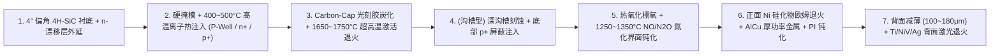

# 碳化硅（SiC）与氮化镓（GaN）宽禁带功率晶圆厂工艺

- **所属模块**：`04_工艺整合与节点 / 04_特色与宽禁带工艺`

---

## 1. 宽禁带材料核心物理参数与 Baliga 优值（BFOM）

硅基 IGBT 与超结 MOSFET 在 $650\sim 3300\text{ V}$ 高压大功率领域已逼近理论物理极限。由单极型功率器件理想漂移区比导通电阻公式——**巴利加优值（Baliga's Figure of Merit, BFOM）**可见宽禁带半导体的碾压优势：

$$R_{on,sp} = \frac{4 V_B^2}{\epsilon_s \mu_n \mathcal{E}_c^3} \implies \text{BFOM} = \epsilon_s \mu_n \mathcal{E}_c^3$$

由于临界击穿场强 **$\mathcal{E}_c$ 以三次方的权重进入分母**，当 SiC 与 GaN 的 $\mathcal{E}_c$ 较硅（$0.3\text{ MV/cm}$）跃升约 $10\times$ 时，同等额定耐压 $V_B$ 下漂移区厚度 $W_d = 2V_B / \mathcal{E}_c$ 可做薄 $10\times$ 且掺杂浓度提升 $100\times$，使得理论比导通电阻 $R_{on,sp}$ **剧降数百至上千倍**，开关损耗与裸片面积同步锐减。

| 物理性质 | 硅 (Si) | 4H-SiC (碳化硅) | GaN (氮化镓) | 功率晶圆厂与器件选型工程意义 |
| :--- | :---: | :---: | :---: | :--- |
| **禁带宽度 $E_g$ (eV)** | 1.12 | **3.26** ($2.9\times$) | **3.40** ($3.0\times$) | 本征载流子浓度极低，关断漏电小，可耐 $200^\circ\text{C}+$ 高结温 |
| **临界击穿场强 $\mathcal{E}_c$ (MV/cm)** | 0.3 | **2.5 ~ 3.0** ($\sim 10\times$) | **3.3** ($11\times$) | 依据 $\mathcal{E}_c^3$ 压缩漂移区 $R_{on,sp}$，突破高压大电流导通瓶颈 |
| **热导率 $\kappa$ (W/(cm·K))** | 1.5 *(150 W/m·K)* | **3.7 ~ 4.9** *(~3X)* | 1.3 *(~130 W/m·K)* | **SiC 散热极其优异**，统治 $800\text{ V}+$ 电动车主驱逆变器与高压储能 |
| **电子饱和速度 $v_{sat}$ ($10^7$ cm/s)** | 1.0 | 2.0 | **2.7** ($2.7\times$) | **GaN 结合高迁移率 2DEG**，主攻 MHz 高频开关电源、快充与射频功放 |
| **晶圆厂量产器件路线** | 300mm 垂直/平面 | 150/200mm **专用线垂直 MOSFET** | 200mm **CMOS 兼容 GaN-on-Si HEMT** | SiC 为垂直体电流器件（抗大浪涌）；GaN 为横向平面结构（高开关速度） |

---

## 2. 碳化硅（SiC）晶圆厂全流程特征与极限工艺难点

量产级 4H-SiC 功率 MOSFET 构建在 **$4^\circ$ 偏角（Off-axis）$\text{4H-SiC}$ `(0001)` 硅面**单晶衬底之上，并经高温 CVD（$\sim 1600^\circ\text{C}$）外延 $5\sim 15\,\mu\text{m}$ 轻掺杂 $n^-$ 漂移层——$4^\circ$ 偏切露出高密原子台阶以引导外延层精准复制 `4H` ABCB 堆垛而不混入 `3C` 杂相，同时促使基面位错（BPD）转化为低危害的贯穿刃位错（TED）预防双极导通退化。



```text
[4H-SiC 平面型 DMOSFET vs 沟槽型 Trench MOSFET 关键集成差异]
       (a) Planar DMOSFET                            (b) Trench MOSFET (消除 JFET 电阻，利用高迁移率侧壁)
     Source     Gate      Source                       Source       Gate (Poly)       Source
   ┌──[n+]──┬──────────┬──[n+]──┐                    ┌──[n+]──┐   ┌───────────┐   ┌──[n+]──┐
   │  P-Well│ [GateOx] │ P-Well │                    │ P-Well │   │ [Gate Ox] │   │ P-Well │
   └────────┴───JFET───┴────────┘                    └────────┴───┴─┬───────┬─┴───┴────────┘
         (存在 JFET 寄生导通电阻)                                   │[p+屏蔽]│  ◄── 沟槽底部必须注入深 p+ 屏蔽保护拐角栅氧!
   ─────── n- SiC 漂移外延层 ───────                  ───────── n- SiC 漂移外延层 ─────────
   ─────── n+ 减薄 SiC 衬底 + 背面激光退火欧姆金属 ───────
```

由于 SiC 莫氏硬度高达 $9.2\sim 9.3$（仅次于金刚石）且化学极其惰性，常规硅厂机台无法通用，存在五大工程与尺寸升级壁垒：

### （1）高温离子注入（Hot Implant）与超高温炭膜激活退火（$1650\sim 1750^\circ\text{C}$）
- **无扩散“硬锁定”结轮廓**：SiC 中杂质扩散系数在 $1800^\circ\text{C}$ 下近乎为零，无法利用高温推进（Drive-in）调结深。P-Well、$p^+$ 体接触与 $n^+$ 源区轮廓 **100% 依赖多能量（几十 keV 至 MeV 级）连续注入拼接出 Box Profile**，横向阻挡依靠厚氧化硅或金属硬掩模。
- **高温热注入（$400\sim 500^\circ\text{C}$）**：$\text{Si}-\text{C}$ 键能高达 $\sim 4.6\text{ eV}$。室温高剂量注入铝（Al 受主）会彻底轰碎晶格形成非晶态，后续退火难以恢复完整 `4H` 晶型并诱发大量堆垛层错。晶圆必须置于 **$400\sim 500^\circ\text{C}$ 加热卡盘**上热注入，实现边损伤边动态修复晶格。
- **Carbon-Cap 保护激活**：传统石英退火炉管在 $1100^\circ\text{C}+$ 即软化塌陷。SiC 激活必须采用专用**感应加热石墨超高温退火炉（$1650\sim 1750^\circ\text{C}$，Ar 气 $15\sim 30\text{ min}$）**。因高温下硅原子蒸气压远高于碳，裸片会挥发升华硅原子导致表面严重台阶束（Step Bunching）与石墨化；退火前必须旋涂光刻胶并在 $\sim 800^\circ\text{C}$ 裂解成致密**硬碳保护膜（Carbon Cap）**封死表面，退火后用氧等离子体灰化及 RCA 清洗去除。

### （2）极慢硬质 CMP 与“透明晶圆”传输量测盲区
- **极限 CMP 难题**：常规硅片 CMP 抛光率达上千 $\text{nm/min}$，而 SiC 在纳米金刚石磨料配高氧化性强酸试剂（如高锰酸钾 $\text{KMnO}_4$、$\text{H}_2\text{O}_2$）下去除率通常仅**数微米/小时**，要求研磨机具备超高主轴刚性与全套防腐腔体。
- **可见光透明引起的机械感知盲区**：$4\text{H-SiC}$ 禁带宽度 $3.26\text{ eV}$（截止吸收波长 $\sim 380\text{ nm}$）使其**对可见光及红外激光完全透明**！普通硅晶圆厂内红外/红光光电检测器（检测晶圆在位、机械手臂寻边 Notch）会直接射穿失明。产线机械手和传输系统必须全线切换为**深紫外波段（$<360\text{ nm}$）光学传感器、电容/声波传感器**，或采用背涂吸光层与边缘机械限位。

### （3）$\text{SiC}-\text{SiO}_2$ 界面碳缺陷钝化与沟槽（Trench）电场屏蔽
- **碳团簇界面态（$D_{it}$）**：热氧化 SiC 副产 $\text{CO}/\text{CO}_2$ 与大量残留界面碳团簇及近界面陷阱（NITs，$D_{it} \approx 10^{12}\sim 10^{13}\text{ cm}^{-2}\text{eV}^{-1}$），早期 SiC MOSFET 反型沟道迁移率惨跌至 **$5\sim 20\text{ cm}^2/(\text{V}\cdot\text{s})$**（体迁移率 $\sim 900$）。
- **NO / $\text{N}_2\text{O}$ 氮化钝化与 BTI 折中**：热氧后必须在 **$1250\sim 1350^\circ\text{C}$ 一氧化氮（NO）或 $\text{N}_2\text{O}$ 气氛下执行 POA 退火**，氮原子中和界面碳缺陷将沟道迁移率提升至 **$40\sim 55\text{ cm}^2/(\text{V}\cdot\text{s})$**；但氮引入过量会增添正电荷及空穴陷阱诱发正/负偏压温度漂移（BTI），必须严控氮化温度与分压。
- **Trench 沟槽屏蔽工程**：沟槽 MOSFET 刻蚀深 $1\sim 1.5\,\mu\text{m}$ 微沟槽消除 JFET 寄生电阻并将沟道置于迁移率翻倍的垂直 `(11-20)`/`(1-100)` 侧壁晶面，但高耐压下电场会集中击穿沟槽底角栅氧——必须通过高能注入在沟槽正下方埋设深 $p^+$ 屏蔽区拦截峰值电场。

### （4）高压边缘终端保护（JTE / 场限环）与减薄背面激光退火
- **高压终端设计（Junction Termination Extension, JTE）**：在 $650\sim 1700\text{ V}+$ 功率芯片边缘，由于主结边界曲率半径小，峰值电场极易在此提前引发雪崩击穿使实测耐压大打折扣。产线必须在芯片边缘周边精确注入剂量梯度分布的**空间调制 Al 离子结终端扩展区（JTE）**或制备多道浮空场限环（FLR），将边缘电场平缓推向外围；同时由于 SiC 终端耐压对表面固定电荷高度敏感，必须覆以低电荷高绝缘氮化硅 + 聚酰亚胺（PI）厚钝化层严防高压打火与湿气漏电。
- **正面欧姆接触与背面激光退火**：正面沉积 Ni 后于 $950\sim 1000^\circ\text{C}$ RTA 形成低阻 $\text{Ni}_2\text{Si}$ 欧姆接触，完成 $4\sim 5\,\mu\text{m}$ AlCu 焊盘与 PI 钝化后，将 $350\sim 500\,\mu\text{m}$ 厚衬底背面磨薄至 $100\sim 180\,\mu\text{m}$ 压缩衬底串联电阻，沉积 Ti/NiV/Ag 后执行**背面纳秒激光退火（Laser Anneal）**局部构筑背面欧姆接触而不熔化正面铝金属。

### （5）150mm → 200mm 产线扩径与键合衬底演进
将 SiC 从 6 英寸（150mm）推向 8 英寸（200mm）不仅是面积放大 $1.78\times$，更挑战全片温度均匀性——200mm 外延炉与 $1700^\circ\text{C}$ 退火炉的径向温差极易诱发滑移位错与翘曲。此外，为了摊薄昂贵单晶 SiC 衬底成本，部分产线正推进**层转移工程衬底（类似 SmartCut 技术）**：通过高剂量氢注入将高质量单晶 SiC 薄层剥离并键合至廉价低阻多晶 SiC 载片上，实现单晶籽晶多次循环复用。

---

## 3. 氮化镓（GaN-on-Si）HEMT 晶圆厂工艺与整合挑战

### （1）200mm CMOS 产线兼容性改造（Au-Free 无金化与低阻欧姆接触）
- **Au-Free 污染红线**：传统射频 GaN 依赖金（Au）做欧姆/栅电极，但金是硅晶体管最致命的深能级复合杀手，绝对禁止进入 200mm 硅晶圆厂。量产级 **200mm GaN-on-Si 必须全面执行 Au-Free 工艺**；
- **非金欧姆接触工艺路径对比**：
  1. **高温合金化穿通欧姆接触（Ti/Al/TiN 或 Ti/Al/W）**：经 $750\sim 850^\circ\text{C}$ 快速热退火使金属穿过 AlGaN 势垒直接接触 2DEG，但高温易诱发 Al 合金熔融团聚造成线边缘粗糙与微短路（影响高密度良率）；
  2. **低温凹槽直触欧姆接触（Recessed Ohmic, $500\sim 580^\circ\text{C}$）**：先干法精准蚀刻穿透欧姆区 AlGaN 势垒至 2DEG 平面，随后沉积 Ti/Al/TiN 低温合金接触，实现边缘平整、低接触电阻（$R_c < 0.4\sim 0.6\text{ }\Omega\cdot\text{mm}$）并完全兼容 CMOS 栅极先做后电极（Gate-First/Last）热预算。

### （2）异质外延应力工程（攻克 17% 晶格失配与 54% 热失配）
```text
[200mm GaN-on-Si(111) 横向 E-mode HEMT 外延叠层与应力自抵消设计]
   Source (Ti/Al)             [p-GaN Gate] (TiN)            Drain (Ti/Al)
  ───┬────────┬────────[in-situ Si3N4 钝化]────────┬────────┬───
     │        └────── Al0.25Ga0.75N 势垒层 (12~15nm) ──┘        │
  ═══╧══════════════════ 2DEG 二维电子气沟道 ═══════════════════╧═══
     │         高晶体质量 GaN 沟道层 + 掺碳高阻 GaN 缓冲层 (1~2μm)     │
     │      AlGaN 渐变 / AlN-GaN 超晶格应力补偿层 (引入生长压应力)    │
     │               AlN 成核层 (阻挡高温 Ga-Si 回熔蚀坑)            │
  ─────────────────────────── Si(111) 单晶衬底 ─────────────────────
```
- 在低成本 `(111)` 硅衬底 MOCVD 外延 GaN（$\sim 1050^\circ\text{C}$），存在 **$17\%$ 晶格失配**、**$54\%$ 热膨胀失配**（降温产生剧烈张应力致碎裂翘曲）及高温 Ga-Si 回熔蚀刻。
- **工程解法**：低温沉积 **AlN 成核层**物理隔绝 Ga-Si 接触；再叠加 $3\sim 5\,\mu\text{m}$ **阶梯渐变 AlGaN 或 AlN/GaN 超晶格缓冲层**在高温生长态人为积攒强**压应力**，刚好在降温至 $25^\circ\text{C}$ 时抵消热失配张应力，将 200mm 晶圆 Bow 压回 $<40\sim 50\,\mu\text{m}$ 以内；同时中段缓冲层掺碳（C-doping $\sim 10^{18}\sim 10^{19}\text{ cm}^{-3}$）形成高阻层防高压纵向击穿。

### （3）2DEG 物理与常关型（E-mode）改造路线对比
在 `(0001)` 镓面 $\text{Al}_{0.25}\text{Ga}_{0.75}\text{N}/\text{GaN}$ 异质结界面，依靠强烈的**自发极化 + 压电极化效应**，无需化学掺杂即可在 GaN 侧自发感应出面密度 $n_s \approx 10^{13}\text{ cm}^{-2}$、迁移率 $\mu_n \approx 1500\sim 2000\text{ cm}^2/(\text{V}\cdot\text{s})$ 的极高导电二维电子气（2DEG）。由于零栅压天然导通（D-mode）极易引起电路上电直通炸机，必须改造成安全**常关型（E-mode, $V_{th} > +1.2\sim +2.5\text{ V}$）**：

| E-mode 工艺路线 | 核心制造原理与步序 | 产线优势与物理/工艺痛点 |
| :--- | :--- | :--- |
| **1. $p\text{-GaN}$ 栅极（当前 650V 绝对主流）** | AlGaN 上外延 Mg 掺杂 $p\text{-GaN}$ 抬高导带底耗尽栅下 2DEG；**极关键步序**：选择性干法刻蚀剥离栅外 $p\text{-GaN}$ 恢复外围 2DEG 导通 | 商业成熟度最高（Infineon/Navitas/Innoscience 主力）；**生死红线**：AlGaN 势垒仅 $12\sim 15\text{ nm}$，刻蚀若过切 $2\sim 3\text{ nm}$ 即彻底摧毁 2DEG！须用低损伤 $\text{Cl}_2/\text{SF}_6$ 或原子层刻蚀（ALE）自停在 AlGaN 表面 |
| **2. 栅下凹槽 MIS-HEMT** | 干法刻蚀彻底挖断栅下 AlGaN 势垒物理切断 2DEG，再 ALD 沉积 $\text{Al}_2\text{O}_3/\text{SiN}$ 重构增强型 MOS 沟道 | $V_{th}$ 可高至 $+3\text{ V}+$、栅漏极低；但刻蚀凹槽界面损伤引起长期工作下的严重 $V_{th}$ 迟滞漂移 |
| **3. Cascode 级联封装** | 保留天然高压 D-mode GaN 芯片，封装内串联一颗低压常关 Si MOSFET 协同关断 | 彻底躲开 $p\text{-GaN}$ 极窄刻蚀工艺风险；但引入双芯片串联寄生电感制约极限 MHz 高频开关效率 |

---

## 4. SiC 与 GaN 产线典型整合失效与 Split 排查矩阵

1. **Case 1：GaN Dynamic $R_{on}$ 电流崩塌（动态导通电阻飙升 $2\sim 5\times$）**
   - **物理根因**：高压关断下栅靠漏端边缘尖峰电场将热电子轰入 AlGaN 表面态或掺碳 GaN 缓冲层陷阱形成“虚拟栅”，导通瞬间局部耗尽 2DEG。
   - **Split 与测试**：MOCVD 原位 **in-situ $\text{Si}_3\text{N}_4$** 钝化帽层厚 + 多级**源/栅场板（Field Plate）**长度与介质厚 + 缓冲层掺碳浓度 Split；依托晶圆级双脉冲动态测试仪标定 Dynamic/Static $R_{on}$ 比值（要求 $<1.2\times$）。
2. **Case 2：SiC 沟槽栅氧早期 TDDB 击穿与 $V_{th}$ 漂移**
   - **物理根因**：沟槽底部微棱角尖峰电场集中，或 NO 钝化引入过量正电氮陷阱诱发高偏压温度不稳定性（BTI）。
   - **Split 与测试**：执行沟槽底圆角化（热氧化 sacrificial + $\text{H}_2$ 退火）、底部 $p^+$ 屏蔽注入剂量/能量与 NO 钝化温度窗口 Split；结合高温栅偏压（HTGB）与 Ramp-$V$ TDDB 失效统计定位。
3. **Case 3：SiC 体二极管双极导通退化（$V_f / R_{on}$ 爬升）**
   - **物理根因**：外延或高温注入过程残留或激发基面位错（BPD），在体二极管正向导通电子-空穴复合能量驱动下扩展为大面积堆垛层错阻碍电流。
   - **Split 与测试**：来料执行全片紫外光致发光（UV-PL）成像筛查 BPD 密度；调节 $400\sim 500^\circ\text{C}$ 热注入温度与缓冲外延层厚度提升 BPD→TED 转化率。
