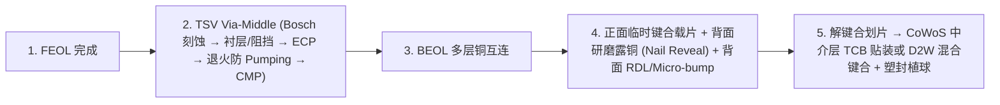

# 晶圆厂与先进封装的桥梁：TSV / RDL / Hybrid Bonding / CoWoS

- **所属模块**：`04_工艺整合与节点 / 05_前道与先进封装衔接`

---

## 1. 为什么传统晶圆厂开始“向后延伸”做先进封装（MEOL / WLP）？

过去几十年，前道晶圆厂（Foundry）负责芯片晶体管与片内布线制造，委外封测厂（OSAT）负责减薄划片与基板封装。然而在 AI 算力芯片（如 NVIDIA Hopper/Blackwell、AMD MI300）时代，两大物理与经济刚性瓶颈打破了行业壁垒，迫使晶圆厂动用精密前道机台向下承接先进封装（**Middle-End / Wafer-Level Packaging**）：
1. **光刻掩模曝光场极限（Reticle Limit）与良率坍塌**：主流 193i 与 EUV 光刻机单次最大曝光视野被光学系统锁定在 **$26\text{ mm} \times 33\text{ mm} \approx 858\text{ mm}^2$**。当今旗舰算力模块（GPU + 多颗 HBM3E/HBM4）硅面积需求高达 $2000\sim 3500\text{ mm}^2$。按泊松良率模型 $Y = \exp(-D_0 A)$，在 $3\text{ nm}/4\text{ nm}$ 节点强行做逼近曝光极限的超大单芯片将遭受灾难性良率损失，必须依靠 **Chiplet 芯粒解耦**拆分计算、I/O 与存储并紧邻互连。
2. **互连密度与单比特传输功耗壁垒**：传统 OSAT 有机基板线宽/线距（L/S）仅 $10\sim 15\,\mu\text{m}$，焊球节距 $130\sim 150\,\mu\text{m}$；而 Chiplet 高带宽直连（UCIe / HBM 总线）需要将 L/S 压榨至 **$0.4\sim 2\,\mu\text{m}$**、垂直节距微缩至 **$25\sim 40\,\mu\text{m}$ 乃至 $<9\,\mu\text{m}$**，且单比特传输功耗降至 $<0.05\sim 0.1\text{ pJ/bit}$。只有晶圆厂级别的**步进光刻机、PVD、电镀（ECP）与超平坦 CMP** 方能支撑此精度：

| 垂直互连技术代际 | 典型节距（Pitch） | I/O 面密度（典型量级） | 每比特能耗（pJ/bit） | 工艺主导权与关键核心制程 |
| :--- | :---: | :---: | :---: | :--- |
| **传统 C4 倒装焊锡球** | $130\sim 150\,\mu\text{m}$ | $\sim 40\sim 60\text{ /mm}^2$ | $> 0.5\sim 1.0$ | OSAT 印刷植球 + 有机载板回流 |
| **Micro-bump 微凸点** | **$25\sim 40\,\mu\text{m}$** | $\sim 600\sim 1600\text{ /mm}^2$ | $\sim 0.1\sim 0.2$ | Foundry WLP 电镀铜柱 + SnAg 焊帽 + TCB 热压键合 |
| **Hybrid Bonding 混合键合** | **$< 1\sim 9\,\mu\text{m}$** | **$> 10^4\sim 10^6\text{ /mm}^2$** | **$< 0.05$** | **纯晶圆厂级制程**：极限微凹陷 CMP + 等离子活化 + 亚微米对准 |

---

## 2. 四大核心衔接技术深度拆解

| 技术 | 英文全称 | 核心制造步骤与归属设备 | 典型应用场景 |
| :--- | :--- | :--- | :--- |
| **RDL** | 重布线层 (Redistribution Layer) | 光刻聚酰亚胺(PI/PBO)介质 + PVD Ti/Cu Seed + ECP 镀铜 + Flash Etch（或大马士革 CMP） | Fan-Out（InFO）、CoWoS 硅/有机中介层横向互连 |
| **TSV** | 硅通孔 (Through-Silicon Via) | **Bosch 深硅刻蚀** → SACVD 低温侧壁绝缘 → PVD 阻挡/种子层 → **自底向上铜电镀** → 背面露铜 | **HBM 垂直堆叠内存**、CoWoS-S 硅中介层、3D SoIC |
| **Micro-bump** | 微凸点 | 晶圆表面电镀铜柱（Cu Pillar）+ SnAg 焊料帽，配合 NCF/CUF 填充与热压键合（TCB） | 2.5D CoWoS 芯片贴装、HBM2E/HBM3/HBM3E 堆叠 |
| **Hybrid Bonding** | 混合键合（无凸点直连） | **超平坦微凹陷 CMP** + 等离子体活化 → **亚微米贴片对准** → 室温预键合 + $250\sim 350^\circ\text{C}$ 退火同步键合 $\text{SiO}_2$ 与 $\text{Cu}$ | AMD 3D V-Cache（TSMC SoIC）、堆叠式 CIS、下一代 HBM4 |



### （1）RDL（重布线层）：光敏聚合物路线 vs 无机 $\text{SiO}_2$ 大马士革
- **有机光敏聚合物 RDL（PI / PBO）**：
  - 在晶圆表面旋涂几微米厚光敏聚酰亚胺或 PBO，直接曝光显影出通孔后于 $200\sim 250^\circ\text{C}$ 固化（无需介质干法刻蚀与昂贵硬掩模）；
  - 整面 PVD 溅射 Ti/Cu 种子层 → 厚胶光刻布线图形 → ECP 镀铜 → 剥胶 → 种子层快速闪蚀（Flash Etch，即 SAP 半加成法）；
  - 线宽/线距典型 **$1.5/1.5\sim 2/2\,\mu\text{m}$**，低弹性模量（$2\sim 4\text{ GPa}$）可吸收硅与封装基板间巨大的热失配应力。
- **无机 $\text{SiO}_2$ 大马士革 RDL**：
  - 直接借用晶圆厂 BEOL 双大马士革 CMP 工艺（如 CoWoS-S 硅中介层与 CoWoS-L 局部硅桥），将 L/S 压榨至 **$0.4/0.4\,\mu\text{m}$** 实现超高互连密度，但成本随金属层数线性攀升。

### （2）TSV 三大工艺时机对比（Via-First vs Via-Middle vs Via-Last）与核心陷阱
根据 TSV 在芯片制造序列中的插入位置不同，晶圆厂形成了三大工艺流派：

| TSV 插入时机 | 插入节点与热预算要求 | 填充材料与主流应用场景 | 核心优势与物理限制 |
| :--- | :--- | :--- | :--- |
| **Via-First** | **FEOL 晶体管制造之前** | **多晶硅（Poly-Si）**（承受后期 $1000^\circ\text{C}+$ 高温）；早年特殊 MEMS/基板 | 不破坏前道热预算，但多晶硅电阻率远高于铜（$100\times$ 以上），不适用于高算力与 HBM |
| **Via-Middle** | **FEOL 之后、BEOL 之前** | **电镀铜（Cu）**；**逻辑 3D IC、HBM 与硅中介层绝对主流** | 兼容低阻铜填充与 BEOL 多层高精度微缩对准；需严控 Cu Pumping 与 KOZ |
| **Via-Last** | **BEOL 全部完成后（正面或背面）** | **电镀铜（Cu）**；**BSI CIS 背面焊盘引出**、部分射频/异构封装 | 无需侵入标准晶圆前道产线；但需击穿厚厚的低 $k$ BEOL 介质或从背面盲对准刻蚀，节距最粗 |

在逻辑/HBM 制造中主流采用 **Via-Middle 架构**（典型特征尺寸：孔径 $5\sim 10\,\mu\text{m}$，深 $50\sim 100\,\mu\text{m}$，深宽比 $AR \approx 10:1$）：

```text
[TSV Via-Middle 关键制程剖面演进与三大风险控制点]
  (1) Bosch 深硅刻蚀           (2) 绝缘/种子层与底部超填         (3) 临时键合 + 背面减薄露铜 (Reveal)
  ┌───┐      ┌───┐             ┌───┐      ┌───┐                ═══临时胶 + 载片 (正面 BEOL 在下)═══
  │SiO│      │SiO│             │   │██Cu██│   │ ◄─ Overburden     ┌──┐  [SiO2/SiN 背面钝化]  ┌──┐
  │   ├──────┤   │             │   │██  ██│   │    (先退火再CMP   │  │  ┌───[Cu Nail]───┐   │  │
  │   │ 扇贝纹│   │◄─波谷<50nm  │   │██  ██│   │     防 Cu Pumping)│Si│  │    露铜 2~5μm   │   │Si│
  └───┴──────┴───┘             └───┴──────┴───┘                   └──┴──┴─────────────────┴──┴──┘
```

1. **Bosch 深硅刻蚀与扇贝纹（Scallop）控制**：高频交替通入 $\text{SF}_6$ 各向同性刻蚀（$\sim 2\sim 3\text{ s}$）与 $\text{C}_4\text{F}_8$ 侧壁钝化（$\sim 1\sim 2\text{ s}$），实现 $5\sim 15\,\mu\text{m/min}$ 高速垂向钻孔。必须压缩周期将孔壁锯齿状**扇贝纹波谷深严控在 $30\sim 50\text{ nm}$ 以内**，否则后续 PVD 阻挡层在波谷处极易断裂漏铜。
2. **侧壁衬层与底部超填电镀**：SACVD/HARP 沉积 $100\sim 300\text{ nm}$ $\text{SiO}_2$ 绝缘层 → 高离化率 PVD（IMP）溅射 Ta/Ti 阻挡层与 Cu 种子层（必须保障孔底角侧壁覆盖 $>5\%\sim 10\%$）→ ECP 借助添加剂组合完成**自底向上超填（Bottom-up Superfilling）**消除内部闭合空洞。
3. **电镀后退火防“铜泵出（Cu Pumping）”**：由于 Cu 热膨胀系数（$16.5\text{ ppm/K}$）远大于硅（$2.6\text{ ppm/K}$），电镀后**必须先对未抛平的覆盖厚铜层执行 $250\sim 350^\circ\text{C}$ 退火（Overburden Anneal）**再运行 CMP。让铜晶粒充分长大并提前将不可逆热挤出释放在自由表面磨平，否则后续 $400^\circ\text{C}$ BEOL 热循环期间，TSV 铜柱将向上剧烈拱出顶碎上层低 $k$ 介质！
4. **Keep-Out Zone（KOZ，禁用区）**：TSV 冷却时残留的径向/切向热应力会经硅压阻效应偏移附近晶体管迁移率（$\Delta\mu/\mu \propto \Pi\cdot\sigma$），EDA 版图必须在每根 TSV 周边留出 **$3\sim 10\,\mu\text{m}$ 晶体管禁用隔离带**。
5. **临时键合与背面露铜（Backside Reveal）**：完成正面 BEOL 后通过临时胶键合至玻璃/硅载片 → 背面精密机械磨削至距铜底数微米 → 干法硅回刻使 Cu 柱突出表面 $2\sim 5\,\mu\text{m}$ → 低温 PECVD 沉积 $\text{SiN}/\text{SiO}_2$ 绝缘层 → CMP 磨平切去铜柱帽露出平整铜面（Nail Reveal），再行制作背面 RDL 与凸点。

### （3）Micro-bump 物理极限与 Hybrid Bonding（W2W vs D2W）
- **Micro-bump 物理终点**：当节距压至 **$15\sim 20\,\mu\text{m}$ 以下**，铜柱顶部薄 SnAg 焊帽在回流或热压键合（TCB）时极易发生**侧向挤出桥连（Solder Bridging）**，且全部微薄焊料几乎完全转化为脆性 $\text{Cu}_3\text{Sn}/\text{Cu}_6\text{Sn}_5$ 金属间化合物（IMC）伴随柯肯达尔空洞断裂；同时填在芯片间的有机底填胶（NCF/CUF，$\kappa < 1\text{ W/m}\cdot\text{K}$）成为 12Hi/16Hi HBM 芯片的致命导热瓶颈。
- **Hybrid Bonding 无凸点直连（W2W vs D2W 工艺选型）**：

| 混合键合模式 | 代表案例 | 核心制程特点与颗粒管控边界 | 良率与商业适用性 |
| :--- | :--- | :--- | :--- |
| **W2W（晶圆对晶圆）** | YMTC Xtacking、Sony 堆叠式 CIS | 整片 CMP（铜微凹陷 $1\sim 5\text{ nm}$、$R_q < 0.2\text{ nm}$）→ $\text{N}_2/\text{O}_2$ 等离子活化 → 整片对准（Overlay $<0.2\sim 0.4\,\mu\text{m}$）→ $250\sim 350^\circ\text{C}$ 退火 | 吞吐量极高且无划片碎屑污染；要求上下 Die 面积必须相等，且承受**良率乘积惩罚（$Y_{tot} = Y_1 \times Y_2$）** |
| **D2W（芯片对晶圆）** | **TSMC SoIC**（AMD 3D V-Cache）、HBM4 研发 | 先划片挑出**已知合格裸片（KGD）**再贴装至母晶圆执行混合键合；依赖无屑划片与超净取放贴装机 | 可跨尺寸异构集成且回避坏 Die 拖累良率；但颗粒污染与取放节拍（UPH）门槛极高 |

- **D2W 划片技术革新（为何必须淘汰机械刀片？）**：混合键合允许的颗粒上限仅亚百纳米级，划片环节成为决定 D2W 良率的命脉：

| D2W 划片方案 | 切割原理与损伤机制 | 颗粒产生量与边沿崩裂 | 适用定位判断 |
| :--- | :--- | :--- | :--- |
| **金刚石机械刀片（Blade Dicing）** | 高速旋转砂轮机械锯切 | 极高（微米级硅屑飞溅与背面崩边） | **严禁直接用于亚微米 D2W 混合键合** |
| **隐形激光切割（Stealth Dicing）** | 红外脉冲激光透射聚焦在硅体内部形成改质层，随后扩膜拉裂分离 | 极低（干式无水雾飞溅） | 适合较厚硅片；对多孔低 $k$ BEOL 划片道兼容性需仔细调谐 |
| **等离子体划片（Plasma Dicing）** | 贴膜光刻定义极窄划片道（$<15\sim 25\,\mu\text{m}$），Bosch 干法刻蚀切分全部芯片 | **几近零机械微粒污染**、芯片侧壁抗折强度翻倍 | **高端 D2W（如 SoIC / 3D 堆叠）核心演进方向**，免除机械应力裂纹 |

### （4）电源完整性（eDTC）、散热界面与微流道耦合管控
当数颗千瓦级算力芯片紧邻互连且封装整体热流密度突破 $100\text{ W/cm}^2$ 时，晶圆厂与封装衔接必须同步解决瞬态供电与垂直热阻墙：
- **嵌入式深沟槽电容（eDTC）**：CoWoS-S 硅中介层与 CoWoS-L 局部硅桥内部直接复用类似 DRAM 深孔刻蚀与 ALD High-$k$ 工艺，在中介层硅体内刻出高密度深沟槽电容（比电容 $>400\sim 1000\text{ nF/mm}^2$），紧贴计算芯片底部消除高频率 $L\,di/dt$ 瞬态压降；
- **异构 Die 高度协同平坦化**：CoWoS/SoIC 中将逻辑芯片与 HBM 堆叠芯片共同贴合塑封后，若不同芯片间原始厚度或焊料塌陷造成高度差 $>10\,\mu\text{m}$，后续封装顶面机械磨削盖板与高导热 TIM1（如铟片 / 液态金属）贴合将出现局部悬空热阻暴增，必须借助前道级精细背磨确保群组等高一致性；
- **3D 垂直散热墙突破（Hybrid Bonding + 片上微流道前瞻）**：混合键合通过消灭低导热 NCF 底填胶，使双片间通过氧化硅共价接触传导热量，热阻比 Micro-bump 方案成倍降低；针对超千瓦 AI 封装，前沿工艺正研发直接利用晶圆背面 Bosch 深硅刻蚀制作微米级液体冷却通道（Micro-fluidic Cooling），将冷媒引入距离晶体管仅百微米处直接带走热量。

---

## 3. CoWoS 架构演进对比与系统级整合失效排查

为突破单颗光罩面积墙并承载超大尺度 AI 集群封装，TSMC 2.5D CoWoS 演进出三大路线（并与 Intel **EMIB** 嵌入式硅桥竞争）：

```text
[CoWoS 三大架构与 Intel EMIB 纵剖面结构对比]
  CoWoS-S (整片硅中介层):  [GPU] [HBM]  ──Micro-bump──►  [    整片被动单晶硅 + TSV + eDTC    ] ──C4──► [ABF 载板]
  CoWoS-R (全有机 RDL)  :  [GPU] [HBM]  ──Micro-bump──►  [   多层 PI/PBO + Cu RDL (无 TSV)    ] ──C4──► [ABF 载板]
  CoWoS-L (局部硅桥+塑封):  [GPU] [HBM]  ──Micro-bump──►  [ RDL + EMC 塑封(内嵌 LSI 硅桥 & TIV)] ──C4──► [ABF 载板]
  Intel EMIB (基板埋桥) :  [GPU] [HBM]  ──Micro-bump──►  [    ABF 有机基板 (顶槽直嵌小硅桥)    ]
```

| 封装架构 | 中介层（Interposer）物理构成 | 互连精度与电容集成 | 工程优劣势与适用场景 |
| :--- | :--- | :--- | :--- |
| **CoWoS-S** | 整片含 TSV 的被动单晶硅中介层（大马士革 Cu RDL） | L/S **$0.4/0.4\,\mu\text{m}$**；片内可集成高密深沟槽电容（eDTC）稳压 | 电气性能与带宽密度最强，但整片硅中介层受限于光刻拼接极值（约 $3.3\times \sim 4\times$ Reticle 极限）、易碎及高昂全硅成本 |
| **CoWoS-R** | 纯有机高分子 **RDL 中介层**（无硅与 TSV，PI/PBO + Cu） | L/S 约 **$2/2\,\mu\text{m}$**；无片内硅电容 | 柔性聚合物显著缓解大尺寸下的 CTE 翘曲开裂，成本低，但难以支撑极端密度的多计算芯粒直连 |
| **CoWoS-L** | 重构塑封体中嵌入多颗小型**局部硅互连桥（LSI Dies）** + 全局 RDL + 铜通孔（TIV） | 芯片跨越区（LSI 上方）实现 **$0.4\sim 0.8\,\mu\text{m}$** 高密直连与 eDTC，其余区走低成本 RDL | **超大尺寸（如双光罩尺寸 AI GPU）主力路线**：彻底打破整片硅尺寸墙兼顾高带宽与低翘曲；难点在于多颗 LSI 在塑封固化中的偏移（Die Shift）补偿 |
| **Intel EMIB** | 将超小硅桥（无 TSV）直接埋入有机 ABF 封装基板顶部凹槽 | 桥接区达亚微米互连密度，彻底取消晶圆级大中介层载体 | 无整片中介层良率与尺寸限制，封装级成本最优；难点在于有机载板嵌入槽的平整度控制与微小桥芯片高精度对准 |

### 系统级整合失效排查与 Split 实验矩阵

1. **Case 1：大尺寸封装翘曲诱导 C4 虚焊（Non-Wet Open / Cold Joint）**
   - **耦合根因**：在 $\sim 250^\circ\text{C}$ 回流焊峰温下，硅芯片（$\alpha \approx 2.6\text{ ppm/K}$）、塑封料 EMC（$8\sim 12\text{ ppm/K}$）与 ABF 载板（$15\sim 18\text{ ppm/K}$）剧烈热失配形成鞍形/锅底翘曲翻转，拉断边角 C4 焊球或压扁中心焊球桥连。
   - **Split 与测试**：调节 EMC 硅微粉填充比（$85\%+$ 压低模塑料 CTE）、调整载板铜层残铜对称性与玻纤布刚性，并通过全温区 **Shadow Moiré 阴影云纹法**将 $25\sim 260^\circ\text{C}$ 动态翘曲死死压在 $<100\sim 150\,\mu\text{m}$。
2. **Case 2：混合键合边缘空洞与接触阻值偏高**
   - **耦合根因**：晶圆中心-边缘 Cu CMP Dishing 不均（局部凹陷 $>8\text{ nm}$ 或铜凸起 $>1\text{ nm}$），或 D2W 划片微屑与取放超时氧化阻断了 $300^\circ\text{C}$ 下铜原子互扩散。
   - **Split 与测试**：100% **CSAM 超声扫描**排查空洞 + **Daisy-Chain 菊花链与 Kelvin 四线法**测单点电阻（目标 $<0.5\sim 1.0\,\Omega$）；修正 CMP 边沿过抛轮廓（Target $2\sim 4\text{ nm}$）、$\text{N}_2/\text{Ar}$ 等离子活化功率与压合前 Q-Time。
3. **Case 3：TSV 铜泵出顶裂上层 IMD 或 KOZ 器件偏移**
   - **耦合根因**：ECP 镀铜后未执行 Overburden 退火即运行 CMP，导致后道 $400^\circ\text{C}$ 期间 TSV 铜柱向上拱出顶碎低 $k$ 介质；或电路晶体管布置过于靠近 TSV 遭受残余径向压阻应力。
   - **Split 与测试**：设定 CMP 前 Overburden 退火温度与时长（$250\sim 350^\circ\text{C}$）矩阵 + TSV 周围 KOZ 间距梯度测试，结合截面 FIB-SEM 检查 TSV 顶部微裂纹。
