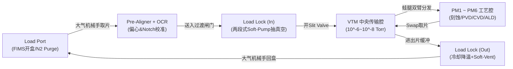

# 集束型设备（Cluster Tool）前端 EFEM 与真空传输架构

- **所属模块**：`05_设备与核心部件 / 01_集束机台与前端EFEM`

## 1. 为什么刻蚀、薄膜设备多采用“多腔体星形集群”架构？

在 300mm 先进晶圆厂中，等离子体刻蚀（Etch）、物理气相沉积（PVD）、化学气相沉积（CVD）及原子层沉积（ALD）机台绝大多数采用**多腔体星形集群平台（Cluster Tool）**——以一个高真空中心传输腔为核心，辐射状挂接 4～8 个独立工艺反应腔室（PM）。这种架构统治前道制程源于工艺物化极限与制造经济性的双重约束。

### 1.1 工艺根因：破真空惩罚（Vacuum Break Penalty）
1. **自然氧化层（Native Oxide）失控**：
   - 裸硅表面暴露于洁净室空气中（典型湿度 ~40%–45% RH），数分钟内就会自发长出约 $0.5\sim 1.0\,\text{nm}$ 厚的无定形 $\text{SiO}_x$；
   - 在接触孔硅化物（Salicide, $\text{NiSi}/\text{TiSi}$）与外延生长（Epi）前，即使数埃的界面氧化层也会显著推高接触电阻（$R_c$）甚至阻断单晶外延连续生长。
2. **铜互连界面氧化与分层失效**：
   - 双大马士革铜互连中，铜籽晶层沉积前必须经历原位加热脱气（Degas）与氩离子反溅射预清洗（Pre-clean）；
   - 随后必须在**同一超高真空系统内**连续完成 $\text{TaN/Ta}$ 阻挡层与 $\text{Cu}$ 种子层溅射；一旦中途破真空，暴露界面立即氧化为高阻 $\text{CuO}_x$，极易诱发电迁移（EM）空洞失效。
3. **高 k 介质吸潮与刻蚀后水解腐蚀**：
   - $\text{HfO}_2$ 等高介电常数（High-k）栅介质暴露空气吸潮后引起等效氧化层厚度（EOT）变厚及阈值电压 $V_{th}$ 漂移；
   - 金属 $\text{Al}/\text{Cu}$ 刻蚀后硅片表面残留的 $\text{Cl}/\text{F}$ 自由基一旦接触环境水汽会瞬间水解生成 $\text{HCl}$ 或 $\text{HF}$，引发严重的侧壁金属腐蚀（Corrosion）。Cluster Tool 把“预处理 + 主工艺 + 原位钝化/去胶”整合在同一真空平台，实现了**零破真空（In-situ）集成**。

### 1.2 节拍经济学与运行域边界（Process-Bound vs. Transport-Bound）
单个工艺腔室执行一次薄膜沉积或高深宽比刻蚀通常耗时 $45\sim 180\,\text{s}$。若采用单腔体机台，前端机械手和真空过渡室长期空等，洁净室占地坪效（Footprint Productivity）极差。通过将 $N$ 个运行同配方的 PM 并联挂在同一个 VTM 周围，设备总产出取决于所处的物理运行域：
- **工艺受限域（Process-Bound）**：当单腔加工时间 $T_{\text{proc}} > N \cdot T_{\text{swap}}$（机械手完成单次门前取旧片/放新片交换及阀门动作总耗时）时，产能受限于腔室工艺耗时，理论每小时产片数（WPH）近似为：
  $$\text{WPH} \approx \frac{3600}{T_{\text{proc}} / N + T_{\text{overhead}}}$$
- **传输受限域（Transport-Bound）**：当 $T_{\text{proc}}$ 很短（例如仅 $10\sim 15\,\text{s}$ 的短时去胶或快速预清洗），继续堆砌 PM 腔数已无法提升产能，瓶颈完全卡在中心机械手动作周期与 Load Lock 抽/破真空速度上。此时需启用**双叶片交换机械手（Dual-blade Swap）**，在 PM 门口一次伸出即可同时完成取旧与放新，将换片开销相比单臂模式缩减约 30%～40%。

```text
[单臂机械手非 Swap 时序] : 取旧片出 PM (4s) -> 退回送至 LL -> 取新片 -> 进 PM (4s) -> 关阀 [单次换片周期 ~12-15s]
[双叶片 Swap 机械手时序] : 携新片待命 PM 门前 -> A臂伸入取旧片 -> 转腕 B臂直放新片 -> 退回关阀 [单次周期 ~5-7s]
```

*工程定量估算案例*：设某 4 腔刻蚀机单腔刻蚀耗时 $T_{\text{proc}} = 60\,\text{s}$，双叶片机械手一次 Swap 周期 $T_{\text{swap}} = 6\,\text{s}$。此时 $N \cdot T_{\text{swap}} = 24\,\text{s} < 60\,\text{s}$，处于工艺受限域，整机每隔 $60/4 = 15\,\text{s}$ 产出 1 片（扣除换盒停顿实际约 $220\text{–}240\,\text{WPH}$）；若配方缩短至 $T_{\text{proc}} = 18\,\text{s}$，因 $24\,\text{s} > 18\,\text{s}$ 立刻转入传输受限域，机械手满负荷运转也只得约 $140\text{–}150\,\text{WPH}$。

---

## 2. 从外面看一台机台的三段式拆解

在 300mm 晶圆厂物理布局中，Cluster Tool 采用**穿墙嵌装（Through-the-Wall / Bulkhead Mounting）**：前端面对 Clean Bay 洁净走廊（ISO Class 1–3），中后端反应腔室延伸进 Service Chase 后廊维护灰区（ISO Class 5–6），干泵与射频电源机柜垂直下沉安置在底层 Sub-Fab。

```text
[Clean Bay 洁净走廊]                | [Bulkhead 隔墙] |                [Service Chase 后廊维护区]
[OHT 天车] ──> [Load Port (Z=900mm)] ──> [EFEM 大气前端] ──> [Load Lock] ──> [VTM 真空传输腔] ──> [PM1~PM6 工艺腔]
  大气搬运       SEMI E15.1 / E62         微正压 +5~15Pa     大气↔粗真空        10^-6~10^-8 Torr      5mTorr~10Torr
                                                                │                   │
                                                         [Sub-Fab 干泵]      [TMP / 低温泵 + RF Match]
```



### 2.1 Load Port（前端装载口，SEMI E15.1 / E47.1 / E57 / E62）
Load Port 是工厂自动物流（AMHS）与机台洁净微环境之间的物理电气交界面：
- **空间基准与运动学定位（SEMI E15.1 / E57）**：台面高度距架高地板 **$900\,\text{mm} \pm 10\,\text{mm}$**；台面上以 $120^\circ$ 等分布置 3 根半球形硬质定位销（Kinematic Pins），精密切合 FOUP 底部的 3 组 V 型凹槽，实现重力自定心并消除 6 个自由度晃动。
- **FIMS（前开式一体门，SEMI E62）标准开闭步序**：
  1. **Docking 推进贴合**：精密丝杠滑台驱动 FOUP 水平推进约 $40\sim 50\,\text{mm}$，将盒体前法兰压紧在 EFEM 面板的密封胶圈上；
  2. **真空吸附与插销开锁**：Port Door 表面伸出 4 个微型真空吸盘吸牢前门板，两根键槽插销（Latch Keys）水平插入锁孔并旋转 $90^\circ$ 收回门锁凸轮；
  3. **向内后撤与垂直潜伏**：机构板带着 FOUP 前门水平退入 EFEM 约 $50\,\text{mm}$，随后垂直下降约 $300\,\text{mm}$ 隐入机架腹腔。全程晶圆绝不暴露于外部走廊湍流。
- **底部充氮功能（FOUP N2 Purge）**：先进节点 Load Port 集成底吹快插气嘴，在 FOUP 停靠待机期间持续向内注入超纯 $\text{N}_2$（将氧浓度压至 $< 100\,\text{ppm}$、$\text{RH} < 5\%$），抑制铜线与超薄界面氧化。

### 2.2 EFEM（设备前端模块，Equipment Front End Module）
EFEM 顶部配备专用 mini-FFU（内置 ULPA 超高效滤网），维持内部 ISO Class 1 洁净度，并相对外部走廊保持 **$+5\sim +15\,\text{Pa}$ 微正压**与 $0.35\sim 0.45\,\text{m/s}$ 单向垂直层流：
1. **Wafer Mapper（槽位映射扫描器）**：在门板下降瞬间，光学扫描臂由上而下在约 $1.5\,\text{s}$ 内扫过 25 层晶圆（标准槽距 `10.0 mm`），识别空槽、正常在位、**Double-slotted（叠片）**与 **Cross-slotted（斜片跨槽）**；一旦检出斜片/叠片立即锁死报警防碎片。
2. **大气双臂 SCARA 机械手**：由伺服电机与谐波减速机直驱，末端叶片为 $2\sim 3\,\text{mm}$ 厚的超薄高刚性碳纤维或氧化铝陶瓷；先进机台全面改用**边缘夹持（Edge-Grip）**替代背面吸盘，仅接触晶圆最外侧 $< 2\,\text{mm}$ 的边缘排除区（Edge Exclusion），杜绝背面微粒污染。
3. **Pre-Aligner（光学预对准台）**：承载晶圆以 $180\sim 300\,\text{RPM}$ 旋转 1～2 圈，侧面线阵 CCD 扫描边缘轮廓：一方面解算圆心偏心距 $(\Delta x, \Delta y)$ 供机械手补偿取片（实现进腔同心度误差 $< \pm 0.1\,\text{mm}$）；另一方面锁定 **V 型定位缺口（Notch）** 并对齐至工艺要求角度（误差 $< \pm 0.1^\circ$）。
4. **OCR（激光编码读取器）**：在 Pre-Aligner 旋转同步阶段自动扫描晶圆边缘 SEMI M12/M13 激光编码，上送 EAP 与 MES 虚拟账目核对，实现 100% 物理防混片。

### 2.3 Load Lock（真空过渡缓冲室）
Load Lock（简称 LL）连接常压（$\sim 760\,\text{Torr}$）与高真空 VTM（$< 10^{-5}\text{ Torr}$），一般采用上下双层叠置或左右并联双腔实现交错异步抽放气。
- **两段式防扬尘抽/充气动力学（Soft Roughing & Soft Venting）**：若在常压直接全开大口径粗抽阀，高速气流湍流会吹起底部积尘（Aerodynamic Sweep-up），且空气绝热膨胀急冷易造成水汽凝结产生水印（Water Marks）。因此必须执行分步节流控制：
  - *抽真空*：先开微孔旁通小阀将腔压从 $760\,\text{Torr}$ 缓抽至 $50\sim 100\,\text{Torr}$ 渡过黏滞流湍流险区 $\to$ 再切换大口径粗抽主阀快速抽至 $10^{-2}\sim 10^{-1}\,\text{Torr}$ 交接本底；
  - *破真空*：经由多孔烧结不锈钢扩流器（Diffuser）平稳慢充洁净 $\text{N}_2$ 恢复微正压后再开门。
- **晶圆降温冷却台（Cool-down Pedestal）**：高温反应出腔的晶圆表面常达 $150\sim 350^\circ\text{C}$，直接放入耐温仅 $80\sim 120^\circ\text{C}$ 的聚碳酸酯 FOUP 会软化塑料引发剧烈放气或粘连；出片侧 LL 常设水冷基座或充氮对流冷却区将其降至 $< 50^\circ\text{C}$ 后回盒。

### 2.4 VTM（真空传输腔）与 PM（工艺反应腔）
- **压差梯度防反流架构**：VTM 由整块 6061-T6 铝合金 CNC 整体铣削成型以消除焊缝渗漏，底部挂载涡轮分子泵（TMP）或低温泵（Cryopump，PVD 强力抽水汽）维持 **$10^{-6}\sim 10^{-8}\,\text{Torr}$** 高真空。全机形成严密的单向防污染压差链：
  $$\text{Clean Bay } (P_0) < \text{EFEM } (+10\,\text{Pa}) \longrightarrow \text{LL } (10^{-2}\,\text{Torr}) \longleftrightarrow \text{VTM } (10^{-7}\,\text{Torr}) \longleftrightarrow \text{PM } (5\,\text{mTorr}\sim 10\,\text{Torr})$$
- **真空机械手运动学与叶片防滑设计**：
  - *连杆构型*：常用刚度极高、Z 向垂振极小的**双蛙腿式（Dual Frog-leg）**或双独立旋转伸缩 SCARA 臂；
  - *动密封防污染*：旋转轴必配无油**磁流体动态密封（Ferrofluidic Seal）**或全封闭**磁悬浮无接触驱动**，杜绝润滑脂蒸气污染真空；
  - *末端防滑托举*：真空下负压吸盘完全失效，高纯氧化铝（$\text{Al}_2\text{O}_3$）或碳化硅（$\text{SiC}$）叶片纯靠微凹台阶与耐高温垫片（如 Kalrez FFKM、Vespel 聚酰亚胺或蓝宝石点接触）静摩擦托运硅片，因此加速 S 曲线（Jerk 控制）极其苛刻。
- **Slit Valve（气动狭缝阀）**：隔离 VTM 与 PM（开口约 $340\,\text{mm} \times 35\,\text{mm}$），开合需执行“**先水平退离密封面、再垂直滑移**”的零剪切动作（如 VAT MONOVAT），避免 O-Ring 搓揉磨粉。

### 2.5 四级核心节点量化指标对照表

| 传输模块 | 参照核心标准 | 压力 / 真空度典型窗 | 核心精度与微环境控制要求 |
| :--- | :--- | :--- | :--- |
| **Load Port** | SEMI E15.1 / E57 / E62 | 常压（选配底吹 N2 Purge） | 台面 $Z = 900\pm 10\,\text{mm}$；三销运动学定位；盒内 $\text{RH} < 5\%, \text{O}_2 < 100\,\text{ppm}$ |
| **EFEM** | SEMI E63 / ISO Class 1 | 微正压 **$+5\sim +15\,\text{Pa}$** | 下沉风速 $0.35\sim 0.45\,\text{m/s}$；Pre-Aligner 对准 $< \pm 0.1\,\text{mm}, \pm 0.1^\circ$ |
| **Load Lock** | 机台标准过渡接口 | 常压 $\leftrightarrow$ **$10^{-2}\sim 10^{-1}\,\text{Torr}$** | Soft-pump 交叉切换点 $50\sim 100\,\text{Torr}$；出片降温至 $< 50^\circ\text{C}$ |
| **VTM / PM** | 厂商高真空传输规范 | **$10^{-6}\sim 10^{-8}\,\text{Torr}$**（VTM） | VTM 机械手重复定位 $< \pm 0.1\sim 0.2\,\text{mm}$；PM ROR 漏率 $< 1\sim 3\,\text{mTorr/min}$ |

---

## 3. 典型真空传输架构对标分析

| 架构类型 | 代表设备平台 | 腔体布局与真空设计特征 | 适用场景与核心工程 Trade-off |
| :--- | :--- | :--- | :--- |
| **单中心星形平台** | Lam **Kiyo / Sense.i**<br>TEL **Tactras** | 1 个多边形 VTM + 4～6 个单晶圆 PM；Sense.i 采取垂直立式气路与紧缩机体 | 逻辑/存储刻蚀。机械路径最短、维修便捷；窄体高密设计显著提高单位面积产出（$\text{WPH}/\text{m}^2$） |
| **双 VTM 级联平台** | AMAT **Endura 300mm** | **Buffer Chamber + Transfer Chamber** 两级真空室串联，辐射挂接 6～8 个 PM | 铜互连阻挡层/种子层与栅极金属化主力。两级压差隔离使传输室稳居 $10^{-8}\sim 10^{-9}\,\text{Torr}$，完美支持长链连续工艺 |
| **双子星并行腔平台** | AMAT **Producer GT**<br>Lam **Striker** | 3 组 **Twin-Chamber（双反应底座共用供气/匹配/抽气框）**配双臂并行取放 | PECVD / ALD 介质薄膜。单次传片同时处理 2 片，以极低的设备扩展边际成本实现产能倍增 |

---

## 4. 产线常见故障诊断（Troubleshooting）与实战病例

| 异常现象 | 典型物理/机械根因 | 工程排查定位手段 | 预防与 PM 修复规范 |
| :--- | :--- | :--- | :--- |
| **FOUP Mapper 报 Cross/Double-Slot** | 前站机械手 Z 轴 Teach 点漂移、FOUP 齿槽受热变形、光路探头积灰 | 安全核查晶圆状态，调取前站交接记录及 Mapper 波形 | 定期复校全厂机械手 Teach 点位；淘汰蠕变老化 FOUP |
| **Load Lock 抽气超时或颗粒喷溅** | Soft-pump 节流阀卡滞引起暴抽扬尘、门封 O-Ring 粘屑、湿片残水汽化 | 抓取 LL 抽气压力斜率拐点，查看晶圆颗粒分布是否呈喷溅状 | 清洗或更换比例节流阀；严格校验前站清洗干燥彻底性 |
| **VTM 机械手滑片（Wafer Slip）** | 陶瓷叶片摩擦垫片磨平硬化、热晶圆冷却不足产生气垫漂浮 | 核对 ESC 氦气背漏位置偏心量，复测机械手 R/$\theta$/Z 编码器 | 保证降温至 $< 50^\circ\text{C}$ 再取片；定期换防滑 Pad 并重做 Auto-Teach |
| **Pre-Aligner 偏心或 Notch 漏识** | 真空吸盘背污打滑、线阵 CCD 积粉、晶圆背面剥落干扰边缘反射 | 观察寻心台旋转时硅片跳动量，调阅 CCD 原始边缘信号 | IPA 清洁吸盘与光学视窗，重新标定传感器阈值 |
| **PM 拆装后 ROR 压升率不达标** | 法兰密封圈压偏或划伤、狭缝阀波纹管疲劳微裂 | 关闭隔离摆阀测压升率 $\text{Leak Rate} = V_{\text{ch}} \cdot \frac{\Delta P}{\Delta t}$ | 使用**氦质谱检漏仪**沿各法兰喷氦精准定位，达标方可点火 |

### 4.1 高发惊险实战闭环病例解析
- **病例 A：热晶圆气体悬浮滑片导致 ESC 碎裂**
  - *现象*：高温薄膜或高功率去胶出腔后，机械手送入下一冷却室时晶圆发生大偏移，触发 Lift Pins 顶卡碎裂。
  - *根因*：高温硅片（$> 250^\circ\text{C}$）直接落上低温陶瓷手片时，两者微隙残余气体瞬间受热急剧膨胀形成“热空气垫”，摩擦系数骤降导致机械手急转弯甩臂时晶圆滑出！
  - *对策*：必须在 PM 内强制增加出片前低气压静置降温步（Cool-down Step），并优化 VTM 针对热片的降速运动曲线（Low-Acceleration Profile）。
- **病例 B：PM 湿洗复位后“冷态 ROR 合格，热态微漏氧”**
  - *现象*：腔体常温静态 ROR 压升率测试完全合格（$< 1.5\,\text{mTorr/min}$），但加热到 $350^\circ\text{C}$ 跑片时薄膜折射率漂移、氧杂质剧增。
  - *根因*：狭缝阀金属波纹管或腔盖 O-Ring 存在热膨胀微裂隙，常温闭合紧密、升温受热膨胀后张开产生微漏。
  - *对策*：所有高温工艺腔大修后必须在**工作设定温度稳定下**进行热态氦质谱检漏与热态 ROR 测试。

---

## 5. 前沿架构演进：混合键合真空集群与预测性维护（PdM）

- **先进封装与键合前界面极致控制**：在 3D 堆叠晶圆对晶圆（W2W）混合键合与 2nm 背面供电工艺中，亚纳米级的界面水膜或碳残留就会阻断低温 $\text{Cu-Cu}$ 互连键合；设备架构正向“等离子体表面活化 + 无水清洗 + 超高真空机械手连续转运进键合腔”的全集群化加速演进。
- **机械手关节智能传感与 PdM**：新一代 EFEM 与 VTM 在关节内置振动加速度传感器与谐波减速机扭矩纹波采集器，可在减速机背隙扩大或摩擦垫即将失效引发真实滑片宕机前 2～4 周自动向 FDC 上报预警，消除突发性产线中断（UDT）。
