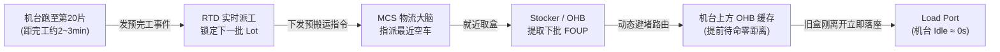

# AMHS 自动物料搬运系统：OHT 天车、Stocker 与 FOUP 规范

- **所属模块**：`06_天车与CIM系统 / 01_AMHS天车与FOUP`

## 1. 为什么 12 寸晶圆厂必须全自动化搬运？

在 300mm 先进晶圆厂中，一个装满 25 片硅片的 **FOUP** 总重达 **$8.5\sim 9.0\,\text{kg}$**（空盒约 $4.5\,\text{kg}$ + 25 片硅片约 $3.2\,\text{kg}$ + 锁定机构），其内部承载着价值数十万甚至数百万人民币的在制品（WIP）。全面淘汰人工手搬、部署 **AMHS（Automated Material Handling System，代表厂商：大福 Daifuku、村田 Murata、SFA 等）** 源于三大刚性物理与运营约束：

1. **人体工学红线与微振冲击抑制**：SEMI 安全指南严格禁止操作员高频跨区搬运重型载具；人为抱盒行走或推车跨区极易引入 $> 0.5\sim 1.0\,\text{G}$ 的瞬时跌落冲击，造成硅片与塑料插槽剧烈碰擦掉粉（Particle Adder），并在高温热处理后沿边缘微裂纹诱发滑移位错（Slip Line）。
2. **杜绝人因错拿（Wrong Lot）与洁净度干扰**：人员在 Clean Bay 频繁穿梭会释放大量人体微尘、扰动天花板 ULPA 垂直层流，更存在把批次放错 Load Port 引发整盒芯片错跑配方报废的致命风险。
3. **海量化高频搬运与 Cycle Time 极限压缩**：一座月投片 10 万片的 300mm Mega-Fab，每片晶圆经历 800～1500 道工序，全厂每天产生成十上百万次的跨 Bay 与区内搬运任务（Moves/Day）。只有依靠全自动天车网络配合就近缓存与前瞻预派工，才能让光刻机、刻蚀机等高折旧核心设备几乎不停机等料。

---

## 2. AMHS 核心硬件组成与工程规范

| 组件 | 英文全称 | 核心作用与机电/洁净规范细节 |
| :--- | :--- | :--- |
| **FOUP** | Front Opening Unified Pod | **前开式晶圆传送盒**（SEMI E47.1）：标准容量 **25 片**（自下而上 Slot 1～25），槽距 **`10.0 mm`**；掺碳抗静电聚碳酸酯或低放气材料；底盘集成 3 组 V 型运动学定位槽（SEMI E57）、134.2 kHz **RFID 标签**与 4 个底部充氮气门 |
| **OHT** | Overhead Hoist Transport | **空中悬吊天车**：沿天花板下方（距架高地板净空 $3.2\sim 3.8\,\text{m}$）封闭铝型材导轨高速运行；采用**非接触感应供电（HID/CPS）**消除电刷粉尘；停稳后释放 4 根凯夫拉扁平带垂降抓手精准对接 Load Port |
| **Stocker** | Automated Storage & Retrieval System | **自动立体存储库**：容纳数百至上千个 FOUP 库位的多层货架，配高速双臂三维堆垛机（Crane）；高敏感区域配有 **N2 Purge Stocker** 与跨区直通 **Dual-Access Stocker** |
| **OHB / UTS** | Overhead Buffer / Under Track Storage | 悬挂在 OHT 轨道正下方或旁侧的单层就近暂存架；将下一批物料预存在目标机台数米内，把等料时间从跨区调运的 $90\sim 150\,\text{s}$ 压低至 **$15\sim 30\,\text{s}$** |
| **Lifter / Bridge** | Inter-floor Lifter & Inter-fab Bridge | 跨楼层高速垂直提升机及连接相邻厂房栋（如 Phase 1 / Phase 2）之间的密闭洁净空中连廊双轨通道 |

### 2.1 晶圆与光罩载具演进、底吹氮气与物理防混盒
| 载具类型 | 适用代际与场景 | 容量与开口结构 | 核心材质与微环境防污染机制 |
| :--- | :--- | :--- | :--- |
| **SMIF Pod** | 200mm（8 寸）晶圆厂 | 25 片，**底部开盖**（由下托出片篮 Cassette） | 常规抗静电工程塑料，主要隔离物理颗粒落灰 |
| **FOUP** | 300mm（12 寸）厂产线主力 | 25 片，**前开门（FIMS）**，无独立内提篮直接插片 | 掺碳聚碳酸酯/PEEK，配备底部 N2 吹扫单向阀与扩散塔，**$\text{O}_2 < 100\,\text{ppm}, \text{RH} < 5\%$** |
| **FOSB** | 硅片厂商出厂长途海空运 | 25 片，前开式抗震密封运输盒（不直上主工艺台） | 阻湿高阻隔壳体 + 减震衬垫，进厂后须在 **Opener/Sorter** 内倒盒换装进 FOUP |
| **EUV RSP / Dual Pod** | 7nm 及以下极紫外光刻掩模 | 单张光罩，**内/外双层气密隔离保护盒** | 内盒超低放气金属合金防止 $<10\,\text{nm}$ 颗粒与碳污染，经专用掩模 OHT 送入光刻机 |

- **底部充氮（N2 Purge）**：FOUP 底部配置 2 进 2 出单向气阀与内部多孔扩散塔；停靠在支持 Purge 的 Load Port、OHB 或 Stocker 时持续注入超纯 $\text{N}_2$，压低氧含量和湿度以延缓铜线氧化和自然氧化膜再生，有效放宽 Q-Time 等待窗口。
- **AMC 吸附净化与 FOUP Cleaner**：光刻和卤素刻蚀后的残留酸碱气体（Amine/HF）易渗入聚合物内壁并缓慢释放污染后续晶圆（Outgassing Cross-contamination）；Fab 内每隔固定周转次数会自动派 OHT 把空盒送往专用 **FOUP Cleaner（热纯水喷淋洗 + 真空热风烘烤再生）**。
- **物理防混片编码销（Info Pads / Pin Coding, SEMI E47.1）**：除了电子 RFID，FOUP 底板还带有标准的**机械防错编码凹槽/销孔（Info Pads）**与颜色区分盖板，直接与 Load Port 台面上的物理传感微动开关一一互锁——**彻底从物理硬件层杜绝铜互连（Cu BEOL）专用 FOUP 被错误放入前端非铜工艺（FEOL）机台引爆全厂铜污染灾难**！

### 2.2 OHT 天车机电架构与单次取放动作全分解
1. **直线电机驱动与运动学减振**：高速 OHT 采用直线电机或静音聚氨酯驱动轮沿铝型材轨运行，主干直道巡航速度可达 **$3.0\sim 5.0\,\text{m/s}$**；进弯前读取轨道位置条码/磁尺施加平滑 S 曲线减速，严格压低离心横向加速度（$< 0.2\sim 0.3\,\text{G}$），防止硅片在盒内槽齿滑动磨粉。
2. **HID / CPS 非接触感应供电**：铝型材导轨双侧敷设高频大电流激励铜缆（典型 $10\sim 20\,\text{kHz}$），车顶骑行式拾电线圈（Pickup Coil）隔数毫米气隙非接触感应耦合电能并整流供电——**无电刷接触摩擦、无电火花、彻底实现驱动供电系统零发尘**。
3. **三级防撞雷达与队列行驶（Platoon Control）**：车头配长/中/近三级激光或红外避障雷达（OBS），随速度自动调整探测包络线，支持天车群最小间距 $< 1\,\text{m}$ 安全高速跟驰；并通过漏泄同轴电缆（Leaky Coax）或工业 5GHz 无线网向 MCS 毫秒级上报坐标。
4. **单次 OHT 到 Load Port 吊放标准化分解动作表**：

| 动作阶段 | 物理动作与传感器交互 | 典型工程精度与耗时 |
| :--- | :--- | :--- |
| **1. 减速精准停位** | 扫描目标工位反光定位标，执行 S 曲线柔顺刹停 | 停止重复位置误差 **$< \pm 1.0\,\text{mm}$**（耗时 ~1.5–2.0 s） |
| **2. E84 红外握手** | 发射红外编码脉冲与 Load Port 交互 `VALID/CS_0/L_REQ/READY` | 确认空台、机门已关闭且光幕无遮挡（耗时 ~0.3–0.5 s） |
| **3. 双速四点垂降** | 底门打开，双卷筒放出 4 根凯夫拉扁平带携 FOUP 垂直下行 | 先 $\sim 0.6\,\text{m/s}$ 快降，距台面 $50\,\text{mm}$ 切 $\sim 0.03\,\text{m/s}$ 缓落（耗时 ~4–5 s） |
| **4. E57 落销脱钩** | 盒底 V 槽精准落入 3 根定位销消隙；检测载荷卸力后开爪并缩回 | 缩回速度 $\sim 1.0\,\text{m/s}$，关闭防尘门驶离（耗时 ~2–3 s） |

### 2.3 Stocker 特种防震与消防机制
单座立体库可存 300～1000+ 个 FOUP，内部配双臂高速堆垛机提高吞吐；全库集成**地震震动感应卡扣**（地震发生瞬间库位机械锁销自动弹出卡死盒子防止坠落）与**消防烟感隔断风门**（发生异常烟雾立刻切断循环气流防蔓延）。

---

## 3. OHT 轨道拓扑与 MCS 调度交通管制核心难题

### 3.1 从分域接力转向 Unified OHT（全厂直达网）与旁路拓扑
早年 300mm 厂区分隔干线（Inter-bay）与区内支线（Intra-bay），跨区需反复经由跨界 Stocker 接力中转；现代 Mega-Fab 普遍采用 **Unified OHT 统一直达拓扑**——取消中间强制落地库，任一 OHT 经高速道岔贯穿全厂将晶圆直达目的机台，平均跨区搬运耗时锐减 **30%–50%**。同时为避免正在垂降吊装的车辆卡死后方整条通道，在作业位上方增设 **Bypass 旁路直通轨**：

```text
   [ Inter-Bay 主干高速单向环道 (3.0~5.0 m/s 巡航) ]
     ============================================>=================>
              \ (分流道岔 Diverge)                   ^ (合流道岔 Merge)
               v                                   /
     [ Intra-Bay 作业支线 ] ---> [ Load Port 1..4 降落停靠工位 ] ---+
               |                                                   |
               +-------------> [ Bypass 旁路直通轨 ] ---------------+
               (前车停靠垂降吊装 10~15s 期间，后车经 Bypass 绕行不堵塞！)
```

### 3.2 JIT 无缝换料闭环与 MCS 五大调度算法难点



**MCS 调度引擎（Material Control System）必须攻克五大核心算法难题**：
- **死锁与拥堵预防（Deadlock & Gridlock Avoidance）**：全网强制单向环形拓扑消除对头相撞；多合流口启用**虚拟区段预约锁（Zone Reservation Lock）**，并限制单条 Bay 支线的并发容纳车辆阈值，超限时主动重路由绕行。
- **动态路阻最优路由（Time-Dependent Routing）**：实时按各轨段当前拥堵流速、正在悬停作业的前车预计阻塞时间及弯道减速损耗动态更新边权，避免所有空车一窝蜂扎进同一拥堵点。
- **空车动态预平衡（Empty Vehicle Balancing）**：因为光刻/清洗与炉管的消耗产出极度不平衡，MCS 根据 RTD 未来 5 分钟预计完工任务提前把卸载后的空车分派到高需求区上游停靠区（Parking Zone），大幅削减空驶接单时间。
- **Hot Lot 抢占与前方避让（Yielding）**：急批发出指令时赋予最高路权权重，必要时强令前方低优先空车提前加速从最近道岔切出让道。
- **车队规模仿真拐点（Fleet Sizing Saturation）**：一座大型 300mm Fab 运行数百至上千台 OHT，建厂必须用 **AutoMod / FlexSim** 做离散事件物流压测——**天车并不是越多越好**！越过系统承载拐点后，过多空车会在交叉道岔口相互挡道死等，反而导致全厂 Delivery Time 断崖恶化。

---

## 4. 产线 AMHS 运维 KPI 与常见故障诊断

| 核心 KPI 指标 | 量产 12 寸 Fab 典型基准 | 失控恶化后果 |
| :--- | :--- | :--- |
| **Delivery Time（平均 / P95）** | Bay 内 $< 45\sim 60\,\text{s}$；跨区全厂 P95 $< 120\sim 180\,\text{s}$ | 光刻与清洗等瓶颈机台空等断料（SBY），甚至引发超 Q-Time 批量报废 |
| **AMHS 物理可用率** | **$> 99.9\%$** | 全厂物料流动阻滞，人工被迫端盒接管大幅推高碎错片风险 |

### 4.1 产线高频异常处置 SOP
1. **OHT E84 握手超时悬停阻断整条 Bay 轨**
   - *表征与根因*：因洁净室强闪光干扰光耦、Load Port 安全光幕被人员遮挡或 TP2/TP3 超时，天车垂降一半悬停锁死并堵死后方整条支线。
   - *处置与预防*：工程人员佩戴安全防护利用遥控器切手动模式收回吊带，推入维修死胡同支线（Maintenance Spur）恢复主轨通行，随后清洁校准 E84 光耦对齐窗口。
2. **RFID 读取失效导致“幽灵料盒”（Unknown Carrier）**
   - *表征与根因*：FOUP 底部 RFID 标签经热洗老化损坏或读头失调，引发 MCS 账目丢失无法自动过站。
   - *处置与预防*：严禁人工直接开盖流片，须核对外贴条码及内部硅片激光编码，在 MES/MCS 同步执行 `Carrier Re-identify` 鉴权绑定，并在清洗站定期检查 RFID 读取良率。
3. **凯夫拉同步带偏磨或抓手倾斜告警（Tilt Alarm）**
   - *表征与根因*：长期高频起落造成四带张力离散或导槽积灰，引发抓手倾斜摩擦 FOUP 顶部法兰或盒壁掉粉。
   - *处置与预防*：定期 PM 校验四带张力平衡（Belt Tension Check），只要单根出现起毛或倾角越限，必须成套更换四根同批次新带并重测落台 Teaching 位置。
4. **Stocker 堆垛机空/满库位错账（Dual-Pick / Empty-Bin Conflict）**
   - *表征与根因*：红外光电在位开关误报导致物理货位与库位账目不一致。
   - *处置与预防*：切至半自动单步盘库模式（Inventory Audit），由操作员目视核对货位物理状态并同步修正数据库账目。
