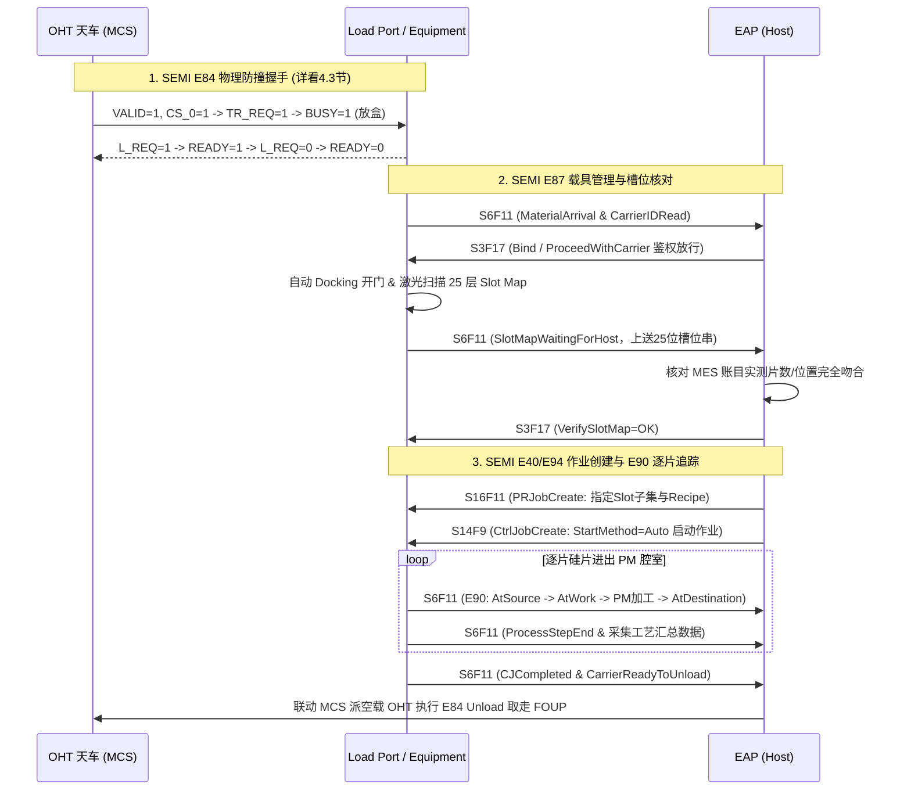

# SEMI 工业通信标准：SECS/GEM 与 GEM300 核心协议栈

- **所属模块**：`06_天车与CIM系统 / 02_SECS_GEM与SEMI标准`

## 1. 为什么所有设备商必须遵循 SEMI 标准？

一座现代化 12 英寸晶圆厂内部署了来自 ASML、AMAT、Lam Research、TEL、KLA、Screen 等数十家设备商的上千台精密设备。如果没有统一的语言规范，工厂的 **EAP / MES / MCS / FDC** 将无法实现跨设备自动化集成——不仅配方（Recipe）无法远程下发防呆、传感器数据无法集中采集，甚至连空中天车（OHT）把 FOUP 放到哪个装载口都无法保证不会砸坏机门。

国际半导体产业协会（SEMI）为此建立了严谨的分层标准体系：从早期 200mm 人工辅助时代的 **SECS/GEM** 演进到 300mm 全自动无人化生产的 **GEM300**，核心工程哲学是将千差万别的物理设备抽象为**确定性的标准有限状态机（FSM）+ 统一格式二进制报文协议**，令 Host（主机自动化系统）能用同套接口逻辑控制全厂异构机台。

---

## 2. 协议栈分层（从物理层到 300mm 业务编排标准）

| 标准编号 | 标准名称 | 所在层级与核心职能详解 |
| :--- | :--- | :--- |
| **SEMI E4 / E37** | SECS-I (串口) / **HSMS** (TCP/IP) | **底层通信传输层**：规定 Host（EAP）与 Equipment（机台）如何建立网络连接、包边界界定及超时机制；300mm 全线淘汰串口并全面使用以太网 **HSMS**（常规端口 TCP 5000） |
| **SEMI E5** | **SECS-II**（Message 语法） | **应用报文格式层**：定义自描述树状二进制数据编码及 **`SxFy`** 指令集（Stream 表示业务大类，Function 奇数代表主动请求、偶数代表对应应答） |
| **SEMI E30** | **GEM** (Generic Equipment Model) | **通用设备行为模型**：定义设备通信状态、控制权限（Offline/Local/Remote）、动态事件报表订阅（CEID/RPTID/VID）、报警处理及远程命令（`PP-SELECT` / `START`） |
| **SEMI E84** | Enhanced Carrier Handoff PIO | **硬件防撞交接层**：OHT 天车与 Load Port 之间通过 **8 路红外光耦并行 I/O 信号**完成物理级同步握手与安全互锁 |
| **SEMI E87** | **CMS** (Carrier Management) | **载具（FOUP）管理层**：规范载具到达、ID 验证、Port 访问模式切换（Manual/Auto）及 25 层硅片槽位映射（Slot Map）与交叉片检查状态机 |
| **SEMI E90** | **STS** (Substrate Tracking) | **单片晶圆追踪层**：精细跟踪每 1 片物理硅片正处于源槽位、EFEM 机械手、Pre-aligner、Load Lock 还是具体工艺腔室 PM1～PM6 中 |
| **SEMI E40 / E94** | Process Job (PJ) / Control Job (CJ) | **作业编排层**：**E40** 规定“哪几片晶圆跑哪个 Recipe”；**E94** 将多个 PJ 打包成可自动排队、切换或并行加工的批作业调度单元 |
| **SEMI E10** | Equipment RAM 标准 | **机台时间分类统计基准**：强制将机台全部寿命时间互斥划分为六大标准状态（PRD/SBY/ENG/SDT/UDT/NST），是计算工厂 OEE 的统一度量尺 |
| **SEMI E120/125/132/134** | **EDA / Interface A** | **高速传感数据旁路协议**：专为先进 FDC 打造（HTTP/XML 或高速异步架构），以 10～100 Hz 旁路抓取腔室物理参数而不阻塞 SECS 控制通道 |

---

## 3. 底层传输与报文语法深度拆解（HSMS & SECS-II）

### 3.1 HSMS（SEMI E37）帧结构与核心定时器
HSMS 运行在 TCP/IP 上，传输速率可达百 Mbps 级（远超仅 9600 bps 的半双工 RS-232 SECS-I）。每帧报文由 **4 字节长度头 + 10 字节固定消息头 + 可变长 SECS-II 报文体** 组成：

```text
+--------------------+-----------------------------------------------------------------------------+
| 4 Bytes: Msg Len   |                           10 Bytes: HSMS Message Header                     |
+--------------------+--------------+-------------+-------------+--------+--------+----------------+
| 大端无符号整数      | Session ID   | Byte 2      | Byte 3      | PType  | SType  | System Bytes   |
| (Header+Body总长)  | (2B, 控制为  | [W-bit | S] | Function    | (1B,   | (1B,   | (4B, 异步事务  |
|                    |  0xFFFF)     |  1b    7b   | (1B, F)     | 0x00)  | 帧类型)| 唯一流水号)    |
+--------------------+--------------+-------------+-------------+--------+--------+----------------+
```
- **SType 控制帧与数据帧区分**：`0` = Data.msg（常规 `SxFy` 业务）；`1/2` = `Select.req/rsp`（建链激活会话）；`5/6` = `Linktest.req/rsp`（周期心跳保活，常用 30～60s 一次）；`9` = `Separate.req`（优雅断开连接）。
- **System Bytes 的关键作用**：由于 HSMS 支持全双工异步并发（不等前一条回复即可连发下一条指令），双方靠这 4 字节唯一交易流水号精确匹配异步返回的应答报文。
- **五大关键超时定时器（CIM 联机排故高频参数）**：
  - **T3（Reply Timeout，典型 45s）**：带 W-Bit 请求报文发出后等待对方应答的最大时限（触发 T3 超时代表机台控制器阻塞或死锁）；
  - **T5（Connect Separation，典型 10s）**：TCP 断开后允许重连的冷却时间；
  - **T6（Control Timeout，典型 5s）**：`Select.req` / `Linktest.req` 等控制命令等待回复超时；
  - **T7（Not Selected Timeout，典型 10s）**：TCP 三次握手建立后，被动方等待对方发送 `Select.req` 的最大宽限，超时即踢断；
  - **T8（Network Intercharacter Timeout，典型 5s）**：接收分片大报文时，相邻 TCP 字节流数据包之间允许的最大等待间隔。

### 3.2 SECS-II（SEMI E5）树状数据封装与常见 `SxFy` 字典
SECS-II 报文体采用紧凑的二进制自描述格式（Item Format Code + Length Bytes + Data），支持嵌套任意层级的 `L,n`（列表），常见编码如 `0x01`=List、`0x41`=ASCII(`A`)、`0xA9`=2字节无符号(`U2`)、`0x91`=4字节浮点(`F4`) 等。
- *示例解剖*：一条最简单的 `S1F1 W`（Are You There 请求）报文体为空（仅 10 字节头，`Byte2=0x81`, `Byte3=0x01`）；机台返回 `S1F2`（On Line Data）典型字节流为：
  - `01 02` $\to$ List 含 2 个元素 (`L,2`)
  - `41 08 45 54 43 48 5F 30 31 20` $\to$ ASCII 8字节：`MDLN` 机台型号（如 `"ETCH_01 "`）
  - `41 05 56 33 2E 32 31` $\to$ ASCII 5字节：`SOFTREV` 软件版本（`"V3.21"`）

产线 EAP 运行期最核心的 `SxFy` 报文字典如下：

| 报文编号 | 方向 | 名称与核心作用 | 产线工程语义与注意事项 |
| :--- | :--- | :--- | :--- |
| **`S1F13` / `S1F14`** | 双向 | Establish Communications | 建立 GEM 会话第一条业务报文，返回 `COMMACK=0` 方可继续 |
| **`S1F17` / `S1F18`** | Host $\to$ Eqp | Request ON-LINE | 请求机台切入联机模式（若物理门钥匙处于强制本地，将返回拒绝码） |
| **`S2F33` / `S2F34`** | Host $\to$ Eqp | Define Report | 动态把多个机台变量 **VID**（如腔压、RF功率、晶圆 ID）打包成报表 **RPTID** |
| **`S2F35` / `S2F36`** | Host $\to$ Eqp | Link Event Report | 将报表 **RPTID** 绑定到机台关键事件 **CEID**（如“工艺步结束”） |
| **`S2F37` / `S2F38`** | Host $\to$ Eqp | Enable/Disable Event | 批量开启事件主动上报（**标准建链四步曲**：先全 Disable $\to$ 清旧 RPTID $\to$ 重绑 $\to$ 再 Enable） |
| **`S2F41` / `S2F42`** | Host $\to$ Eqp | Host Command Send | 下发远程操作指令（如 `PP-SELECT`、`START`、`PAUSE`、`ABORT`），返回 `HCACK=0` 表示接受 |
| **`S5F1` / `S5F2`** | Eqp $\to$ Host | Alarm Report Send | 实时推送硬软件报警 `ALID`、置位/恢复标志 `ALCD` 与文本 `ALTX` |
| **`S6F11` / `S6F12`** | Eqp $\to$ Host | Event Report Send | 设备生产驱动引擎：每当状态迁跃发生，立刻自动触发携带实时数据的事件上报给 EAP |
| **`S7F1/F3/F5/F19`** | 双向 | Process Program 相关 | 配方创建申请、下载（`S7F3`）、上传验证（`S7F5` 防私改）与配方目录查询（`S7F19`） |
| **`S10F3` / `S10F4`** | Host $\to$ Eqp | Terminal Display | 向机台操作屏弹窗推送警示信息（例如拦截非合格批时提示操作员原因） |

---

## 4. GEM 状态机、GEM300 时序闭环与 SEMI E84 握手

### 4.1 GEM（SEMI E30）控制权状态机
- **通信状态（Communication State）**：分为 `DISABLED` 与 `ENABLED`（下含 `NOT COMMUNICATING` 轮询建链态与 `COMMUNICATING` 正常通信态）。
- **控制状态（Control State）**：
  - `OFF-LINE`：机台脱离主控管理，所有数据不上报且拒收远程命令（仅维修或隔离试验使用）；
  - `ON-LINE LOCAL`：**工程调机态**——EAP 仍能收到事件与采集数据，但**启动与选配方控制权归属机台本地触摸屏**（用于 PM 后跑控片、DOE 验证）；
  - `ON-LINE REMOTE`：**量产铁律态**——机台面板所有选配方和 Start 按钮被自动锁定屏蔽，仅允许由 EAP 校验 MES 账目和 RMS 配方通过后遥控启动，彻底杜绝人为误作业。

### 4.2 GEM300 端到端全自动上下料加工时序图
300mm 机台将 E84、E87、E40、E94、E90 无缝编排为精密的软硬件协作流（可运行仓库内置 Python 仿真脚本 [`e10_state_machine_sim.py`](../../../09_实战脚本与3D/02_SECS_GEM状态机仿真/e10_state_machine_sim.py) 直观演示状态跃迁与 E84 信号步进）：



### 4.3 SEMI E84 8-Bit PIO 硬件光耦时序与超时保护
OHT（Active 侧，控制 `VALID`, `CS_0`, `TR_REQ`, `BUSY`, `COMPT` 共 5 线）与 Load Port（Passive 侧，控制 `L_REQ`, `U_REQ`, `READY` 共 3 线）通过红外对管逐脉冲互锁，防止未停妥就降落抓手或抓手未退出门板突然强关：

```text
OHT  VALID   ___/‾‾‾‾‾‾‾‾‾‾‾‾‾‾‾‾‾‾‾‾‾‾‾‾‾‾‾‾‾‾‾‾‾‾‾‾‾‾‾‾‾‾‾\___
     CS_0    ___/‾‾‾‾‾‾‾‾‾‾‾‾‾‾‾‾‾‾‾‾‾‾‾‾‾‾‾‾‾‾‾‾‾‾‾‾‾‾‾‾‾‾‾\___
LP   L_REQ   ________/‾‾‾‾‾‾‾‾‾‾‾‾‾‾‾‾‾‾‾‾‾‾‾‾\_________________  (检测到FOUP落稳即拉低)
OHT  TR_REQ  ____________/‾‾‾‾‾‾‾‾‾‾‾‾‾‾‾‾‾‾‾‾‾‾‾‾‾‾‾‾‾‾‾‾‾‾\___
LP   READY   ________________/‾‾‾‾‾‾‾‾‾‾‾‾‾‾‾‾‾‾‾‾‾‾‾‾‾‾‾‾‾‾‾‾\_  (门缩回/互锁安全就绪)
OHT  BUSY    ____________________/‾‾‾‾‾‾‾‾‾‾‾‾‾‾‾‾‾‾‾‾‾\________  (垂降与提钩动作期间)
OHT  COMPT   __________________________________________/‾‾‾‾\___  (动作结束请求释放)
             |<TP1>|<TP2>|    |<--- TP3 (放盒超时) --->|<TP4>|<TP5>
```

底层安全 PLC 严格监视 **TP1～TP5** 超时阈值（典型工程窗：TP1/TP2/TP4/TP5 约 $2\sim 10\,\text{s}$，TP3 垂降作业约 $45\sim 60\,\text{s}$）：只要任一区间超出限时或人员不慎走近打断光路，双方信号立刻归零急停，严防重大机械碰撞。

### 4.4 SEMI E10 六大设备标准状态与 OEE 统计锚点
EAP 依据机台状态跃迁事件自动向 MES 汇报并计入以下六个互斥态：
- **PRD（Productive）**：正常产出晶圆（含有效加工及随片传输）；
- **SBY（Standby）**：机台完好、已授权生产，但处于空等 FOUP 来料（No WIP）、等派工或等工程师处理；
- **ENG（Engineering）**：工艺工程测试、DOE 分片试验与新产品调机；
- **SDT（Scheduled Downtime）**：计划内保养（PM）、换耗材、定期定检；
- **UDT（Unscheduled Downtime）**：非计划突发报警宕机（真空漏气、RF 失配、机械手卡片）；
- **NST（Non-Scheduled）**：工厂停电岁修、未完成验收装机或长期闲置封存。

---

## 5. 产线联机集成高频故障与排故指南

1. **T3 Timeout 频繁断线重连（SECS 通道阻塞）**
   - *表征*：EAP 日志密集弹出 `T3 Timeout` 或指令延迟十几秒才响应。
   - *根因与对策*：排查是否有人在加工高峰期触发几十 KB/MB 的大配方上传，或通过 `S6F11` 开启过高频率（如 $> 10\,\text{Hz}$）的传感器实时订阅冲垮机台单线程通信栈。应将高速传感器流剥离迁移至旁路 **SEMI EDA（Interface A）**，并对 `S6F11` 仅保留工艺边界关键事件。
2. **机台软件升级后 S2F33/S2F35 事件失踪**
   - *表征*：FOUP 进出正常但 MES 账目纹丝不动，EAP 收不到任何 `ProcessEnd` 上报。
   - *根因与对策*：厂商软件升级可能重置或更改了底层默认 `CEID/VID` 映射。EAP 每次建链初始化（Initialization Sequence）必须严格执行“先 `S2F37` 禁用全事件 $\to$ `S2F33` 传入空列表清零全部旧报表 $\to$ 重建定义与绑定 $\to$ 末步再激活”，切忌增量追加导致重复定义报错（`DRACK/LRACK != 0`）。
3. **E87 长期卡在 `WaitingForHost` 拒不取片**
   - *表征*：FOUP 已经压紧扫描完 Slot Map，但机台机械手原地待命不动。
   - *根因与对策*：对比机台扫码上报的 25 字符 SlotMap 状态串（标准定义 `0`=Undefined, `1`=Empty, `2`=Not Empty, `3`=Correctly Occupied, `4`=Double Slotted, `5`=Cross Slotted）与 MES 账面该批次片数/槽号记录。常见于前站做完抽片测试后操作员漏改 MES 账目或片子放错槽位，EAP 防呆引擎故意冻结该批等待工程特批确认。
