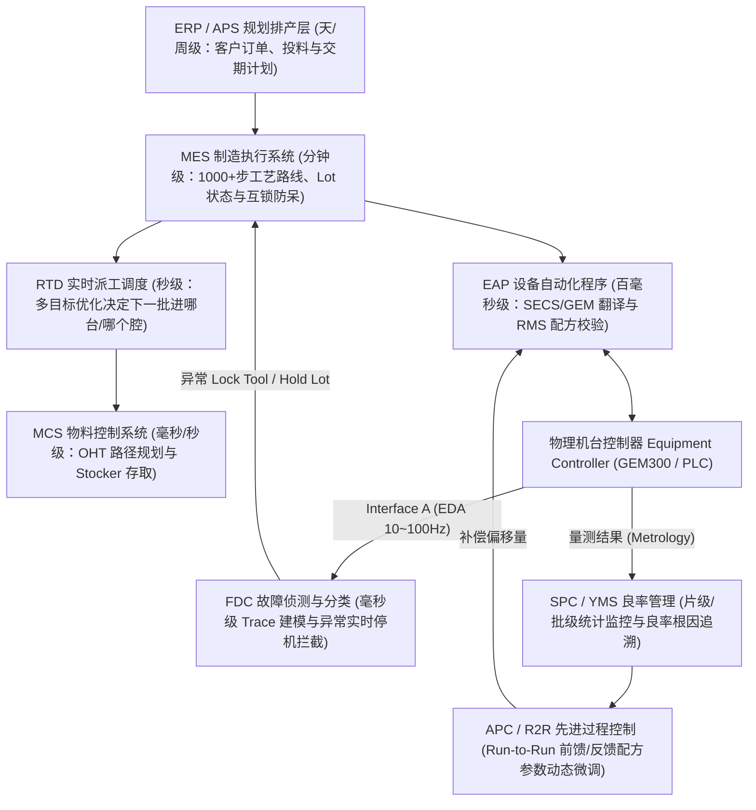

# 晶圆厂 CIM 工业软件栈：MES / EAP / RTD / APC 全链路

- **所属模块**：`06_天车与CIM系统 / 03_MES_EAP与APC软件栈`

## 1. 自顶向下的智能制造软件架构与时间尺度解耦

一座投资百亿美元级的 300mm 晶圆厂无法仅凭孤立的顶尖设备维持高良率与低成本，必须依托高度协同的 **CIM（Computer Integrated Manufacturing，计算机集成制造）** 工业软件金字塔作为中枢神经。从顶层产能计划到反应腔内毫秒级传感器控制，各子系统按**时间尺度与功能职责严格解耦**，共同构筑全自动数据闭环：



### 1.1 CIM 软件栈各层响应尺度、通信协议与容灾边界全景表

| 软件系统 | 所在架构层级 | 控制响应尺度 | 核心通信协议 / 存储载体 | 宕机失效影响半径与业务特征 |
| :--- | :--- | :--- | :--- | :--- |
| **ERP / APS** | 企业计划与排产层 | 天 ～ 周级 | 批量接口 / 关系型数据库 | 仅影响远期投料与交期承诺，短时不影响现场生产 |
| **MES** | 制造执行核心层 | 分钟级 | 双活高可用数据库 + MQ 消息总线 | **最高危**：全厂无法进出站过账，数十分钟内大面积停摆 |
| **RTD** | 实时派工调度层 | 秒级（1～10 s） | 内存规则计算引擎 + 实时快照 | 自动最优调度中断，需降级为人工或简单 FIFO 派工 |
| **MCS** | 自动物流控制层 | 毫秒 ～ 秒级 | 漏泄波导/无线网 + TCP/IP | OHT 天车全线停泊，机台出现断料或满盒滞留 |
| **EAP / RMS** | 设备控制边缘层 | 百毫秒 ～ 秒级 | **HSMS / SECS-II** (GEM300) | 仅波及所属 Bay 或对应机台（按 Bay 容器化隔离避免扩散） |
| **FDC (EDA)** | 过程健康监测层 | 毫秒级（10～100 Hz） | **SEMI EDA / Interface A** (HTTP/XML) | 失去腔室实时阻断防呆，故障隐患批次可能带病流出 |
| **APC / R2R** | 先进过程微调层 | 批间 / 片间（Run-to-Run） | 控制算法 API + 历史量测库 | 丧失自动漂移微调补偿，暂退回静态 Golden Recipe 维持 |
| **SPC / YMS** | 质检与良率挖掘层 | 出片量测后 / CP 后 | 分布式大数据分析仓库 | 无法第一时间抓出工艺分布异常，延迟良率根因定位 |

---

## 2. 核心软件模块分工与底层工程算法逻辑

### 2.1 MES（Manufacturing Execution System，制造执行系统）
半导体前道制造区别于汽车或消费电子组装业的本质在于**高度重入式制造（Re-entrant Manufacturing）**：同一盒晶圆将在 2～3 个月制造周期内反复进出光刻区、刻蚀区、薄膜区、清洗区高达 30～60 轮，工艺路线（Route / Flow）动辄包含 **800～1500 道工序（Step）** 且嵌套复杂动态分支。
- **Lot 全生命周期流转与柔性分支控制**：
  ```text
  [投料 Create] ──> [等待 Wait] ──> [进站 Track-In / Run] ──> [量测 Metrology] ──(Pass)──> [下一主工序]
                         ▲                   │                         │
                         │              (异常触发 Hold)           (Overlay超差)
                         │                   ▼                         ▼
                  [工程师 Release] <── [工程分析扣留 Hold]       [Rework 返工剥胶流] ──(重光刻)──┘
  ```
  - **Split / Merge**：支持从 25 片生产批中拆分 2 片送去工程实验（DOE）或破坏性切片测量，随后再与主批合并；
  - **动态跳检策略（Skip-Lot Sampling）**：若某台机连续多批量测过程能力优良（$C_{pk} > 1.67$）时自动放宽抽检比例，释放宝贵的 CD-SEM 与光学量测机时。
- **硬核防呆互锁（Interlock Engine）**：任何批次在进站（Track-In）前必须通过四重检验：前站量测是否 Pass？批次当前是否处于 Hold 冻结态？目标机台与具体 PM 腔室是否在有效认证周期（Chamber Qual Valid）内？操作员资质授权是否匹配？
- **主流系统代表**：Applied Materials **FactoryWorks / SmartFactory** 与 IBM **SiView**（成熟巨厂长期底座），以及国产 12 寸替代平台（上扬软件、赛美特 SEMI-eCIM、华磊迅拓等）。

### 2.2 EAP（Equipment Automation Program）与 RMS（配方防呆）
EAP 部署在机台侧边缘服务器集群上，是 MES 业务规则与物理机台 SECS/GEM（GEM300）之间的双向翻译与控制中枢：
```text
[Load Port 到盒读取 ID] ──> [MES 进站防呆校验] ──> [RMS 上传/核对 Recipe Body (S7F5)] ──> [E40/E94 建作业启动]
                                                                                                  │
[APC/SPC 实时触发更新] <── [E90 逐片追踪 PM1~PM6 基因记录] <── [EDA 100Hz Trace 采集入 FDC] <─────┘
```
1. **单晶圆基因级追溯（Wafer-Level Traceability）**：针对挂接多腔的 Cluster Tool，EAP 依托 `SEMI E90` 精密记录 25 片中**每一片物理硅片分别进了哪个子腔室（如 Slot 1–12 进 PM1，Slot 13–25 进 PM2）及加工顺序（追踪首片效应 First-Wafer Effect）**。日后若 CP 电性图谱现出双峰失真，良率系统数秒内即可精准指认异常腔室。
2. **RMS（Recipe Management System，配方管控体系）**：产线严禁私自修改或误选配方。EAP 在下发 `PP-SELECT` 前除校验版本号外，针对高敏工艺强制通过 `S7F5` 上传机台物理配方参数体，与中心库 Golden Recipe 进行**字段级数值容差比对（Body Verification）**（射频功率、气压、时间、MFC 流量等），任何违规篡改均立即拒绝启动并通过 `S10F3` 弹窗拦截。

### 2.3 RTD（Real-Time Dispatching，实时派工系统）与调度数学逻辑
由于机台不断经历保养（SDT）、工艺限定（Dedication）与急件插队，RTD 必须在秒级协同求解四大互相制衡的复杂约束：

| 核心调度约束 | 产线工程问题根源 | RTD 算法处置与协同策略 |
| :--- | :--- | :--- |
| **Q-Time 队列限时** | 湿法去氧化层后若超 $2\,\text{h}$ 未进外延/栅氧炉管，表面再生长氧化层致界面劣化 | 临近超时批赋予指数级激增权重抢占路权；联动开启**下游产能感知拦截**，下游堵死即暂缓上游清洗投料！ |
| **机台专用与交叉隔离** | 严防铜污染区域晶圆误入前道前端机台；高敏光刻层要求固定绑定同一机台 | 硬过滤机台资格矩阵（Qualification Matrix），绝对阻断非法跨机路径 |
| **炉管/槽洗 Batch 凑批** | 立式炉可容 100～150 片；单盒开炉浪费炉温机时，死等 6 盒又拖垮交期 | 采用 **动态最大等待时间阈值（Max Batch Wait Time）**：凑满目标盒数或任意批等待超时即强制触发开炉 |
| **换型成本最小化** | 炉管升降温、PVD 换靶预热、光刻切换掩模版（Reticle）均产生巨额时间损耗 | 优先聚簇同温度、同气体配方或同光罩的批次连跑，削减非生产性换型损耗 |

典型动态规则打分引擎每数秒计算候选“批次 $i$ - 机台 $j$”配对综合优先级分值 $S_{i,j}$，驱动 MCS 执行最优搬运：
$$S_{i,j} = w_1 \cdot \text{Priority}_i + w_2 \cdot \exp\!\left(-\frac{T_{\text{Q-rem},i}}{\tau}\right) + w_3 \cdot \mathbb{I}_{\text{SameSetup}(i,j)} - w_4 \cdot \text{QueueWait}_j$$

### 2.4 FDC（故障侦测与分类）与 SEMI EDA (Interface A) 高速通道
| 对比维度 | 传统离线量测 SPC | 在线实时过程监控 FDC（结合 SEMI EDA） |
| :--- | :--- | :--- |
| **采样时机与粒度** | 出机台后抽检数片，片级/批级单点结果（滞后几十分钟至数小时） | 加工瞬间采集全晶圆全腔室内部传感器（10～100 Hz 毫秒级 Trace 波形） |
| **通信协议通道** | 传统 SECS/GEM `S6F11` 数据报文 | 独立高带宽旁路 **SEMI EDA（E120/E125/E132/E134, Interface A）**，绝不阻塞控制信道 |
| **核心算法流程** | 西屋电气（WECO）/ Nelson 八大判异规则 | ①按工艺步 Windowing 裁去瞬态震荡 $\to$ ②提均值/斜率/积分特征 $\to$ ③**PCA 建模（Hotelling $T^2$ 与 SPE 残差）** |
| **阻损拦截效应** | 发现异常时后续多盒已带病流入下道造成批量损失 | 毫秒级抓出 RF 打弧、He 背漏或终点飘移，立刻调用 MES **精准锁定故障腔室（Tool Lock）** 并 Auto-Hold 可疑片 |

### 2.5 APC / R2R（Run-to-Run 先进过程控制）闭环算法与协同案例
随着运行片数累积，腔室内壁聚合物增厚（Wall Seasoning）、CMP 抛光垫磨损变平或光刻胶批间微差都会引起工艺稳态漂移。**R2R APC** 在批次与批次之间（甚至片间）自动算出微调补偿量写入下轮配方，将制程能力指数 $C_{pk}$ 从 1.0 拉升至 $1.67+$。

假设一阶增量机台模型为 $y_k = b \cdot u_k + c_k$（$y_k$ 为实测输出如 CD/膜厚，$u_k$ 为可控参数如主刻蚀时间/曝光剂量，$b$ 为 DOE 标定灵敏度斜率，$c_k$ 为腔室漂移状态截距）。收到按 `Product + Layer + Chamber_ID` 上下文独立线程（Context Thread）隔离归档的上一批反馈 $y_{k-1}$ 后，控制器更新状态并给出限幅控制率：
$$\hat{c}_k = \lambda \left( y_{k-1} - b \cdot u_{k-1} \right) + (1 - \lambda)\hat{c}_{k-1}, \quad u_k = \text{clip}\!\left(\frac{T_{\text{target}} - \hat{c}_k}{b},\; u_{\min},\; u_{\max}\right)$$

| R2R 控制算法演进 | 数学模型与核心机制 | 产线典型应用场景与工程局限性 |
| :--- | :--- | :--- |
| **单重 EWMA** | 指数加权移动平均，$\lambda \in [0.2, 0.5]$ 权衡响应敏捷度与抗量测噪能力 | 适用常规阶跃漂移或缓慢漂移（普通刻蚀、CVD 沉积时间自动微调） |
| **Double-EWMA** | 引入二次斜率漂移补偿项，彻底消除持续斜坡型漂移下的稳态跟踪静差 | **高度契合连续单调磨损型工艺**（如 **CMP 抛光垫老化抛光时间补偿**、靶材耗尽功率递增） |
| **MIMO 多变量矩阵控制** | 将多个强耦合可控参数映射至多个工艺指标，基于约束二次规划（QP）求解 | **先进光刻 Overlay（套刻高阶模型 $K_1\sim K_{20}$ 联调）**与多区热盘温度联合微调 |

- **典型“前馈 + 反馈”双闭环协同实战（栅极 Gate CD Control）**：
  1. *前馈补偿（Feed-Forward）*：光刻曝光显影后，经 CD-SEM 量测发现某批晶圆的 **ADI CD（显影后线宽）** 整体偏粗 $+2.0\,\text{nm}$；数据不经人工直接通过 APC 前馈至下游栅极刻蚀机，在进片瞬间自动向该批配方追加 $+0.8\,\text{s}$ 的修剪刻蚀时间（Trim Time）把偏粗部分提前削平；
  2. *反馈修正（Feed-Back）*：刻蚀出腔后再测得最终 **AEI CD（刻蚀后线宽）**；一方面反馈微调刻蚀机自身腔室的 $\hat{c}_k$ 速率估计，另一方面将偏差回馈给光刻机 APC 修正下一批晶圆的曝光能量 Dose，达成前后端联防协同！

---

## 3. CIM 系统高可用韧性架构、故障排查与数字孪生演进

一座满产 12 英寸晶圆厂每意外停线 1 小时的经济损失高达百万美元级别，CIM 软件栈必须兼顾极致的工程韧性与故障阻断能力：

1. **高可用双活容灾与 CIM Down 应急预案**
   - MES 与 RTD 核心数据库均运行同城双活集群，EAP 按物理 Bay 容器化隔离部署防止单点崩溃波及全厂；
   - 极端断网（CIM Down）时，现场依据应急 SOP 手动切入机台 `LOCAL` 模式优先抢救快超 Q-Time 的高风险批，网络恢复后严密人工审计补账。
2. **产线典型集成故障诊断（Troubleshooting）**
   - **Q-Time 连锁超期报废事故**：某氧化炉突发 UDT 停机，但上游清洗机仍不断投洗新批，导致几十批硅片积压超 2 小时报废。*根治*：RTD 强制启用“下游可用腔室冗余度联锁保护规则”，下游产能跌破红线即提前冻结上游投洗派工。
   - **APC“野值发散”事故（Runaway Control）**：CD-SEM 某次对焦失败误报出一个极端假偏离值，直接输入 EWMA 模型把下批刻蚀时间拉满导致整盒过刻报废！*根治*：APC 前端必须构建严密的**“三道防线”**：① 量测样本点与靶标置信度门槛校验；② 单步反馈残差幅度剔除（Outlier Rejection）；③ 下发参数物理绝对硬限幅（Clamp），越限立即报警回滚至 Golden Recipe。
   - **国产 CIM 大厂迁移双轨校验**：大型晶圆厂切换国产 MES/RTD/APC 时面临高并发锁表及上万条复杂分支流无损迁移痛点，工程上通常采取“**影子系统并行比对（Shadow Run）+ 分区域灰度切换**”平稳过渡。
3. **前沿演进：全厂数据湖 + AI 自动化根因定位（YMS + FDC 联动）**
   - 当代先进 Fab 已打通 FDC 毫秒波形与 YMS 晶圆良率分布图（Wafer Map）。当 CP 或 WAT 出现中心环状或边缘良率异常时，平台可在分钟级沿 EAP 单片过腔记录交叉锁定对应机台在对应小时内的射频谐波与温压漂移特征，将工程师定位根因耗时从数天压缩至小时级。
