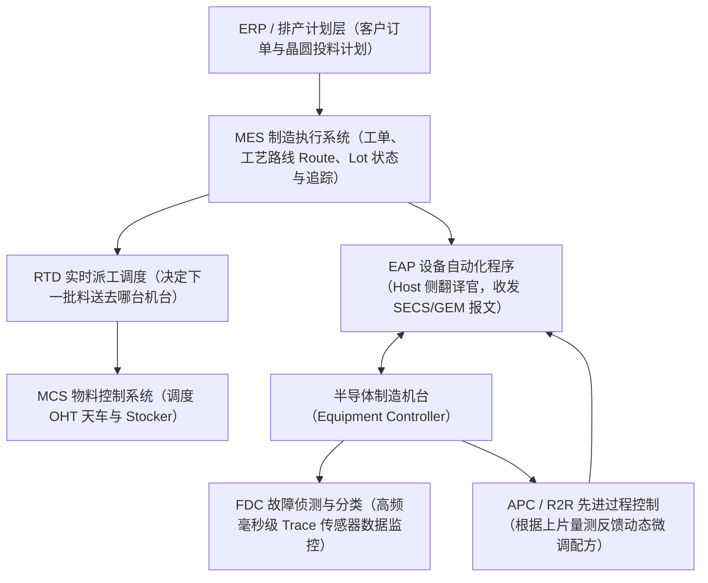

# 晶圆厂 CIM 工业软件栈：MES / EAP / RTD / APC 全链路

- **所属模块**：`06_天车与CIM系统 / 03_MES_EAP与APC软件栈`

## 1. 自顶向下的智能制造软件架构

---

## 2. 核心软件模块分工详解

1. **MES（Manufacturing Execution System）**：整个晶圆厂的中枢神经，管理成千上万个在制批次（Lot）走到了 1000 步中的哪一步、Hold/Release 扣留放行、电子流转卡（Run Card）和防呆规则。
2. **EAP（Equipment Automation Program）**：直接通过 HSMS/SECS-II 与每台物理设备通信，替 MES 下发 `PP-SELECT`（自动选配方防选错）、核对 Slot Map，并将腔室加工完成事件与传感器数据回传。
3. **RTD（Real-Time Dispatching）**：由于晶圆厂是**重入式制造**且机台常因保养或工艺限制被锁住（Qualification），RTD 需在秒级根据优先级（Hot Lot 加急批）、队列时间限制（**Q-Time**，例如清洗后必须在 2 小时内进炉管防氧化！）、同配方合并等约束算出最优派工决策。
4. **SPC & FDC**：SPC 看量测结果（事后片级），FDC 抓机台内部射频反射功率、腔压、MFC 流量、终点时间曲线（事中毫秒级 Trace），提前抓出异常防止整批报废。
5. **APC / R2R（Run-to-Run 先进过程控制）**：例如光刻后测得套刻误差 Overlay 漂移了 +1.5nm，APC 自动把下一批的补偿参数写入配方下发，形成**闭环自动微调**。
