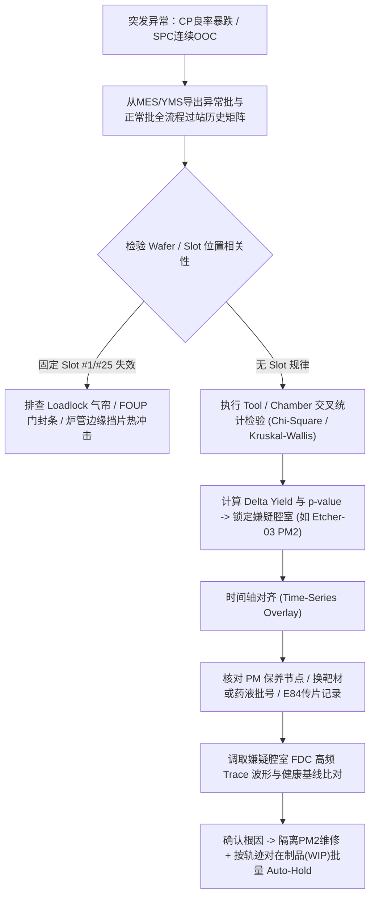

# SPC 统计过程控制、Cp/Cpk 与西方电气判异规则

- **所属模块**：`07_良率SPC与FA / 02_SPC控制与FDC诊断`

---

## 1. 两个关键区别：控制限（CL）vs 规格限（SL）

在晶圆厂统计过程控制（SPC）体系中，新工程师最易混淆的红线是“控制限”与“规格限”——二者分别映射设备稳定性与器件物理边界：

| 对比维度 | 规格限（USL / LSL，Specification Limits） | 控制限（UCL / LCL，Control Limits） |
| :--- | :--- | :--- |
| **本质来源** | **客户/器件之声（Voice of Customer）**：器件电性或封装可靠性能容忍的物理容差（如 Gate CD `20.0 ± 1.5 nm`） | **机台/工艺之声（Voice of Process）**：机台处于无异常稳态运转时，由随机自然波动构成的统计边界 |
| **计算方式** | 由工艺整合（PIE）与器件团队依据 TCAD / Spice 仿真提前锁定，不随机台波动改变 | 基于历史稳态基线样本按组内短时波动计算：$\text{CL} = \bar{\bar{X}} \pm 3\hat{\sigma}_{\text{within}}$ |
| **越界处置** | 触发 **OOS（Out of Specification）**：晶圆已实质超规，强制锁批交 **MRB（材料评审委员会）** 判定返工或报废 | 触发 **OOC（Out of Control）**：虽常仍位于 USL/LSL 内部，但机台已失稳，立即 **Auto-Hold 拦截** 排查根因 |
| **黄金铁律** | **控制限必须显著窄于规格限**（通常要求控制带宽度 $\le$ 规格带宽度的 `50%~75%`） | 若出现 `UCL > USL` 或 `LCL < LSL`，表明机台先天硬件精度不足（$C_p < 1.0$），必须停机改造 |

### 1.1 晶圆厂常用控制图选型与方差拆分陷阱
- **$\bar{X}-R$ 图 / $\bar{X}-S$ 图（多点子组图）**：适用于每片多点量测（如膜厚 9-site、CD-SEM 5-site）或每批抽多片。组内标准差由平均极差估计 $\hat{\sigma}_{\text{within}} = \bar{R}/d_2$，控制限为 $\bar{\bar{X}} \pm A_2\bar{R}$（典型 $n=5$ 时 $d_2 = 2.326, A_2 = 0.577, D_3 = 0, D_4 = 2.114$）。
- **I-MR 图（单值-移动极差图）**：适用于每片/每批仅测单汇总指标（如片均刻蚀速率 ER、颗粒总数 Adder）。以相邻差均值 $\overline{MR}$ 估算短时噪声，控制限取 $\bar{X} \pm 2.66\,\overline{MR}$（常数 $E_2 = 3/1.128 = 2.660$）。
- **计数型控制图（$c / u / p$ 图）**：专用于 KLA 颗粒数（泊松分布 $u$ 图）或破片率（二项分布 $p$ 图）监控。
- **工程大坑——片内（WIWNU）与片间（WTW/LTL）方差混同**：300mm 晶圆中心与边缘通常存在固定物理梯度（如旋涂边缘偏厚 `1.2 nm`）。若误将片内 9 点的极大极小差 $\bar{R}$ 直接用于计算片均值（Wafer Mean）控制限，会把系统性的径向差异当作随机噪声，导致控制限极度虚宽、彻底漏抓批间漂移！**标准做法**：采用 **片均值 I-MR 图** 专控批间均值漂移，同时另设 **片内极差 $R$ 或标准差 $S$ 图** 独立监控片内均匀性。

### 1.2 量测系统前提：Gauge R&R（%GRR）
做任何 SPC 分析前必须确保测量仪（CD-SEM/OCD/Ellipsometer）自身噪声远小于工艺波动。Fab 量测验收强制要求测量系统重复性与再现性占比 **$\text{\%GRR} = \frac{\sigma_{\text{Gauge}}}{\sigma_{\text{Total}}} \times 100\%$**：
- **`%GRR < 10%`**：量测系统优秀，可直接用于闭环控制；
- **`10% ~ 30%`**：勉强可用，需增加重复测量次数或固定测试机台；
- **`> 30%`**：量测仪噪声已淹没真实工艺信号（甚至掩盖 Rule 1~4 趋势），必须先大修或更换高阶量测机台（如由光学转为 CD-SEM/TEM）。

---

## 2. 过程能力指数 $C_p$、$C_{pk}$ 与长期性能指数 $P_p$、$P_{pk}$

### 2.1 核心数学定义与中心偏移惩罚
设规格中心 $T = \frac{USL + LSL}{2}$，偏心度 $k = \frac{|\mu - T|}{(USL - LSL)/2}$，短期组内标准差为 $\hat{\sigma}_{\text{within}}$，长期总体标准差为 $s_{\text{overall}}$：

1. **过程潜力指数 $C_p$**（只看离散度，假定均值完全居中）：
   $$C_p = \frac{USL - LSL}{6\hat{\sigma}_{\text{within}}}$$
2. **实际过程能力指数 $C_{pk}$**（同时考核离散度与均值偏心）：
   $$C_{pk} = \min\left(\frac{USL - \mu}{3\hat{\sigma}_{\text{within}}},\; \frac{\mu - LSL}{3\hat{\sigma}_{\text{within}}}\right) = (1 - k)\cdot C_p$$
3. **长期过程性能指数 $P_p / P_{pk}$ 与田口偏离指数 $C_{pm}$**：
   $P_{pk}$ 将分母替换为涵盖保养跳变、耗材退化与跨腔偏差的长期标准差 $s_{\text{overall}}$。若出现 **$C_{pk} = 1.8$ 但 $P_{pk} = 1.0$**，表明**单次单腔精度本身很高，真正拖垮产线的是长期均值漂移或多腔系统偏差（Chamber Mismatch）**！而 $C_{pm} = \frac{USL - LSL}{6\sqrt{\sigma^2 + (\mu - T)^2}}$ 用于惩罚偏离设计甜点 $T$ 的器件性能退化。

### 2.2 $C_{pk}$ 与理论缺陷率（DPMO）对照及 Fab 量产基准

| $C_{pk}$ 水平 | 等效单侧边界距离 | 理论双侧超规率（居中正态） | 晶圆厂工程评价与产线处置 |
| :---: | :---: | :---: | :--- |
| `< 1.00` | `< 3.0σ` | `> 2,700 PPM`（`0.27%`） | **过程能力严重不足**：必然产出超规废片，严禁放行量产，立即停机修机 |
| `1.00 ~ 1.33` | `3.0σ ~ 4.0σ` | `63 ~ 2,700 PPM` | **勉强合格 / 高危监控区**：需提升抽检频次（Sampling Up），立项优化窗口 |
| `1.33 ~ 1.67` | `4.0σ ~ 5.0σ` | **`0.57 ~ 63 PPM`** | **晶圆厂量产常见基准红线（$\ge 1.33$）**：常规薄膜与非关键层稳定放行 |
| `>= 1.67` | `>= 5.0σ` | **`< 0.57 PPM`** | **核心高危参数与车规（AEC-Q100）底线**：如 EUV Overlay、Gate CD、栅氧厚度 |
| `2.00`（6σ） | `6.0σ` | `0.002 PPM`（计入 $1.5\sigma$ 漂移为 **`3.4 DPMO`**） | **千步串联极高门槛**：因先进芯片串联 `1,000+` 步，关键层必须逼近极低 DPMO |

### 2.3 R2R / APC（先进过程控制）与 EWMA 实时补偿
当机台硬件短时随机波动已达物理极限（$C_p \approx 1.4$），中心稍微偏离就会导致 $C_{pk} < 1.33$。先进 Fab 广泛部署 **R2R（Run-to-Run）EWMA 控制器**，依据上一批在线量测残差自动微调下一批曝光剂量或刻蚀时间：

$$\hat{a}_k = \lambda (y_k - \hat{b}\,u_{k-1}) + (1 - \lambda)\hat{a}_{k-1}, \qquad u_k = \frac{T - \hat{a}_k}{\hat{b}}$$

其中 $y_k$ 为第 $k$ 批实测值，$u_k$ 为下发机台的调控配方偏移量，$\lambda \in (0.1, 0.4)$ 为阻尼权重，从而强行压低偏心度 $k \to 0$，使 $C_{pk}$ 紧贴上限 $C_p$。

---

## 3. 西方电气判异法则（Western Electric / Nelson 常用预警规则）

即使数据尚未突破 $3\sigma$ 控制限，只要控制图呈现**非随机规律特征**，即可在产品报废前抢先触发 OOC 预警。以中心线 CL 与 $\pm 1\sigma, \pm 2\sigma, \pm 3\sigma$ 划分 Zone C / B / A：

| 规则编号 | 统计判定条件 | 晶圆厂最典型物理与设备根因 |
| :---: | :--- | :--- |
| **Rule 1** | 1 个点落在 $3\sigma$ 控制限外 | 突发硬件故障：RF 打火、MFC 流量计卡滞、真空微漏、错跑 Recipe |
| **Rule 2** | 连续 9 个点（厂规常收紧为 7/8 点）在中心线同侧 | **均值阶跃偏移**：PM 保养装配偏移、更换新批号药液或靶材、标定漂移 |
| **Rule 3** | 连续 6 个点单调严格递增或递减 | **渐进性耗材退化**：CMP 抛光垫釉化、刻蚀腔壁聚合物累积、炉管温控飘移 |
| **Rule 4** | 连续 14 个点上下交替锯齿震荡 | **双腔室 / 双机台系统偏差混跑（Chamber Mismatch）**：Etch PM1 与 PM2 存在固有偏移却交替加工；或双对准头未匹配 |
| **Rule 5** | 连续 3 点中 2 点在同侧 $2\sigma$ 外（Zone A） | 较灵敏的中早期突发均值偏离预警 |
| **Rule 6** | 连续 5 点中 4 点在同侧 $1\sigma$ 外（Zone B 及外） | 早期微弱持续漂移信号，常早于 Rule 2 触发 |
| **Rule 7** | 连续 15 个点全部挤在 $\pm 1\sigma$ 内（Zone C） | **虚假稳定假象（Stratification）**：极易漏查！多因控制限被错误算得过宽，或**量测机台分辨率卡死/数据冻结** |
| **Rule 8** | 连续 8 个点分布于中心线两侧但**无一点**进入 $\pm 1\sigma$ | **双峰混合（Mixture）**：两套均值差 `2.5σ+` 的机台或来料批次混在一张图监控 |

### 3.1 误报率权衡（$ARL_0$）、OCAP 处置流与代码验证
- **警惕规则全开导致警报疲劳**：正态稳态下，单开 Rule 1 单点误报率仅 `0.27%`（$ARL_0 \approx 370$ 批误报 1 次）；若不加筛选把 Rule 1~8 全开，复合误报率飙升至 `~1.05%`（$ARL_0$ 骤跌至约 **`95` 批**），频繁假警报会导致工程师麻木放行。**产线策略**：每张图只激活匹配机台物理退化特征的子集（通常为 **Rule 1 + Rule 2 + Rule 3 + Rule 4**）。
- **标准 OCAP（Out-of-Control Action Plan，失控处理流）**：一旦触发 OOC，MES 自动执行：**① Auto-Hold 冻结当前批及同腔在制品 $\to$ ② 复测确认排除量测仪本身故障 $\to$ ③ 核对机台 FDC 波形与耗材寿命 $\to$ ④ 修机并跑 Qual Monitor 控片确认恢复后方可 Release 放行**。
- **代码实战案例**：运行 [`spc_cpk_demo.py`](../../../09_实战脚本与3D/01_Python良率与SPC仿真/spc_cpk_demo.py) 模拟栅长漂移（`Target = 20.0 nm`, `Spec = [18.5, 21.5] nm`, `baseline σ = 0.25 nm`）：虽然样本整体 $C_{pk} = 1.617$ 且直到 **第 13 批（`20.82 nm`）** 才破 $3\sigma$ 触发 Rule 1，但 **Rule 3（连续 6 点递增）早在第 10 批（`20.36 nm`）就已精准拦截**，抢在报废前 3 批启动腔室干洗！

---

## 4. FDC（故障检测与分类）架构与多变量诊断（EDA / Interface A）

传统 SPC 必须等晶圆流到下游量测机台且通常仅抽测 `5%~20%`，一旦突发腔内异常可能已连续跑废数批。**FDC** 则实现 **100% 全晶圆毫秒级在线诊断**。

### 4.1 SEMI EDA（Interface A）高速采集标准套件
为避免高频拉取数据阻塞 SECS/GEM 机台主控信道，现代 300mm 设备单独开放 **SEMI EDA（Interface A）** 高速通道：
- **SEMI E125（设备自描述 EqSD）& E164（通用元数据）**：向工厂标准化暴露腔室树形结构与全量传感器 SVID 定义；
- **SEMI E134（数据采集计划管理 DCM）**：FDC 下发采集计划（DCP），在工艺关键步以 **`10 Hz ~ 100 Hz`（10~100 ms 步长）** 实时拉取 RF 前向/反射功率、Match 调谐电容位置、节流阀（Throttle Valve）开度、ESC 漏电流、He 背冷压力及 OES 等离子体发射光谱。

### 4.2 时序窗口化（Windowing）与多变量 PCA 诊断
```text
[高频 SVID 波形 (10~100Hz)] ──▶ [Step Windowing 步序切片 (剔除起弧瞬态)]
       │                                      │
       ▼ (单变量 SVID 特征统计)                ▼ (多传感器耦合模型：PCA / PLS)
[Mean / Std / Slope / Overshoot / Area]  [Hotelling T² (主元空间偏离) & SPE/Q (耦合破坏)]
       │                                      │
       └──────────────▶ [FDC 规则引擎] ◀──────┘
                              │
             [片级 Auto-Hold / 机台 Interlock 禁止下片 / 故障分类标签]
```
- **多变量 PCA 捕捉单变量盲区**：当发生轻微真空微漏时，PID 闭环会自动关小节流阀强行把腔压稳在设定值，表面单变量看腔压和功率全都正常！但通过历史良片建立主成分矩阵 $\mathbf{P}$ 后，监控两个正交统计量：
  $$T^2 = \mathbf{x}^T \mathbf{P} \mathbf{\Lambda}^{-1} \mathbf{P}^T \mathbf{x}, \qquad SPE\text{ (或 } Q\text{)} = \| (\mathbf{I} - \mathbf{P}\mathbf{P}^T)\mathbf{x} \|^2$$
  一旦节流阀开度与腔压间的固有物理耦合被打破，**$SPE / Q$ 残差瞬间飙升百倍**，在晶圆离开反应腔前秒级触发 **Interlock 锁机止损**。

---

## 5. DOE（实验设计）与 Commonality Analysis（共性分析）实战流程

### 5.1 DOE 三段式工艺开发与窗口居中法
针对强耦合工艺参数（如刻蚀源功率、偏压、腔压与气体比），严禁低效的单因子试错（OFAT）：
1. **筛选设计（Screening）**：5~8 个因子采用 **部分因子设计（Fractional Factorial, Resolution IV/V）**，用 $1/4$ 或 $1/8$ 实验片筛选主效应并防止与二阶交互混杂（Aliasing）；
2. **响应面优化（RSM）**：保留核心 2~3 个因子，采用 **中心复合设计（CCD）** 或 **Box-Behnken（BBD）** 拟合二次曲面，找到对机台波动梯度最小、窗口最宽的 **“工艺甜点中心”**；
3. **确认批（Confirmation Run）**：在最优参数下连跑 3~5 批验证片，核实结果落在 `95%` 置信区间且 $C_{pk} \ge 1.33$ 后锁入 RMS。

### 5.2 Commonality Analysis（机台共性分析）良率救火闭环
当突发 CP 良率暴跌或成批 OOC 时，良率团队调取 MES 过站轨迹矩阵执行标准化溯源：



- **量化锁死准则**：若统计学检验显示某腔室经过片平均良率 `68%`、同机台其他腔室 `94%` 且 $p < 0.001$，立刻隔离腔室；若所有机台同步均匀恶化，则立即跳出设备维度，转向排查**上游硅片/光刻胶/Slurry 原料换批共性**或**跨厂区光罩设计规则热点**。
