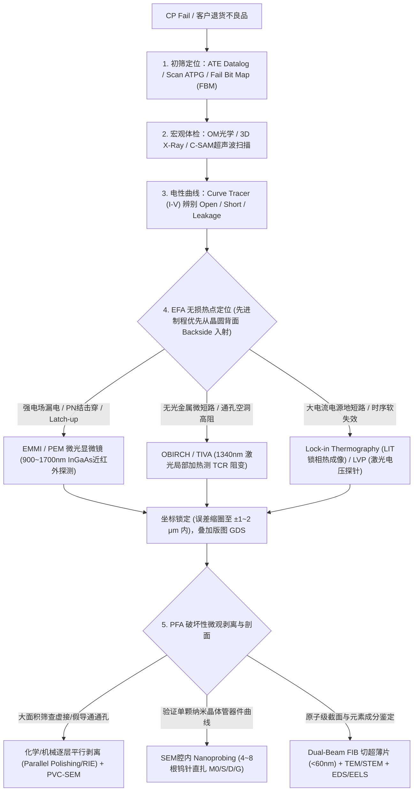

# WAT、CP Wafer Map 识别与失效分析（FA）方法论

- **所属模块**：`07_良率SPC与FA / 03_WAT_CP与失效分析FA`

---

## 1. WAT（晶圆允收测试）vs CP（晶圆针测）

在晶圆结束前道制造准备出厂（Wafer Out）或发往封测厂前，电性测试分为**基础参数把关（WAT）**与**全片芯片筛选（CP）**两大防线。

### 1.1 WAT / PCM 与 CP 核心维度对比

| 维度 | WAT / PCM（晶圆级电性参数测试） | CP（Chip Probing / Wafer Sort，晶圆中测） |
| :--- | :--- | :--- |
| **物理测试位置** | 芯片之间**切割道（Scribe Line，通常宽 60~80 μm）**专门设计的测试结构（TEG） | 每一颗真实**产品芯片（Die）的铝焊盘（Al Pad）或微铜柱（Cu Pillar）** |
| **核心测试硬件** | 高精度半导体参数分析仪（如 Keysight B1500/4080 级）+ 通用 2xN 矩阵探针卡 | 高速 ATE 测试机台 + 精密 Prober + 定制垂直/MEMS 探针卡（Pitch 低至 `35~60 μm`）+ 多温区 Chuck（`-40℃~125℃`） |
| **测试内容** | 单管 $V_{th}/I_{dsat}/I_{off}$、开尔文接触电阻、方块电阻、环形振荡器、GOI 栅氧击穿 | 数字逻辑 Scan ATPG 扫描链、存储 MBIST、静态漏电 $I_{DDQ}$、最低工作电压 $V_{\min}$、主频 Speed Binning |
| **覆盖率与耗时** | 每片抽测 **5 点或 9 点（Site）**（中心 + 上下左右 + 四角），单片耗时数分钟 | **100% 全片逐颗扎针**，单片测试时间直接决定测试机 CoO 成本 |
| **工程定界功能** | 快速定界**系统性晶体管参数漂移**，作为 FAB 交付客户的电性允收门禁 | 生成 **Wafer Map** 辨识随机颗粒与几何空间规律缺陷；执行 **PAT / GDBN** 车规剔除 |

### 1.2 WAT TEG 测试结构设计原理
切割道内紧凑排布的 TEG（Test Element Group）各司其职，对应不同的前中道失效层级：
- **多尺寸单管矩阵**：覆盖不同宽长比（$W/L$）的 NMOS/PMOS 器件，提取 $V_{th,lin}/V_{th,sat}$、DIBL、亚阈值摆幅 SS 与跨导 $G_m$，用于精确反推有效沟道长度 $\Delta L$ 与栅氧等效厚度 EOT 偏移；
- **四线开尔文（Kelvin）结构**：Force 端通入恒流、独立 Sense 端测压降，彻底消除探针接触电阻干扰，精确测量单颗 Contact/Via 电阻 $R_c$（先进节点常处于数十欧姆级）；
- **梳状与蛇形（Comb & Serpentine）结构**：折返排布数米长的最小线宽金属线，专门捕捉大面积金属线桥接漏电与刻蚀断线开路；
- **GOI（栅氧完整性）测试**：对大面积栅氧电容施加斜坡电压或恒流应力（测量 $V_{bd}/Q_{bd}$），灵敏检测硅片 COP 空洞或清洗残留金属导致的早期击穿隐患。

### 1.3 WAT/CP 交叉排查直觉与车规筛选（PAT / GDBN）
- **WAT 全过但 CP 良率骤降**：基础晶体管参数完美居中，问题极大概率为**随机颗粒缺陷（$D_0$）、单层光罩重复缺陷、CMP 划伤或芯片内部非切割道覆盖区域的局域电源网/时序热点**。
- **WAT 参数偏移（如 $V_{th}$ 整体偏低、`Ioff` 抬高）但 CP 良率微降**：全片存在系统性工艺偏移，虽然芯片低速仍勉强通过功能，但在高温高主频下极易发生 **Speed Bin 降档** 或待机功耗超标，需立即回溯前道热预算与注入 SPC。
- **车规高可靠性增强筛选（PAT / GDBN）**：除了直接判死的 Hard Bin，现代汽车电子/AI 芯片在 CP 阶段强制执行 **PAT（Part Average Testing）**——对同片健康裸片的 $I_{DDQ}$ 或 $V_{\min}$ 做统计筛选，剔除虽在规格内但偏离群体均值 $\pm 3\sigma\sim 6\sigma$ 的“异常离群芯片”；同时执行 **GDBN（Good Die in Bad Neighborhood）**——若某颗良片四周 8 颗邻居全因划伤或边缘失效死亡，该片极可能隐含微裂纹，必须强制作废以将终端失效率压到 **DPPM `< 1`**。

---

## 2. 常见 Wafer Map 空间图谱与根因直觉

在良率管理系统（YMS）中，CP Wafer Map 的空间几何形态（Spatial Signature）常能直接指明故障发生的具体腔室甚至机械动作：

| Wafer Map 失败图形 | 数学 / 算法识别特征 | 高概率对应的晶圆厂根因 |
| :--- | :--- | :--- |
| **Edge Ring（边缘环状失效）** | 外环带（$r > 0.8 R$）失效率陡增，中心区良率正常 | 1. 涂胶显影 EBR（洗边）溶剂喷嘴偏位或边缘光刻胶厚积（Edge Bead） 2. CMP 挡环（Retaining Ring）磨损造成边缘过抛（Edge Roll-off）断线 3. 刻蚀聚焦环（Focus Ring）消耗变薄引起边缘等离子体鞘层弯曲 4. RTP 退火边缘 $T^4$ 散热偏快或旋转甩干边缘水痕（Watermark） |
| **Center Bullseye（中心靶心失效）** | 中心同心圆区域（$r < 0.4 R$）集中失效 | 1. 薄膜/刻蚀喷淋头（Showerhead）中心微孔堵塞导致气场失调 2. 静电吸盘（ESC）中心加热丝/氦气背冷流量异常引发温偏 3. PVD 靶材侵蚀沟道（Erosion Track）变形致中心薄膜偏薄 4. CMP 抛光头中心气囊区域（Zone 1）下压力设置失调 |
| **Donut / Radial（圆环带或径向渐变）** | 中间环带集中失效或由中心向外连续渐变 | 立式扩散炉装舟径向热梯度引发晶体滑移位错（Slip Line）；旋涂流体剪切力引发的同心波纹膜厚波动 |
| **Scratch / Arc（直线或弧形划伤）** | 像素呈强共线或圆弧曲率连通（**霍夫变换 Hough Transform** 自动提取） | 1. **弧形划伤**：CMP 抛光垫脆裂或金刚石修整盘掉粒，在行星相对运动轨迹下连续刮伤多颗 Die 2. **直线/短刮伤**：EFEM / 真空传输机械手夹爪陶瓷垫老化蹭伤或 Loadport 卡匣偏心摩擦 |
| **Repeated Grid / Shot（周期性曝光场失效）** | 严格按曝光步距（如 `26×33 mm`）在每个 Shot 固定坐标重复死 Die（**2D-FFT 傅里叶变换** 秒级锁定） | **光刻掩模版（Reticle）或防尘膜（Pellicle）脏污/损伤**！每步进扫描一次即固定复制同一死 Die，可直接锁死特定光罩层与光刻机，立即复检并清洗光罩 |
| **Chuck Pin / Notch（顶针或切口失效）** | 呈现 $120^\circ$ 对称三点小斑或紧邻 Notch 缺口处集聚失效 | 腔室顶针（Lift Pin）升降不同步撞伤背面导致局部导热失效、高温盘支撑点微裂，或寻边器碰撞 Notch |
| **Random Scattered（全片随机散点）** | 无空间规律性，近似服从泊松/负二项均匀分布 | 洁净室环境微尘、UPW/化学液滤芯穿透、刻蚀/CVD 腔室内壁聚合物剥落（Flaking），直接对应基础 $D_0$ |

> **脚本实战联动**：运行 [`wafer_map_pattern_simulator.py`](../../../09_实战脚本与3D/01_Python良率与SPC仿真/wafer_map_pattern_simulator.py)，可直接模拟生成 Edge Ring、Center Bullseye、CMP Scratch Arc 与 Reticle Shot Repeater 分布图并验证空间自动诊断规则。

---

## 3. 失效分析（FA, Failure Analysis）标准流：先无损电定位，再破坏看微观

失效分析必须严守 **“漏斗式逐级缩圈，先无损电定位（EFA），再破坏看微观（PFA）”** 铁律——一旦直接切片或研磨，微弱电学通道现场即遭永久毁灭。

### 3.1 EFA（非破坏性电定位）背面穿透技术与物理极限
先进芯片正面覆盖 10~15 层致密铜金属走线会完全屏蔽光学信号，因此 **高阶 EFA 几乎全部采用晶圆背面（Backside）探测**——利用单晶硅带隙 $E_g \approx 1.12\,\text{eV}$（吸收截止波长约 `1100 nm`）的物理窗口，波长大于 `1100 nm` 的近红外光子可无阻穿透硅衬底背面直达晶体管区。
- **硅背面制样与重掺杂瓶颈**：背面检测前需将 `775 μm` 晶圆减薄至 `50~100 μm` 并镜面抛光（防散射）；若遇重掺杂 $p^+$ 衬底（如某些功率或模拟外延片），高浓度自由载流子会产生强烈的红外吸收，必须将硅背面进一步机械/化学减薄至 `< 20~30 μm` 方能透光。
- **EMMI / PEM（微光显微镜）**：载流子在栅氧击穿点、PN 结雪崩或饱和区强电场下复合发光（`900~1700 nm`），借液氮制冷 InGaAs 相机捕获亚微米级热点。**盲区**：纯金属欧姆短路（两点压降近零、无强电场）不发光，EMMI 无法探测。
- **OBIRCH / TIVA（激光诱导电阻/电压变化）**：采用 `1340 nm` 激光从背面逐点扫描加热，触发金属微桥接或通孔空洞处局部电阻变化 $\Delta R = R_0 \alpha_{\text{TCR}} \Delta T$（恒压测电流脉冲 $\Delta I$ 为 **OBIRCH**；恒流测电压微变与热电塞贝克效应为 **TIVA**）。**完美互补 EMMI**，专为抓出不发光的金属桥接、Cu Void 与高阻通孔而生。
- **LIT（锁相热成像）与 LVP（激光电压探针）**：LIT 对大功率电源-地短路加脉冲调制并锁相滤除热扩散，微瓦级定位主短路点；LVP 则借反射激光调制读取纳米级高频开关波形，突破高速动态时序软失效瓶颈。

### 3.2 PFA（破坏性物理失效分析）微观剥离与电镜表征
- **平行研磨去层与 PVC-SEM（被动电压衬度）**：用亚微米机械抛光配合低温 RIE 刻蚀逐层剥离金属层。针对外观正常却虚接的通孔阵列，利用 **PVC-SEM**：电子束扫描表面时，下方良好接地的正常通孔因电荷顺利泄放呈常规灰度，而下方开路/高阻残余的异常通孔因电荷堆积呈现截然相反的极暗或极亮衬度，瞬间从百万颗通孔中定位出单颗坏孔。
- **Nanoprobing（腔内纳米探针）**：在 SEM 腔内操控 4~8 根尖端半径 `< 10~20 nm` 钨针直接扎在剥离露出的 `M0` 接触孔上，实测单颗 FinFET/GAA 器件转移与输出曲线（$I_d-V_g / I_d-V_d$），铁证剥离外围布线寄生影响。
- **Dual-Beam FIB + TEM / STEM / EDS / EELS**：利用聚焦离子束（$\text{Ga}^+$ 或大束流 $\text{Xe}^+$ Plasma FIB）在热点处切取并减薄至 `< 50~80 nm` 电子透明薄片（Lamella），送入高分辨 TEM / HAADF-STEM 直视原子晶格位错、High-K 膜厚异常与阻挡层破洞；结合 **EDS** 鉴定金属污染元素，而针对超轻元素（B/C/N/O）及化学键态分辨（如分辨孔底残渣是 $\text{SiO}_2$ 还是含氟碳聚合物），必须采用能量分辨率更高的 **EELS（电子能量损失谱）**。

---

## 4. EFA / PFA 工具选型矩阵与产线实战闭环案例

| 观察到的电性失效现象 | 首选 EFA 定位方案 | 交叉验证辅助工具 | 后续 PFA 物理路径 | 工程避坑关键提示 |
| :--- | :--- | :--- | :--- | :--- |
| **静态漏电 $I_{DDQ}$ / 栅氧击穿** | **背面 EMMI**（加偏压诱发光子） | Curve Tracer 核对 PN 结指数漏电特征 | FIB 截面 + TEM/EELS 看栅氧/Fin 界面 | 起始偏压务必微调，严防热失控（Thermal Runaway）瞬间烧毁原始损伤点 |
| **金属桥接 / 通孔高阻（无发光）** | **OBIRCH / TIVA**（捕获 TCR 阻变） | **PVC-SEM**（大面积比对通孔明暗衬度） | 平行去层 + Top-down SEM / TEM + EDS | OBIRCH 热点坐标偏离真缺陷通常 `< 1 μm`，切 FIB 前必做 GDS 精对准 |
| **大电流电源-地硬短路** | **LIT 锁相热成像** | 3D X-Ray / CSAM 排除封装引线桥接 | 逐层研磨 + OM/SEM 寻找烧蚀熔融点 | 功率过大时全片温升淹没热点，需降压限流并调节锁相占空比 |
| **存储阵列规律失败（FBM）** | **FBM 位图反推物理行列坐标** | **Nanoprobing** 测单颗 6T Cell 六管特性 | PVC-SEM 对比好坏 Cell + 垂直 FIB-TEM | 高度规律的行列失效先通过 FBM 直锁物理位置，无需盲扫 EMMI |
| **高低温频点软失效（Speed Fail）** | **LVP / EOP（激光电压探针）** | 扫描电压/温度窗确定敏化边界 | Nanoprobing 测驱动电流退化 + EELS | **动态软失效一旦剥离金属即永久失活，破坏前必须充分测全边界条件** |

### 4.1 产线闭环案例一：WAT 正常但 CP 突发 12% 良率跌落（隐形单孔虚接）
1. **初筛定位**：某 28nm 逻辑产品 WAT 完美居中，CP 突发片内分散功能死片，Scan ATPG 诊断指向 `M2-Via1` 某信号路径高阻，Curve Tracer 呈非标准欧姆漂移。
2. **EFA 定位**：背面 EMMI 完全无光点；切换 **OBIRCH（`1340 nm`）** 成功在逻辑模块边缘捕获极强电热脉冲热点，叠加 GDS 锁定单颗 `Via1`。
3. **PFA 实锤**：平行研磨至 `M2` 后通过 **PVC-SEM** 发现该热点处 `Via1` 呈现明显的暗态充电异常；切取 **FIB-TEM + EELS**，清晰观察到铜垫表面残留厚约 `4 nm` 含氟碳聚合物（EELS 检出强 C/F 峰），阻断了 TaN 阻挡层接触。
4. **工程闭环**：联动 Commonality Analysis 回溯 MES，锁死一台 Via1 刻蚀后干法灰化去胶机因 PM 后工艺时间误改所致，即刻隔离修复并 Hold 全部同路径在制品。

### 4.2 产线闭环案例二：Reticle Shot 周期重复失效（光罩污染定位）
某批产品 CP Wafer Map 出现间隔 `26×33 mm` 周期性网格状单点死 Die（2D-FFT 报警）；直接绕过繁琐的 EMMI，调取对应曝光光罩送入 Reticle Inspection 机台复检，在光罩图形边缘抓出 `0.5 μm` 有机粘附结晶（Haze），经超纯水与微酸性光罩清洗再生后，后续批次良率立刻恢复正常。
