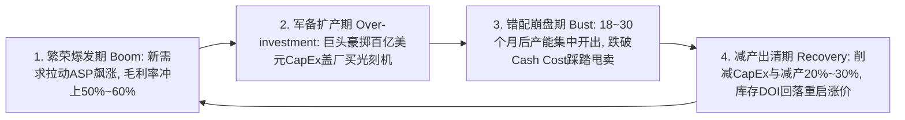

# 全球存储三巨头竞争格局、HBM 先进堆叠与半导体超级周期

- **所属模块**：`08_运营与产业链 / 03_全球晶圆厂与周期`

---

## 1. 存储芯片两大主战场格局（DRAM & NAND Flash）与微缩物理极限

不同于高度定制化的逻辑代工，标准化存储器具备**极强的大宗商品（Commodity）定价特征、极其剧烈的价格波动弹性以及残酷的规模 CapEx 门槛**。

### 1.1 DRAM 动态随机存取内存格局与“1T1C”深宽比困局
- **全球“三足鼎立”稳态（CR3 长期占据全球市场 `88% ~ 92%`）**：
  - **三星电子（Samsung）**：总营收份额长期领先（约 `38%~42%` 区间波动），拥有全球规模最大的平泽 P1~P4 超级晶圆园区，早在 `1z` 节点抢先导入 EUV，正全力抢攻标准 DDR5 与 HBM3E/HBM4 高端份额；
  - **SK 海力士（SK Hynix）**：整体 DRAM 份额约 `25%~32%`，凭 **HBM 堆栈与 MR-MUF 封装工艺** 先机深度绑定英伟达 AI GPU，在 AI 周期内斩获了行业最高营业利润率；
  - **美光科技（Micron）**：份额约 `20%~25%`，以日本广岛、中国台湾台中（Fab 16）与美国博伊西为三大主力基地，在 `1α` 与 `1β` 节点率先靠极端 DUV 四重曝光绕开高价 EUV 控本，直至 `1γ` 节点方导入 EUV 衔接下一代微缩；
  - **中国大陆后起之秀**：**长鑫存储（CXMT）** 依托合肥与北京基地加速放量 DDR4/LPDDR4X/DDR5/LPDDR5 产品，整体营收份额已跨入高个位数百分比区间并持续提升国产化率。
- **DRAM 微缩的物理死穴（1T1C 电容极限）**：每个 DRAM 单元由 **1 颗晶体管 + 1 颗电容（1T1C）** 组成。不管制程如何由 `1X/1Y/1Z` 缩至 `1α/1β/1γ`（`10nm 级` 三代微缩），电容仍必须维持 **`≥ 10 ~ 20 fF`** 的绝对电量以保证读取信噪比并抵御宇宙射线软错误。平面面积被挤成 $6F^2$ 极限后，只能把电容做成极细长的立体杯状结构——导致**深宽比（Aspect Ratio）狂飙至 `50:1 ~ 70:1+`**！不仅刻蚀极难贯通且极易倾斜倒塌（需布置多层氮化硅支撑网），更要求原子层沉积（ALD）在深孔内壁均匀镀出超高 k 复合介质（如 $\text{ZrO}_2/\text{Al}_2\text{O}_3/\text{ZrO}_2$, ZAZ）。业界正加紧向 **4F² 垂直沟道晶体管（VCT）** 与 **3D DRAM** 架构突围。

### 1.2 NAND Flash 格局与“双晶圆混合键合”范式转移
- **主要玩家阵营**：三星（V9 迈向 290+ 层）、SK 海力士（含原 Intel 闪存业务 Solidigm）、铠侠（Kioxia）/ 西部数据（WDC）、美光（232 层及多堆栈 String Stacking），以及中国大陆的**长江存储（YMTC）**。
- **从“单片顺次堆叠”全面转向“双晶圆混合键合（W2W Hybrid Bonding）”**：早期 3D NAND 将外围 CMOS 控制电路做在存储阵列下面（PUC / CuA），但后续 200~300+ 层存储单元的千度级长时退火与高膜层应力会严重破坏底层逻辑晶体管性能：
  - **长江存储（YMTC）率先破局**：全球首创 **Xtacking®（晶栈）架构**，将外围 CMOS 逻辑晶圆与高密度存储阵列晶圆**彻底分离在两片独立晶圆上用各自最优工艺制造**，再面对面通过千万级亚微米 **Cu-Cu 混合键合** 一次接通。至 **Xtacking 3.0（232 层 X3-9070）**，实现了约 `15.47 Gb/mm²` 顶尖密度与 `2400 MT/s+` I/O 传输速率；
  - **行业路线全面趋同**：Kioxia/WDC 在 **BiCS8（218+ 层）** 全面转型 **CBA（CMOS Bonded to Array）** 混合键合架构，宣告超高层 3D NAND 终结单片顺次时代；同时在超深通道孔刻蚀上（`HAR > 60:1~100:1`），行业广泛导入 **`-40℃ ~ -70℃` 超低温等离子体刻蚀（Cryogenic Etch）**，利用 $\text{HF}/\text{CF}_4$ 在低温侧壁形成可控保护钝化层，维持深孔笔直不弯折（Bowing）。

---

## 2. AI 浪潮下的 HBM 军备竞赛与晶圆级制造壁垒

大模型算力的增长速度远超显存引脚速率增速，传统 DDR5/GDDR6 走 PCB 铜箔受制于高速 SerDes 信号衰减与引脚数量上限，爆发严重 **“内存墙（Memory Wall）”** 瓶颈。HBM 采用“超宽位并行 + 硅中介层短距直连”，将单位比特传输能耗（pJ/bit）压低至板级接口的数分之一：

```text
[ 高算力 AI GPU / ASIC 裸片 ] <== 2.5D 硅中介层 (Interposer 亚微米铜 RDL 布线) ==> [ 8~16 层 TSV 垂直堆叠 HBM ]
                                                | (通信距离缩至毫米级，同时开放上千条并行数据通道)
                                         [ 封装基板 Substrate & BGA 锡球 ]
```

### 2.1 HBM 世代演进与 JEDEC 核心规格对比

| HBM 世代（JEDEC 规范） | 堆叠层数 | 单脚速率 / 接口位宽 | 单颗粒带宽 | 核心技术演进与制造卡点 |
| :--- | :---: | :---: | :---: | :--- |
| **HBM2E** | 4-Hi / 8-Hi | `3.2~3.6 Gb/s` / `1024-bit` | `~410~460 GB/s` | 基础微凸点（Micro-bump）回流焊 + 传统底部填充 |
| **HBM3**（JESD238） | 8-Hi / 12-Hi | `6.4 Gb/s` / `1024-bit` | `~819 GB/s` | 单层减薄至 `< 30~35 μm`；散热痛点爆发，MR-MUF 开始放大良率差距 |
| **HBM3E**（JESD238 扩展） | 8-Hi / 12-Hi | `~9.2~9.8 Gb/s` / `1024-bit` | **`1.18 ~ 1.25 TB/s`** | **Advanced MR-MUF vs TC-NCF 竞争白热化**；容量达 `24~36 GB`，限高卡在 `720 μm` |
| **HBM4**（**JESD270-4**, 2025 发布） | 12-Hi / 16-Hi | 基线 `8.0 Gb/s`（商用冲 `11~13+ Gb/s`） / **`2048-bit`（32 通道）** | **基线 `2.0 TB/s`**（高频商用 **`2.8~3.3 TB/s`**） | **三大颠覆**：① **接口位宽翻倍至 2048-bit**（靠宽度而非硬拉单脚频率提带宽）；② **Base Die 逻辑底座首次转交台积电等 4nm/3nm 先进逻辑代工厂制造**以集成定制逻辑；③ JEDEC 放宽 HBM4 高度上限至 **`775 μm`**，让高级 MR-MUF/TC-NCF 可过渡承接早期 16-Hi，再迈向无凸点混合键合 |

### 2.2 HBM 晶圆级与先进封装的四大制造壁垒
1. **TSV 制造与 KGD 串联良率惩罚**：每颗 DRAM 裸片需穿透数千根微米级铜 TSV 孔（Bosch 深硅刻蚀 $\to$ 低温绝缘层 $\to$ 阻挡/种子层 $\to$ 无空洞超共形电镀 $\to$ 背面 CMP 露头 + 退火防 Cu Pumping 热挤出）。其核心商业杀手在于**串联良率乘积悬崖**：
   $$Y_{\text{stack}} = (Y_{\text{KGD}})^N \times (Y_{\text{bond}})^{N-1}$$
   若单层 DRAM 漏测不良率为 `4%`（$Y_{\text{KGD}} = 0.96$），直接堆叠 12 层后的整颗 HBM 成品率骤降至 $0.96^{12} \approx 61.3\%$！一旦一颗坏 Die 混入堆栈，连同其余 11 颗好片和昂贵 Base Die 全数报废，因此堆叠前必须实施极其严苛的 **Wafer-level Burn-in 已知良品（KGD）筛选**。
2. **超薄减薄与晶圆翘曲（Warpage）控制**：为将 12~16 层叠进 `720~775 μm` 高度内，每片原厚 `775 μm` 的 DRAM 晶圆需背面研磨抛光减薄至 **`25 ~ 35 μm` 以下**（比头发丝更细）。全程必须依赖 **TBDB（临时键合/解键合）载片** 支撑，且极易因铜硅热膨胀系数（CTE）差异导致晶圆严重翘曲失焦。
3. **散热物理限制与封装流派对抗（TC-NCF vs MR-MUF）**：
   - **HBM 致命热物理约束**：DRAM 存储电容漏电流随结温呈指数增长；若 12~16 层堆栈内部散热受阻导致温度飙升过 `85℃~95℃`，JEDEC 规范强制将刷新周期（$t_{\text{REF}}$）从 `64 ms` 砍半至 `32 ms`，直接吞噬大量有效访存带宽！
   - **TC-NCF（热压非导电薄膜键合，Samsung 主力）**：在微凸点间预贴固体绝缘 NCF 膜，用热压机逐层加压加热焊接。优点是结构支撑力强、压平翘曲能力好；短板是逐层贴合耗时慢、微凸点边角容易残留微气泡且薄膜整体热阻偏高；
   - **MR-MUF（批量回流模塑料底填，SK Hynix 护城河）**：全部预贴片后进炉**一次性批量回流焊（Mass Reflow）**，再趁热真空注入高导热填料（如微米氧化铝）液态环氧模塑料（MUF）。既成倍提高单机吞吐，又大幅降低了垂向热阻与空洞率，成为 SK Hynix 在 HBM3/HBM3E 时代拉大良率与热表现优势的核心护城河。
4. **无凸点混合键合（Hybrid Bonding）终局**：取消 `15~25 μm` 高的微凸点，靠亚纳米平坦化的铜盘（Cu-Cu）与介质直接共价键合（Pitch `< 10 μm`），大幅降厚度与热阻。虽因 JEDEC 放宽 HBM4 高度至 `775 μm` 延缓了强制切换节点，但针对 16-Hi 以上超高堆叠，具备前道 ISO 1 级洁净度与亚纳米表面 CMP 要求的混合键合仍是终极演进方向。

---

## 3. 存储超级周期的“猪周期”波动律与微观机理

存储行业历史上平均每 **3~4 年** 经历一轮大起大落的牛熊周期（如 2017–2018 云端爆发 $\to$ 2019 暴跌 $\to$ 2020–2021 居家办公反弹 $\to$ 2022–2023 全行业历史级亏损去库 $\to$ 2024–2026 AI/HBM 超级周期），底层逻辑由 **蛛网定理（Cobweb Model）** 与重资产成本刚性锁死：



- **产能供给长周期滞后**：新建存储 Fab 叠加核心设备（EUV/刻蚀）`12~18 个月` 交期与爬坡，新增产能从拍板投资到大规模投放市场长达 **`18~30 个月`**，往往在开出时刚好撞上下游宏观转冷窗口；
- **“囚徒困境”与 Cash Cost 踩踏**：存储厂固定折旧占成本 **`50%~60%`**。价格下行初期只要售价还高于**变动现金成本（Cash Cost）**，单家主动减产只会把份额拱手让人并拉高自身单片折旧；因此巨头往往陷入“亏钱也要满产摊折旧”的对耗期，直至价格击穿现金成本引发全行业集体削减 CapEx 与投片（Wafer Starts）方见大底。

---

## 4. AI 时代周期异化：HBM 产能挤出效应与先行观测指标

进入 AI 算力爆发期，存储器周期出现显著的“结构性异化”——**HBM 正在化身吞噬全球 DRAM 晶圆产能的“黑洞”**：

- **Wafer Bit Density Penalty（晶圆位元面积惩罚）**：由于 HBM 裸片需预留大片 TSV 通孔矩阵、更复杂测试冗余以及更高的 KGD 堆叠损耗，**产出同等 1 GB 存储容量的 HBM 所耗费的 12 寸晶圆面积是标准 DDR5 的 `2.5 ~ 3.0 倍以上`**！当三巨头将有限的高阶净室与 EUV 机时优先分配给高毛利的 HBM3E/HBM4 时，相当于被动抽干了常规 DDR5/LPDDR5 的有效供给，从而在普通消费电子温和发展下也极易诱发局部紧缺涨价。

### 产线运营与周期研判的五大先行量化指标
1. **DOI（原厂与渠道库存周转天数）**：行业健康稳态线约 **`6 ~ 8 周`**；若突破 **`14 ~ 18 周`**，通常预示剧烈跌价清库存周期迫近；
2. **现货价（Spot）vs 合约价（Contract ASP）剪刀差**：现货成交极其敏感，通常**领先季度合约价 `1 ~ 2 个季度`** 出现转折；现货止跌并反超合约价是重要的筑底前瞻信号；
3. **Bit Growth（年度位元供给增速 vs 需求增速）**：行业常规增长基准约 `15%~20%`；若巨头联手严控资本开支使供给增速压至 `10%` 以下，供需逆转将大幅提前；
4. **CapEx Intensity（资本开支占营收比）**：若行业连续两年以上 CapEx/营收冲破 `40%~50%`，常埋下两年后过剩隐忧；反之当全行业 CapEx 同比砍掉 `35%~50%` 时常临近周期底部；
5. **后道先进封装瓶颈积压**：追踪台积电 CoWoS 产能、TSV 电镀设备及 TCB/MR-MUF 键合设备订单交期（Backlog），比单纯盯着前端晶圆投片更能提前半年判断 AI 内存真实供给上限。
