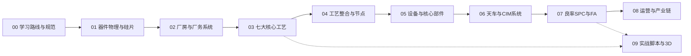

# 半导体晶圆厂系统学习与资料归档库（Wafer Fab Handbook）

> 从**器件物理**、**洁净室厂务**、**七大核心单项工艺**、**工艺整合**、**制造设备与零部件**、**AMHS/CIM 自动化**到**良率工程与晶圆厂经济账**的 GitHub 开源学习路线与结构化知识库。

---

## 1. 学习全景图



---

## 2. 目录导航与学习进度看板

| 模块 | 主题方向 | 核心内容 | 建议学时 | 当前进度 |
| :--- | :--- | :--- | :---: | :---: |
| [00_学习路线与规范](./00_学习路线与规范/README.md) | 路线与规范 | 4 阶段规划、分岗位学习路线、笔记与上传规范 | 1h | 🟢 100% 完整 |
| [01_器件物理与硅片](./01_器件物理与硅片/README.md) | 器件与物理基础 | CZ 单晶、300mm 规范矢量图、能带/载流子、MOS C-V、短沟道 SCE、FinFET/GAA/3D NAND | 1~2 周 | 🟢 100% 完整 |
| [02_厂房与厂务系统](./02_厂房与厂务系统/README.md) | 厂房与厂务系统 | 三层建筑剖面、UPW 超纯水/特气/CDS、HVAC/MAU/PCW、真空干泵/Scrubber、SEMI F47/抗微振 | 1 周 | 🟢 100% 完整 |
| [03_七大核心工艺](./03_七大核心工艺/README.md) | **七大单项工艺** | 光刻 / 刻蚀清洗 / 薄膜沉积 / 热处理与注入 / CMP / 金属化 / 量测检测（全套配 7 张精制 SVG 矢量图 + 7 份经典论文精读指南） | 4~6 周 | 🟢 100% 完整 |
| [04_工艺整合与节点](./04_工艺整合与节点/README.md) | 工艺整合与节点 | CMOS 全流程串联、HKMG/GAA/BSPDN、1T1C DRAM、3D NAND 百层 HARC、CIS 背照堆叠、SiC/GaN 功率工艺、先进封装桥梁 | 2 周 | 🟢 100% 完整 |
| [05_设备与核心部件](./05_设备与核心部件/README.md) | 设备与核心部件 | Cluster Tool/EFEM、RF/ESC/MFC/干泵/分子泵、全球五大巨头与国产替代格局 | 1~2 周 | 🟢 100% 完整 |
| [06_天车与CIM系统](./06_天车与CIM系统/README.md) | 天车与 CIM/MES | OHT/FOUP/Stocker、SECS/GEM/E84/E87/E90、MES/EAP/RTD/APC 软件栈 | 1~2 周 | 🟢 100% 完整 |
| [07_良率SPC与FA](./07_良率SPC与FA/README.md) | 良率、SPC 与 FA | 良率四大模型($D_0$)、$C_p/C_{pk}$、西方电气判异规则、WAT/CP/Wafer Map 图谱、EFA/PFA 流程 | 2 周 | 🟢 100% 完整 |
| [08_运营与产业链](./08_运营与产业链/README.md) | 运营与产业链 | 晶圆单片成本模型、IE 运营指标、七大耗材供应链矩阵、全球代工厂与存储三巨头产能周期 | 1 周 | 🟢 100% 完整 |
| [09_实战脚本与3D](./09_实战脚本与3D/README.md) | 实战代码与图表 | Python 良率/SPC 脚本、E10/E84 状态机仿真、Mermaid 流程图、现代晶圆厂三维建模全套规范 | 穿插全程 | 🟢 100% 完整 |
| [10_词典书单与面经](./10_词典书单与面经/README.md) | 工具箱与资源 | 60+ 晶圆厂中英术语词典、经典教材与公开课书单、分岗位笔面试高频题库 | 随时查阅 | 🟢 100% 完整 |
| [99_临时收件箱](./99_临时收件箱/README.md) | 临时收件箱 | 暂存收件箱与标准化草稿模板，每周日集中归档 | 每周清理 | 🟢 规范就绪 |

---

## 3. 快速上手指南

1. **先读路线**：查看 [4 阶段学习路线](./00_学习路线与规范/01_四阶段16周学习路线.md) 和 [分岗位路径](./00_学习路线与规范/02_分岗位学习路径指南.md)，确定自己的重点模块。
2. **遵守上传规则**：阅读 [仓库规范](./00_学习路线与规范/03_仓库整理与上传规范.md)——**笔记/代码/轻量图进 Git；教材 PDF、视频、3D 工程文件只写进 `外部资料索引.md`**，不直接 push 大文件。
3. **跑通实战脚本**：进入 `09_实战脚本与3D/` 运行 Python 示例：
   ```bash
   python 09_实战脚本与3D/01_Python良率与SPC仿真/yield_and_dpw_calculator.py
   python 09_实战脚本与3D/01_Python良率与SPC仿真/spc_cpk_demo.py
   python 09_实战脚本与3D/02_SECS_GEM状态机仿真/e10_state_machine_sim.py
   ```
4. **每周打卡**：在 GitHub Issues 使用 `.github/ISSUE_TEMPLATE/` 里的打卡模板或精读模板记录进度。

---

## 4. 日常学习同步到 GitHub

每次在本地新增或整理笔记后，执行以下命令即可同步到仓库：

```powershell
cd wafer-fab-handbook
git add .
git commit -m "docs: 新增晶圆厂学习笔记"
git push
```
