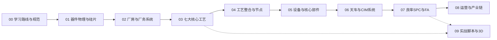
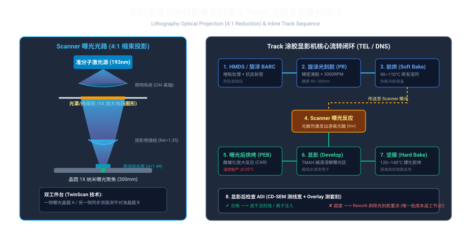

# 半导体晶圆厂系统学习与资料归档库（Wafer Fab Handbook）


> 从**器件物理**、**洁净室厂务**、**七大核心单项工艺**、**工艺整合**、**制造设备与零部件**、**AMHS/CIM 自动化**到**良率工程与晶圆厂经济账**的 GitHub 开源学习路线与结构化知识库。

---

## 1. 学习全景图



---

## 2. 目录导航与资料完备度看板

| 目录 | 主题方向 | 核心覆盖资料 | 建议学时 | 当前状态 |
| :--- | :--- | :--- | :---: | :---: |
| [00_学习路线与规范](./00_学习路线与规范/README.md) | 路线与规范 | 4 阶段 16 周学习规划、7 大岗位学习权重、仓库上传与命名规范 | 1h | 🟢 完整 |
| [01_器件物理与硅片](./01_器件物理与硅片/README.md) | 物理与器件基础 | CZ 单晶、300mm 硅片矢量图、能带/载流子、MOS C-V、短沟道 SCE、FinFET/GAA/CFET、DRAM/3D NAND | 1~2 周 | 🟢 完整 |
| [02_厂房与厂务系统](./02_厂房与厂务系统/README.md) | 厂房与厂务动力 | 垂直分层与 Bay-Chase、UPW 超纯水/特气/CDS、HVAC/PCW、Sub-Fab 真空干泵/Scrubber、SEMI F47/抗微振、EHS | 1 周 | 🟢 完整 |
| [03_七大核心工艺](./03_七大核心工艺/README.md) | **七大单项工艺** | 光刻（含 CAR/MOR、RET/SAQP、Overlay）/ 刻蚀清洗（含 HARC/ALE/SAC）/ 薄膜（含 Low-k/High-k/ASD）/ 热处理与注入（含热预算/PLAD）/ CMP（含 Dishing/Post-CMP）/ 金属化（含 W/RMG/Co/Ru/Mo）/ 量测检测（含明暗场/EBI/OCD）；**全套配 7 张矢量 SVG + 7 份经典论文指南** | 4~6 周 | 🟢 完整 |
| [04_工艺整合与节点](./04_工艺整合与节点/README.md) | 工艺整合与节点 | CMOS FEOL/MOL/BEOL 重入流转、HKMG→GAA→BSPDN、1T1C DRAM、百层 3D NAND、BSI CIS、SiC/GaN 功率、CoWoS/HBM 衔接 | 2 周 | 🟢 完整 |
| [05_设备与核心部件](./05_设备与核心部件/README.md) | 设备与核心部件 | Cluster Tool/EFEM 架构、RF/ESC/MFC/干泵/分子泵原理、全球五大龙头与国产设备对标图谱 | 1~2 周 | 🟢 完整 |
| [06_天车与CIM系统](./06_天车与CIM系统/README.md) | 天车与 CIM/MES | OHT 天车/FOUP/Stocker、SECS/GEM 与 E84/E87/E90/E94、MES/EAP/RTD/APC 软件栈 | 1~2 周 | 🟢 完整 |
| [07_良率SPC与FA](./07_良率SPC与FA/README.md) | 良率、SPC 与 FA | 良率层级与四大数学模型、$C_p/C_{pk}$ 与西方电气判异规则、WAT/CP/Wafer Map 图谱、EFA/PFA 流程 | 2 周 | 🟢 完整 |
| [08_运营与产业链](./08_运营与产业链/README.md) | 运营与产业链 | 晶圆单片成本模型、IE 运营 KPI、七大核心耗材矩阵、全球代工厂与存储三巨头周期 | 1 周 | 🟢 完整 |
| [09_实战脚本与3D](./09_实战脚本与3D/README.md) | 实战代码与 3D | 4 套 Python 良率/SPC/Wafer Map/SEMI E84 仿真脚本、Mermaid 流程图库、**现代晶圆厂三维建模全套专著** | 穿插全程 | 🟢 可运行 |
| [10_词典书单与面经](./10_词典书单与面经/README.md) | 工具箱与资源 | 60+ 晶圆厂中英高频缩略语词典、经典教材与公开课书单、分岗位笔面试高频题库 | 随时查阅 | 🟢 完整 |
| [99_临时收件箱](./99_临时收件箱/README.md) | 临时收件箱 | 碎片资料暂存缓冲区与标准化登记模板，每周日集中归档 | 每周清理 | 🟢 就绪 |

---

## 3. 矢量原理图库一览（GitHub 原生高清渲染）

全库内置 **8 张高精度 SVG 矢量图**，点击下方链接可直接查看大图（下附光刻与铜大马士革核心原理图示例预览）：

| 所属工艺 | 矢量原理图直达链接 |
| :--- | :--- |
| 硅片制备 | [CZ 单晶提拉与 300mm 晶圆加工全景图](./01_器件物理与硅片/01_单晶生长与硅片规范/图解/CZ单晶提拉与晶圆加工全景图.svg) |
| 01 光刻 | [光刻系统光学投影曝光与 Track 涂胶显影联机闭环](./03_七大核心工艺/01_光刻工艺/图解/光刻光学曝光与Track闭环图.svg) |
| 02 刻蚀清洗 | [ICP 等离子体刻蚀各向异性机理与 RCA 清洗技术](./03_七大核心工艺/02_刻蚀与清洗/图解/等离子体刻蚀与RCA清洗机理图.svg) |
| 03 薄膜沉积 | [高深宽比微沟槽填充对比：PVD vs CVD vs ALD](./03_七大核心工艺/03_薄膜沉积/图解/微沟槽填充对比_PVD_CVD_ALD.svg) |
| 04 热处理注入 | [退火热预算演变曲线与离子注入防沟道效应](./03_七大核心工艺/04_热处理与离子注入/图解/热预算演化与离子注入防沟道图.svg) |
| 05 CMP 平坦化 | [CMP 动力学、Preston 定律与碟形凹陷/侵蚀缺陷](./03_七大核心工艺/05_CMP平坦化/图解/CMP抛光动力学与碟形凹陷图.svg) |
| 06 金属化电镀 | [铜双大马士革 6 步全流程与 ECP 自底向上超填](./03_七大核心工艺/06_金属化与电镀/图解/铜双大马士革6步与电镀超填图.svg) |
| 07 量测检测 | [产线量测 Metrology 与缺陷检测 Inspection 设备矩阵](./03_七大核心工艺/07_量测与缺陷检测/图解/产线量测与缺陷检测设备矩阵图.svg) |



---

## 4. 快速上手与实战脚本运行

1. **按路线开干**：先读 [4 阶段学习路线](./00_学习路线与规范/01_四阶段16周学习路线.md) 与 [分岗位学习路径](./00_学习路线与规范/02_分岗位学习路径指南.md)。
2. **跑通 4 套 Python 零依赖仿真脚本**（仅使用 Python 标准库，克隆后直接可运行）：
   ```powershell
   # 1. 300mm 晶圆 Gross Die 几何排布与四大良率模型计算
   python 09_实战脚本与3D/01_Python良率与SPC仿真/yield_and_dpw_calculator.py

   # 2. 栅长 CD 的 SPC Cp/Cpk 与 Western Electric 判异法则检查
   python 09_实战脚本与3D/01_Python良率与SPC仿真/spc_cpk_demo.py

   # 3. CP Wafer Map 四大典型失效图谱生成与空间诊断（边缘环/靶心/划痕/光罩死点）
   python 09_实战脚本与3D/01_Python良率与SPC仿真/wafer_map_pattern_simulator.py

   # 4. SEMI E84 OHT 天车并行交接握手与 E10 设备状态迁移仿真
   python 09_实战脚本与3D/02_SECS_GEM状态机仿真/e10_state_machine_sim.py
   ```
3. **打卡与文献精读**：在 GitHub 本仓库 **Issues** 页面直接使用内置的周度打卡与论文精读模板记录成长轨迹。

---

## 5. 日常学习同步到 GitHub

每次在本地新增或整理笔记后，执行以下命令即可同步到远程仓库：

```powershell
cd wafer-fab-handbook
git add .
git commit -m "docs: 新增晶圆厂学习笔记"
git push
```
