# 12 寸先进制程半导体晶圆厂（Wafer Fab）全栈工程学习手册


> 面向 **工艺整合（PIE）、单项工艺（PE）、设备（EE）、厂务（Facility）、CIM/自动化、良率工程（YE）与芯片制造科普/3D 可视化团队** 的开源工程知识库。内容横跨晶体管物理、厂房三明治结构、七大单元工艺机理、EUV/GAA/BSPDN 节点演进、Cluster Tool、OHT/SECS-GEM、良率与成本模型、Python 闭环仿真脚本以及名校公开课原版教材。

---

## 1. 全栈学习路径总览（从硅片物理到整座熄灯晶圆厂）

```mermaid
flowchart LR
    A["01 硅片与器件物理<br/>CZ单晶 · FinFET/GAA"] --> B["02 厂房与厂务动力<br/>FFU · UPW/CDS/Sub-Fab"]
    B --> C["03 七大核心单元工艺<br/>光刻/刻蚀/薄膜/注入/CMP/ECP/量测"]
    C --> D["04 工艺整合与节点<br/>CMOS串联 · 3nm/BSPDN · 3D NAND"]
    D --> E["05 设备与关键部件<br/>EFEM/VTM/ESC/分子泵/RF"]
    E --> F["06 天车与CIM自动化<br/>OHT/E84 · MES/EAP/R2R APC"]
    F --> G["07 良率 SPC 与 FA<br/>Poisson/NB · CP Map · FIB/TEM"]
    G --> H["08 Fab运营与产业链<br/>Kingman排队 · 成本与设备材料"]
    H --> I["09-11 实战仿真与教科书<br/>Python/Three.js · 24题解析 · 34份PDF"]
```



---

## 2. 核心目录导航（全中文直观结构）

| 序号 | 模块目录 | 核心覆盖内容与特色资产 | 推荐入口 |
| :---: | :--- | :--- | :--- |
| **00** | **学习路线与规范** | 16 周阶梯学习规划、按岗位定制书单、仓库编辑与同步规范 | [00_学习路线与规范](./00_学习路线与规范/README.md) |
| **01** | **器件物理与硅片** | CZ 直拉法、300mm 硅片平整度指标、MOS 物理、FinFET/GAA、DRAM/3D NAND/SiC | [01_器件物理与硅片](./01_器件物理与硅片/README.md) |
| **02** | **厂房与厂务系统** | 洁净室垂直三明治结构、Bay & Chase、UPW/CDS/特气房、HVAC/FFU/尾气/HF 急救 | [02_厂房与厂务系统](./02_厂房与厂务系统/README.md) |
| **03** | **七大核心工艺** | 光刻（ArFi/EUV/SAQP）、刻蚀与 RCA 清洗、PVD/CVD/ALD、扩散与注入、CMP、Cu 电镀、量测检测 | [03_七大核心工艺](./03_七大核心工艺/README.md) |
| **04** | **工艺整合与节点** | 28nm HKMG/FinFET/GAA/BSPDN 节点演进、3D NAND HARC 通道工艺、HBM TSV 先进封装 | [04_工艺整合与节点](./04_工艺整合与节点/README.md) |
| **05** | **设备与核心部件** | Cluster Tool 模块解剖、ESC/MFC/分子泵/RF 匹配器壁垒、全球与国产核心设备图谱 | [05_设备与核心部件](./05_设备与核心部件/README.md) |
| **06** | **天车与 CIM 系统** | OHT/Stocker 物流、SEMI E10/E84/E87/E90、HSMS/SECS-II、MES/EAP/RTD/FDC/APC | [06_天车与CIM系统](./06_天车与CIM系统/README.md) |
| **07** | **良率 SPC 与 FA** | Poisson/Murphy/Seeds/负二项模型、Western Electric 规则、WAT/CP 与 EMMI/OBIRCH/FIB/TEM | [07_良率SPC与FA](./07_良率SPC与FA/README.md) |
| **08** | **运营与产业链** | 晶圆单片成本结构、Kingman 运作曲线、Cycle Time 优化、核心材料靶材浆料与全球晶圆厂 | [08_运营与产业链](./08_运营与产业链/README.md) |
| **09** | **实战脚本与 3D** | **8 套零依赖 Python 仿真**、合成分腔 CSV、3 套 Mermaid、**Blender `bpy` + Three.js 3D 洁净室预览** | [09_实战脚本与3D](./09_实战脚本与3D/README.md) |
| **10** | **词典书单与面经** | **173 条按八大工艺域归类高频缩略语**、经典教材与公开课导航、**17 道四大方向笔面试高频题（含详答）** | [10_词典书单与面经](./10_词典书单与面经/README.md) |
| **11** | **教材精读、习题与 PDF 库** | 6 大经典教材导读、**24 题工程手算详尽解析**、48 步 CMOS Run Sheet、8 例异常排错 + **34 份开源 PDF** | [11_教材精读_习题与开源PDF库](./11_教材精读_习题与开源PDF库/README.md) |
| **99** | **临时收件箱** | 日常读书摘录、产线笔记草稿与灵感中转区 | [99_临时收件箱](./99_临时收件箱/README.md) |

---

## 3. 全模块 14 张矢量原理图库一览（GitHub 原生高清渲染）

本仓库为 `01`~`08` 全部核心工程模块配备了原创高精度 SVG 矢量原理图（缩放无限清晰）：

### 硅片、厂房、工艺整合、设备、CIM、良率与运营（7 张全景架构图）
- **单晶与硅片**：[CZ 单晶提拉与晶圆加工全景图](./01_器件物理与硅片/01_单晶生长与硅片规范/图解/CZ单晶提拉与晶圆加工全景图.svg)
- **厂房空间结构**：[晶圆厂垂直剖面与 Bay/Chase 布局图](./02_厂房与厂务系统/01_厂房结构与洁净室/图解/晶圆厂垂直剖面与Bay_Chase布局图.svg)
- **器件节点演进**：[晶体管四代演进（Planar→FinFET→GAA→CFET）与背面供电架构图](./04_工艺整合与节点/02_逻辑制程节点演进/图解/晶体管四代演进与背面供电架构图.svg)
- **集束型机台**：[Cluster Tool 内部传输架构（LP→EFEM→LL→VTM→PM）图](./05_设备与核心部件/01_集束机台与前端EFEM/图解/集束型机台ClusterTool内部传输架构图.svg)
- **自动化 CIM**：[晶圆厂 CIM 软件金字塔与 E84 光电握手闭环图](./06_天车与CIM系统/02_SECS_GEM与SEMI标准/图解/晶圆厂CIM软件金字塔与E84闭环图.svg)
- **良率与 FA**：[Wafer Map 四大失效图谱与 FA 定位路径图](./07_良率SPC与FA/03_WAT_CP与失效分析FA/图解/WaferMap四大失效图谱与FA定位路径图.svg)
- **成本与 IE 运营**：[晶圆单片成本结构与瓶颈运作曲线（X-Factor）图](./08_运营与产业链/01_晶圆成本与IE运营/图解/晶圆成本结构与瓶颈运作曲线图.svg)

### 七大核心单元工艺专图（7 张机理剖面图）
- **01 光刻**：[光刻光学曝光与 Track 闭环图](./03_七大核心工艺/01_光刻工艺/图解/光刻光学曝光与Track闭环图.svg)
- **02 刻蚀与清洗**：[等离子体刻蚀与 RCA 清洗机理图](./03_七大核心工艺/02_刻蚀与清洗/图解/等离子体刻蚀与RCA清洗机理图.svg)
- **03 薄膜沉积**：[微沟槽台阶覆盖对比：PVD / CVD / ALD](./03_七大核心工艺/03_薄膜沉积/图解/微沟槽填充对比_PVD_CVD_ALD.svg)
- **04 热与注入**：[热预算演化与离子注入防沟道效应图](./03_七大核心工艺/04_热处理与离子注入/图解/热预算演化与离子注入防沟道图.svg)
- **05 CMP 平坦化**：[CMP 抛光动力学与碟形凹陷机制图](./03_七大核心工艺/05_CMP平坦化/图解/CMP抛光动力学与碟形凹陷图.svg)
- **06 铜双大马士革**：[铜双大马士革 6 步与 ECP 超填图](./03_七大核心工艺/06_金属化与电镀/图解/铜双大马士革6步与电镀超填图.svg)
- **07 量测检测**：[产线量测（CD-SEM/OCD）与缺陷检测矩阵图](./03_七大核心工艺/07_量测与缺陷检测/图解/产线量测与缺陷检测设备矩阵图.svg)


---

## 4. 快速上手实战仿真、数据集与 3D 洁净室模型

所有仿真脚本均仅使用 Python 3 标准库（零 `pip` 依赖），克隆后即可一行命令运行验证物理规律：

```bash
# 1. 单元工艺物理仿真（Deal-Grove 热氧化 · 瑞利 CD/DOF 极限 · LSS 高斯注入分布）
python 09_实战脚本与3D/01_Python良率与SPC仿真/process_physics_simulator.py

# 2. Double-EWMA R2R APC 闭环控制对比（消除腔室漂移与 PM 阶跃扰动）
python 09_实战脚本与3D/01_Python良率与SPC仿真/apc_r2r_ewma_simulator.py

# 3. Kingman 排队论与 Little's Law Fab 运作曲线（85%+ 瓶颈利用率周期爆炸规律）
python 09_实战脚本与3D/01_Python良率与SPC仿真/fab_wip_littles_law_sim.py

# 4. 良率 DPW、SPC Cpk 判异与 CP Wafer Map 四大典型失效图谱仿真
python 09_实战脚本与3D/01_Python良率与SPC仿真/yield_and_dpw_calculator.py
python 09_实战脚本与3D/01_Python良率与SPC仿真/spc_cpk_demo.py
python 09_实战脚本与3D/01_Python良率与SPC仿真/wafer_map_pattern_simulator.py

# 5. SEMI E10 状态机 / E84 握手 & SECS-II (HSMS SML) S1F1/S2F41/S6F11 报文对话
python 09_实战脚本与3D/02_SECS_GEM状态机仿真/e10_state_machine_sim.py
python 09_实战脚本与3D/02_SECS_GEM状态机仿真/secs2_sml_codec_sim.py
```

- **实战量测数据集练习**：打开 [lot_cd_metrology.csv](./09_实战脚本与3D/01_Python良率与SPC仿真/sample_datasets/lot_cd_metrology.csv)，练习通过脚本诊断隐藏其中的 `PM-A` / `PM-B` 双腔 CD 失配、时间漂移与第 16 批颗粒异常峰值。
- **交互式 3D 洁净室与 Blender 自动化**：用浏览器打开本地克隆的 [08_交互式3D洁净室CleanBay结构预览.html](./09_实战脚本与3D/04_三维建模与视觉参考/08_交互式3D洁净室CleanBay结构预览.html)，可实时缩放旋转 1:1 标高洁净湾与 Cluster Tool，并一键切换 **589nm 光刻黄光区** 与 **OHT 天车巡航**；Blender 用户可直接调用 [07_Blender_bpy_300mm晶圆厂标准件生成脚本.py](./09_实战脚本与3D/04_三维建模与视觉参考/07_Blender_bpy_300mm晶圆厂标准件生成脚本.py) 一键生成标准 300mm 晶圆、FOUP 与 Load Port 网格资产。

---

## 5. 日常学习同步到 GitHub

每次增补读书笔记、刷完计算题或完善仿真脚本后，在仓库根目录执行：

```bash
git status
git add .
git commit -m "docs: update wafer fab notes and lab exercises"
git push origin main
```
